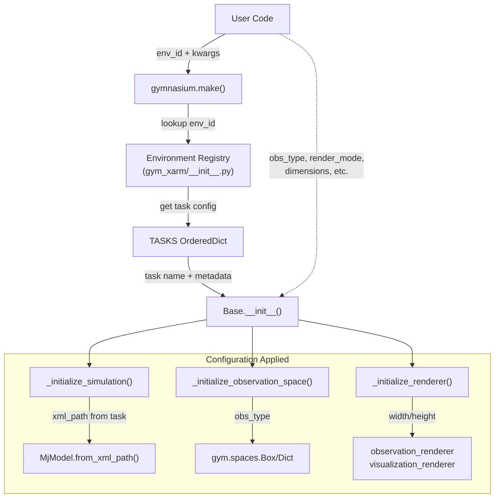
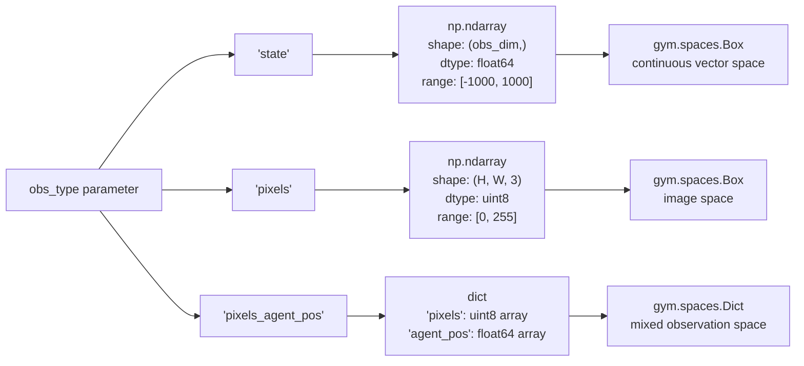
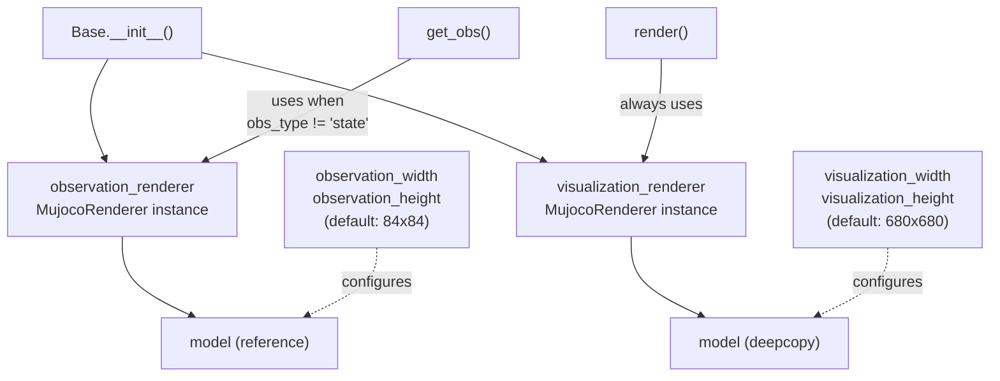
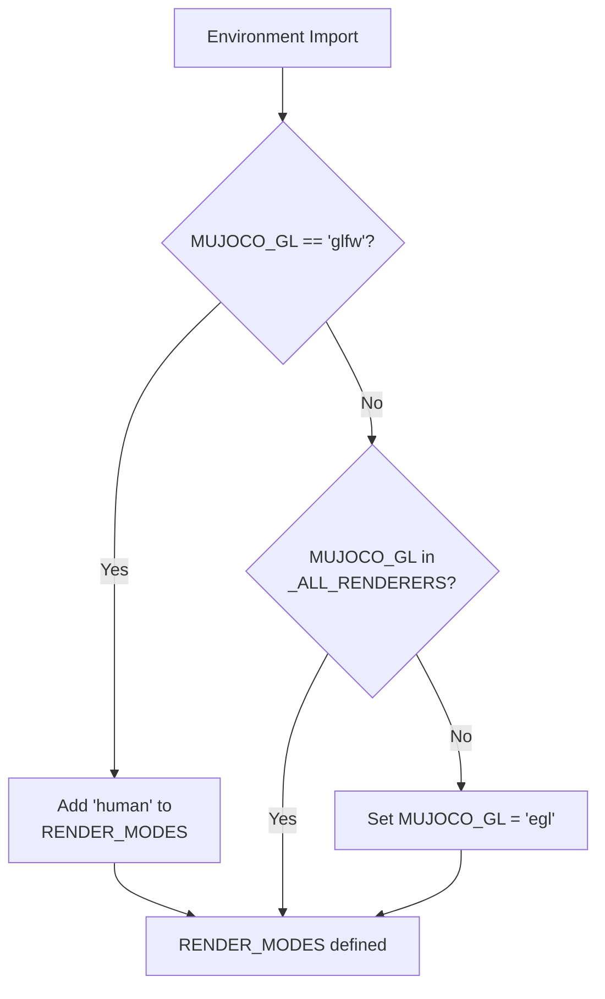

<!-- source: DeepWiki mcp.deepwiki.com · repo huggingface/gym-xarm · page 2.3 Configuration Options · fetched 2026-10-26 -->

# Configuration Options

<details>
<summary>Relevant source files</summary>

The following files were used as context for generating this wiki page:

- [README.md](README.md)
- [example.py](example.py)
- [gym_xarm/tasks/base.py](gym_xarm/tasks/base.py)
- [gym_xarm/tasks/mocap.py](gym_xarm/tasks/mocap.py)

</details>


This page documents all configuration parameters available when creating and using gym-xarm environments. These options control observation modality, rendering behavior, and simulation display settings. For information about the internal implementation of these systems, see [Observation System](#3.4) and [MuJoCo Integration](#3.3). For practical usage examples, see [Quick Start Tutorial](#2.2).

## Configuration Flow

The following diagram shows how configuration parameters flow from environment creation through to the Base class initialization:



**Sources:** [gym_xarm/tasks/base.py:35-76](), [gym_xarm/__init__.py]()

## Environment Creation Parameters

When calling `gymnasium.make("gym_xarm/XarmLift-v0", **kwargs)`, the following parameters can be specified:

| Parameter | Type | Default | Valid Values | Purpose |
|-----------|------|---------|--------------|---------|
| `obs_type` | `str` | `"state"` | `"state"`, `"pixels"`, `"pixels_agent_pos"` | Determines observation structure returned by environment |
| `render_mode` | `str` | `"rgb_array"` | `"rgb_array"`, `"human"` | Controls rendering output mode |
| `observation_width` | `int` | `84` | Any positive integer | Width of observation renderer output in pixels |
| `observation_height` | `int` | `84` | Any positive integer | Height of observation renderer output in pixels |
| `visualization_width` | `int` | `680` | Any positive integer | Width of visualization renderer output in pixels |
| `visualization_height` | `int` | `680` | Any positive integer | Height of visualization renderer output in pixels |
| `gripper_rotation` | `list[float]` | `[0, 1, 0, 0]` | Quaternion (4 floats) | Initial rotation quaternion for gripper orientation |

**Example Usage:**

```python
import gymnasium as gym
import gym_xarm

# State-based observation with default rendering
env = gym.make("gym_xarm/XarmLift-v0", obs_type="state")

# Pixel observations with higher resolution
env = gym.make("gym_xarm/XarmLift-v0", 
               obs_type="pixels",
               observation_width=128,
               observation_height=128)

# Hybrid observation with human visualization
env = gym.make("gym_xarm/XarmLift-v0",
               obs_type="pixels_agent_pos",
               render_mode="human")
```

**Sources:** [gym_xarm/tasks/base.py:35-45](), [README.md:28-40]()

## Observation Type Configuration

The `obs_type` parameter determines the structure and content of observations returned by `env.reset()` and `env.step()`. This is one of the most critical configuration choices as it affects agent architecture requirements.

### Observation Type Mapping



**Sources:** [gym_xarm/tasks/base.py:110-131](), [gym_xarm/tasks/base.py:245-259]()

### State Observations (`obs_type="state"`)

Returns a state vector containing robot and object information. The observation is generated by the task-specific `_get_obs()` method.

**Observation Space:**
- Type: `gym.spaces.Box`
- Shape: Task-dependent (Lift task returns 28-dimensional vector)
- Data type: `np.float64`
- Range: `[-1000.0, 1000.0]`

**Observation Generation:** Directly calls `_get_obs()` method without rendering [gym_xarm/tasks/base.py:245-247]()

### Pixel Observations (`obs_type="pixels"`)

Returns rendered RGB image from the observation renderer.

**Observation Space:**
- Type: `gym.spaces.Box`
- Shape: `(observation_height, observation_width, 3)`
- Data type: `np.uint8`
- Range: `[0, 255]`
- Default dimensions: `(84, 84, 3)`

**Observation Generation:** Renders scene using `observation_renderer` [gym_xarm/tasks/base.py:248-250]()

### Hybrid Observations (`obs_type="pixels_agent_pos"`)

Returns dictionary containing both rendered image and robot state vector.

**Observation Space:**
- Type: `gym.spaces.Dict`
- Keys:
  - `"pixels"`: RGB image array `(H, W, 3)`, dtype `uint8`
  - `"agent_pos"`: Robot state vector, dtype `float64`

**Observation Generation:** Combines rendering with `robot_state` property [gym_xarm/tasks/base.py:251-255]()

The `robot_state` property concatenates end-effector position and gripper angle [gym_xarm/tasks/base.py:170-171]().

**Sources:** [gym_xarm/tasks/base.py:110-131](), [gym_xarm/tasks/base.py:245-259](), [README.md:57-62]()

## Rendering Configuration

gym-xarm uses a dual-renderer architecture where observation rendering and visualization rendering are handled separately with potentially different resolutions.

### Render Mode

The `render_mode` parameter controls how `env.render()` behaves:

| Mode | Description | Output | Use Case |
|------|-------------|--------|----------|
| `"rgb_array"` | Returns numpy array | `np.ndarray` with shape `(H, W, 3)` | Programmatic access to frames |
| `"human"` | Opens display window | Visual display (returns frame copy) | Human observation and debugging |

**Important:** The `"human"` render mode requires the `MUJOCO_GL` environment variable to be set to `"glfw"`. See [Environment Variables](#environment-variables) below.

**Sources:** [gym_xarm/tasks/base.py:11-15](), [gym_xarm/tasks/base.py:315-321]()

### Renderer Dimensions

The dual-renderer system maintains two separate rendering pipelines:



**Observation Renderer:**
- Used by: `get_obs()` when `obs_type` is `"pixels"` or `"pixels_agent_pos"`
- Dimensions: `observation_width` × `observation_height`
- Default: 84 × 84 pixels
- Configuration: [gym_xarm/tasks/base.py:90-91]()

**Visualization Renderer:**
- Used by: `render()` method
- Dimensions: `visualization_width` × `visualization_height`
- Default: 680 × 680 pixels
- Configuration: [gym_xarm/tasks/base.py:133-150]()

**Implementation Note:** The visualization renderer uses a deep copy of the MuJoCo model to allow different rendering dimensions, working around Gymnasium's limitation on dynamic rendering sizes [gym_xarm/tasks/base.py:137-144]().

**Sources:** [gym_xarm/tasks/base.py:71-72](), [gym_xarm/tasks/base.py:133-150](), [gym_xarm/tasks/base.py:90-91]()

## Environment Variables

### MUJOCO_GL

The `MUJOCO_GL` environment variable controls MuJoCo's OpenGL rendering backend. This must be configured before importing gym-xarm.

**Configuration Logic:**



**Valid Values:**
- `"glfw"`: GLFW windowing (required for `render_mode="human"`)
- `"egl"`: EGL rendering (headless, default if not set)
- `"osmesa"`: OSMesa software rendering
- Other values in `gymnasium.envs.mujoco.mujoco_rendering._ALL_RENDERERS`

**Configuration Table:**

| MUJOCO_GL Value | Available Render Modes | Use Case |
|-----------------|------------------------|----------|
| `"glfw"` | `["rgb_array", "human"]` | Interactive visualization with GUI window |
| `"egl"` (default) | `["rgb_array"]` | Headless rendering (servers, clusters) |
| `"osmesa"` | `["rgb_array"]` | Software rendering without GPU |

**Setting the Variable:**

```bash
# Set for single script execution
MUJOCO_GL=glfw python example.py

# Set for entire shell session
export MUJOCO_GL=glfw
python example.py

# Set in Python (must be before import)
import os
os.environ["MUJOCO_GL"] = "glfw"
import gym_xarm
```

**Important:** The environment variable must be set before importing `gym_xarm`. Setting it after import has no effect because the `RENDER_MODES` list is determined at module load time [gym_xarm/tasks/base.py:11-15]().

**Sources:** [gym_xarm/tasks/base.py:11-15](), [README.md:42-45](), [example.py:1-15]()

## Configuration Validation

The Base class performs several validation checks during initialization to ensure configuration consistency:

### Timestep and FPS Validation

The environment validates that the simulation timestep matches the expected render FPS:

```python
assert (
    int(np.round(1.0 / self.dt)) == self.metadata["render_fps"]
), f'Expected value: {int(np.round(1.0 / self.dt))}, Actual value: {self.metadata["render_fps"]}'
```

**Sources:** [gym_xarm/tasks/base.py:77-79]()

### Action Space Validation

The action space dimensionality is validated during `step()`:

```python
assert action.shape == (4,)
assert self.action_space.contains(action)
```

The action space is always 4-dimensional, but the task configuration determines which dimensions are active via `metadata["action_space"]` [gym_xarm/tasks/base.py:74-75](), [gym_xarm/tasks/base.py:261-263]().

### Observation Type Validation

Invalid `obs_type` values raise a `ValueError` with descriptive message:

```python
raise ValueError(
    f"Unknown obs_type {self.obs_type}. Must be one of [pixels, state, pixels_agent_pos]"
)
```

**Sources:** [gym_xarm/tasks/base.py:127-129](), [gym_xarm/tasks/base.py:257-259]()

### XML Path Validation

The environment verifies that the task XML file exists:

```python
if not os.path.exists(self.xml_path):
    raise OSError(f"File {self.xml_path} does not exist")
```

**Sources:** [gym_xarm/tasks/base.py:65-67]()

## Configuration Properties

After initialization, several computed properties reflect the active configuration:

### Spatial and Temporal Properties

| Property | Type | Description | Source |
|----------|------|-------------|--------|
| `dt` | `float` | Gymnasium step timestep (`n_substeps * model.opt.timestep`) | [base.py:153-155]() |
| `center_of_table` | `np.ndarray` | Table center coordinates `[1.655, 0.3, 0.63625]` | [base.py:50]() |
| `max_z` | `float` | Maximum gripper Z coordinate (`1.2`) | [base.py:51]() |
| `min_z` | `float` | Minimum gripper Z coordinate (`0.2`) | [base.py:52]() |
| `gripper_rotation` | `np.ndarray` | Gripper orientation quaternion | [base.py:49]() |

### Metadata Properties

The `metadata` class attribute defines environment metadata:

```python
metadata = {
    "render_modes": RENDER_MODES,  # Dynamically set based on MUJOCO_GL
    "render_fps": 25,
}
```

Additional metadata is added from the task registry:
- `"action_space"`: String defining active action dimensions (e.g., `"xyzw"`)

**Sources:** [gym_xarm/tasks/base.py:26-29](), [gym_xarm/tasks/base.py:50-52](), [gym_xarm/tasks/base.py:153-155]()

## Complete Configuration Example

The following example demonstrates comprehensive environment configuration:

```python
import os
import gymnasium as gym

# Configure rendering backend BEFORE importing gym_xarm
os.environ["MUJOCO_GL"] = "glfw"

import gym_xarm

# Create environment with full configuration
env = gym.make(
    "gym_xarm/XarmLift-v0",
    obs_type="pixels_agent_pos",           # Hybrid observations
    render_mode="human",                    # Visual display window
    observation_width=128,                  # Higher resolution observations
    observation_height=128,
    visualization_width=1024,               # High quality visualization
    visualization_height=1024,
    gripper_rotation=[0.0, 1.0, 0.0, 0.0]  # Default orientation
)

# Verify configuration
print(f"Observation space: {env.observation_space}")
print(f"Action space: {env.action_space}")
print(f"Render modes: {env.metadata['render_modes']}")
print(f"Timestep: {env.dt} seconds")

obs, info = env.reset()
print(f"Observation keys: {obs.keys()}")
print(f"Pixels shape: {obs['pixels'].shape}")
print(f"Agent position shape: {obs['agent_pos'].shape}")
```

**Sources:** [gym_xarm/tasks/base.py:35-76](), [README.md:23-45](), [example.py:1-15]()

---

