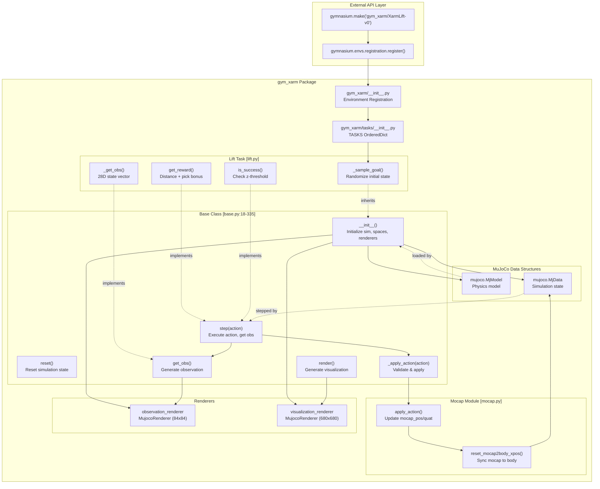
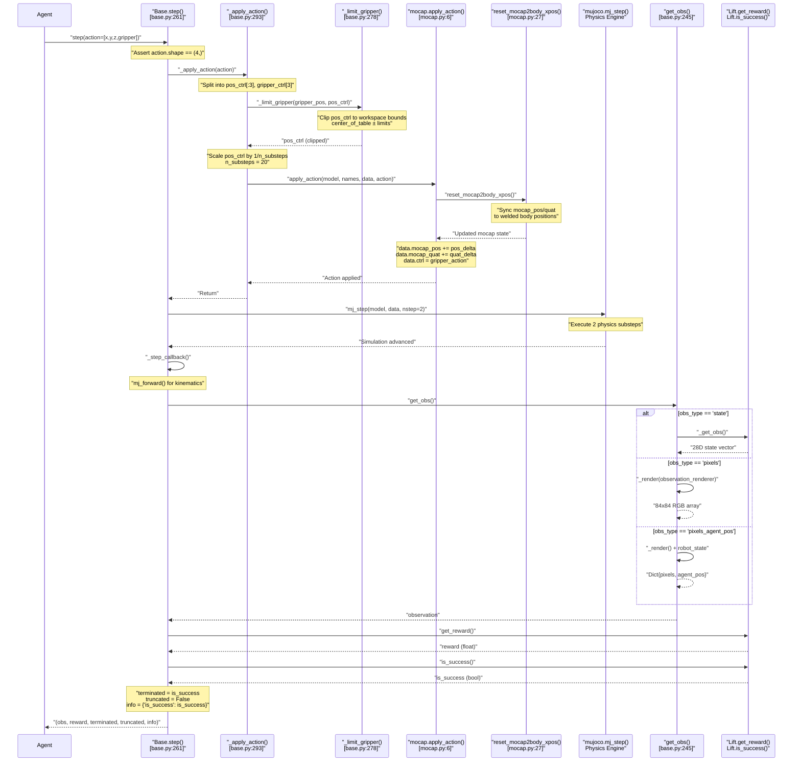

<!-- source: DeepWiki mcp.deepwiki.com · repo huggingface/gym-xarm · page 3 Core Architecture · fetched 2026-10-26 -->

# Core Architecture

<details>
<summary>Relevant source files</summary>

The following files were used as context for generating this wiki page:

- [gym_xarm/__init__.py](gym_xarm/__init__.py)
- [gym_xarm/tasks/__init__.py](gym_xarm/tasks/__init__.py)
- [gym_xarm/tasks/base.py](gym_xarm/tasks/base.py)
- [gym_xarm/tasks/mocap.py](gym_xarm/tasks/mocap.py)

</details>


## Purpose and Scope

This document provides a comprehensive overview of gym-xarm's core architecture, explaining how the major components integrate to provide a Gymnasium-compliant robotic manipulation environment. It covers the layered design, component interactions, and data flow patterns that enable reinforcement learning agents to interact with the simulated xArm robot through the MuJoCo physics engine.

For detailed documentation of specific components:
- Base class methods and lifecycle: see [Base Environment Class](#3.1)
- Task registration and configuration: see [Task System](#3.2)
- Physics simulation details: see [MuJoCo Integration](#3.3)
- Observation generation modes: see [Observation System](#3.4)
- Action processing pipeline: see [Action Processing and Mocap Control](#3.5)

---

## Architectural Overview

The gym-xarm package follows a layered architecture where the `Base` class serves as the central orchestrator, coordinating between the Gymnasium API contract, MuJoCo physics simulation, and task-specific logic. The architecture is designed around three core principles:

1. **Separation of Concerns**: Generic environment mechanics (simulation, rendering, observation generation) are separated from task-specific logic (rewards, goals, success criteria)
2. **Template Method Pattern**: The `Base` class provides the infrastructure while delegating task-specific decisions to subclasses
3. **Dual Rendering System**: Separate renderers handle low-resolution observations for agents and high-resolution visualization for humans

The system processes actions through a multi-stage pipeline: validation → scaling → gripper limiting → mocap translation → physics simulation. Observations are generated in three modes (`state`, `pixels`, `pixels_agent_pos`) to support different agent architectures.

**Sources**: [gym_xarm/tasks/base.py:18-335]()

---

## Component Relationship Diagram



**Diagram: Class and Module Dependencies**

This diagram maps the architectural components to their concrete implementations in code. The `Base` class [gym_xarm/tasks/base.py:18]() inherits from `gym.Env` and implements the Gymnasium interface. The `Lift` task extends `Base` and implements four abstract methods. The `mocap` module [gym_xarm/tasks/mocap.py]() provides utilities for translating high-level actions into MuJoCo physics commands.

**Sources**: [gym_xarm/tasks/base.py:18-335](), [gym_xarm/tasks/mocap.py:1-51](), [gym_xarm/tasks/__init__.py:1-51](), [gym_xarm/__init__.py:1-9]()

---

## Execution Flow During step()



**Diagram: Action Execution Pipeline**

This sequence diagram illustrates the complete data flow during a single `step()` call. The action passes through validation [base.py:262-263](), workspace limiting [base.py:278-291](), scaling [base.py:299](), and mocap translation [mocap.py:6-16]() before reaching the physics engine. The `n_substeps=20` constant [base.py:30]() and `nstep=2` parameter [base.py:265]() mean each Gymnasium step executes 2 physics substeps, while each action is divided into 20 increments. The observation generation branches based on `obs_type` [base.py:246-259](), and task-specific reward/success logic is delegated to the `Lift` subclass.

**Sources**: [gym_xarm/tasks/base.py:261-273](), [gym_xarm/tasks/base.py:293-306](), [gym_xarm/tasks/mocap.py:6-16](), [gym_xarm/tasks/mocap.py:27-51]()

---

## Key Architectural Components

### Registration and Discovery

The environment registration follows a two-tier system:

1. **Task Registry** [gym_xarm/tasks/__init__.py:11-50](): The `TASKS` OrderedDict maps task names to configuration dictionaries containing the environment class, action space specification, episode length, and description.

2. **Gymnasium Registration** [gym_xarm/__init__.py:3-8](): The `gymnasium.register()` call creates the public environment ID `"gym_xarm/XarmLift-v0"` with `max_episode_steps=300` and default `obs_type="state"`.

| Component | File Location | Purpose |
|-----------|---------------|---------|
| `TASKS` | gym_xarm/tasks/__init__.py:11 | Task metadata registry |
| `register()` | gym_xarm/__init__.py:3 | Gymnasium environment ID |
| `Base` | gym_xarm/tasks/base.py:18 | Abstract environment class |
| `Lift` | gym_xarm/tasks/lift.py | Concrete task implementation |

**Sources**: [gym_xarm/tasks/__init__.py:11-50](), [gym_xarm/__init__.py:3-8]()

### Simulation Initialization

The `Base.__init__()` method [base.py:35-83]() orchestrates a multi-stage initialization:

1. **Configuration Storage** [base.py:46-62](): Store observation type, render mode, coordinate system parameters, and renderer dimensions
2. **Asset Loading** [base.py:64-67](): Validate XML file path in `assets/` directory
3. **Simulation Setup** [base.py:70](): Call `_initialize_simulation()` which loads the MuJoCo model and data structures
4. **Renderer Creation** [base.py:71-72](): Initialize both `observation_renderer` (84×84) and `visualization_renderer` (680×680)
5. **Space Definition** [base.py:73-75](): Create `observation_space` and `action_space` based on configuration

The `_initialize_simulation()` method [base.py:84-96]() performs:
- Load MuJoCo model from XML path
- Create MjData structure
- Configure offscreen rendering dimensions
- Call `_env_setup()` for initial configuration
- Store initial state snapshots

**Sources**: [gym_xarm/tasks/base.py:35-96]()

### Dual Renderer Architecture

The system maintains two separate `MujocoRenderer` instances [base.py:71-72]():

```
observation_renderer: 84×84 pixels → used by get_obs() for agent observations
visualization_renderer: 680×680 pixels → used by render() for human visualization
```

This design addresses a Gymnasium limitation where renderer resolution cannot be changed dynamically [base.py:137-144](). The `_initialize_renderer()` method [base.py:133-150]() creates a deep copy of the MuJoCo model for the visualization renderer with different offscreen buffer dimensions.

**Sources**: [gym_xarm/tasks/base.py:71-72](), [gym_xarm/tasks/base.py:133-150]()

### Observation Generation Modes

The `get_obs()` method [base.py:245-259]() supports three observation types:

| Mode | Data Type | Shape | Use Case |
|------|-----------|-------|----------|
| `"state"` | numpy.float64 | (28,) | Model-based RL algorithms |
| `"pixels"` | numpy.uint8 | (84, 84, 3) | Vision-based RL algorithms |
| `"pixels_agent_pos"` | Dict | {"pixels": (84,84,3), "agent_pos": (4,)} | Hybrid approaches |

The state vector includes robot state (end-effector position, gripper angle) and object state (position, rotation, velocities), as defined by the task's `_get_obs()` implementation. The observation space is initialized dynamically [base.py:110-131]() based on the selected mode.

**Sources**: [gym_xarm/tasks/base.py:245-259](), [gym_xarm/tasks/base.py:110-131]()

### Action Processing Pipeline

Actions flow through a four-stage pipeline:

1. **Validation** [base.py:262-263](): Assert action shape is (4,) and within action space bounds
2. **Workspace Limiting** [base.py:278-291](): The `_limit_gripper()` method clips position deltas to prevent the gripper from exceeding workspace boundaries defined relative to `center_of_table`
3. **Temporal Scaling** [base.py:299](): Divide position control by `n_substeps=20` to create smooth motion
4. **Mocap Translation** [base.py:301-306](): Call `mocap.apply_action()` to update mocap body positions and gripper control signals

The action space is defined as `Box(low=-1.0, high=1.0, shape=(4,))` [base.py:74]() where dimensions correspond to the task's action space specification from the registry.

**Sources**: [gym_xarm/tasks/base.py:261-306](), [gym_xarm/tasks/base.py:278-291]()

---

## Mocap Control System

The `mocap` module [gym_xarm/tasks/mocap.py]() implements motion capture-based control, where high-level actions are translated into physics updates through welded constraints.

### Key Functions

**`apply_action(model, model_names, data, action)`** [mocap.py:6-16]()
- Splits action into position/quaternion updates (7 DOF per mocap body) and gripper control signals
- Calls `reset_mocap2body_xpos()` to synchronize mocap with welded body positions
- Updates `data.mocap_pos` and `data.mocap_quat` with deltas
- Sets `data.ctrl` for gripper actuation

**`reset_mocap2body_xpos(model, model_names, data)`** [mocap.py:27-51]()
- Iterates through equality constraints to find weld constraints
- Identifies mocap-to-body pairings (excluding specific bodies: "B0", "B9", "B1")
- Copies body positions/quaternions to mocap positions/quaternions
- Ensures consistency before applying action deltas

**`reset(model, data)`** [mocap.py:19-24]()
- Resets weld constraint data to identity transformation
- Called during environment setup [base.py:105]()

**Sources**: [gym_xarm/tasks/mocap.py:6-51](), [gym_xarm/tasks/base.py:301-306]()

---

## Properties and State Access

The `Base` class exposes physics state through properties that abstract MuJoCo data structures:

| Property | Source | Description |
|----------|--------|-------------|
| `dt` | [base.py:152-155]() | Gymnasium timestep = n_substeps × model.opt.timestep |
| `eef` | [base.py:157-159]() | End-effector position relative to table center |
| `eef_velp` | [base.py:161-163]() | End-effector velocity scaled by dt |
| `gripper_angle` | [base.py:165-167]() | Right outer knuckle joint angle |
| `robot_state` | [base.py:169-171]() | Concatenation of eef and gripper_angle |
| `obj` | [base.py:173-175]() | Object position from "object_site" |
| `obj_rot` | [base.py:177-179]() | Object quaternion rotation |
| `obj_velp` | [base.py:181-183]() | Object linear velocity |
| `obj_velr` | [base.py:185-187]() | Object angular velocity |

These properties use `gymnasium_robotics.utils.mujoco_utils` functions [base.py:7]() to safely extract state from the MuJoCo data structures. All positions are normalized relative to `center_of_table = [1.655, 0.3, 0.63625]` [base.py:50]().

**Sources**: [gym_xarm/tasks/base.py:152-187]()

---

## Template Method Pattern

The `Base` class defines four abstract methods that subclasses must implement:

1. **`_sample_goal()`** [base.py:196-198](): Randomize goal state and initial object positions
2. **`_get_obs()`**: Return task-specific state vector observation
3. **`get_reward()`** [base.py:193-194](): Compute reward based on current state
4. **`is_success()`** [base.py:189-191](): Determine if task goal is achieved

The `Base` class provides all infrastructure (simulation, rendering, action processing) while delegating task-specific decisions to these methods. This enables easy creation of new tasks by inheriting from `Base` and implementing these four methods.

The `Lift` task [gym_xarm/tasks/__init__.py:40-48]() is currently the only active implementation, registered with:
- Action space: `"xyzw"` (3D position + gripper)
- Episode length: 50 steps
- Description: "Lift a cube above a height threshold"

**Sources**: [gym_xarm/tasks/base.py:189-198](), [gym_xarm/tasks/__init__.py:40-48]()

---

## Reset and Episode Management

The `reset()` method [base.py:200-229]() implements a robust reset loop:

1. Call `super().reset(seed=seed)` to initialize Gymnasium's random state
2. Repeatedly attempt `_reset_sim()` until successful
3. Generate initial observation via `get_obs()`
4. Return observation and empty info dict

The `_reset_sim()` method [base.py:231-243]() performs:
- Reset simulation time to `initial_time`
- Copy `initial_qpos` and `initial_qvel` to data structures
- Call `_sample_goal()` for task-specific randomization
- Execute 10 simulation steps to settle the state
- Return True if reset successful

This retry loop [base.py:224-226]() handles cases where randomization produces invalid states (penetration, gimbal lock), continuing to randomize until a valid initial configuration is achieved.

**Sources**: [gym_xarm/tasks/base.py:200-243]()

---

## Rendering System

The rendering system provides two modes configured via `render_mode` [base.py:58]():

- `"rgb_array"`: Returns numpy array, always supported [base.py:11]()
- `"human"`: Creates window viewer, requires `MUJOCO_GL="glfw"` [base.py:12-13]()

The public `render()` method [base.py:315-316]() uses `visualization_renderer`, while the internal `_render()` method [base.py:318-321]() accepts a renderer parameter and calls `_render_callback()` [base.py:323-324]() to ensure kinematics are up-to-date before rendering.

Both renderers target the `"camera0"` viewpoint defined in the MuJoCo XML model [base.py:320]().

The environment's `close()` method [base.py:326-334]() properly cleans up both renderer instances by calling their `close()` methods, terminating any window viewers.

**Sources**: [gym_xarm/tasks/base.py:11-16](), [gym_xarm/tasks/base.py:315-334]()

---

## Summary

The gym-xarm architecture demonstrates a well-factored design where the `Base` class serves as a comprehensive foundation, handling all Gymnasium API compliance, MuJoCo simulation management, observation generation, rendering, and action processing. Task implementations like `Lift` need only focus on defining goals, rewards, and success criteria. The mocap control system provides an intuitive high-level action interface while maintaining physics accuracy. The dual renderer architecture elegantly solves the problem of different resolution requirements for agent observations versus human visualization.

---

