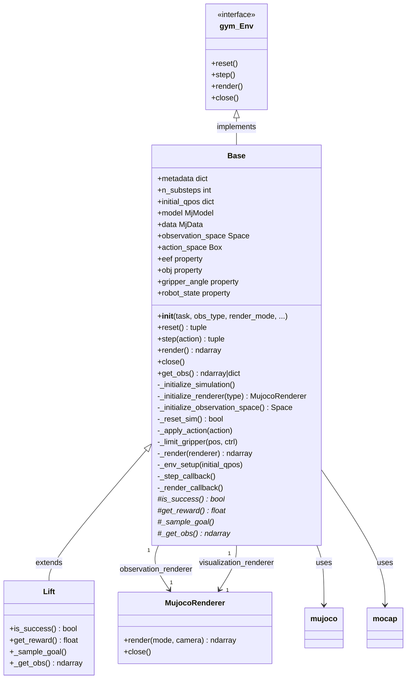
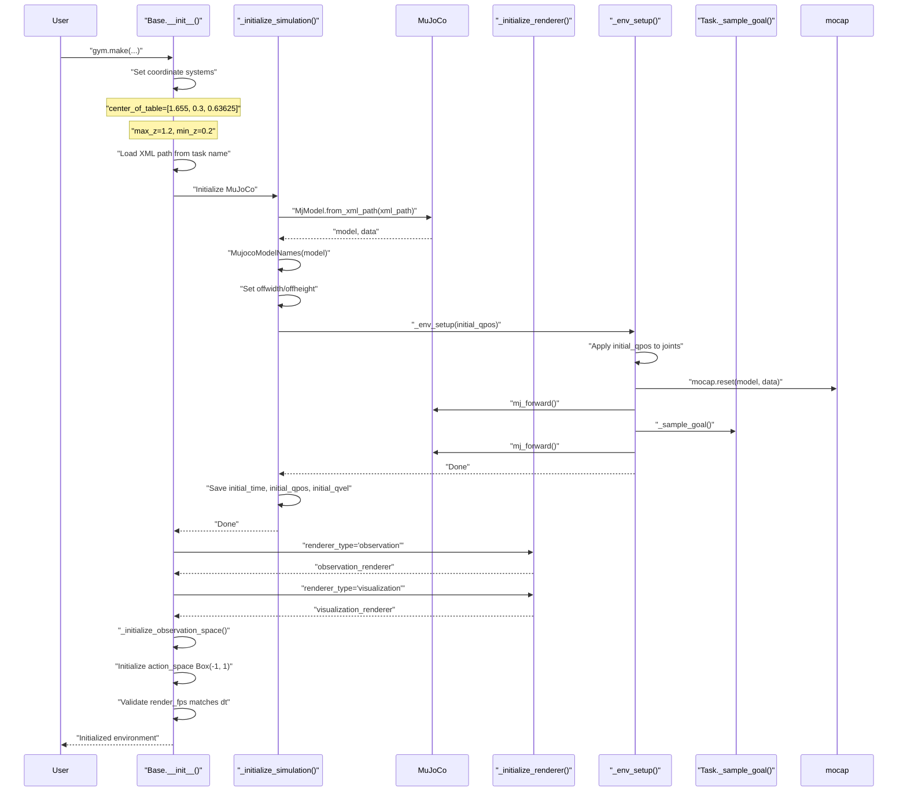
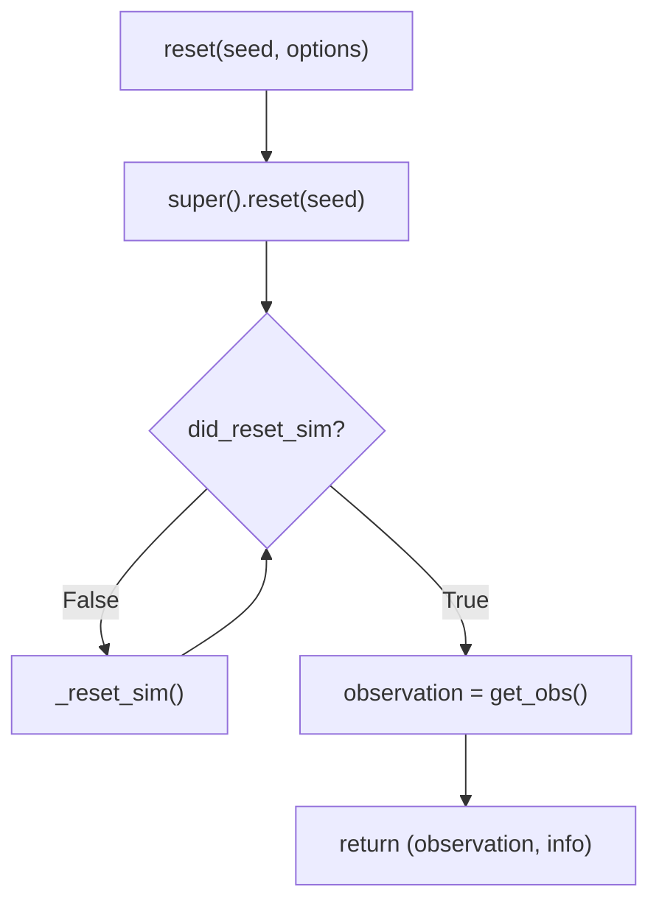
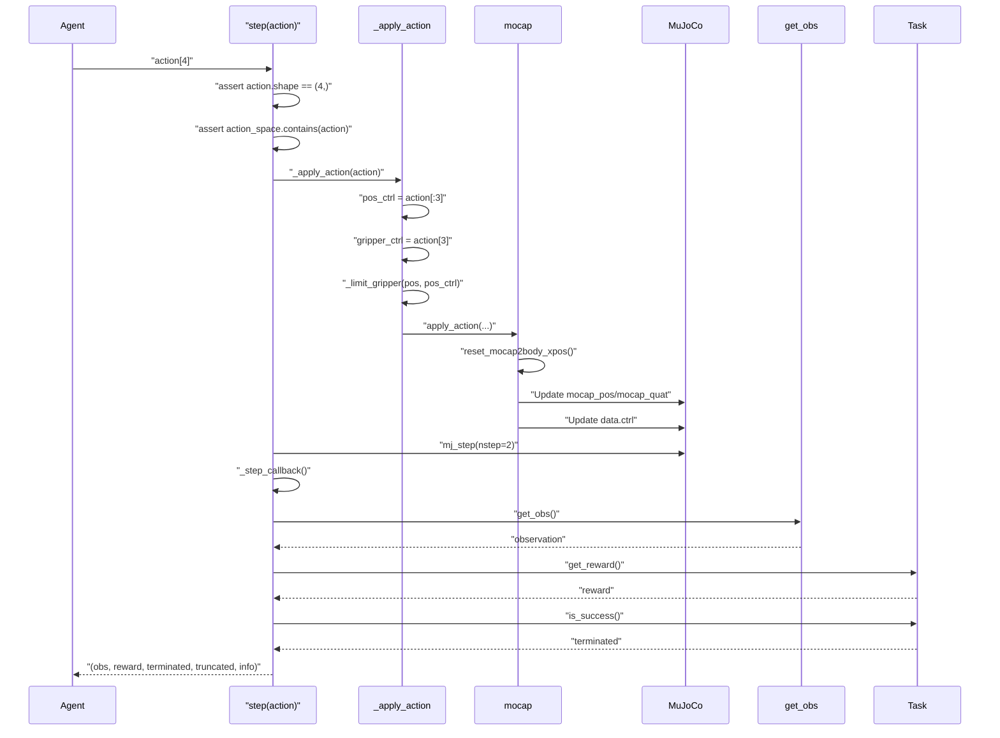
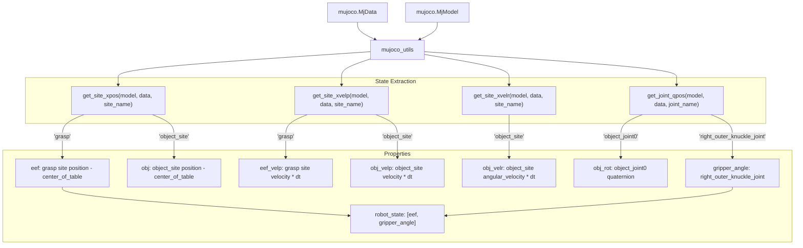
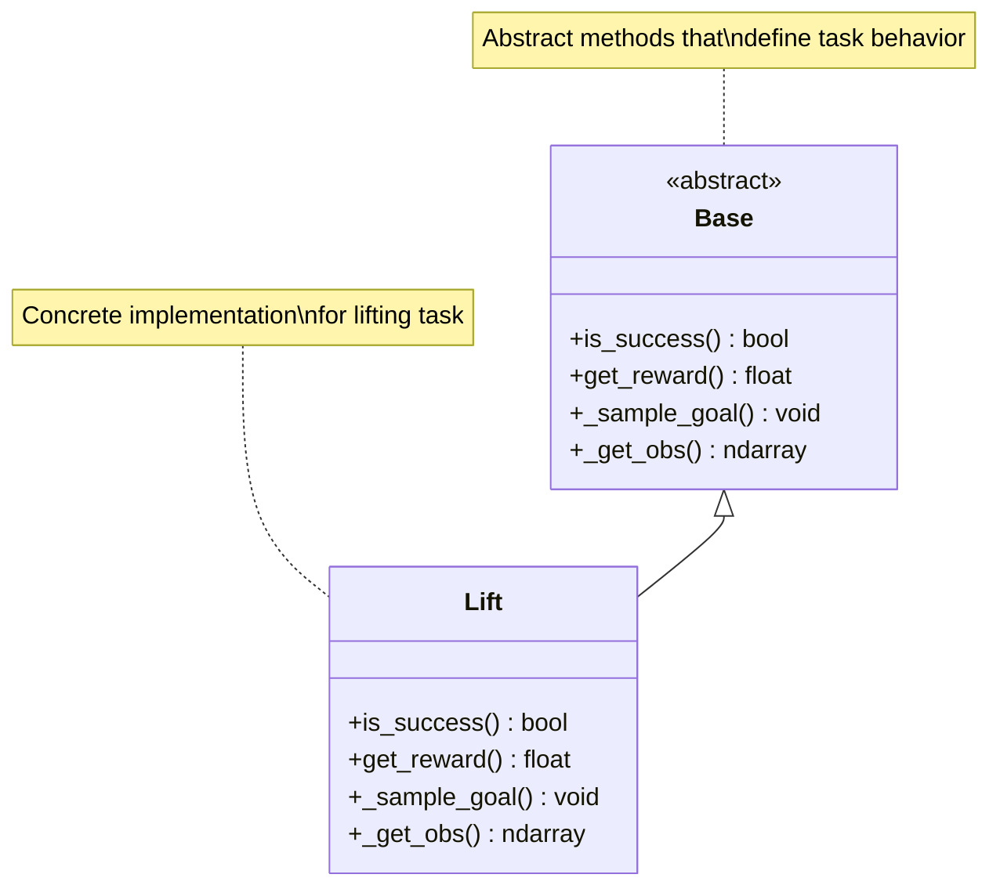
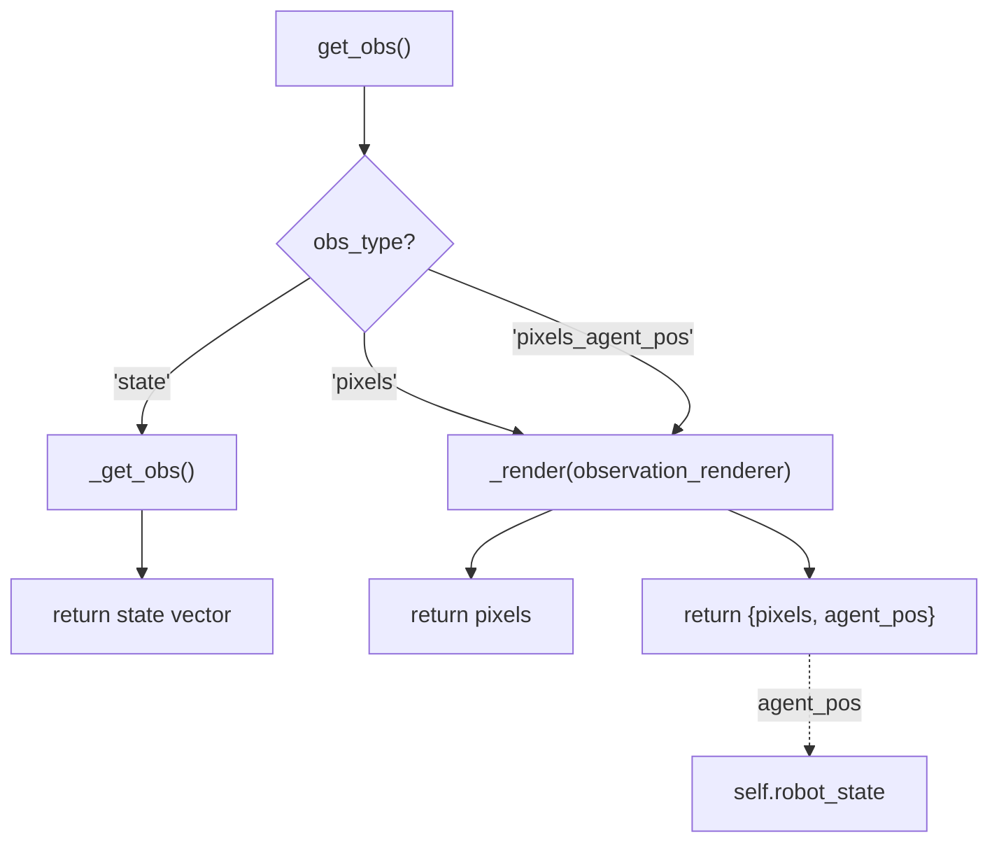
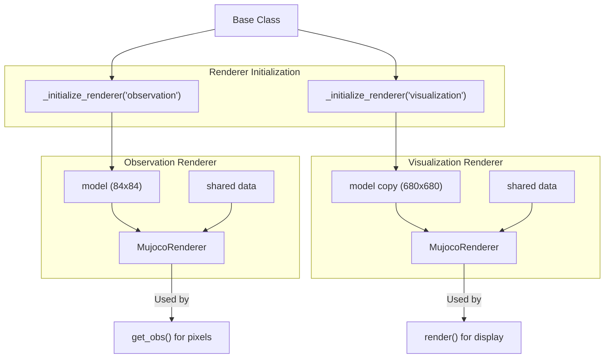
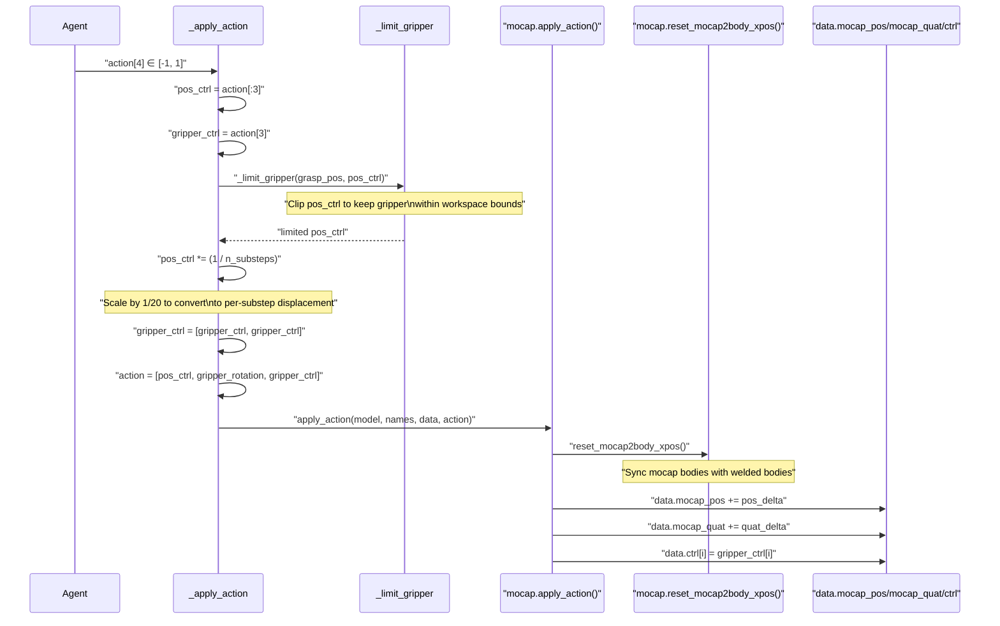

<!-- source: DeepWiki mcp.deepwiki.com · repo huggingface/gym-xarm · page 3.1 Base Environment Class · fetched 2026-10-26 -->

# Base Environment Class

<details>
<summary>Relevant source files</summary>

The following files were used as context for generating this wiki page:

- [gym_xarm/tasks/base.py](gym_xarm/tasks/base.py)
- [gym_xarm/tasks/mocap.py](gym_xarm/tasks/mocap.py)

</details>


## Purpose and Scope

The `Base` class ([gym_xarm/tasks/base.py:18-335]()) is the foundational environment class that provides all core Gymnasium environment functionality and MuJoCo simulation integration for gym-xarm. This document covers the Base class's architecture, lifecycle, properties, abstract methods, and internal systems.

For information about specific task implementations that inherit from Base, see [Task System](#3.2). For details on the observation generation system, see [Observation System](#3.4). For the mocap control mechanism used by Base, see [Action Processing and Mocap Control](#3.5).

**Sources:** [gym_xarm/tasks/base.py:18-335]()

---

## Class Responsibilities

The `Base` class serves as the template for all gym-xarm manipulation tasks. It orchestrates five major subsystems:

| Subsystem | Responsibility | Key Methods/Properties |
|-----------|---------------|----------------------|
| **Simulation Management** | Initialize and manage MuJoCo physics simulation | `_initialize_simulation()`, `model`, `data` |
| **Environment Interface** | Implement Gymnasium API contract | `reset()`, `step()`, `render()`, `close()` |
| **Observation Generation** | Produce observations in three modes (state/pixels/hybrid) | `get_obs()`, `_get_obs()`, `observation_space` |
| **Action Processing** | Validate, scale, and apply actions through mocap | `_apply_action()`, `_limit_gripper()`, `action_space` |
| **State Access** | Provide properties for robot and object state | `eef`, `obj`, `gripper_angle`, `robot_state` |

The Base class follows the **Template Method pattern**: it implements the complete environment machinery while delegating task-specific logic to three abstract methods that subclasses must implement: `is_success()`, `get_reward()`, and `_sample_goal()`.

**Sources:** [gym_xarm/tasks/base.py:18-335]()

---

## Class Structure and Inheritance



The `Base` class implements the `gym.Env` interface from Gymnasium while providing infrastructure for MuJoCo-based robotic manipulation. Methods marked with `*` are abstract and must be implemented by task subclasses. The dual renderer architecture supports different resolutions for observations versus visualization.

**Sources:** [gym_xarm/tasks/base.py:18-76](), [gym_xarm/tasks/base.py:189-199]()

---

## Initialization Flow

### Constructor Parameters

The `Base` class constructor ([gym_xarm/tasks/base.py:35-83]()) accepts the following parameters:

| Parameter | Type | Default | Description |
|-----------|------|---------|-------------|
| `task` | `str` | Required | Task name used to locate XML file (`{task}.xml`) |
| `obs_type` | `str` | `"state"` | Observation mode: `"state"`, `"pixels"`, or `"pixels_agent_pos"` |
| `render_mode` | `str` | `"rgb_array"` | Rendering mode: `"rgb_array"` or `"human"` (if `MUJOCO_GL=glfw`) |
| `gripper_rotation` | `list` | `[0, 1, 0, 0]` | Initial gripper rotation as quaternion |
| `observation_width` | `int` | `84` | Width of observation renderer output |
| `observation_height` | `int` | `84` | Height of observation renderer output |
| `visualization_width` | `int` | `680` | Width of visualization renderer output |
| `visualization_height` | `int` | `680` | Height of visualization renderer output |

### Initialization Sequence



The initialization establishes three critical coordinate systems: the `center_of_table` origin ([gym_xarm/tasks/base.py:50]()), workspace bounds (`min_z`, `max_z` at [gym_xarm/tasks/base.py:51-52]()), and the `gripper_rotation` quaternion ([gym_xarm/tasks/base.py:49]()). These coordinates are used throughout the environment for state representation and action limiting.

**Sources:** [gym_xarm/tasks/base.py:35-83](), [gym_xarm/tasks/base.py:84-109]()

---

## Environment Lifecycle

### Reset Mechanism

The `reset()` method ([gym_xarm/tasks/base.py:200-229]()) implements a retry loop to handle numerical instabilities:



The `_reset_sim()` method ([gym_xarm/tasks/base.py:231-243]()) performs the actual reset:

1. Restore `data.time` to `initial_time`
2. Copy `initial_qpos` and `initial_qvel` to `data.qpos` and `data.qvel`
3. Call task-specific `_sample_goal()` to randomize initial conditions
4. Execute 10 simulation steps (`mj_step(nstep=10)`) to settle physics
5. Return `True` to indicate successful reset

**Sources:** [gym_xarm/tasks/base.py:200-243]()

### Step Execution

The `step()` method ([gym_xarm/tasks/base.py:261-273]()) implements the standard Gymnasium step interface:



**Key Implementation Details:**

- Actions are always 4-dimensional vectors in range `[-1.0, 1.0]` ([gym_xarm/tasks/base.py:262-263]())
- Each step performs 2 MuJoCo substeps ([gym_xarm/tasks/base.py:265]()), which combined with `n_substeps=20` gives 40 total physics steps per Gymnasium step
- `terminated` is set to the result of `is_success()` ([gym_xarm/tasks/base.py:269]())
- `truncated` is always `False` - episode length is managed by Gymnasium's `TimeLimit` wrapper
- The `info` dictionary contains `"is_success"` for logging ([gym_xarm/tasks/base.py:271]())

**Sources:** [gym_xarm/tasks/base.py:261-273]()

---

## State Properties

The Base class provides properties that access various aspects of the simulation state. All positions are expressed relative to `center_of_table` for numerical stability.

### Robot State Properties

| Property | Return Type | Description | Implementation |
|----------|------------|-------------|----------------|
| `eef` | `ndarray[3]` | End-effector position relative to table center | [gym_xarm/tasks/base.py:158-159]() |
| `eef_velp` | `ndarray[3]` | End-effector linear velocity scaled by `dt` | [gym_xarm/tasks/base.py:162-163]() |
| `gripper_angle` | `float` | Right outer knuckle joint angle | [gym_xarm/tasks/base.py:166-167]() |
| `robot_state` | `ndarray[4]` | Concatenation of `eef` (3D) and `gripper_angle` (1D) | [gym_xarm/tasks/base.py:170-171]() |

### Object State Properties

| Property | Return Type | Description | Implementation |
|----------|------------|-------------|----------------|
| `obj` | `ndarray[3]` | Object position relative to table center | [gym_xarm/tasks/base.py:174-175]() |
| `obj_rot` | `ndarray[4]` | Object rotation as quaternion | [gym_xarm/tasks/base.py:178-179]() |
| `obj_velp` | `ndarray[3]` | Object linear velocity scaled by `dt` | [gym_xarm/tasks/base.py:182-183]() |
| `obj_velr` | `ndarray[3]` | Object angular velocity scaled by `dt` | [gym_xarm/tasks/base.py:186-187]() |

### Property Data Flow



All properties access the current simulation state through `mujoco_utils` helper functions, which internally query `self.model` and `self.data`. The velocities are scaled by `dt` ([gym_xarm/tasks/base.py:153-155]()) to represent per-step displacement rather than per-second velocity.

**Sources:** [gym_xarm/tasks/base.py:152-187]()

---

## Abstract Methods Contract

Subclasses must implement four abstract methods to define task-specific behavior:

### Required Implementations



#### `is_success()` → `bool`

**Location:** [gym_xarm/tasks/base.py:189-191]()

**Purpose:** Determines whether the task objective has been achieved.

**Contract:**
- Must return `True` if the task goal is satisfied, `False` otherwise
- Called during `step()` to set the `terminated` flag
- Result is also stored in `info["is_success"]` for logging

#### `get_reward()` → `float`

**Location:** [gym_xarm/tasks/base.py:193-194]()

**Purpose:** Computes the reward for the current state.

**Contract:**
- Must return a scalar reward value
- Called during every `step()` execution
- Can use any state properties provided by Base (e.g., `self.eef`, `self.obj`)
- May implement sparse or dense reward shaping

#### `_sample_goal()` → `None`

**Location:** [gym_xarm/tasks/base.py:196-198]()

**Purpose:** Randomizes initial conditions for the environment.

**Contract:**
- Called during `_env_setup()` and `_reset_sim()`
- Must modify `self.data` to set initial object positions, goal positions, etc.
- Should set any goal-related state that the task tracks
- No return value required

#### `_get_obs()` → `ndarray`

**Purpose:** Generates the state-based observation vector.

**Contract:**
- Called by `get_obs()` when `obs_type="state"`
- Must return a 1D numpy array containing task-relevant state information
- The returned shape defines the `observation_space` shape
- Typically concatenates robot state, object state, and goal information

**Sources:** [gym_xarm/tasks/base.py:189-198]()

---

## Observation System Integration

The `get_obs()` method ([gym_xarm/tasks/base.py:245-259]()) routes to different observation generators based on `obs_type`:



### Observation Space Initialization

The `_initialize_observation_space()` method ([gym_xarm/tasks/base.py:110-131]()) calls `get_obs()` once to determine the observation shape, then creates the appropriate `gym.spaces.Space`:

| `obs_type` | Observation Space | Description |
|------------|------------------|-------------|
| `"state"` | `Box(-1000, 1000, shape=obs.shape, dtype=float64)` | Task-specific state vector from `_get_obs()` |
| `"pixels"` | `Box(0, 255, shape=(H, W, 3), dtype=uint8)` | RGB image from observation renderer |
| `"pixels_agent_pos"` | `Dict{"pixels": Box(...), "agent_pos": Box(...)}` | Hybrid observation with image and robot state |

For `"pixels_agent_pos"`, the `"agent_pos"` key contains `self.robot_state` (4D: eef position + gripper angle).

**Sources:** [gym_xarm/tasks/base.py:110-131](), [gym_xarm/tasks/base.py:245-259]()

---

## Rendering Architecture

### Dual Renderer System

The Base class maintains two separate `MujocoRenderer` instances ([gym_xarm/tasks/base.py:71-72]()):

1. **`observation_renderer`**: Renders at `(observation_width, observation_height)` for agent observations
2. **`visualization_renderer`**: Renders at `(visualization_width, visualization_height)` for human viewing



**Rationale:** Gymnasium's rendering API does not support dynamic resolution changes. By maintaining two renderers with different model copies (where only `vis.global_.offwidth` and `vis.global_.offheight` differ), the Base class can generate low-resolution observations for training while providing high-resolution visualization for human viewing.

**Implementation:** [gym_xarm/tasks/base.py:133-150]()

### Rendering Methods

| Method | Renderer Used | Purpose | Implementation |
|--------|--------------|---------|----------------|
| `render()` | `visualization_renderer` | Public API for visualization | [gym_xarm/tasks/base.py:315-316]() |
| `_render(renderer)` | Parameter-specified | Internal rendering with callback | [gym_xarm/tasks/base.py:318-321]() |

Both methods call `_render_callback()` ([gym_xarm/tasks/base.py:323-324]()) before rendering, which executes `mj_forward()` to ensure the visualization reflects the current state.

**Sources:** [gym_xarm/tasks/base.py:133-150](), [gym_xarm/tasks/base.py:315-324]()

---

## Action Processing Pipeline

### Action Space Definition

The action space is a 4-dimensional continuous space: `Box(low=-1.0, high=1.0, shape=(4,))` ([gym_xarm/tasks/base.py:74]()).

**Action Components:**
- `action[0:3]`: Position control in x, y, z (relative to current end-effector position)
- `action[3]`: Gripper control (positive = close, negative = open)

The actual action space dimension is determined by `metadata["action_space"]` from the task configuration, but padding is applied ([gym_xarm/tasks/base.py:75-76]()) to always produce 4-dimensional actions.

### Action Processing Flow



### Workspace Limits

The `_limit_gripper()` method ([gym_xarm/tasks/base.py:278-291]()) enforces workspace boundaries by clipping position control:

| Axis | Minimum | Maximum | Description |
|------|---------|---------|-------------|
| X | `center_of_table[0] - 0.105 - 0.3` | `center_of_table[0] - 0.105 + 0.15` | Forward/backward range |
| Y | `center_of_table[1] - 0.3` | `center_of_table[1] + 0.3` | Left/right range |
| Z | `self.min_z` (0.2) | `self.max_z` (1.2) | Vertical range |

When the gripper is at a boundary, the corresponding component of `pos_ctrl` is clipped to prevent further movement in that direction.

### Action Scaling

Position controls are scaled by `1 / n_substeps` ([gym_xarm/tasks/base.py:299]()), converting the action range from `[-1, 1]` per Gymnasium step to `[-0.05, 0.05]` per physics substep. This scaling ensures smooth motion over the 20 substeps executed per Gymnasium step.

**Sources:** [gym_xarm/tasks/base.py:278-307](), [gym_xarm/tasks/mocap.py:6-16]()

---

## Coordinate Systems and Reference Frames

### Primary Coordinate System

All positions in the Base class are expressed relative to `center_of_table` ([gym_xarm/tasks/base.py:50]()):

```python
center_of_table = [1.655, 0.3, 0.63625]  # meters in world frame
```

**Properties using relative coordinates:**
- `eef`: End-effector position = `get_site_xpos("grasp") - center_of_table`
- `obj`: Object position = `get_site_xpos("object_site") - center_of_table`
- `robot_state`: Concatenates relative `eef` with `gripper_angle`

**Rationale:** Using table-relative coordinates keeps values near zero, improving numerical stability and making it easier for agents to learn spatial relationships.

### Quaternion Convention

Gripper rotation is represented as a quaternion `[x, y, z, w]` ([gym_xarm/tasks/base.py:48-49]()):
- Default: `[0, 1, 0, 0]` (pointing downward)
- Applied to mocap control during action processing ([gym_xarm/tasks/base.py:305]())

### Workspace Bounds Summary

| Parameter | Value | Location |
|-----------|-------|----------|
| `center_of_table` | `[1.655, 0.3, 0.63625]` | [gym_xarm/tasks/base.py:50]() |
| `max_z` | `1.2` | [gym_xarm/tasks/base.py:51]() |
| `min_z` | `0.2` | [gym_xarm/tasks/base.py:52]() |
| X range | `[center[0] - 0.405, center[0] + 0.045]` | [gym_xarm/tasks/base.py:279-282]() |
| Y range | `[center[1] - 0.3, center[1] + 0.3]` | [gym_xarm/tasks/base.py:283-286]() |

**Sources:** [gym_xarm/tasks/base.py:46-52](), [gym_xarm/tasks/base.py:278-291]()

---

## Cleanup and Resource Management

The `close()` method ([gym_xarm/tasks/base.py:326-334]()) properly releases rendering resources:

```python
def close(self):
    if self.observation_renderer is not None:
        self.observation_renderer.close()
    if self.visualization_renderer is not None:
        self.visualization_renderer.close()
```

This terminates any `WindowViewer` instances created by the `MujocoRenderer` for `"human"` render mode, preventing resource leaks when environments are destroyed.

**Sources:** [gym_xarm/tasks/base.py:326-334]()

---

## Configuration Metadata

The Base class defines class-level metadata ([gym_xarm/tasks/base.py:26-33]()):

```python
metadata = {
    "render_modes": RENDER_MODES,  # ["rgb_array"] or ["rgb_array", "human"]
    "render_fps": 25,
}
n_substeps = 20
initial_qpos = {}
```

### Timestep Calculation

The environment timestep `dt` is computed as ([gym_xarm/tasks/base.py:153-155]()):

```
dt = n_substeps * model.opt.timestep = 20 * 0.002 = 0.04 seconds
```

This gives a control frequency of 25 Hz, which must match `metadata["render_fps"]` (validated at [gym_xarm/tasks/base.py:77-79]()).

### Render Modes

Available render modes depend on the `MUJOCO_GL` environment variable ([gym_xarm/tasks/base.py:11-15]()):
- If `MUJOCO_GL=glfw`: Both `"rgb_array"` and `"human"` modes available
- Otherwise: Only `"rgb_array"` mode available (defaults to `MUJOCO_GL=egl`)

**Sources:** [gym_xarm/tasks/base.py:11-33](), [gym_xarm/tasks/base.py:153-155]()

---

