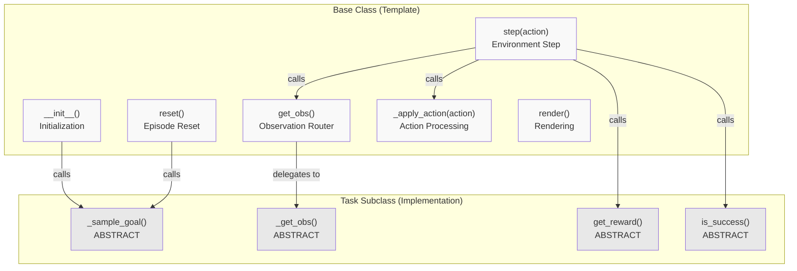
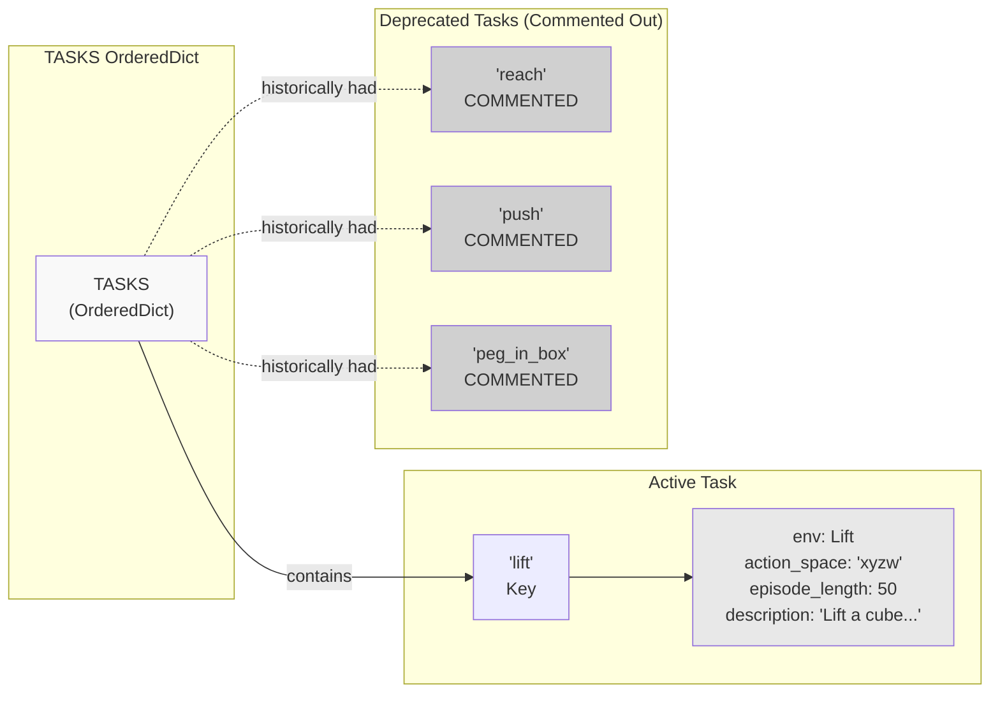
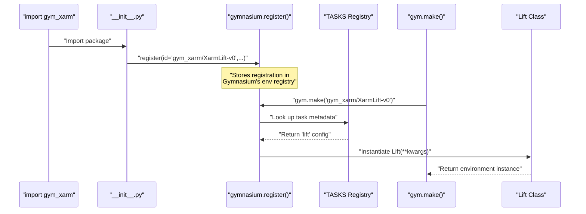
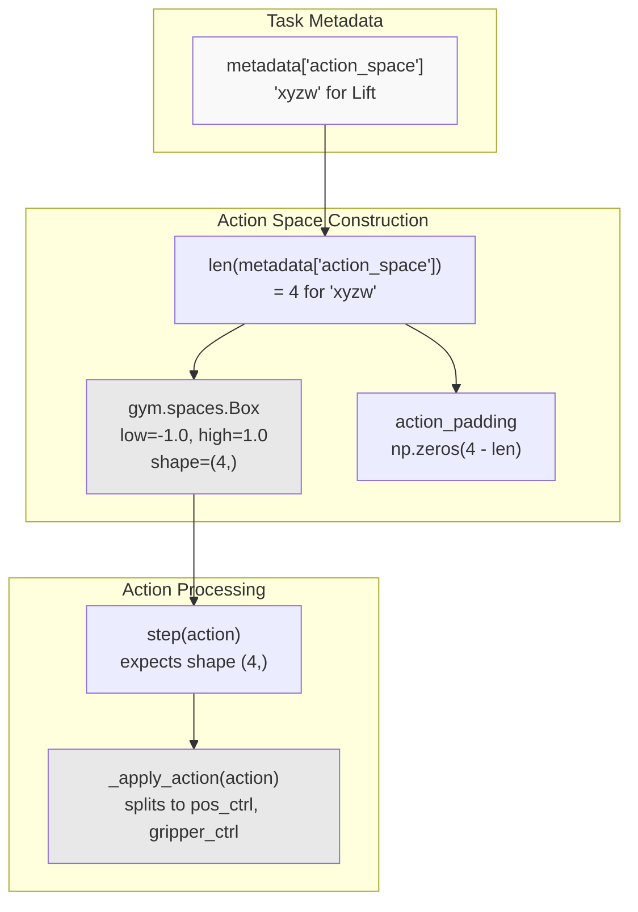
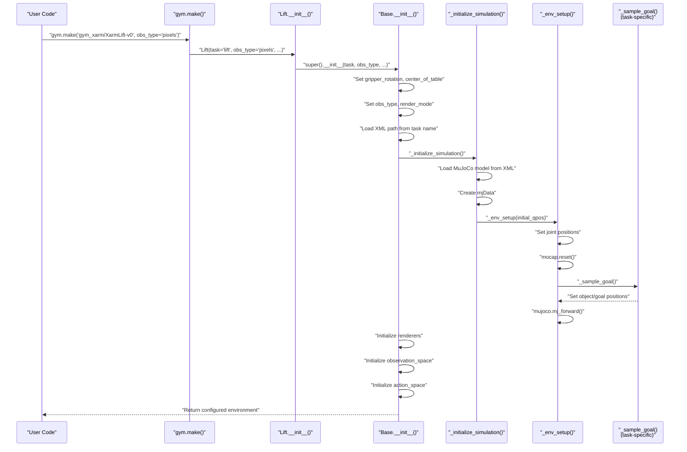

<!-- source: DeepWiki mcp.deepwiki.com · repo huggingface/gym-xarm · page 3.2 Task System · fetched 2026-10-26 -->

# Task System

<details>
<summary>Relevant source files</summary>

The following files were used as context for generating this wiki page:

- [gym_xarm/__init__.py](gym_xarm/__init__.py)
- [gym_xarm/tasks/__init__.py](gym_xarm/tasks/__init__.py)
- [gym_xarm/tasks/base.py](gym_xarm/tasks/base.py)
- [gym_xarm/tasks/mocap.py](gym_xarm/tasks/mocap.py)

</details>


## Purpose and Scope

This document describes the task abstraction and registration system in gym-xarm. The task system defines how manipulation tasks are structured, configured, and registered with the Gymnasium framework. It explains the template method pattern used to separate environment mechanics from task-specific logic, the task registry that stores task metadata, and how tasks integrate with Gymnasium's environment registration.

For details on the Base environment class implementation, see [Base Environment Class](#3.1). For a step-by-step guide on creating custom tasks, see [Creating Custom Tasks](#5.5). For documentation of the active Lift task, see [Lift Task](#4.1).

---

## Task Abstraction and Template Method Pattern

The task system uses the **template method pattern** to separate generic environment mechanics from task-specific behavior. The `Base` class [gym_xarm/tasks/base.py:18-335]() implements all Gymnasium environment infrastructure while delegating task-specific logic to abstract methods that subclasses must implement.

### Abstract Methods Required by Tasks

Each task subclass must implement four abstract methods:

| Method | Purpose | Return Type | Line Reference |
|--------|---------|-------------|----------------|
| `is_success()` | Determines if the task goal has been achieved | `bool` | [gym_xarm/tasks/base.py:189-191]() |
| `get_reward()` | Computes the reward for the current state | `float` | [gym_xarm/tasks/base.py:193-194]() |
| `_sample_goal()` | Samples initial object/goal positions | `None` | [gym_xarm/tasks/base.py:196-198]() |
| `_get_obs()` | Generates task-specific state observations | `np.ndarray` | [gym_xarm/tasks/base.py:247]() |

### Separation of Concerns



**Sources:** [gym_xarm/tasks/base.py:18-335]()

---

## Task Registry Structure

The task registry is defined as an `OrderedDict` named `TASKS` in [gym_xarm/tasks/__init__.py:11-50](). It maps task names to their configuration dictionaries.

### Registry Schema

Each task entry in the `TASKS` dictionary has the following structure:

```python
{
    "env": TaskClass,              # The task implementation class
    "action_space": str,           # Action dimensions ("xyz" or "xyzw")
    "episode_length": int,         # Maximum episode steps
    "description": str             # Human-readable description
}
```

### Current Registry Contents



**Active Task Configuration:**

| Field | Value | Purpose |
|-------|-------|---------|
| `env` | `Lift` | Class implementing lift task |
| `action_space` | `"xyzw"` | 4D actions: x, y, z position deltas + gripper control |
| `episode_length` | `50` | Maximum steps per episode |
| `description` | `"Lift a cube above a height threshold"` | Task description |

**Sources:** [gym_xarm/tasks/__init__.py:11-50]()

---

## Environment Registration

Tasks are registered with Gymnasium using the standard `gymnasium.register()` API. The registration connects task configurations to Gymnasium's environment creation system.

### Registration Flow



**Sources:** [gym_xarm/__init__.py:1-8](), [gym_xarm/tasks/__init__.py:11-50]()

### Registration Parameters

The registration in [gym_xarm/__init__.py:3-8]() specifies:

```python
register(
    id="gym_xarm/XarmLift-v0",           # Gymnasium environment ID
    entry_point="gym_xarm.tasks:Lift",   # Direct reference to Lift class
    max_episode_steps=300,                # Global step limit (6x task episode_length)
    kwargs={"obs_type": "state"}          # Default observation type
)
```

**Key Points:**
- `entry_point` references the `Lift` class directly, not via the `TASKS` registry
- `max_episode_steps=300` overrides task's `episode_length=50` with a higher limit
- Default `obs_type="state"` can be overridden when calling `gym.make()`

**Sources:** [gym_xarm/__init__.py:3-8]()

---

## Task Configuration System

### Task Metadata Structure

The `TASKS` registry stores task metadata that influences environment behavior, although the current implementation only uses it for documentation purposes. The metadata stored in [gym_xarm/tasks/__init__.py:40-48]() includes:

| Field | Type | Usage | Example |
|-------|------|-------|---------|
| `"env"` | `class` | Task implementation class | `Lift` |
| `"action_space"` | `str` | Action dimensions identifier | `"xyzw"` (4D actions) |
| `"episode_length"` | `int` | Suggested episode length | `50` |
| `"description"` | `str` | Human-readable task description | `"Lift a cube above..."` |

### Action Space Configuration

The `"action_space"` field specifies which action dimensions the task uses:

- `"xyz"`: 3D position control (deprecated tasks)
- `"xyzw"`: 3D position + 1D gripper control (active lift task)

The Base class reads this from task metadata via `self.metadata["action_space"]` [gym_xarm/tasks/base.py:74]() to:
1. Set the `action_space` bounds [gym_xarm/tasks/base.py:74]()
2. Calculate action padding for unused dimensions [gym_xarm/tasks/base.py:75-82]()



**Sources:** [gym_xarm/tasks/base.py:74-82](), [gym_xarm/tasks/__init__.py:40-48]()

---

## Task Lifecycle and Instantiation

### Initialization Sequence



**Sources:** [gym_xarm/tasks/base.py:35-83](), [gym_xarm/tasks/base.py:84-109]()

### Task Method Invocation During Episode

The Base class orchestrates task method calls during environment operation:

| Environment Method | Task Method Called | When Called | Purpose |
|-------------------|-------------------|-------------|---------|
| `__init__()` | `_sample_goal()` | During initialization | Set initial scene configuration |
| `reset()` | `_sample_goal()` | Every episode reset | Randomize object/goal positions |
| `get_obs()` | `_get_obs()` | Every step (if `obs_type="state"`) | Generate state observations |
| `step()` | `get_reward()` | Every step | Compute step reward |
| `step()` | `is_success()` | Every step | Check task completion |

**Sources:** [gym_xarm/tasks/base.py:107](), [gym_xarm/tasks/base.py:241](), [gym_xarm/tasks/base.py:247](), [gym_xarm/tasks/base.py:268-269]()

---

## Task Assets and XML Models

Each task requires a corresponding MuJoCo XML file that defines the simulation environment. The Base class constructs the XML path using the task name:

```python
# From Base.__init__()
self.xml_path = os.path.join(os.path.dirname(__file__), "assets", f"{task}.xml")
```

For the active "lift" task, this resolves to `gym_xarm/tasks/assets/lift.xml`. The XML file must exist or an `OSError` is raised [gym_xarm/tasks/base.py:65-67]().

**Sources:** [gym_xarm/tasks/base.py:65-67]()

---

## Extending the Task System

The task system is designed to be extensible. To add a new task:

1. **Create a task class** inheriting from `Base`
2. **Implement the four abstract methods** (`is_success`, `get_reward`, `_sample_goal`, `_get_obs`)
3. **Create an XML model** in `gym_xarm/tasks/assets/` named `{task_name}.xml`
4. **Add to TASKS registry** in [gym_xarm/tasks/__init__.py]()
5. **Register with Gymnasium** in [gym_xarm/__init__.py]()

For detailed instructions, see [Creating Custom Tasks](#5.5).

**Sources:** [gym_xarm/tasks/__init__.py:1-50](), [gym_xarm/__init__.py:1-8](), [gym_xarm/tasks/base.py:18-335]()

---

