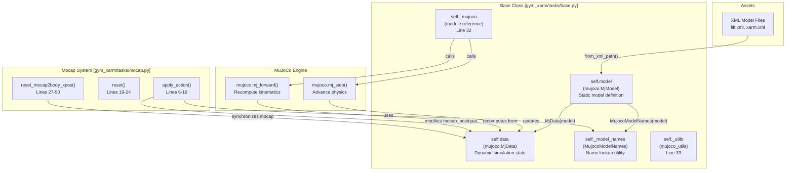
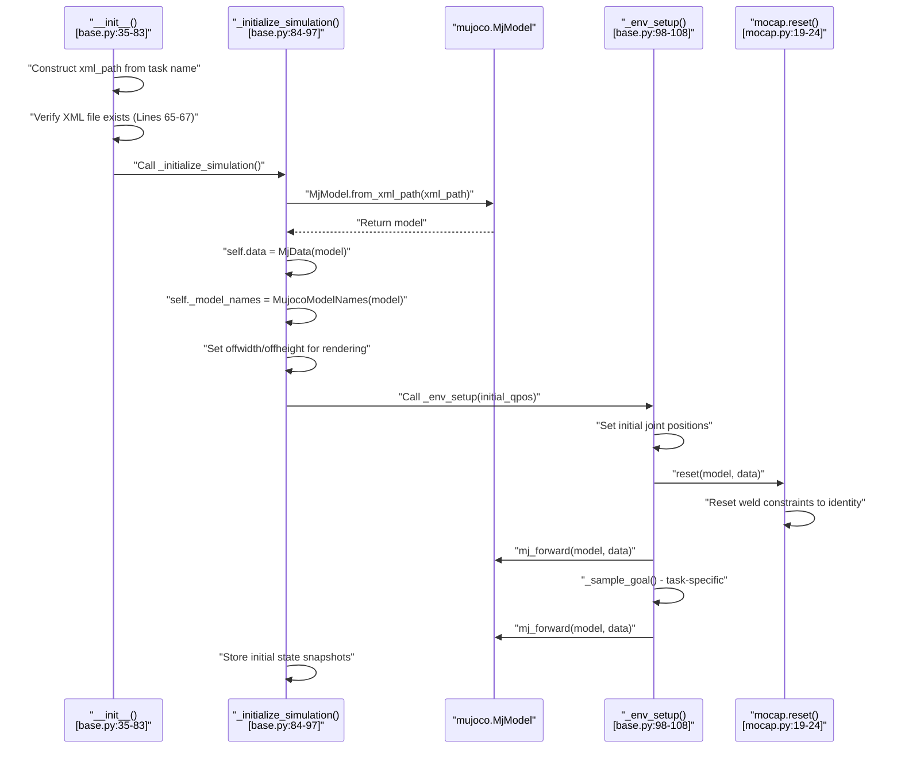
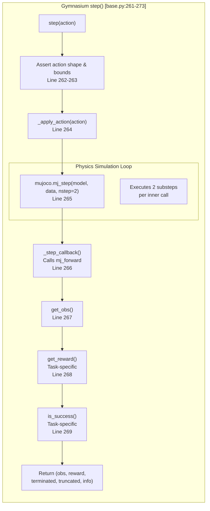
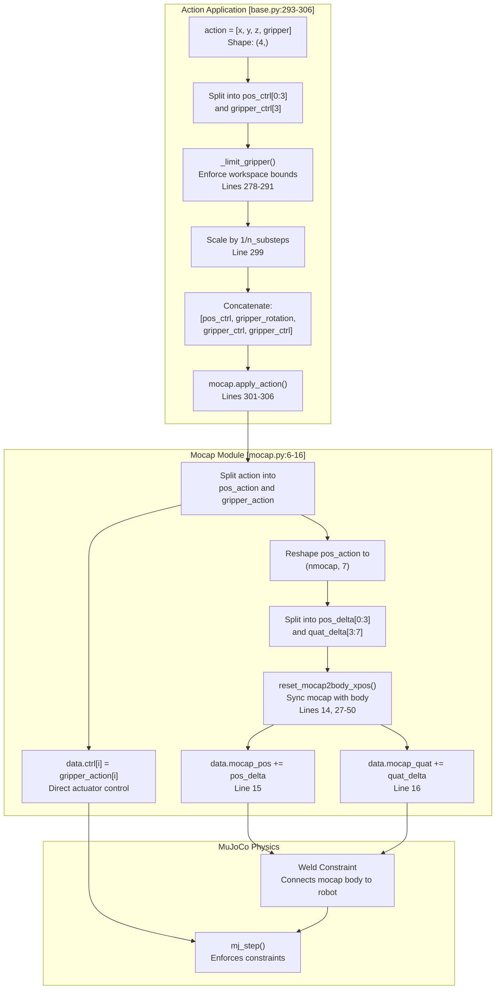
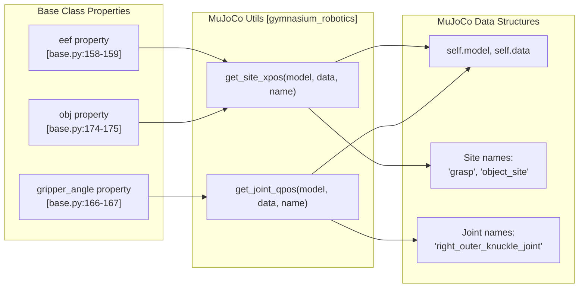
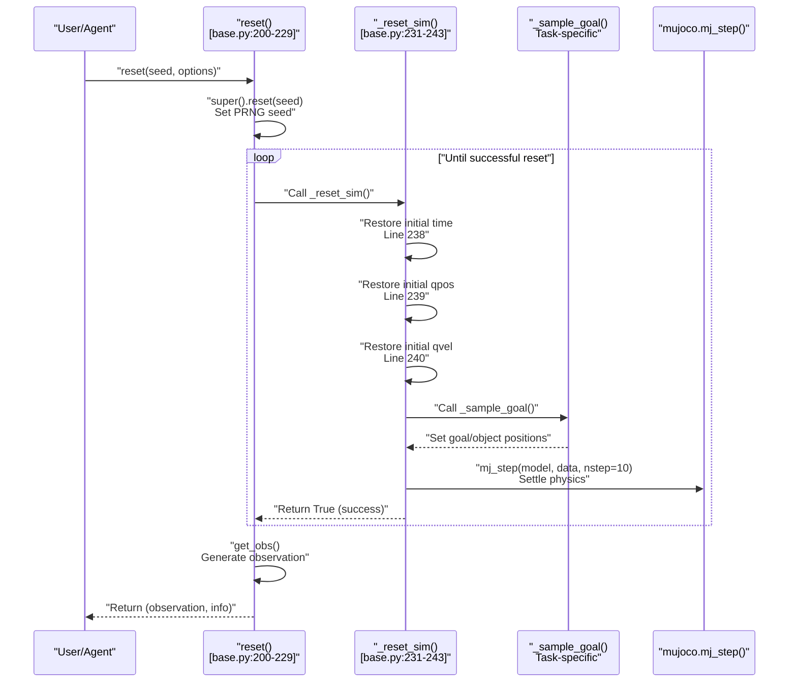

<!-- source: DeepWiki mcp.deepwiki.com · repo huggingface/gym-xarm · page 3.3 MuJoCo Integration · fetched 2026-10-26 -->

# MuJoCo Integration

<details>
<summary>Relevant source files</summary>

The following files were used as context for generating this wiki page:

- [gym_xarm/tasks/base.py](gym_xarm/tasks/base.py)
- [gym_xarm/tasks/mocap.py](gym_xarm/tasks/mocap.py)

</details>


## Purpose and Scope

This document explains how gym-xarm integrates with the MuJoCo physics engine to perform robotic manipulation simulation. It covers the MuJoCo data structures (`mjModel`, `mjData`), XML model loading, simulation stepping architecture, and the mocap (motion capture) control system that translates high-level actions into physics commands.

For action processing and validation logic, see [Action Processing and Mocap Control](#3.5). For observation generation and rendering, see [Observation System](#3.4). For XML model structure and assets, see [MuJoCo XML Models](#7.1).

---

## MuJoCo Data Structures

The Base class maintains two primary MuJoCo data structures that form the foundation of the physics simulation:

| Data Structure | Type | Purpose | Initialization |
|---------------|------|---------|----------------|
| `self.model` | `mujoco.MjModel` | Contains static model definition (geometry, masses, constraints) | [gym_xarm/tasks/base.py:86]() |
| `self.data` | `mujoco.MjData` | Contains dynamic simulation state (positions, velocities, forces) | [gym_xarm/tasks/base.py:87]() |
| `self._model_names` | `MujocoModelNames` | Name-to-ID lookup utility from gymnasium-robotics | [gym_xarm/tasks/base.py:88]() |

The `mjModel` is immutable after loading and defines the robot structure, while `mjData` is modified at each simulation step and contains the evolving state of the environment.

**MuJoCo Integration Architecture**



Sources: [gym_xarm/tasks/base.py:32-33](), [gym_xarm/tasks/base.py:84-88](), [gym_xarm/tasks/mocap.py:1-51]()

---

## Model Loading and Initialization

The MuJoCo model is loaded during environment initialization through the `_initialize_simulation()` method:

**Model Loading Flow**



The initialization process follows this sequence:

1. **XML Path Construction** [base.py:65](): The task name (e.g., "lift") is used to construct the path to the XML file in the assets directory
2. **Model Loading** [base.py:86](): `MjModel.from_xml_path()` parses the XML and creates the immutable model
3. **Data Allocation** [base.py:87](): `MjData` is allocated based on the model's requirements
4. **Rendering Configuration** [base.py:90-91](): Offscreen rendering dimensions are set on the model
5. **Environment Setup** [base.py:93](): Initial joint positions are applied and mocap system is reset
6. **State Snapshot** [base.py:94-96](): Initial time, qpos, and qvel are stored for later reset operations

Sources: [gym_xarm/tasks/base.py:35-97](), [gym_xarm/tasks/mocap.py:19-24]()

---

## Simulation Stepping Architecture

gym-xarm uses a multi-substep simulation architecture where each Gymnasium `step()` call executes multiple MuJoCo physics steps:

| Configuration | Value | Purpose |
|--------------|-------|---------|
| `n_substeps` | 20 | Number of MuJoCo steps per Gymnasium step [base.py:30]() |
| `model.opt.timestep` | Defined in XML | MuJoCo physics timestep (typically 0.002s) |
| Gymnasium timestep (`dt`) | `n_substeps * model.opt.timestep` | Effective timestep per `step()` call |
| `render_fps` | 25 | Expected rendering frequency [base.py:28]() |

**Simulation Stepping Pipeline**



The stepping architecture involves:

1. **Action Validation** [base.py:262-263](): Ensures action has shape (4,) and is within bounds
2. **Action Application** [base.py:264](): Translates action to mocap commands (see [Action Processing](#3.5))
3. **Physics Substeps** [base.py:265](): Executes 2 MuJoCo steps (not 20 as might be expected from `n_substeps`)
4. **Forward Kinematics** [base.py:266](): Recomputes derived quantities after physics step
5. **Observation Generation** [base.py:267](): Extracts current state (see [Observation System](#3.4))
6. **Reward Calculation** [base.py:268](): Task-specific reward function
7. **Termination Check** [base.py:269](): Task-specific success criterion

**Note on Substeps**: Despite `n_substeps=20`, the `step()` method only calls `mj_step()` with `nstep=2` [base.py:265](). The `n_substeps` value is primarily used for timestep calculation and action scaling [base.py:299]().

Sources: [gym_xarm/tasks/base.py:30](), [gym_xarm/tasks/base.py:152-155](), [gym_xarm/tasks/base.py:261-273]()

---

## Timestep Management

The environment's effective timestep is computed from the substep configuration:

```python
@property
def dt(self):
    """Return the timestep of each Gymnasium step."""
    return self.n_substeps * self.model.opt.timestep
```

[gym_xarm/tasks/base.py:152-155]()

This timestep is validated against the render FPS [base.py:77-79]():

```python
assert (
    int(np.round(1.0 / self.dt)) == self.metadata["render_fps"]
), f'Expected value: {int(np.round(1.0 / self.dt))}, Actual value: {self.metadata["render_fps"]}'
```

With typical values:
- `model.opt.timestep` = 0.002s (defined in XML)
- `n_substeps` = 20
- `dt` = 20 × 0.002 = 0.04s
- Expected `render_fps` = 1/0.04 = 25 Hz

The `dt` property is used for:
- Velocity scaling in `eef_velp`, `obj_velp`, `obj_velr` properties [base.py:163, 183, 187]()
- Action scaling in `_apply_action()` [base.py:299]()

Sources: [gym_xarm/tasks/base.py:152-155](), [gym_xarm/tasks/base.py:77-79]()

---

## Mocap Control System

The mocap (motion capture) control system is the bridge between high-level actions and MuJoCo physics updates. It uses MuJoCo's mocap bodies and weld constraints to control the robot's end-effector.

**Mocap Control Flow**



### Mocap System Components

The mocap system consists of three key functions in [gym_xarm/tasks/mocap.py]():

| Function | Lines | Purpose |
|----------|-------|---------|
| `apply_action()` | 6-16 | Applies position and gripper commands to mocap bodies and actuators |
| `reset()` | 19-24 | Resets weld constraint data to identity transformation |
| `reset_mocap2body_xpos()` | 27-50 | Synchronizes mocap body positions with welded body positions |

### Mocap Body Synchronization

The `reset_mocap2body_xpos()` function ensures mocap bodies track their welded counterparts [mocap.py:27-50]():

1. Iterates through all weld constraints (`eq_type == mjEQ_WELD`)
2. Identifies the mocap body and welded body pair
3. Skips specific bodies ("B0", "B9", "B1") that should not be synchronized
4. Copies position (`xpos`) and orientation (`xquat`) from welded body to mocap body

This synchronization is crucial before applying new actions to prevent discontinuities in the control signal.

Sources: [gym_xarm/tasks/base.py:293-306](), [gym_xarm/tasks/mocap.py:6-50]()

---

## MuJoCo Utilities Integration

The Base class integrates utilities from `gymnasium_robotics.utils.mujoco_utils` for common MuJoCo operations:

**Utility Methods Used**

| Utility Method | Purpose | Usage Example |
|----------------|---------|---------------|
| `get_site_xpos()` | Get site position | `eef` property [base.py:159]() |
| `get_site_xvelp()` | Get site linear velocity | `eef_velp` property [base.py:163]() |
| `get_site_xvelr()` | Get site rotational velocity | `obj_velr` property [base.py:187]() |
| `get_joint_qpos()` | Get joint position | `gripper_angle` property [base.py:167]() |
| `set_mocap_pos()` | Set mocap body position | `_set_gripper()` [base.py:309]() |
| `set_mocap_quat()` | Set mocap body orientation | `_set_gripper()` [base.py:310]() |
| `set_joint_qpos()` | Set joint position | `_env_setup()` [base.py:104]() |

These utilities abstract low-level MuJoCo operations and provide a consistent interface for accessing simulation data through the `_model_names` lookup utility.

**Property Access Pattern**



Sources: [gym_xarm/tasks/base.py:158-188](), [gym_xarm/tasks/base.py:309-311]()

---

## Reset and State Management

The reset mechanism uses MuJoCo's state management to restore the environment to initial conditions:

**Reset Sequence**



Key aspects of the reset process:

1. **State Restoration** [base.py:238-240](): Copies initial snapshots of `time`, `qpos`, and `qvel` to current state
2. **Goal Sampling** [base.py:241](): Task-specific goal generation (object positions, target locations)
3. **Physics Settling** [base.py:242](): 10 MuJoCo steps allow the simulation to reach a stable configuration
4. **Retry Logic** [base.py:225-226](): Repeatedly attempts reset until successful (handles numerical instabilities)

The initial snapshots are created during `_initialize_simulation()` [base.py:94-96]() and remain constant throughout the environment's lifetime.

Sources: [gym_xarm/tasks/base.py:200-243]()

---

