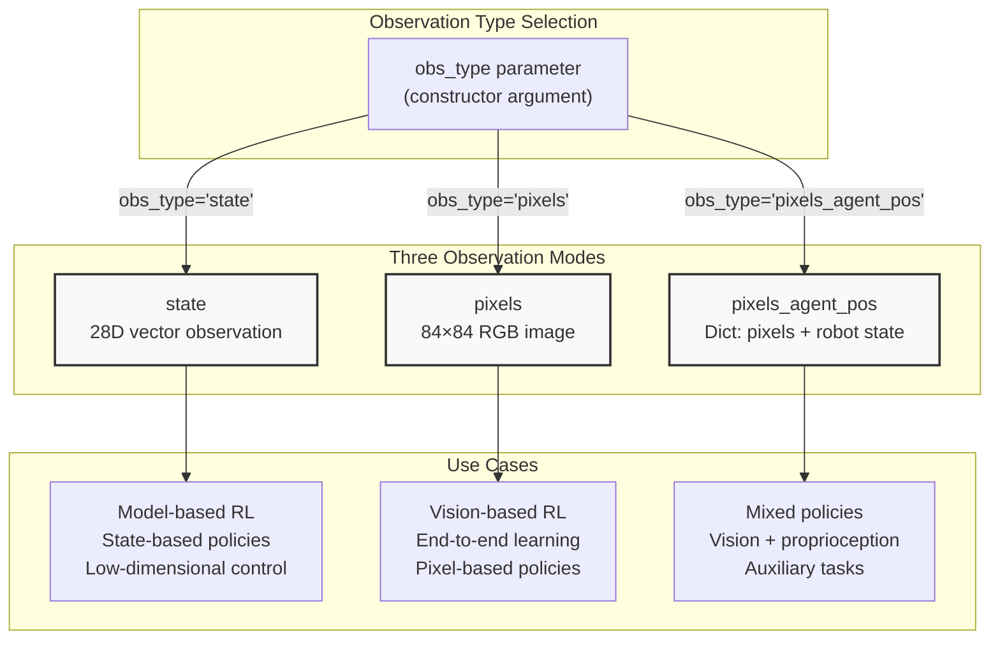
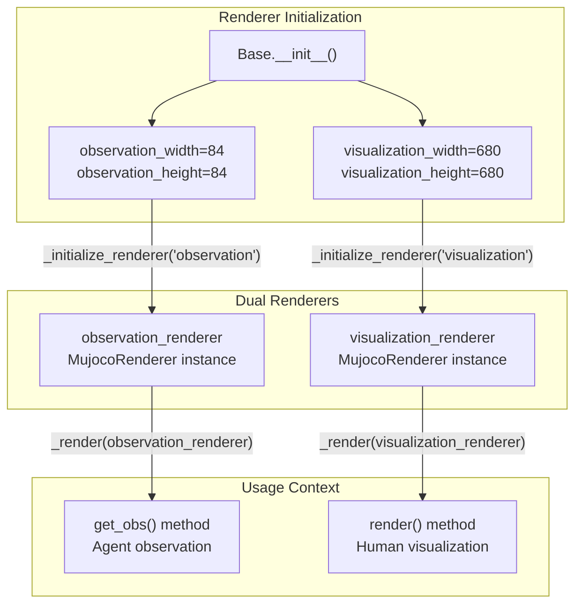
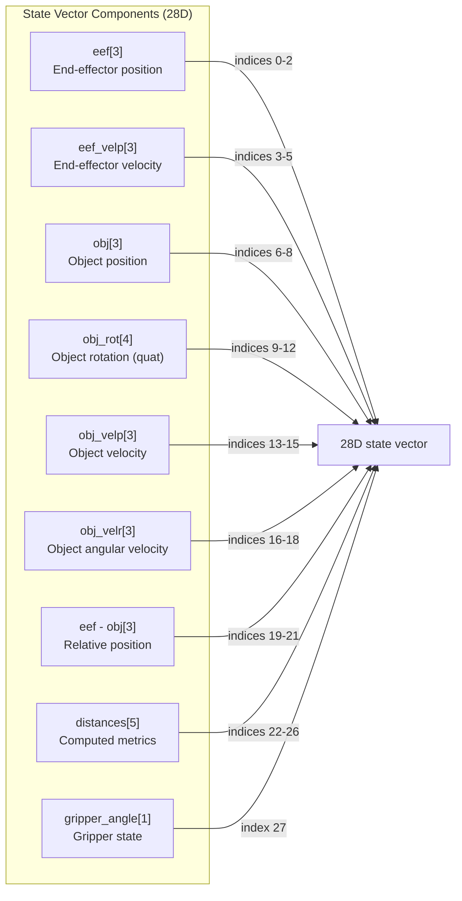
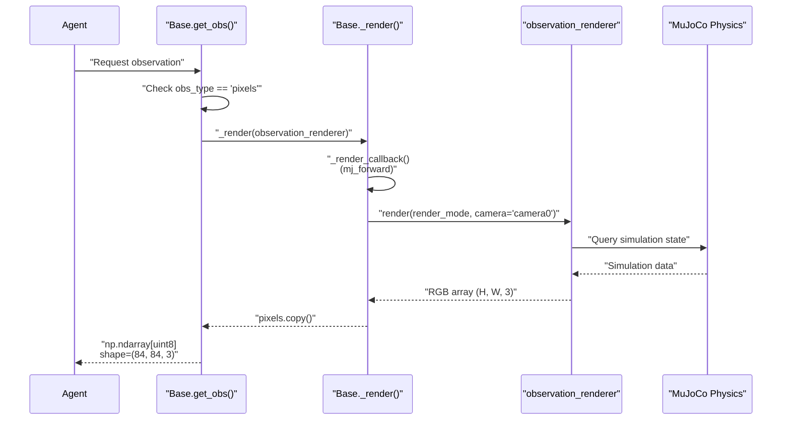
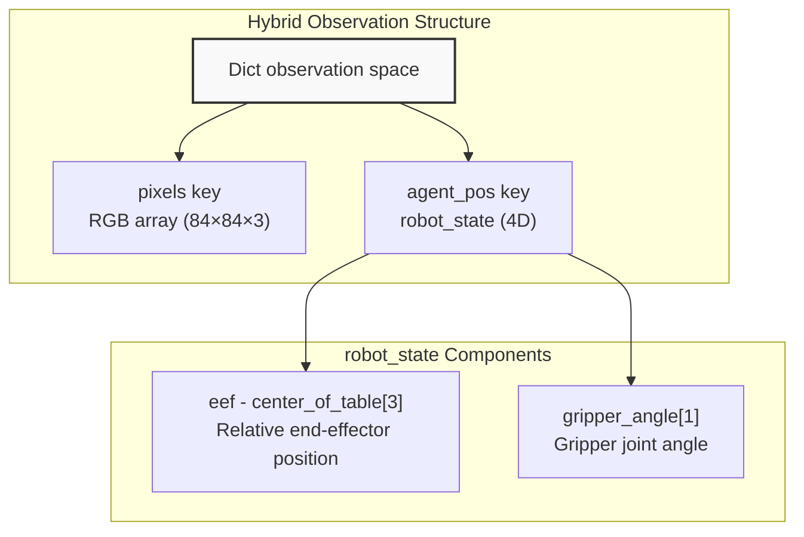
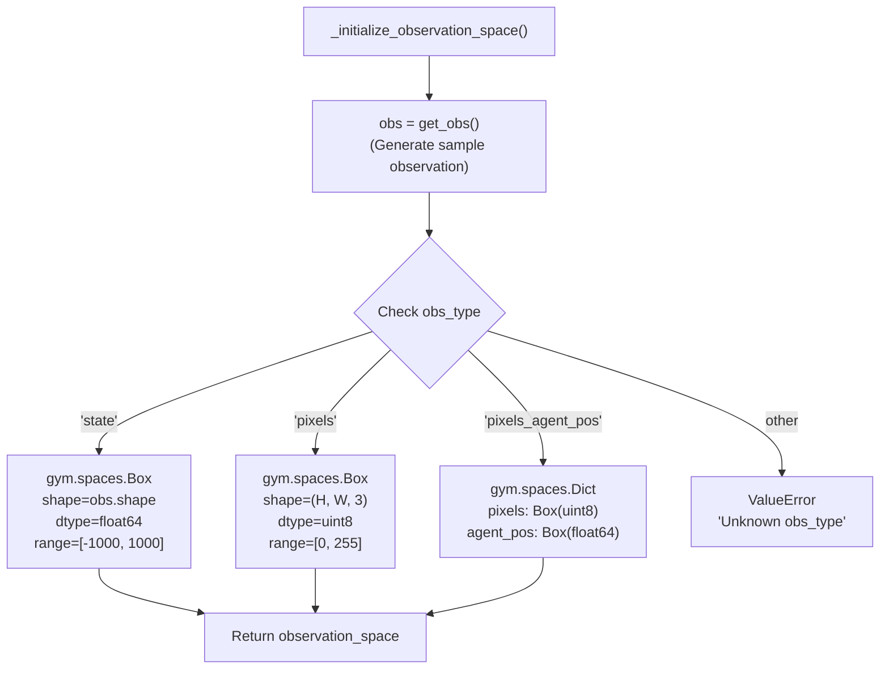
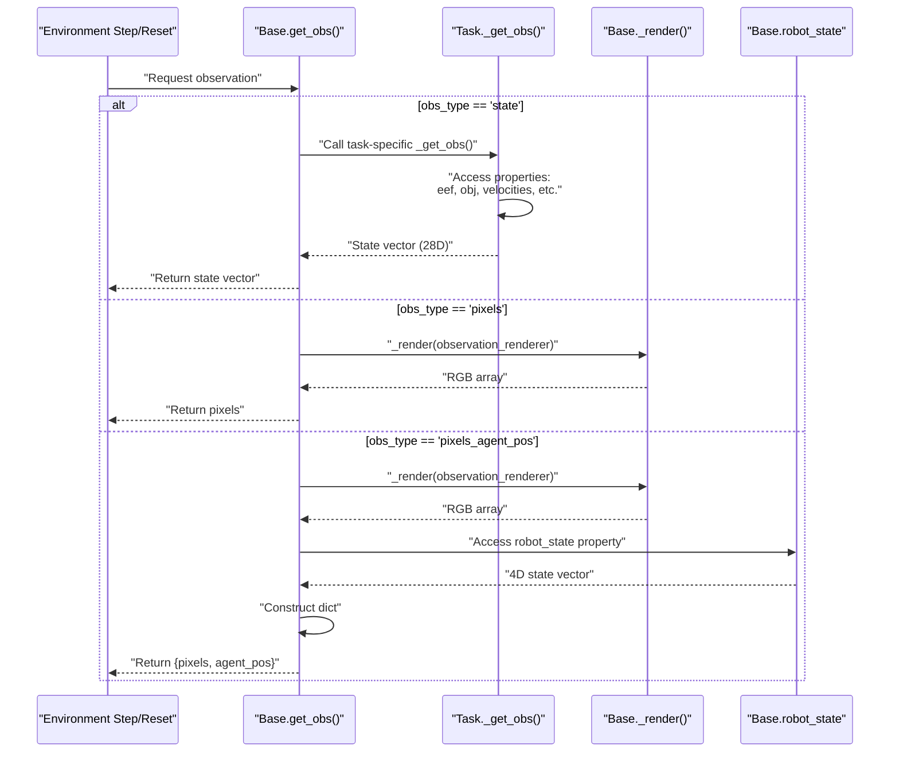
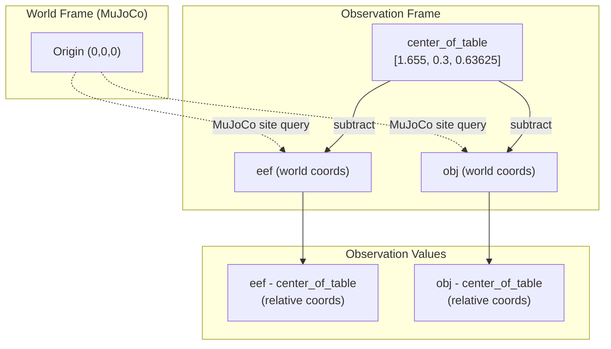

<!-- source: DeepWiki mcp.deepwiki.com · repo huggingface/gym-xarm · page 3.4 Observation System · fetched 2026-10-26 -->

# Observation System

<details>
<summary>Relevant source files</summary>

The following files were used as context for generating this wiki page:

- [gym_xarm/tasks/base.py](gym_xarm/tasks/base.py)
- [gym_xarm/tasks/lift.py](gym_xarm/tasks/lift.py)
- [gym_xarm/tasks/mocap.py](gym_xarm/tasks/mocap.py)

</details>


## Purpose and Scope

This document explains the observation generation system in gym-xarm, detailing how the environment produces three different observation modalities (state vectors, pixel observations, and hybrid observations) and how the dual renderer architecture supports both observation collection and visualization. For information about action processing and control, see [Action Processing and Mocap Control](#3.5). For task-specific details about the Lift task's observation composition, see [Lift Task](#4.1).

---

## Overview of Observation Modalities

The gym-xarm environment supports three distinct observation types, configured via the `obs_type` parameter during environment initialization. Each modality serves different agent architectures and learning approaches.



**Sources:** [gym_xarm/tasks/base.py:38](), [gym_xarm/tasks/base.py:110-131](), [gym_xarm/tasks/base.py:245-259]()

---

## Dual Renderer Architecture

The environment maintains two separate `MujocoRenderer` instances with different resolutions, enabling efficient observation collection at lower resolution while supporting high-quality visualization for human monitoring.

### Renderer Initialization

| Renderer Type | Purpose | Resolution | Configured By | Initialized At |
|--------------|---------|------------|---------------|----------------|
| `observation_renderer` | Generate observation pixels | 84×84 (default) | `observation_width`, `observation_height` | [base.py:71]() |
| `visualization_renderer` | Human rendering | 680×680 (default) | `visualization_width`, `visualization_height` | [base.py:72]() |



**Implementation Details:**

The dual renderer system uses a workaround to support different rendering resolutions. Gymnasium's standard renderer doesn't support on-the-fly resolution changes, so gym-xarm creates a deep copy of the MuJoCo model with different viewport dimensions for visualization [gym_xarm/tasks/base.py:133-150]().

```python
# Observation renderer uses the main model
if renderer_type == "observation":
    model = self.model
# Visualization renderer uses a deep-copied model with custom dimensions
elif renderer_type == "visualization":
    from copy import deepcopy
    model = deepcopy(self.model)
    model.vis.global_.offwidth = self.visualization_width
    model.vis.global_.offheight = self.visualization_height
```

Both renderers share the same `self.data` (MuJoCo's `mjData` structure), ensuring they render the same simulation state while producing different resolution outputs.

**Sources:** [gym_xarm/tasks/base.py:69-72](), [gym_xarm/tasks/base.py:133-150](), [gym_xarm/tasks/base.py:315-321]()

---

## State Observations

When `obs_type="state"`, the environment returns a 28-dimensional floating-point vector containing full state information about the robot and object.

### State Vector Composition (Lift Task)



### Detailed Component Descriptions

**Position and Velocity Information:**

- **`eef` (3D)**: End-effector position relative to table center, obtained via `_utils.get_site_xpos(model, data, "grasp")` [gym_xarm/tasks/base.py:158-159]()
- **`eef_velp` (3D)**: End-effector linear velocity scaled by timestep `dt` [gym_xarm/tasks/base.py:162-163]()
- **`obj` (3D)**: Object position relative to table center, obtained via `_utils.get_site_xpos(model, data, "object_site")` [gym_xarm/tasks/base.py:174-175]()
- **`obj_rot` (4D)**: Object orientation as quaternion [gym_xarm/tasks/base.py:178-179]()
- **`obj_velp` (3D)**: Object linear velocity scaled by timestep [gym_xarm/tasks/base.py:182-183]()
- **`obj_velr` (3D)**: Object angular velocity scaled by timestep [gym_xarm/tasks/base.py:186-187]()

**Derived Geometric Features:**

The state vector includes pre-computed geometric relationships to facilitate learning:

- **`eef - obj` (3D)**: Relative position vector from object to end-effector [gym_xarm/tasks/lift.py:59]()
- **Distance metrics (5D)** [gym_xarm/tasks/lift.py:60-67]():
  - 3D Euclidean distance between end-effector and object
  - XY-plane distance (ignoring Z)
  - Target Z height (`z_target`)
  - Vertical gap: `z_target - obj_z`
  - End-effector vertical gap: `z_target - eef_z`

**Gripper State:**

- **`gripper_angle` (1D)**: Joint angle of `right_outer_knuckle_joint`, indicating gripper open/closed state [gym_xarm/tasks/base.py:166-167]()

**Sources:** [gym_xarm/tasks/lift.py:50-72](), [gym_xarm/tasks/base.py:158-187]()

---

## Pixel Observations

When `obs_type="pixels"`, the environment returns RGB images rendered from the simulation using the observation renderer.



### Pixel Observation Characteristics

| Property | Value | Source |
|----------|-------|--------|
| Default shape | `(84, 84, 3)` | [base.py:42-43]() |
| Data type | `np.uint8` | [base.py:116]() |
| Value range | `[0, 255]` | [base.py:116]() |
| Color space | RGB | MujocoRenderer default |
| Camera | `"camera0"` | [base.py:320]() |

**Rendering Process:**

1. **Forward kinematics:** `mj_forward()` ensures all derived quantities are up-to-date [gym_xarm/tasks/base.py:323-324]()
2. **Renderer invocation:** `observation_renderer.render(render_mode, camera_name="camera0")` [gym_xarm/tasks/base.py:318-321]()
3. **Copy operation:** The rendered array is copied to prevent mutation [gym_xarm/tasks/base.py:321]()

**Sources:** [gym_xarm/tasks/base.py:245-259](), [gym_xarm/tasks/base.py:318-324]()

---

## Hybrid Observations (pixels_agent_pos)

The `pixels_agent_pos` observation mode combines pixel observations with low-dimensional robot state information, providing both visual context and precise proprioceptive feedback.



### Observation Space Definition

```python
observation_space = gym.spaces.Dict({
    "pixels": gym.spaces.Box(
        low=0, 
        high=255, 
        shape=(observation_height, observation_width, 3), 
        dtype=np.uint8
    ),
    "agent_pos": gym.spaces.Box(
        low=-1000.0, 
        high=1000.0, 
        shape=(4,),  # [eef_x, eef_y, eef_z, gripper_angle]
        dtype=np.float64
    ),
})
```

The `robot_state` property provides the agent position component [gym_xarm/tasks/base.py:170-171]():

```python
@property
def robot_state(self):
    return np.concatenate([self.eef - self.center_of_table, self.gripper_angle])
```

**Use Cases:**

- **Auxiliary task learning:** Vision encoder can be regularized with proprioceptive prediction
- **Mixed policy architectures:** Pixel-based visual processing with direct state-based control
- **Debugging:** Compare pixel-based observations with ground truth state

**Sources:** [gym_xarm/tasks/base.py:117-125](), [gym_xarm/tasks/base.py:170-171](), [gym_xarm/tasks/base.py:251-255]()

---

## Observation Space Initialization

The `_initialize_observation_space()` method creates appropriate Gymnasium `Space` objects based on the selected observation type. This occurs during environment construction after the first observation is generated to infer shapes.



### Space Bounds and Types

| Observation Type | Gymnasium Space | Shape | Dtype | Bounds |
|-----------------|-----------------|-------|-------|--------|
| `state` | `Box` | `(28,)` for Lift | `np.float64` | `[-1000.0, 1000.0]` |
| `pixels` | `Box` | `(84, 84, 3)` | `np.uint8` | `[0, 255]` |
| `pixels_agent_pos` | `Dict` | `{"pixels": (84,84,3), "agent_pos": (4,)}` | Mixed | See above |

**Note:** The wide bounds `[-1000.0, 1000.0]` for state observations are conservative and don't reflect actual state ranges. The robot operates in a much smaller workspace around the table center.

**Sources:** [gym_xarm/tasks/base.py:110-131]()

---

## Observation Generation Flow

The `get_obs()` method coordinates observation generation, dispatching to different code paths based on `obs_type`.



### Code Flow Map

The observation generation flow maps directly to these code entities:

1. **Entry point:** `Base.get_obs()` [gym_xarm/tasks/base.py:245-259]()
2. **State branch:** Calls task-specific `_get_obs()` (abstract method implemented by tasks)
3. **Pixel branch:** Calls `_render(observation_renderer)` [gym_xarm/tasks/base.py:248]()
4. **Hybrid branch:** Combines pixel rendering with `robot_state` property access [gym_xarm/tasks/base.py:251-255]()

**Sources:** [gym_xarm/tasks/base.py:245-259](), [gym_xarm/tasks/lift.py:50-72]()

---

## Key Properties and Utilities

The Base class provides properties that abstract MuJoCo's low-level data access, simplifying observation construction in task implementations.

### Robot State Properties

| Property | Return Type | Description | Source Line |
|----------|-------------|-------------|-------------|
| `eef` | `np.ndarray (3,)` | End-effector position relative to table center | [base.py:158-159]() |
| `eef_velp` | `np.ndarray (3,)` | End-effector linear velocity (scaled by dt) | [base.py:162-163]() |
| `gripper_angle` | `np.ndarray (1,)` | Gripper joint angle | [base.py:166-167]() |
| `robot_state` | `np.ndarray (4,)` | Combined [eef, gripper_angle] | [base.py:170-171]() |

### Object State Properties

| Property | Return Type | Description | Source Line |
|----------|-------------|-------------|-------------|
| `obj` | `np.ndarray (3,)` | Object position relative to table center | [base.py:174-175]() |
| `obj_rot` | `np.ndarray (4,)` | Object rotation quaternion | [base.py:178-179]() |
| `obj_velp` | `np.ndarray (3,)` | Object linear velocity (scaled by dt) | [base.py:182-183]() |
| `obj_velr` | `np.ndarray (3,)` | Object angular velocity (scaled by dt) | [base.py:186-187]() |

All position properties use `self.center_of_table` as the reference frame [gym_xarm/tasks/base.py:50](), making observations invariant to absolute world coordinates.

**Sources:** [gym_xarm/tasks/base.py:152-187]()

---

## Coordinate System and Reference Frame

All spatial observations use a consistent reference frame centered at the table workspace.



This coordinate transformation ensures:
- Observations are workspace-relative, not absolute
- Learning is invariant to robot's world position
- Values stay within reasonable numerical ranges

**Sources:** [gym_xarm/tasks/base.py:50](), [gym_xarm/tasks/base.py:158-175]()

---

