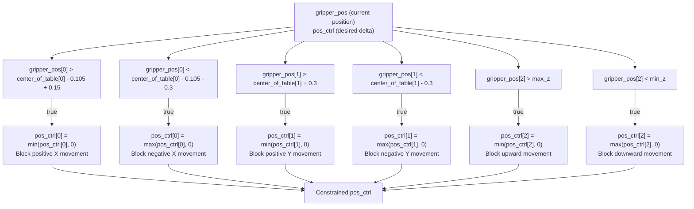
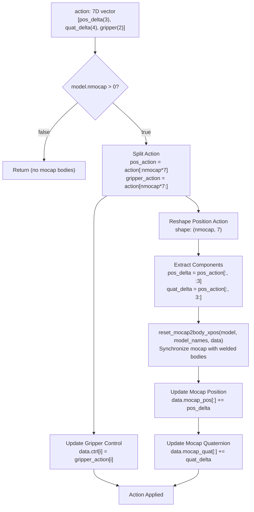
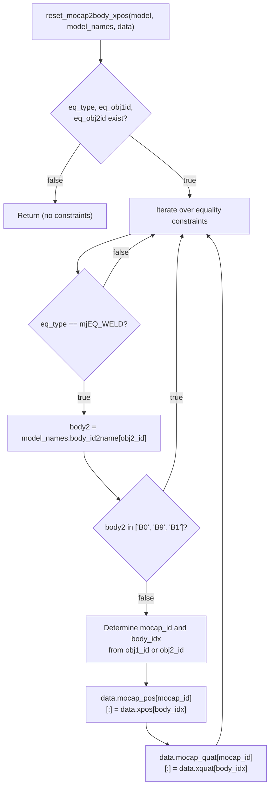
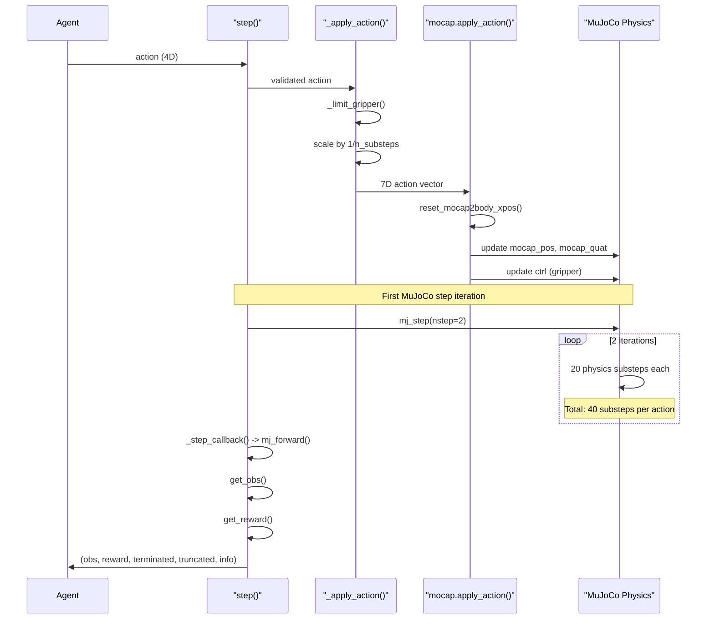

<!-- source: DeepWiki mcp.deepwiki.com · repo huggingface/gym-xarm · page 3.5 Action Processing and Mocap Control · fetched 2026-10-26 -->

# Action Processing and Mocap Control

<details>
<summary>Relevant source files</summary>

The following files were used as context for generating this wiki page:

- [gym_xarm/tasks/base.py](gym_xarm/tasks/base.py)
- [gym_xarm/tasks/mocap.py](gym_xarm/tasks/mocap.py)

</details>


This page documents how agent actions are processed, validated, and applied to the MuJoCo simulation through the motion capture (mocap) control system. It covers the action space definition, safety constraints, scaling mechanisms, and the integration with MuJoCo's mocap bodies for controlling the robot manipulator.

For information about the overall Base environment class architecture, see [Base Environment Class](#3.1). For details on MuJoCo simulation integration, see [MuJoCo Integration](#3.3).

---

## Action Space Definition

The action space is a 4-dimensional continuous space defined in the Box format with bounds [-1.0, 1.0] for each dimension:

| Dimension | Index | Description | Range |
|-----------|-------|-------------|-------|
| X position delta | 0 | End-effector position change along X-axis | [-1.0, 1.0] |
| Y position delta | 1 | End-effector position change along Y-axis | [-1.0, 1.0] |
| Z position delta | 2 | End-effector position change along Z-axis | [-1.0, 1.0] |
| Gripper control | 3 | Gripper opening/closing command | [-1.0, 1.0] |

The action space is initialized during environment construction at [gym_xarm/tasks/base.py:74](), where it uses the `metadata["action_space"]` to determine the dimensionality. The metadata is task-specific and defined in the task registry.

For tasks that do not include gripper rotation control (i.e., "w" is not in `metadata["action_space"]`), an action padding mechanism ensures compatibility with the mocap system that expects 4D actions. The padding is set to [0, 0, 0, 1] where the final 1.0 represents the default quaternion component [gym_xarm/tasks/base.py:75-82]().

**Sources:** [gym_xarm/tasks/base.py:74-83]()

---

## Action Processing Pipeline

The following diagram illustrates the complete action processing flow from agent input to MuJoCo physics update:

```mermaid
flowchart TD
    Agent["Agent"] -->|"action: np.array(4,)"| StepMethod["step(action)"]
    StepMethod -->|"validate shape & bounds"| Validation["Action Validation<br/>assert action.shape == (4,)<br/>assert action_space.contains(action)"]
    Validation -->|"valid action"| ApplyAction["_apply_action(action)"]
    
    ApplyAction -->|"copy & split"| Split["Split Action<br/>pos_ctrl = action[:3]<br/>gripper_ctrl = action[3]"]
    
    Split --> LimitGripper["_limit_gripper(gripper_pos, pos_ctrl)"]
    LimitGripper -->|"constrained pos_ctrl"| Scale["Scale by Substeps<br/>pos_ctrl *= (1 / n_substeps)"]
    
    Scale --> PrepareGripper["Prepare Gripper Control<br/>gripper_ctrl = [gripper_ctrl, gripper_ctrl]"]
    PrepareGripper --> Concatenate["Concatenate Components<br/>[pos_ctrl, gripper_rotation, gripper_ctrl]"]
    
    Concatenate -->|"7D action vector"| MocapApply["mocap.apply_action(model, model_names, data, action)"]
    
    MocapApply --> ResetMocap["reset_mocap2body_xpos()<br/>Sync mocap with body positions"]
    ResetMocap --> UpdateMocap["Update mocap_pos and mocap_quat<br/>data.mocap_pos += pos_delta<br/>data.mocap_quat += quat_delta"]
    UpdateMocap --> UpdateCtrl["Update gripper control<br/>data.ctrl[i] = gripper_action[i]"]
    
    UpdateCtrl --> MjStep["mj_step(model, data, nstep=2)"]
    MjStep --> StepCallback["_step_callback()<br/>mj_forward()"]
    StepCallback --> GetObs["get_obs()"]
```



**Sources:** [gym_xarm/tasks/base.py:261-273](), [gym_xarm/tasks/base.py:293-306](), [gym_xarm/tasks/mocap.py:6-16]()

---

## Action Validation and Step Method

The `step()` method is the entry point for action execution, performing validation before delegating to internal processing methods:

```python
# From gym_xarm/tasks/base.py:261-273
def step(self, action):
    assert action.shape == (4,)
    assert self.action_space.contains(action), f"{action!r} ({type(action)}) invalid"
    self._apply_action(action)
    self._mujoco.mj_step(self.model, self.data, nstep=2)
    self._step_callback()
    observation = self.get_obs()
    reward = self.get_reward()
    terminated = is_success = self.is_success()
    truncated = False
    info = {"is_success": is_success}
    return observation, reward, terminated, truncated, info
```

Key validation checks:
1. **Shape validation**: Ensures action is exactly 4-dimensional
2. **Bounds validation**: Confirms all action values are within [-1.0, 1.0] using Gymnasium's `contains()` method
3. **Type validation**: Implicit through the assertion error message

After applying the action and stepping the simulation with `nstep=2` substeps, the method calls `_step_callback()` which invokes `mj_forward()` to update derived quantities before generating observations and rewards.

**Sources:** [gym_xarm/tasks/base.py:261-273](), [gym_xarm/tasks/base.py:275-276]()

---

## Gripper Position Constraints

The `_limit_gripper()` method enforces safety boundaries on the end-effector position to prevent the robot from exceeding its workspace limits. This method operates on the position control component of the action before it is applied:



The workspace boundaries are defined as:
- **X-axis**: `[center_of_table[0] - 0.405, center_of_table[0] + 0.045]`
- **Y-axis**: `[center_of_table[1] - 0.3, center_of_table[1] + 0.3]`
- **Z-axis**: `[min_z, max_z]` where `min_z = 0.2` and `max_z = 1.2`
- **center_of_table**: `[1.655, 0.3, 0.63625]` (defined at [gym_xarm/tasks/base.py:50]())

The constraint mechanism works by detecting when the gripper is at a boundary and zeroing out the action component that would move it further beyond the boundary. This creates a "soft wall" effect where the robot can still move parallel to boundaries but cannot penetrate them.

**Sources:** [gym_xarm/tasks/base.py:278-291](), [gym_xarm/tasks/base.py:46-52]()

---

## Action Application and Scaling

The `_apply_action()` method is responsible for transforming the validated 4D action into the format required by the mocap control system:

| Step | Operation | Code Location |
|------|-----------|---------------|
| 1. Copy action | `action = action.copy()` | [gym_xarm/tasks/base.py:295]() |
| 2. Split components | `pos_ctrl, gripper_ctrl = action[:3], action[3]` | [gym_xarm/tasks/base.py:296]() |
| 3. Apply constraints | `pos_ctrl = self._limit_gripper(...)` | [gym_xarm/tasks/base.py:297-299]() |
| 4. Scale by substeps | `pos_ctrl *= (1 / self.n_substeps)` | [gym_xarm/tasks/base.py:299]() |
| 5. Duplicate gripper | `gripper_ctrl = np.array([gripper_ctrl, gripper_ctrl])` | [gym_xarm/tasks/base.py:300]() |
| 6. Concatenate | `[pos_ctrl, gripper_rotation, gripper_ctrl]` | [gym_xarm/tasks/base.py:305]() |
| 7. Apply via mocap | `mocap.apply_action(...)` | [gym_xarm/tasks/base.py:301-306]() |

The scaling by `1 / n_substeps` where `n_substeps = 20` is critical for controlling the action magnitude. Since MuJoCo will simulate multiple physics substeps, the position delta must be divided to prevent overshooting the intended position. This scaling is applied at [gym_xarm/tasks/base.py:299]().

The gripper control value is duplicated because the gripper mechanism in the MuJoCo model has two symmetric actuators that must receive identical commands. The final concatenated action vector has 7 components: `[dx, dy, dz, qx, qy, qz, qw, gripper1, gripper2]` where the quaternion components come from `self.gripper_rotation`.

**Sources:** [gym_xarm/tasks/base.py:293-306](), [gym_xarm/tasks/base.py:30]()

---

## Mocap Control System

The mocap (motion capture) control system provides the interface between high-level position commands and MuJoCo's constraint-based control mechanism. The system consists of three functions in the `mocap` module:

### mocap.apply_action()



This function is the main entry point for applying actions to the mocap bodies. It handles both position/orientation updates for the mocap body and direct actuator control for the gripper. The function supports multiple mocap bodies (though gym-xarm uses only one), as indicated by the `model.nmocap` check and the reshaping operation.

**Sources:** [gym_xarm/tasks/mocap.py:6-16]()

### mocap.reset_mocap2body_xpos()

This function synchronizes mocap body positions and orientations with their welded counterparts before applying action deltas. This is essential for maintaining consistency in the constraint-based control system:



The function iterates through all weld constraints (`mjEQ_WELD`) in the model, identifying which body is the mocap and which is the welded body. It then copies the position (`xpos`) and quaternion (`xquat`) from the welded body to the mocap body. This ensures that action deltas are applied relative to the current body position rather than accumulating from the initial mocap position.

Bodies "B0", "B9", and "B1" are explicitly skipped, likely because they represent fixed parts of the robot or environment that should not be synchronized.

**Sources:** [gym_xarm/tasks/mocap.py:27-50]()

### mocap.reset()

This function initializes mocap constraints during environment setup:

```python
# From gym_xarm/tasks/mocap.py:19-24
def reset(model, data):
    if model.nmocap > 0 and model.eq_data is not None:
        for i in range(model.eq_data.shape[0]):
            if model.eq_type[i] == mujoco.mjtEq.mjEQ_WELD:
                model.eq_data[i, :8] = np.array([0.0, 0.0, 0.0, 0.0, 0.0, 0.0, 1.0, 0])
    mujoco.mj_forward(model, data)
```

Called during `_env_setup()` at [gym_xarm/tasks/base.py:105](), this function resets all weld constraint data to identity (zero position offset, identity quaternion [0,0,0,1], zero torque). This establishes the initial constraint configuration before the simulation begins.

**Sources:** [gym_xarm/tasks/mocap.py:19-24](), [gym_xarm/tasks/base.py:105]()

---

## Physics Integration and Timestep Management

The action application process integrates with MuJoCo's physics engine through a multi-step simulation cycle:



### Timestep Calculation

The effective timestep for each Gymnasium step is calculated as:

```
dt = n_substeps * model.opt.timestep
   = 20 * model.opt.timestep
```

This value is verified during initialization to match the metadata render FPS at [gym_xarm/tasks/base.py:77-79](). The `dt` property is used for velocity calculations throughout the Base class, such as `eef_velp` and `obj_velp` at [gym_xarm/tasks/base.py:162-187]().

### Simulation Steps

The simulation executes in two phases:
1. **Action application**: `mj_step(nstep=2)` at [gym_xarm/tasks/base.py:265]() performs 2 simulation iterations, each containing `n_substeps=20` physics substeps, totaling 40 substeps
2. **State update**: `_step_callback()` calls `mj_forward()` at [gym_xarm/tasks/base.py:275-276]() to update derived quantities (Jacobians, forward kinematics, etc.)

This multi-step approach provides smooth physics simulation while allowing the mocap control system to guide the end-effector through intermediate positions during each action.

**Sources:** [gym_xarm/tasks/base.py:152-155](), [gym_xarm/tasks/base.py:261-276](), [gym_xarm/tasks/base.py:77-79]()

---

## Code Entity Reference Map

The following table maps conceptual components to their code implementations:

| Component | File | Class/Function | Lines |
|-----------|------|----------------|-------|
| Action space definition | `gym_xarm/tasks/base.py` | `Base.__init__()` | 74-76 |
| Action validation | `gym_xarm/tasks/base.py` | `Base.step()` | 262-263 |
| Action processing | `gym_xarm/tasks/base.py` | `Base._apply_action()` | 293-306 |
| Position constraints | `gym_xarm/tasks/base.py` | `Base._limit_gripper()` | 278-291 |
| Mocap action application | `gym_xarm/tasks/mocap.py` | `apply_action()` | 6-16 |
| Mocap-body synchronization | `gym_xarm/tasks/mocap.py` | `reset_mocap2body_xpos()` | 27-50 |
| Mocap initialization | `gym_xarm/tasks/mocap.py` | `reset()` | 19-24 |
| Substep configuration | `gym_xarm/tasks/base.py` | `Base.n_substeps` | 30 |
| Timestep property | `gym_xarm/tasks/base.py` | `Base.dt` | 152-155 |
| Gripper rotation | `gym_xarm/tasks/base.py` | `Base.__init__()` | 47-49 |
| Table center coordinate | `gym_xarm/tasks/base.py` | `Base.__init__()` | 50 |
| Z-axis limits | `gym_xarm/tasks/base.py` | `Base.__init__()` | 51-52 |

**Sources:** [gym_xarm/tasks/base.py:1-335](), [gym_xarm/tasks/mocap.py:1-51]()

---

