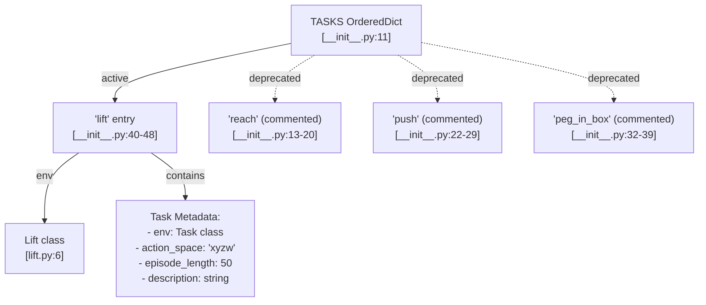
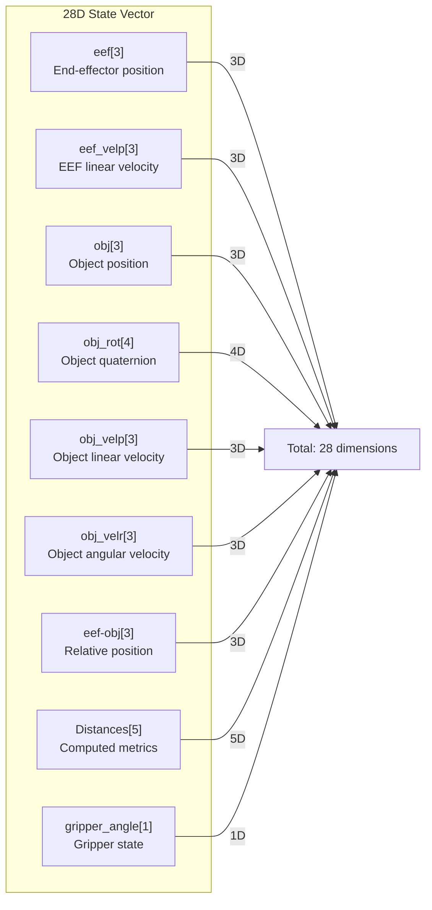
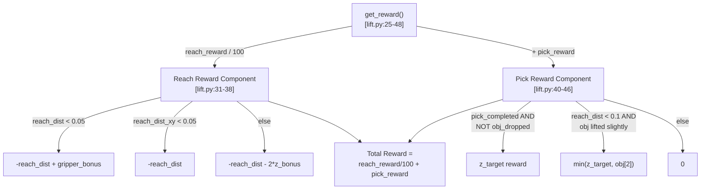
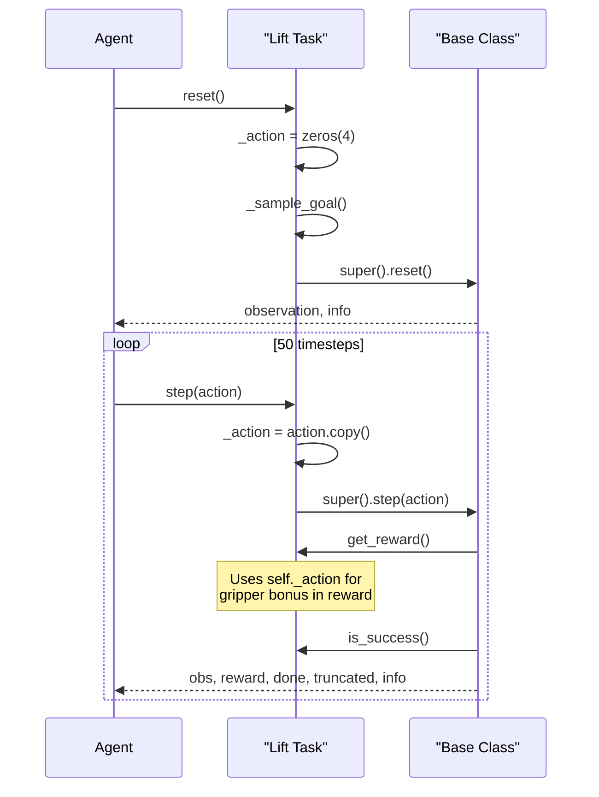
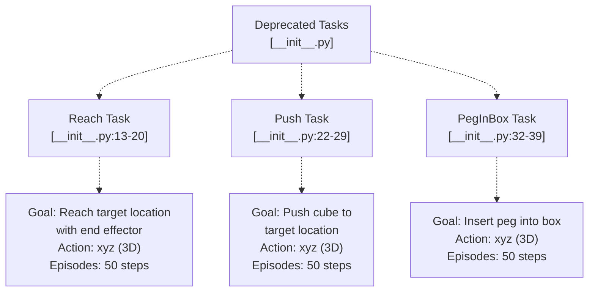

<!-- source: DeepWiki mcp.deepwiki.com · repo huggingface/gym-xarm · page 4 Tasks Reference · fetched 2026-10-26 -->

# Tasks Reference

<details>
<summary>Relevant source files</summary>

The following files were used as context for generating this wiki page:

- [gym_xarm/tasks/__init__.py](gym_xarm/tasks/__init__.py)
- [gym_xarm/tasks/lift.py](gym_xarm/tasks/lift.py)

</details>


This page provides reference documentation for all manipulation tasks in gym-xarm. Tasks define the specific manipulation objectives that the xArm robot must accomplish, including their action spaces, observation spaces, reward functions, and success criteria.

For architectural details on how tasks integrate into the environment system, see [Task System](#3.2). For guidance on implementing custom tasks, see [Creating Custom Tasks](#5.5).

## Task Registry

The gym-xarm package uses a task registry system to organize available manipulation tasks. Tasks are registered in the `TASKS` OrderedDict defined in [gym_xarm/tasks/__init__.py:11-50]().



**Sources:** [gym_xarm/tasks/__init__.py:11-50]()

### Task Metadata Structure

Each task entry in the registry contains the following metadata:

| Field | Type | Description |
|-------|------|-------------|
| `env` | Class | The task class implementing the environment logic |
| `action_space` | str | Action space type: `"xyz"` (3D position) or `"xyzw"` (3D position + gripper) |
| `episode_length` | int | Maximum steps per episode |
| `description` | str | Human-readable task description |

### Currently Active Tasks

As of the current version, only the **Lift** task is active. All other tasks are commented out in the registry and considered deprecated.

**Sources:** [gym_xarm/tasks/__init__.py:1-50]()

## Lift Task

The Lift task is the primary manipulation task in gym-xarm. The robot must grasp a cube and lift it above a specified height threshold.

### Task Metadata

```python
# From Lift.metadata
{
    "action_space": "xyzw",        # 4D: xyz position + w gripper
    "episode_length": 50,           # 50 timesteps per episode
    "description": "Lift a cube above a height threshold"
}
```

**Sources:** [gym_xarm/tasks/lift.py:7-12]()

### Goal and Success Criteria

The task is considered successful when the cube's z-coordinate reaches or exceeds the target height:

```python
# From Lift.is_success()
return self.obj[2] >= self.z_target
```

The `z_target` is calculated as:
```python
z_target = initial_object_z + 0.15  # 15cm above initial position
```

**Sources:** [gym_xarm/tasks/lift.py:15-23]()

### Action Space

The Lift task uses a 4-dimensional action space `"xyzw"`:

| Dimension | Range | Description |
|-----------|-------|-------------|
| x | [-1, 1] | End-effector x-position delta |
| y | [-1, 1] | End-effector y-position delta |
| z | [-1, 1] | End-effector z-position delta |
| w | [-1, 1] | Gripper control (negative=close, positive=open) |

Actions are processed through the Base class mocap system (see [Action Processing and Mocap Control](#3.5)).

**Sources:** [gym_xarm/tasks/lift.py:7-12]()

### Observation Space

The Lift task provides a 28-dimensional state vector when using `obs_type="state"`. The observation components are assembled in [gym_xarm/tasks/lift.py:50-72]().



**Observation Breakdown:**

| Component | Dims | Description | Source Property |
|-----------|------|-------------|-----------------|
| End-effector position | 3 | xyz position in world frame | `self.eef` |
| End-effector velocity | 3 | Linear velocity | `self.eef_velp` |
| Object position | 3 | xyz position of cube | `self.obj` |
| Object rotation | 4 | Quaternion orientation | `self.obj_rot` |
| Object linear velocity | 3 | Cube linear velocity | `self.obj_velp` |
| Object angular velocity | 3 | Cube angular velocity | `self.obj_velr` |
| Relative position | 3 | `eef - obj` vector | Computed |
| Distance metrics | 5 | Computed distances (see below) | Computed |
| Gripper angle | 1 | Current gripper opening | `self.gripper_angle` |

**Distance Metrics (5D):**

1. `np.linalg.norm(eef - obj)` - 3D Euclidean distance
2. `np.linalg.norm(eef[:-1] - obj[:-1])` - 2D xy-plane distance
3. `z_target` - Target height
4. `z_target - obj[-1]` - Remaining height to lift
5. `z_target - eef[-1]` - End-effector distance to target height

**Sources:** [gym_xarm/tasks/lift.py:50-72]()

### Reward Function

The reward function combines two components: **reach reward** and **pick reward**. This two-stage design encourages the robot to first reach the object, then lift it.



**Reach Reward Logic:**

The reach reward uses distance-based shaping with three cases:

1. **Close range** (`reach_dist < 0.05`):
   ```python
   reach_reward = -reach_dist + max(action[-1], 0) / 50
   ```
   Penalizes distance and rewards gripper opening (preparing to grasp).

2. **Moderate range** (`reach_dist_xy < 0.05`):
   ```python
   reach_reward = -reach_dist
   ```
   Simple distance penalty when xy-aligned but z may differ.

3. **Far range** (else):
   ```python
   z_bonus = np.linalg.norm(obj[-1] - eef[-1])
   reach_reward = -reach_dist - 2 * z_bonus
   ```
   Additional penalty for z-axis misalignment.

**Pick Reward Logic:**

The pick reward provides bonus for lifting:

1. **Pick completed** (`obj[2] >= z_target - 0.01` and not dropped):
   ```python
   pick_reward = z_target  # 0.15
   ```

2. **Partial lift** (`reach_dist < 0.1` and `obj[2] > init_z + 0.005`):
   ```python
   pick_reward = min(z_target, obj[2])
   ```
   Rewards proportional to current height.

3. **No lift**:
   ```python
   pick_reward = 0
   ```

**Object Dropped Detection:**

An object is considered dropped if:
```python
obj_dropped = (obj[2] < init_z + 0.005) and (reach_dist > 0.02)
```

**Sources:** [gym_xarm/tasks/lift.py:25-48]()

### Initial Conditions

Each episode begins with randomized initial positions for both the gripper and the cube, sampled in `_sample_goal()`:

**Gripper Initialization:**
```python
# Base position with uniform noise
gripper_pos = [1.280, 0.295, 0.735] + uniform(-0.05, 0.05, size=3)
```

**Object Initialization:**
```python
# Offset from table center with xy randomization
object_pos = center_of_table - [0.15, 0.10, 0.07]
object_pos[0] += uniform(-0.05, 0.05)  # x variation
object_pos[1] += uniform(-0.05, 0.05)  # y variation
```

The initial object z-coordinate is stored as `self._init_z` and used to compute the lift target height.

**Sources:** [gym_xarm/tasks/lift.py:74-89]()

### Episode Lifecycle

The Lift task tracks the current action for reward computation:



The `_action` attribute is stored during each step and used in the reward calculation for the gripper opening bonus.

**Sources:** [gym_xarm/tasks/lift.py:91-101]()

## Deprecated Tasks

Three manipulation tasks are currently deprecated and commented out in the task registry. These tasks were part of earlier versions of gym-xarm but are no longer actively maintained.



### Reach Task

- **Goal:** Move the end-effector to a target location
- **Action Space:** `"xyz"` (3D position control only, no gripper)
- **Episode Length:** 50 timesteps
- **Description:** "Reach a target location with the end effector"
- **Status:** Commented out in [gym_xarm/tasks/__init__.py:13-20]()

### Push Task

- **Goal:** Push a cube to a target location on the table
- **Action Space:** `"xyz"` (3D position control only, no gripper)
- **Episode Length:** 50 timesteps
- **Description:** "Push a cube to a target location"
- **Status:** Commented out in [gym_xarm/tasks/__init__.py:22-29]()

### PegInBox Task

- **Goal:** Insert a peg into a box (precision manipulation)
- **Action Space:** `"xyz"` (3D position control only, no gripper)
- **Episode Length:** 50 timesteps
- **Description:** "Insert a peg into a box"
- **Status:** Commented out in [gym_xarm/tasks/__init__.py:32-39]()

### Deprecation Rationale

These tasks are deprecated because:

1. **Maintenance Focus:** Development effort is concentrated on the Lift task, which provides sufficient complexity for manipulation research
2. **Code Comments:** The task implementations remain commented in the codebase but are not registered or tested
3. **Import Statements:** Task class imports are commented out in [gym_xarm/tasks/__init__.py:6-8]()

The deprecated task classes may still exist in the repository but are not accessible through the standard environment registration system. Users requiring these tasks should use older versions of gym-xarm or implement custom tasks based on the Base class (see [Creating Custom Tasks](#5.5)).

**Sources:** [gym_xarm/tasks/__init__.py:6-8](), [gym_xarm/tasks/__init__.py:13-39]()

## Task Comparison Table

| Task | Status | Action Space | Gripper Control | Goal Type | Complexity |
|------|--------|--------------|-----------------|-----------|------------|
| **Lift** | Active | xyzw (4D) | Yes | Lift above threshold | Medium |
| Reach | Deprecated | xyz (3D) | No | Position reaching | Low |
| Push | Deprecated | xyz (3D) | No | Object positioning | Medium |
| PegInBox | Deprecated | xyz (3D) | No | Precision insertion | High |

**Sources:** [gym_xarm/tasks/__init__.py:11-50](), [gym_xarm/tasks/lift.py:7-12]()

---

