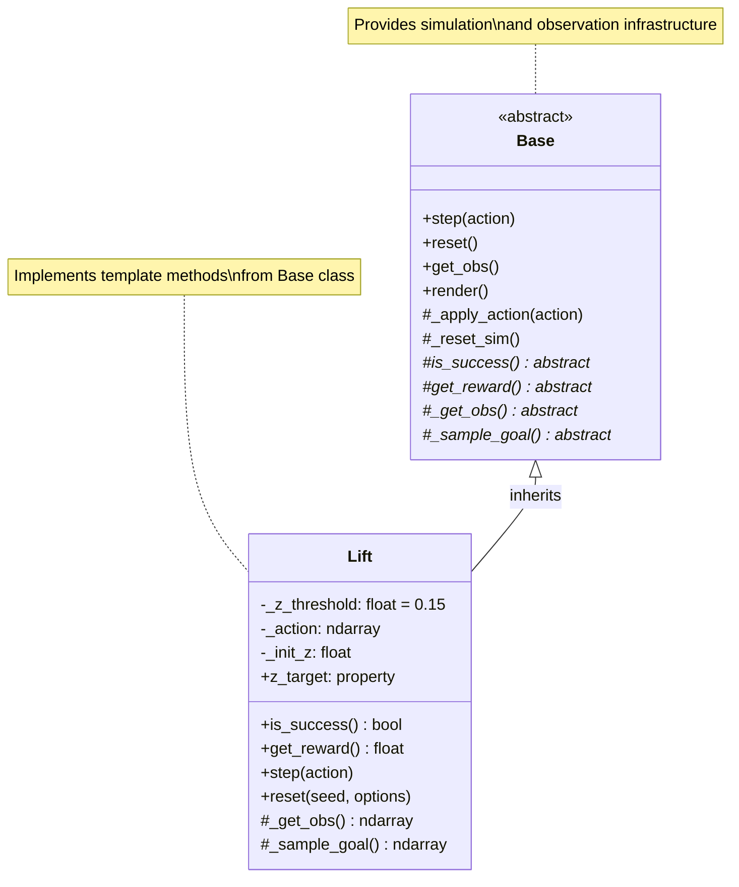
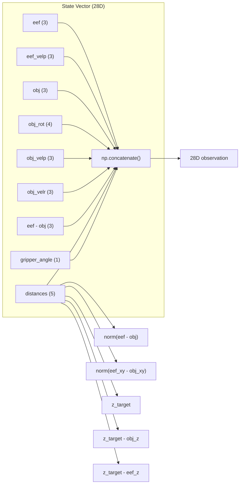
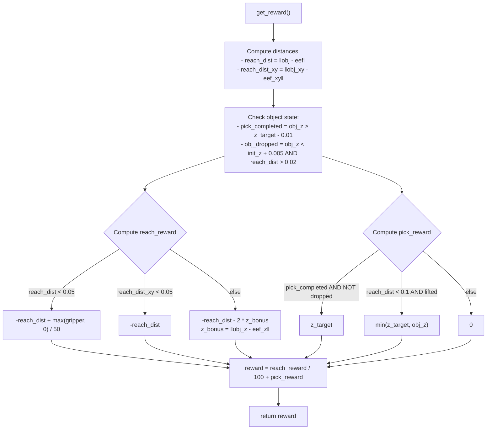
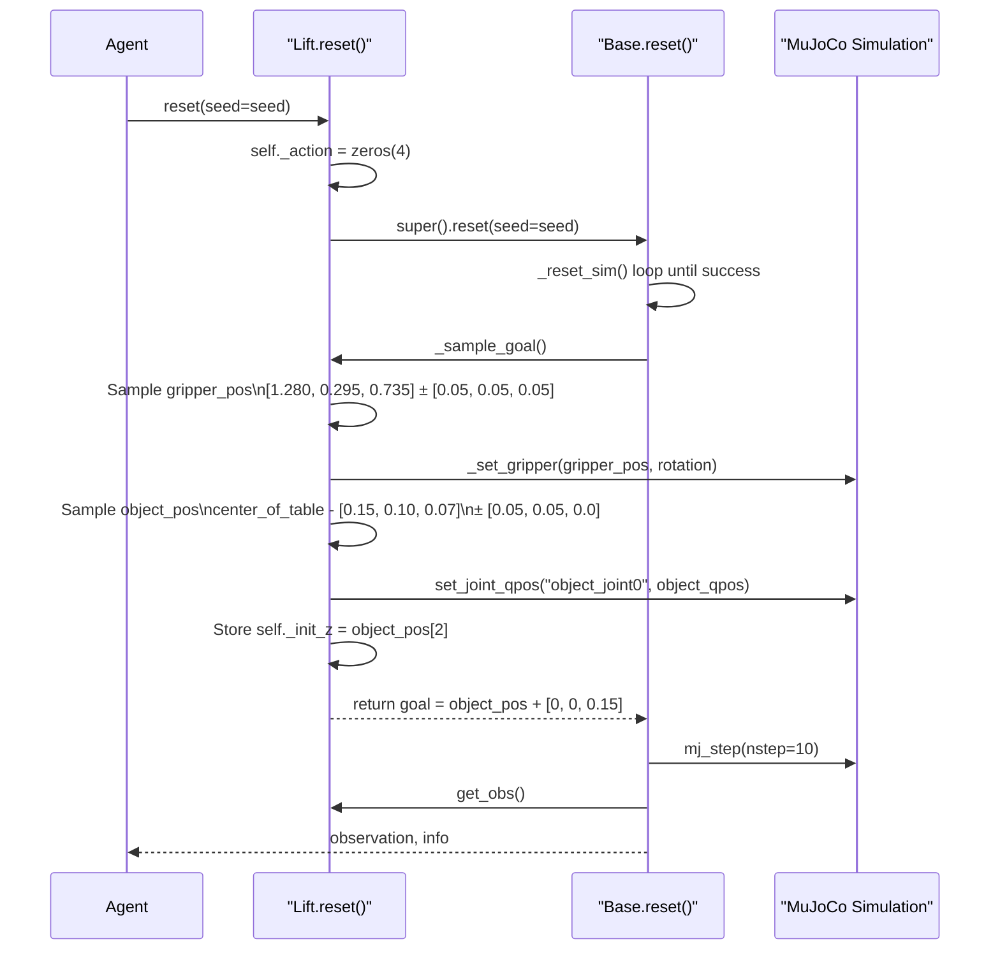

<!-- source: DeepWiki mcp.deepwiki.com · repo huggingface/gym-xarm · page 4.1 Lift Task · fetched 2026-10-26 -->

# Lift Task

<details>
<summary>Relevant source files</summary>

The following files were used as context for generating this wiki page:

- [gym_xarm/tasks/base.py](gym_xarm/tasks/base.py)
- [gym_xarm/tasks/lift.py](gym_xarm/tasks/lift.py)
- [gym_xarm/tasks/mocap.py](gym_xarm/tasks/mocap.py)

</details>


## Purpose and Scope

This page documents the **Lift task**, the primary and only active manipulation task in the gym-xarm environment. The Lift task requires the robot to grasp a cube from the table surface and lift it above a specified height threshold. This page covers the task-specific implementation including the observation space, reward function, success criteria, and initialization logic.

For general environment mechanics, simulation integration, and action processing shared across all tasks, see [Base Environment Class](#3.1). For information about creating new custom tasks, see [Creating Custom Tasks](#5.5). For deprecated task implementations, see [Deprecated Tasks](#4.2).

---

## Task Overview

The `Lift` class ([gym_xarm/tasks/lift.py:6-102]()) implements a manipulation task where the xArm robot must pick up a cube and lift it to a target height. The task is registered as `gym_xarm/XarmLift-v0` and represents the only actively maintained task implementation in the codebase.

### Task Goal

Lift a cube from the table surface to a height of `initial_z + 0.15` meters, where `initial_z` is the object's starting z-coordinate. The task terminates successfully when the cube's z-position exceeds this threshold.

### Task Metadata

```python
metadata = {
    "action_space": "xyzw",      # 4D action: x, y, z deltas + gripper
    "episode_length": 50,         # Maximum steps per episode
    "description": "Lift a cube above a height threshold"
}
```

**Sources:** [gym_xarm/tasks/lift.py:7-12]()

---

## Class Hierarchy and Method Overrides



The `Lift` class inherits from `Base` and implements the four abstract methods required by the template method pattern. The parent `Base` class handles all MuJoCo simulation, action processing via mocap, and observation rendering, while `Lift` provides task-specific logic.

**Sources:** [gym_xarm/tasks/lift.py:6-102](), [gym_xarm/tasks/base.py:18-335]()

---

## Action Space

The Lift task uses a 4-dimensional continuous action space defined as `"xyzw"`:

| Dimension | Range | Description |
|-----------|-------|-------------|
| 0 (x) | [-1.0, 1.0] | End-effector x-axis delta (relative to current position) |
| 1 (y) | [-1.0, 1.0] | End-effector y-axis delta (relative to current position) |
| 2 (z) | [-1.0, 1.0] | End-effector z-axis delta (relative to current position) |
| 3 (w) | [-1.0, 1.0] | Gripper control (-1 = open, +1 = close) |

Actions are processed by the `Base._apply_action()` method ([gym_xarm/tasks/base.py:293-306]()), which:
1. Limits gripper position to valid workspace bounds via `_limit_gripper()`
2. Scales position deltas by `1/n_substeps` (1/20)
3. Applies the action through the mocap control system

The `Lift` class overrides `step()` to track the current action in `self._action` for use in reward computation ([gym_xarm/tasks/lift.py:99-101]()).

**Sources:** [gym_xarm/tasks/lift.py:7-12,99-101](), [gym_xarm/tasks/base.py:74-75,293-306]()

---

## Observation Space

### State Vector Observation (28 dimensions)

When `obs_type="state"`, the `_get_obs()` method returns a 28-dimensional state vector composed of the following components:



#### State Vector Component Breakdown

| Components | Dimensions | Description | Source Property |
|------------|------------|-------------|-----------------|
| End-effector position | 3 | Gripper position relative to table center | `self.eef` |
| End-effector velocity | 3 | Gripper linear velocity (scaled by dt) | `self.eef_velp` |
| Object position | 3 | Cube position relative to table center | `self.obj` |
| Object rotation | 4 | Cube orientation (quaternion) | `self.obj_rot` |
| Object linear velocity | 3 | Cube linear velocity (scaled by dt) | `self.obj_velp` |
| Object angular velocity | 3 | Cube angular velocity (scaled by dt) | `self.obj_velr` |
| Relative position | 3 | Vector from object to end-effector | `self.eef - self.obj` |
| 3D distance | 1 | Euclidean distance between eef and object | `‖eef - obj‖` |
| XY distance | 1 | Horizontal distance (ignoring z) | `‖eef_xy - obj_xy‖` |
| Target height | 1 | Goal z-position for the object | `self.z_target` |
| Height deficit (object) | 1 | Remaining height for object to reach goal | `z_target - obj_z` |
| Height deficit (eef) | 1 | Remaining height for gripper to reach goal | `z_target - eef_z` |
| Gripper angle | 1 | Joint angle of right outer knuckle | `self.gripper_angle` |

All position and velocity measurements are relative to the `center_of_table` coordinate ([gym_xarm/tasks/base.py:50]()).

**Sources:** [gym_xarm/tasks/lift.py:50-72](), [gym_xarm/tasks/base.py:158-188]()

### Alternative Observation Types

The Lift task supports three observation modes inherited from the `Base` class:

- **`"state"`**: 28D state vector (described above)
- **`"pixels"`**: 84×84 RGB image from camera0
- **`"pixels_agent_pos"`**: Dictionary with `"pixels"` (84×84 RGB) and `"agent_pos"` (robot state: eef position + gripper angle)

See [Observation System](#3.4) for details on pixel-based observations.

**Sources:** [gym_xarm/tasks/base.py:245-259]()

---

## Reward Function

The reward function implements a composite approach that encourages both reaching the object and successfully picking it. The function is computed in `get_reward()` ([gym_xarm/tasks/lift.py:25-48]()).



### Reward Components

#### 1. Reach Reward (scaled by 1/100)

The reach component encourages the gripper to approach the object:

- **Close proximity** (`reach_dist < 0.05`): 
  - Base: `-reach_dist` (encourages closing distance)
  - Bonus: `+max(action[3], 0) / 50` (incentivizes closing gripper when near)
  
- **XY aligned** (`reach_dist_xy < 0.05` but `reach_dist ≥ 0.05`):
  - `-reach_dist` (gripper is horizontally aligned, encourage vertical approach)
  
- **Far from object** (otherwise):
  - `-reach_dist - 2 * ‖obj_z - eef_z‖` (penalize vertical misalignment more heavily)

#### 2. Pick Reward

The pick component rewards lifting the object:

- **Successful pick**: If `obj_z ≥ z_target - 0.01` and object hasn't dropped: `+z_target` (≈0.15)
  
- **Partial lift**: If `reach_dist < 0.1` and `obj_z > init_z + 0.005`: `+min(z_target, obj_z)` (proportional reward for partial lifting)
  
- **No lift**: Otherwise: `0`

#### Drop Detection

An object is considered "dropped" when:
- Object height drops below `init_z + 0.005`, AND
- Gripper is more than 0.02 away from object

When dropped, the pick reward becomes zero even if the object was previously at the target height.

**Sources:** [gym_xarm/tasks/lift.py:25-48]()

---

## Episode Initialization

### Reset Flow



### Randomization Details

The `_sample_goal()` method ([gym_xarm/tasks/lift.py:74-89]()) randomizes initial conditions each episode:

#### Gripper Initialization

```python
gripper_pos = [1.280, 0.295, 0.735] + uniform(-0.05, 0.05, size=3)
```

- **Nominal position**: Above and to the side of the cube
- **Randomization**: ±5cm in each axis (x, y, z)
- **Rotation**: Fixed to `self.gripper_rotation` (typically `[0, 1, 0, 0]`)

#### Object Initialization

```python
object_pos = center_of_table - [0.15, 0.10, 0.07]
object_pos[0] += uniform(-0.05, 0.05)  # x randomization
object_pos[1] += uniform(-0.05, 0.05)  # y randomization
# z is fixed (on table surface)
```

- **Nominal position**: Offset from table center
- **Randomization**: ±5cm in x and y only
- **Z-coordinate**: Fixed at table surface height, stored in `self._init_z`

#### Goal Definition

The method returns the goal position:
```python
goal = object_pos + [0, 0, self._z_threshold]  # object_pos + [0, 0, 0.15]
```

This goal is used to compute `self.z_target = self._init_z + 0.15`, the height threshold for success.

**Sources:** [gym_xarm/tasks/lift.py:74-89,91-97](), [gym_xarm/tasks/base.py:200-243]()

---

## Success Criteria

The task terminates when `is_success()` returns `True`, which occurs when:

```python
def is_success(self):
    return self.obj[2] >= self.z_target
```

**Success condition:** Object z-position ≥ initial z-position + 0.15 meters

The success check is performed at every step ([gym_xarm/tasks/base.py:269]()) and determines both:
- Episode termination (`terminated = is_success`)
- Info dictionary (`info["is_success"]`)

### Z-Threshold Property

The target height is accessible via the `z_target` property:

```python
@property
def z_target(self):
    return self._init_z + self._z_threshold  # init_z + 0.15
```

This property is also included in the observation vector at index 26, allowing the agent to observe the goal height.

**Sources:** [gym_xarm/tasks/lift.py:18-23](), [gym_xarm/tasks/base.py:261-273]()

---

## Task-Specific State Tracking

The `Lift` class maintains additional state beyond the parent `Base` class:

| Attribute | Type | Purpose | Initialized |
|-----------|------|---------|-------------|
| `_z_threshold` | `float` | Height threshold (0.15m) | Constructor ([lift.py:15]()) |
| `_init_z` | `float` | Initial object z-coordinate | `_sample_goal()` ([lift.py:86]()) |
| `_action` | `ndarray(4,)` | Last action taken | `reset()` and `step()` ([lift.py:96,100]()) |

### Action Tracking

The `_action` attribute stores the most recent action and is used in the reward function to provide a gripper-closing bonus:

```python
def step(self, action):
    self._action = action.copy()  # Store for reward computation
    return super().step(action)

def get_reward(self):
    # ...
    reach_reward = -reach_dist + max(self._action[-1], 0) / 50  # Use gripper action
```

This incentivizes closing the gripper (positive action[3]) when the gripper is near the object.

**Sources:** [gym_xarm/tasks/lift.py:14-16,25-48,86,91-101]()

---

## Integration with Base Class

The `Lift` class leverages extensive infrastructure from the `Base` class:

### Inherited Components

- **Simulation management**: MuJoCo model loading and stepping
- **Action processing**: `_apply_action()` with workspace limits via `_limit_gripper()`
- **Mocap control**: Action translation to physics via `mocap.apply_action()`
- **Observation rendering**: Dual renderer system for 84×84 observations and 680×680 visualization
- **Episode lifecycle**: `reset()` and `step()` orchestration

### Base Class Properties Used by Lift

The reward and observation functions extensively use properties defined in `Base`:

| Property | Returns | Source |
|----------|---------|--------|
| `self.eef` | End-effector position | [base.py:158-159]() |
| `self.eef_velp` | End-effector velocity | [base.py:162-163]() |
| `self.obj` | Object position | [base.py:174-175]() |
| `self.obj_rot` | Object rotation (quaternion) | [base.py:178-179]() |
| `self.obj_velp` | Object linear velocity | [base.py:182-183]() |
| `self.obj_velr` | Object angular velocity | [base.py:186-187]() |
| `self.gripper_angle` | Gripper joint angle | [base.py:166-167]() |
| `self.center_of_table` | Table center coordinate | [base.py:50]() |

All positions are relative to `center_of_table` for consistent coordinate frames.

**Sources:** [gym_xarm/tasks/base.py:18-335](), [gym_xarm/tasks/lift.py:6-102]()

---

## Usage Example

```python
import gymnasium as gym
import gym_xarm

# Create environment with state observations
env = gym.make("gym_xarm/XarmLift-v0", obs_type="state", render_mode="rgb_array")

# Reset returns 28D state vector
obs, info = env.reset(seed=42)
print(obs.shape)  # (28,)

# Run episode
for step in range(50):  # max_episode_steps = 50
    action = env.action_space.sample()  # Random [x, y, z, gripper]
    obs, reward, terminated, truncated, info = env.step(action)
    
    if terminated:
        print(f"Success! Lifted cube in {step + 1} steps")
        print(f"is_success: {info['is_success']}")
        break
        
env.close()
```

For pixel-based observations:
```python
env = gym.make("gym_xarm/XarmLift-v0", obs_type="pixels")
obs, info = env.reset()
print(obs.shape)  # (84, 84, 3)
```

**Sources:** [gym_xarm/tasks/lift.py:7-12](), [gym_xarm/tasks/base.py:35-79]()

---

