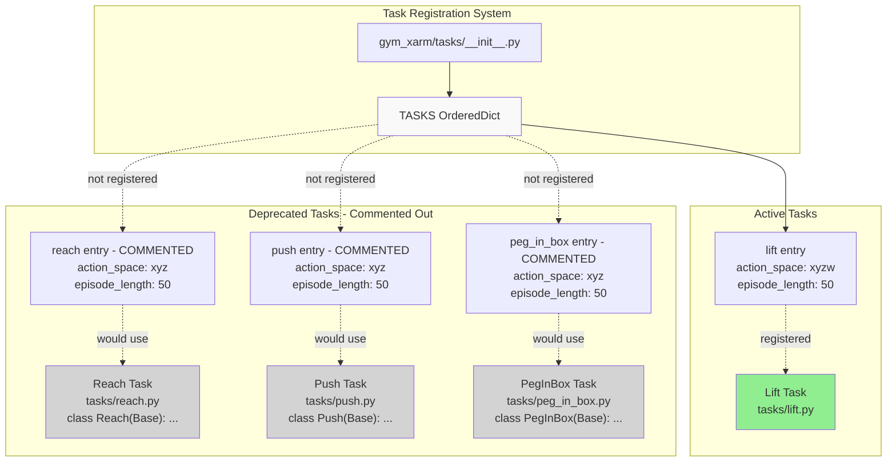
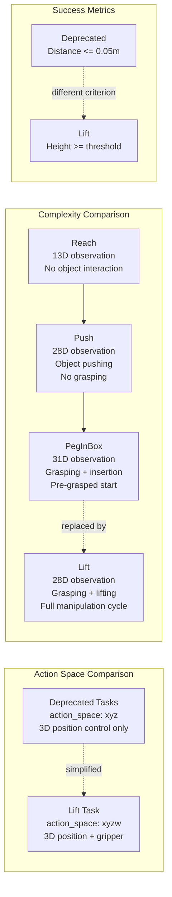
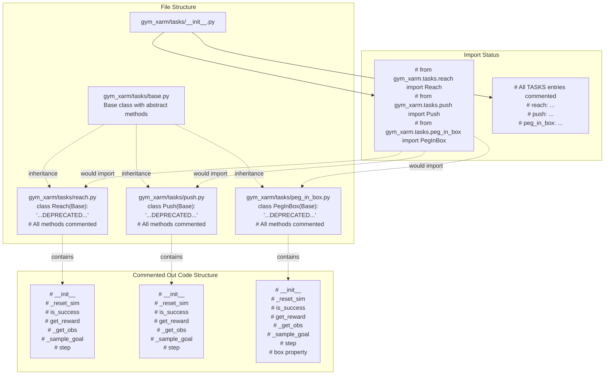

<!-- source: DeepWiki mcp.deepwiki.com · repo huggingface/gym-xarm · page 4.2 Deprecated Tasks · fetched 2026-10-26 -->

# Deprecated Tasks

<details>
<summary>Relevant source files</summary>

The following files were used as context for generating this wiki page:

- [gym_xarm/tasks/__init__.py](gym_xarm/tasks/__init__.py)
- [gym_xarm/tasks/peg_in_box.py](gym_xarm/tasks/peg_in_box.py)
- [gym_xarm/tasks/push.py](gym_xarm/tasks/push.py)
- [gym_xarm/tasks/reach.py](gym_xarm/tasks/reach.py)

</details>


## Purpose and Scope

This document provides reference documentation for the three deprecated manipulation tasks in gym-xarm: **Reach**, **Push**, and **PegInBox**. These tasks are no longer active and exist only as commented-out code for historical reference. All current development and usage should focus on the **Lift** task, documented in [Lift Task](#4.1).

This page explains what each deprecated task was designed to accomplish, their implementation details, and the rationale for deprecation. For information about creating new custom tasks, see [Creating Custom Tasks](#5.5).

---

## Overview

The gym-xarm repository contains three deprecated task implementations that are currently inactive and completely commented out in the codebase. These tasks represent earlier experimental manipulation objectives that have been consolidated in favor of the **Lift** task.

### Current Status

All deprecated tasks share the following characteristics:

- **Implementation Status**: All code is commented out; only class shells remain
- **Registry Status**: Not registered in the `TASKS` OrderedDict
- **Import Status**: Import statements are commented out in `gym_xarm/tasks/__init__.py`
- **Deprecation Notice**: Each class contains the docstring `"DEPRECATED: use only Lift for now"`

The deprecated tasks are:

| Task | File | Original Objective | Action Space | Episode Length |
|------|------|-------------------|--------------|----------------|
| **Reach** | `reach.py` | Move end-effector to target location | xyz (3D) | 50 steps |
| **Push** | `push.py` | Push cube to target location | xyz (3D) | 50 steps |
| **PegInBox** | `peg_in_box.py` | Insert peg into box | xyz (3D) | 50 steps |

**Sources:** [gym_xarm/tasks/__init__.py:1-50](), [gym_xarm/tasks/reach.py:1-9](), [gym_xarm/tasks/push.py:1-9](), [gym_xarm/tasks/peg_in_box.py:1-9]()

---

## Task Registry Structure



**Diagram:** Task registry showing active Lift task and commented-out deprecated tasks

**Sources:** [gym_xarm/tasks/__init__.py:1-50]()

---

## Deprecated Task Implementations

### Reach Task

The **Reach** task was the simplest manipulation task, requiring the robot to move its end-effector to a randomly sampled target location without gripper interaction.

#### Original Objective

Move the robot's end-effector (grasping point) to a target position in 3D space, marked by a visual target site in the MuJoCo simulation.

#### Success Criterion

```python
# From gym_xarm/tasks/reach.py:17-18 (commented out)
def is_success(self):
    return np.linalg.norm(self.eef - self.goal) <= 0.05
```

Success was defined as reaching within 5cm (0.05m) of the goal position using Euclidean distance.

#### Reward Function

```python
# From gym_xarm/tasks/reach.py:20-23 (commented out)
def get_reward(self):
    dist = np.linalg.norm(self.eef - self.goal)
    penalty = self._act_magnitude**2
    return -(dist + 0.15 * penalty)
```

The reward combined:
- **Distance component**: Negative Euclidean distance from end-effector to goal
- **Action penalty**: 0.15 × squared L2 norm of action magnitude to encourage efficiency

#### Observation Space

The Reach task used a **13-dimensional state observation** consisting of:

| Components | Dimensions | Description |
|------------|------------|-------------|
| End-effector position | 3 | Position relative to table center |
| End-effector velocity | 3 | Linear velocity scaled by `dt` |
| Goal position | 3 | Target position relative to table center |
| Relative vector | 3 | `eef - goal` |
| Distance scalar | 1 | L2 norm of `eef - goal` |
| Gripper angle | 1 | Right outer knuckle joint position |

#### Goal Sampling

```python
# From gym_xarm/tasks/reach.py:34-43 (commented out)
def _sample_goal(self):
    # Gripper
    gripper_pos = np.array([1.280, 0.295, 0.735]) + self.np_random.uniform(-0.05, 0.05, size=3)
    super()._set_gripper(gripper_pos, self.gripper_rotation)
    
    # Goal
    self.goal = np.array([1.550, 0.287, 0.580])
    self.goal[:2] += self.np_random.uniform(-0.125, 0.125, size=2)
    self.sim.model.site_pos[self.sim.model.site_name2id("target0")] = self.goal
    return self.goal
```

- **Gripper initialization**: Random position around `[1.280, 0.295, 0.735]` with ±0.05m variation
- **Target position**: Base position `[1.550, 0.287, 0.580]` with ±0.125m XY randomization
- **Visual marker**: Target rendered at `target0` site position

**Sources:** [gym_xarm/tasks/reach.py:1-48]()

---

### Push Task

The **Push** task required the robot to use its end-effector to push a cube from an initial position to a target location on the table surface.

#### Original Objective

Push a manipulable cube object to a randomly sampled goal position using the robot's end-effector. The robot must make contact with the cube and apply forces to move it.

#### Success Criterion

```python
# From gym_xarm/tasks/push.py:17-18 (commented out)
def is_success(self):
    return np.linalg.norm(self.obj - self.goal) <= 0.05
```

Success required positioning the cube within 5cm of the goal location.

#### Reward Function

```python
# From gym_xarm/tasks/push.py:20-23 (commented out)
def get_reward(self):
    dist = np.linalg.norm(self.obj - self.goal)
    penalty = self._act_magnitude**2
    return -(dist + 0.15 * penalty)
```

Identical structure to Reach task but measuring cube-to-goal distance instead of end-effector-to-goal distance:
- **Distance component**: Negative distance from cube to goal
- **Action penalty**: 0.15 × squared action magnitude

#### Observation Space

The Push task used a **28-dimensional state observation**:

| Components | Dimensions | Description |
|------------|------------|-------------|
| End-effector position | 3 | Position relative to table center |
| End-effector velocity | 3 | Linear velocity scaled by `dt` |
| Goal position | 3 | Target position relative to table center |
| Object position | 3 | Cube position relative to table center |
| Object rotation | 4 | Quaternion from `object_joint0` |
| Object linear velocity | 3 | Cube velocity scaled by `dt` |
| Object angular velocity | 3 | Cube angular velocity scaled by `dt` |
| `eef - goal` | 3 | End-effector to goal vector |
| `eef - obj` | 3 | End-effector to object vector |
| `obj - goal` | 3 | Object to goal vector |
| Distance scalars | 3 | L2 norms of above three vectors |
| Gripper angle | 1 | Right outer knuckle joint position |

This is significantly richer than Reach, including full object state and relative geometries.

#### Goal Sampling

```python
# From gym_xarm/tasks/push.py:60-77 (commented out)
def _sample_goal(self):
    # Gripper
    gripper_pos = np.array([1.280, 0.295, 0.735]) + self.np_random.uniform(-0.05, 0.05, size=3)
    super()._set_gripper(gripper_pos, self.gripper_rotation)
    
    # Object
    object_pos = self.center_of_table - np.array([0.25, 0, 0.07])
    object_pos[0] += self.np_random.uniform(-0.08, 0.08, size=1)
    object_pos[1] += self.np_random.uniform(-0.08, 0.08, size=1)
    object_qpos = self.sim.data.get_joint_qpos("object_joint0")
    object_qpos[:3] = object_pos
    self.sim.data.set_joint_qpos("object_joint0", object_qpos)
    
    # Goal
    self.goal = np.array([1.600, 0.200, 0.545])
    self.goal[:2] += self.np_random.uniform(-0.1, 0.1, size=2)
    self.sim.model.site_pos[self.sim.model.site_name2id("target0")] = self.goal
    return self.goal
```

- **Gripper**: Random around `[1.280, 0.295, 0.735]` ±0.05m
- **Object initial position**: Near table center minus `[0.25, 0, 0.07]` with ±0.08m XY variation
- **Goal position**: Base at `[1.600, 0.200, 0.545]` with ±0.1m XY randomization
- **Spatial layout**: Object starts on one side, goal on the other, requiring pushing motion

**Sources:** [gym_xarm/tasks/push.py:1-82]()

---

### PegInBox Task

The **PegInBox** task was the most complex deprecated task, requiring the robot to grasp a peg-shaped object and insert it into a box with appropriate positioning.

#### Original Objective

Grasp a peg object that starts in the gripper and precisely insert it into a box placed randomly on the table surface. This requires maintaining grasp while performing precise positioning.

#### Success Criterion

```python
# From gym_xarm/tasks/peg_in_box.py:24-25 (commented out)
def is_success(self):
    return np.linalg.norm(self.obj - self.box) <= 0.05
```

Success required positioning the peg within 5cm of the box center (accessed via `box_site`).

#### Reward Function

```python
# From gym_xarm/tasks/peg_in_box.py:27-30 (commented out)
def get_reward(self):
    dist_xy = np.linalg.norm(self.obj[:2] - self.box[:2])
    dist_xyz = np.linalg.norm(self.obj - self.box)
    return float(dist_xy <= 0.045) * (2 - 6 * dist_xyz) - 0.2 * np.square(self._act_magnitude) - dist_xy
```

This reward function was more sophisticated than Reach/Push:
- **XY alignment bonus**: If peg is within 4.5cm in XY plane, add `(2 - 6 × dist_xyz)` bonus
- **Action penalty**: 0.2 × squared action magnitude (higher penalty than other tasks)
- **XY distance penalty**: Negative XY distance to encourage horizontal alignment
- **Multi-stage incentive**: Rewards first getting XY alignment, then vertical insertion

#### Observation Space

The PegInBox task used a **31-dimensional state observation**:

| Components | Dimensions | Description |
|------------|------------|-------------|
| End-effector position | 3 | Position relative to table center |
| End-effector velocity | 3 | Linear velocity scaled by `dt` |
| Box position | 3 | Box center relative to table center |
| Object position | 3 | Peg position relative to table center |
| Object rotation | 4 | Quaternion from `object_joint0` |
| Object linear velocity | 3 | Peg velocity scaled by `dt` |
| Object angular velocity | 3 | Peg angular velocity scaled by `dt` |
| `eef - box` | 3 | End-effector to box vector |
| `eef - obj` | 3 | End-effector to peg vector |
| `obj - box` | 3 | Peg to box vector |
| Distance scalars | 3 | L2 norms of above three vectors |
| Gripper angle | 1 | Right outer knuckle joint position |

This is the richest observation space, including both object and target container state.

#### Goal Sampling

```python
# From gym_xarm/tasks/peg_in_box.py:67-85 (commented out)
def _sample_goal(self):
    # Gripper
    gripper_pos = np.array([1.280, 0.295, 0.9]) + self.np_random.uniform(-0.05, 0.05, size=3)
    super()._set_gripper(gripper_pos, self.gripper_rotation)
    
    # Object
    object_pos = gripper_pos - np.array([0, 0, 0.06]) + self.np_random.uniform(-0.005, 0.005, size=3)
    object_qpos = self.sim.data.get_joint_qpos("object_joint0")
    object_qpos[:3] = object_pos
    self.sim.data.set_joint_qpos("object_joint0", object_qpos)
    
    # Box
    box_pos = np.array([1.61, 0.18, 0.58])
    box_pos[:2] += self.np_random.uniform(-0.11, 0.11, size=2)
    box_qpos = self.sim.data.get_joint_qpos("box_joint0")
    box_qpos[:3] = box_pos
    self.sim.data.set_joint_qpos("box_joint0", box_qpos)
    
    return self.box
```

- **Gripper**: Random around `[1.280, 0.295, 0.9]` ±0.05m (higher Z than other tasks)
- **Peg initialization**: Positioned 6cm below gripper with minimal ±0.005m variation (pre-grasped)
- **Box position**: Base at `[1.61, 0.18, 0.58]` with ±0.11m XY randomization
- **Initial state**: Peg starts in gripper, requiring maintained grasp during insertion

#### Reset Behavior

```python
# From gym_xarm/tasks/peg_in_box.py:13-18 (commented out)
def _reset_sim(self):
    self._act_magnitude = 0
    super()._reset_sim()
    for _ in range(10):
        self._apply_action(np.array([0, 0, 0, 1], dtype=np.float32))
        self.sim.step()
```

PegInBox had a unique reset procedure: after calling the base reset, it executed 10 simulation steps with a neutral action `[0, 0, 0, 1]` to allow the gripper to settle around the peg before episode start.

**Sources:** [gym_xarm/tasks/peg_in_box.py:1-90]()

---

## Comparison with Active Tasks



**Diagram:** Comparison of deprecated tasks with the active Lift task

### Key Differences

| Aspect | Deprecated Tasks | Lift Task |
|--------|-----------------|-----------|
| **Action Space** | `xyz` (3D position only) | `xyzw` (3D position + gripper control) |
| **Gripper Control** | No direct gripper control | Explicit gripper open/close via `w` action |
| **Manipulation Cycle** | Simplified (reach/push) or pre-grasped (peg) | Full grasp-lift-release cycle |
| **Success Criterion** | Distance-based (≤0.05m) | Height-based (object Z ≥ threshold) |
| **Observation Dimensions** | 13D (Reach), 28D (Push), 31D (PegInBox) | 28D (same as Push) |
| **Reward Complexity** | Simple distance + penalty | Multi-component (reach, pick, height) |
| **Episode Length** | 50 steps | 50 steps |

The **Lift** task represents a consolidation of lessons learned from the deprecated tasks:
- **From Reach**: 3D position control and end-effector targeting
- **From Push**: Object state tracking and manipulation
- **From PegInBox**: Grasping mechanics (but without pre-grasping simplification)

The key advancement in Lift is the **explicit gripper control** via the `w` action dimension, enabling full pick-and-place manipulation that the deprecated tasks could not accomplish.

**Sources:** [gym_xarm/tasks/__init__.py:11-48]()

---

## Code Structure



**Diagram:** Code entity structure showing deprecated task files and their commented-out implementations

### Implementation Details

Each deprecated task file follows the same pattern:

1. **Minimal imports**: Only imports `Base` from `gym_xarm.tasks`
2. **Class declaration**: Inherits from `Base`
3. **Deprecation docstring**: `"DEPRECATED: use only Lift for now"`
4. **Ellipsis placeholder**: `...` as the only executable code
5. **Commented implementation**: All original methods preserved as comments

The commented-out implementations preserve:
- `__init__()`: Task name initialization
- `_reset_sim()`: Reset logic including action magnitude tracking
- `is_success()`: Success criterion based on distance metrics
- `get_reward()`: Reward function with distance and action penalties
- `_get_obs()`: Observation construction from simulation state
- `_sample_goal()`: Goal and initial state sampling
- `step()`: Action magnitude tracking (in Push and PegInBox)

**Sources:** [gym_xarm/tasks/reach.py:1-48](), [gym_xarm/tasks/push.py:1-82](), [gym_xarm/tasks/peg_in_box.py:1-90]()

---

## Historical Context and Rationale

### Deprecation Timeline

The deprecated tasks were commented out in favor of focusing development on the **Lift** task. The decision to deprecate rather than remove entirely preserves the implementation as reference documentation.

### Rationale for Deprecation

Several factors likely contributed to consolidating around the Lift task:

1. **Gripper Control Necessity**: The `xyz` action space used by deprecated tasks could not effectively control grasping. The Lift task's `xyzw` space enables full pick-and-place manipulation.

2. **Complexity vs. Capability Trade-off**:
   - **Reach**: Too simple for meaningful manipulation research
   - **Push**: Limited to contact-based manipulation without grasping
   - **PegInBox**: Complex but the pre-grasped initialization bypassed the grasping challenge
   - **Lift**: Balances complexity with a complete manipulation cycle

3. **Maintenance Burden**: Supporting four tasks requires maintaining:
   - Four observation implementations
   - Four reward functions
   - Four goal sampling procedures
   - Four sets of tests and documentation

4. **Research Focus**: The Lift task provides a canonical manipulation benchmark that aligns with standard robotics benchmarks (pick-and-place).

### Preservation as Comments

The implementations remain as comments rather than being deleted because:
- They serve as **implementation examples** for developers creating custom tasks
- They provide **historical context** for design decisions
- They demonstrate **different reward structures** and observation designs
- They can be **reactivated** if future development requires these tasks

**Sources:** [gym_xarm/tasks/__init__.py:1-50](), [gym_xarm/tasks/reach.py:6-7](), [gym_xarm/tasks/push.py:6-7](), [gym_xarm/tasks/peg_in_box.py:6-7]()

---

## Reactivation Procedure

If a developer needs to reactivate any deprecated task for experimental purposes, the procedure would be:

1. **Uncomment class implementation** in respective task file (`reach.py`, `push.py`, or `peg_in_box.py`)
2. **Uncomment import statement** in [gym_xarm/tasks/__init__.py:6-8]()
3. **Uncomment registry entry** in [gym_xarm/tasks/__init__.py:13-39]()
4. **Update MuJoCo XML model** if the task requires different objects/sites than Lift
5. **Test with `gymnasium.utils.env_checker`** to ensure API compliance
6. **Update documentation** to reflect the reactivated task

**Warning**: Reactivated tasks may require updates to work with current dependency versions, particularly for:
- MuJoCo API changes (data access patterns)
- Gymnasium API changes (observation/action space specifications)
- NumPy API changes (random number generation)

**Sources:** [gym_xarm/tasks/__init__.py:1-50]()

---

## Summary

The deprecated tasks (Reach, Push, PegInBox) represent evolutionary steps toward the current Lift task implementation. They are preserved as commented-out code for reference but are not active in the current release. All users and developers should use the **Lift** task documented in [Lift Task](#4.1) for robot manipulation research.

The consolidation around Lift provides:
- **Focused development effort** on a single, well-tested task
- **Complete manipulation cycle** with explicit gripper control
- **Standard benchmark** alignment with robotics research
- **Reduced maintenance burden** with fewer code paths

For developers interested in custom manipulation tasks, the deprecated implementations serve as valuable reference examples demonstrating different approaches to reward shaping, observation design, and goal sampling.

---

