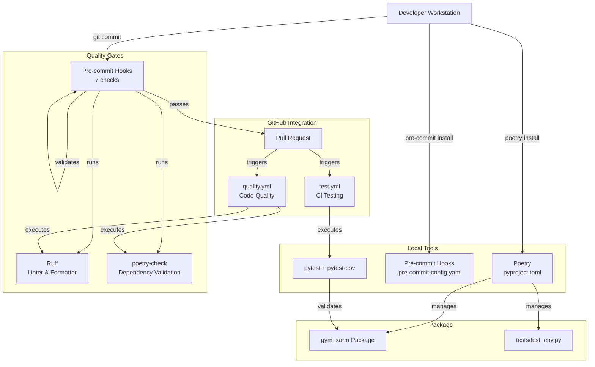
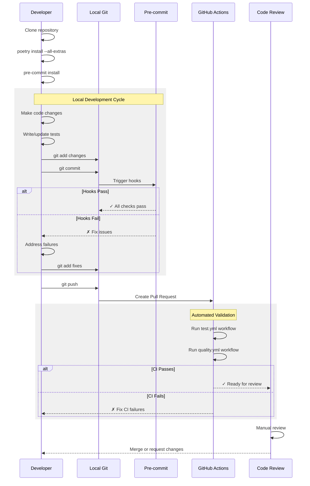
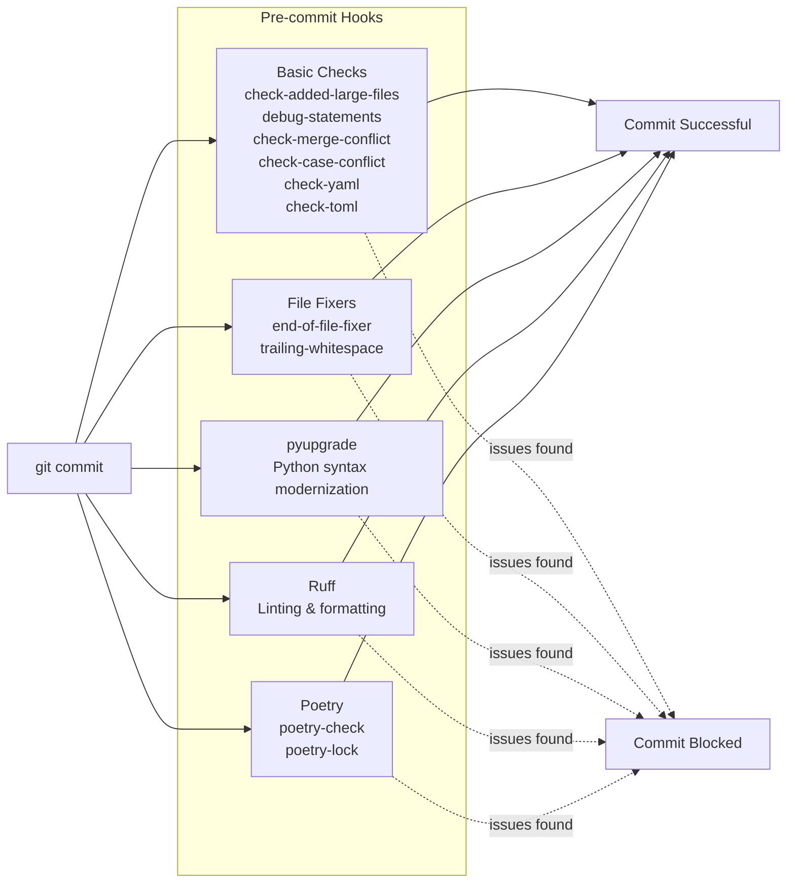
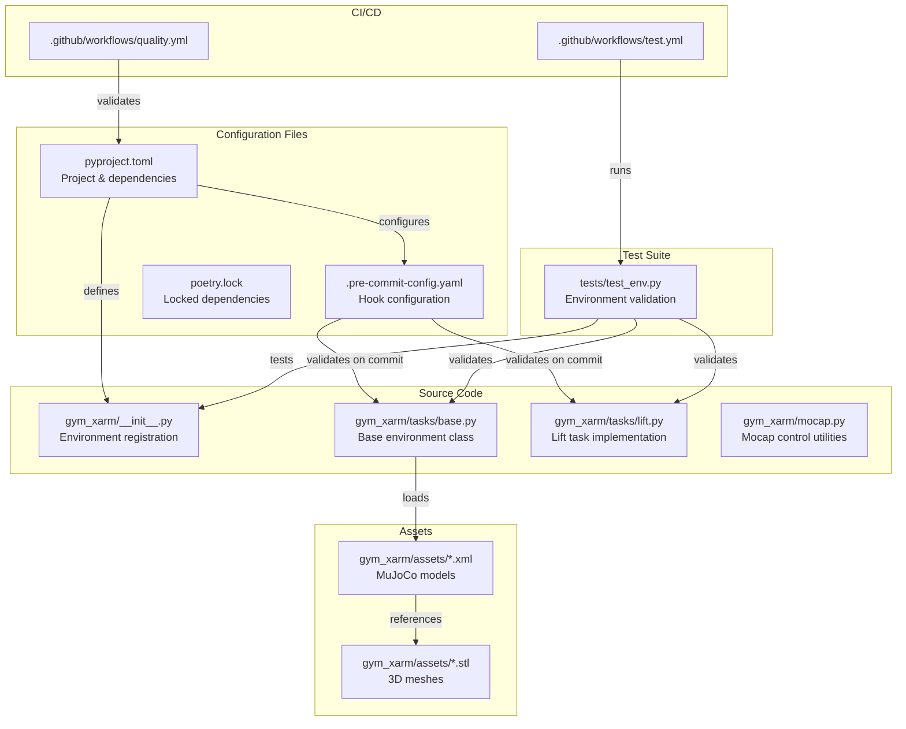
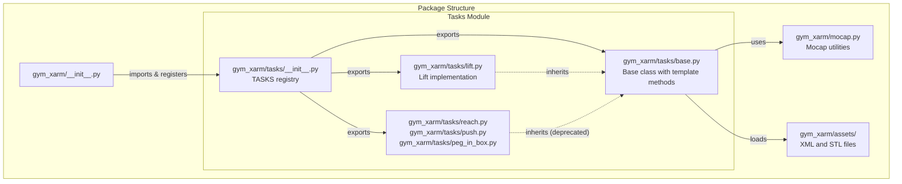

<!-- source: DeepWiki mcp.deepwiki.com · repo huggingface/gym-xarm · page 5 Development Guide · fetched 2026-10-26 -->

# Development Guide

<details>
<summary>Relevant source files</summary>

The following files were used as context for generating this wiki page:

- [.pre-commit-config.yaml](.pre-commit-config.yaml)
- [README.md](README.md)
- [example.py](example.py)
- [pyproject.toml](pyproject.toml)

</details>


This guide provides comprehensive documentation for developers who want to contribute to or extend gym-xarm. It covers the development ecosystem, tools, workflows, testing infrastructure, and guidelines for creating custom manipulation tasks.

For installation instructions for end users, see [Installation](#2.1). For information on using the environment in your research or applications, see [Getting Started](#2).

The sub-pages of this guide cover specific aspects of development:
- [Development Setup](#5.1) - Installing development dependencies and configuring your environment
- [Testing](#5.2) - Running and writing tests
- [CI/CD Workflows](#5.3) - Understanding automated checks
- [Code Quality Standards](#5.4) - Style guidelines and quality tools
- [Creating Custom Tasks](#5.5) - Extending the Base class with new manipulation tasks

## Development Ecosystem Overview

gym-xarm uses a modern Python development stack with automated quality assurance at multiple layers:



**Sources:** [pyproject.toml:1-77](), [.pre-commit-config.yaml:1-34](), [README.md:65-83]()

## Development Workflow

The typical development workflow follows this pattern:



**Sources:** [README.md:65-83](), [.pre-commit-config.yaml:1-34]()

## Core Development Tools

### Poetry - Dependency Management

Poetry is the primary dependency and package management tool. It uses [pyproject.toml:1-77]() to define all project metadata, dependencies, and build configuration.

| Configuration | Location | Purpose |
|---------------|----------|---------|
| Project metadata | [pyproject.toml:1-21]() | Name, version, authors, license |
| Runtime dependencies | [pyproject.toml:24-28]() | Core packages (mujoco, gymnasium) |
| Optional dependencies | [pyproject.toml:29-37]() | Dev tools (pre-commit, pytest) |
| Build configuration | [pyproject.toml:74-76]() | Poetry-core backend |

For detailed installation instructions, see [Development Setup](#5.1).

**Sources:** [pyproject.toml:1-77](), [README.md:67-73]()

### Pre-commit - Local Quality Gates

Pre-commit hooks run automatically on `git commit` to catch issues before they reach CI. The configuration in [.pre-commit-config.yaml:1-34]() defines seven hook categories:



Note that [example.py:1-16]() is explicitly excluded from checks via [.pre-commit-config.yaml:1]() and [pyproject.toml:44]() to allow simple demonstration code.

For details on code quality standards, see [Code Quality Standards](#5.4).

**Sources:** [.pre-commit-config.yaml:1-34](), [pyproject.toml:40-66]()

### Ruff - Linting and Formatting

Ruff provides fast linting and formatting. The configuration in [pyproject.toml:40-72]() specifies:

| Setting | Value | Purpose |
|---------|-------|---------|
| `line-length` | 110 | Maximum characters per line |
| `target-version` | py310 | Python 3.10 compatibility |
| `select` | E4, E7, E9, F, I, N, B, C4, SIM | Enabled rule categories |

Selected rule categories:
- **E4, E7, E9**: pycodestyle error checks
- **F**: Pyflakes (unused imports, undefined names)
- **I**: isort-style import sorting
- **N**: PEP 8 naming conventions
- **B**: flake8-bugbear (common bugs)
- **C4**: flake8-comprehensions
- **SIM**: flake8-simplify

**Sources:** [pyproject.toml:40-72](), [.pre-commit-config.yaml:21-26]()

### Pytest - Testing Framework

The test suite uses pytest with coverage reporting. Development dependencies include:

```toml
pytest = {version = ">=8.1.0", optional = true}
pytest-cov = {version = ">=5.0.0", optional = true}
```

Tests are defined in the `test` extras group and can be installed via:
```bash
poetry install --extras test
```

For comprehensive testing documentation, see [Testing](#5.2).

**Sources:** [pyproject.toml:31-32](), [pyproject.toml:35-37]()

## Quick Start for Contributors

### Initial Setup

```bash
# Clone the repository
git clone https://github.com/huggingface/gym-xarm.git
cd gym-xarm

# Install with all development dependencies
poetry install --all-extras

# Install pre-commit hooks
poetry run pre-commit install
```

### Development Commands

| Command | Purpose |
|---------|---------|
| `poetry run pytest` | Run test suite |
| `poetry run pytest --cov=gym_xarm` | Run tests with coverage |
| `poetry run pre-commit run --all-files` | Manually run all hooks |
| `poetry run ruff check .` | Check linting issues |
| `poetry run ruff format .` | Format code |
| `poetry check` | Validate pyproject.toml |

**Sources:** [README.md:65-83]()

## Key Files for Development



| File Type | Purpose | Key Examples |
|-----------|---------|--------------|
| Configuration | Project settings and tool configuration | `pyproject.toml`, `.pre-commit-config.yaml` |
| Source Code | Core environment implementation | `gym_xarm/tasks/base.py`, `gym_xarm/tasks/lift.py` |
| Tests | Validation and regression prevention | `tests/test_env.py` |
| Assets | Simulation models and meshes | `gym_xarm/assets/*.xml`, `gym_xarm/assets/*.stl` |
| CI/CD | Automated validation workflows | `.github/workflows/test.yml`, `.github/workflows/quality.yml` |

**Sources:** [pyproject.toml:1-77](), [.pre-commit-config.yaml:1-34]()

## Understanding the Development Architecture

### Code Organization



The codebase follows a template method pattern where:
1. **Base class** ([gym_xarm/tasks/base.py]()) provides all environment infrastructure
2. **Task classes** (e.g., [gym_xarm/tasks/lift.py]()) implement task-specific logic
3. **TASKS registry** ([gym_xarm/tasks/__init__.py]()) stores task configurations
4. **Package initialization** ([gym_xarm/__init__.py]()) registers environments with Gymnasium

For detailed architecture documentation, see [Core Architecture](#3).

**Sources:** [pyproject.toml:21]()

### Extension Points

The Base class defines abstract methods that custom tasks must implement:

| Method | Purpose | Return Type |
|--------|---------|-------------|
| `_get_obs()` | Generate task-specific observations | `dict` |
| `get_reward()` | Calculate reward for current state | `float` |
| `is_success()` | Determine if goal is achieved | `bool` |
| `_sample_goal()` | Sample initial goal state | `np.ndarray` |

For a complete guide on creating custom tasks, see [Creating Custom Tasks](#5.5).

**Sources:** [README.md:47-63]()

## CI/CD Integration

Automated workflows run on every pull request:

| Workflow | File | Triggers | Purpose |
|----------|------|----------|---------|
| Test | `.github/workflows/test.yml` | Push, PR | Run pytest suite, validate environments |
| Quality | `.github/workflows/quality.yml` | Push, PR | Run Ruff checks, poetry validation |

The workflows ensure that:
- All tests pass across multiple Python versions
- Code meets style standards
- Dependencies are properly locked
- Environment API compliance (via `gymnasium.utils.env_checker`)

For detailed CI/CD documentation, see [CI/CD Workflows](#5.3).

**Sources:** [.pre-commit-config.yaml:1-34]()

## Development Best Practices

### Before Making Changes

1. Create a feature branch from `main`
2. Ensure pre-commit hooks are installed: `poetry run pre-commit install`
3. Run existing tests to verify baseline: `poetry run pytest`

### During Development

1. Write tests for new functionality (see [Testing](#5.2))
2. Run tests frequently: `poetry run pytest tests/`
3. Let pre-commit hooks auto-fix issues on commit
4. If hooks fail, address issues before force-committing

### Before Submitting PR

1. Run full test suite: `poetry run pytest --cov=gym_xarm`
2. Manually run all pre-commit checks: `poetry run pre-commit run --all-files`
3. Verify poetry lock is up to date: `poetry check && poetry lock --check`
4. Test environment creation manually:
   ```python
   import gymnasium as gym
   import gym_xarm
   env = gym.make("gym_xarm/XarmLift-v0")
   ```

### Code Style Guidelines

- Follow PEP 8 naming conventions (enforced by Ruff N rules)
- Keep lines under 110 characters (configured in [pyproject.toml:41]())
- Use type hints where appropriate (Python 3.10+ syntax)
- Sort imports automatically (Ruff I rules)
- Avoid common bugs (Ruff B rules)
- Simplify code where possible (Ruff SIM rules)

For comprehensive code quality standards, see [Code Quality Standards](#5.4).

**Sources:** [pyproject.toml:40-72](), [.pre-commit-config.yaml:1-34]()

## Dependency Management

### Adding Dependencies

To add a new runtime dependency:
```bash
poetry add package-name
```

To add a development-only dependency:
```bash
poetry add --group dev package-name
```

To add an optional dependency (e.g., for extras):
```bash
poetry add --optional package-name
# Then add to [tool.poetry.extras] section
```

### Version Constraints

Current version constraints follow this pattern:
- **Caret (^)**: `^2.3.7` allows `>=2.3.7, <3.0.0` (recommended for stable packages)
- **Greater than or equal (≥)**: `>=0.29.1` allows any version `>=0.29.1` (used for fast-moving packages)

Example from [pyproject.toml:24-28]():
```toml
python = "^3.10"          # >=3.10, <4.0
mujoco = "^2.3.7"         # >=2.3.7, <3.0.0
gymnasium = ">=0.29.1"    # >=0.29.1 (no upper bound)
```

### Updating Dependencies

```bash
# Update all dependencies within constraints
poetry update

# Update specific package
poetry update package-name

# Update lock file without installing
poetry lock --no-update
```

For detailed dependency documentation, see [Dependencies and Requirements](#6).

**Sources:** [pyproject.toml:24-37]()

## Testing Strategy

The test suite validates three key aspects:

1. **API Compliance**: Gymnasium's `env_checker` validates standard interface
2. **Observation Types**: All three obs_type modes (`state`, `pixels`, `pixels_agent_pos`)
3. **Rendering Modes**: Both `rgb_array` and `human` render modes

Test execution matrix:

| Test | Validates | Coverage Target |
|------|-----------|-----------------|
| Environment creation | Registration & initialization | Core setup |
| Observation types | State, pixels, hybrid modes | Observation system |
| Rendering modes | rgb_array, human modes | Renderer system |
| Step mechanics | Action processing, rewards | Environment loop |
| Reset behavior | State initialization, goal sampling | Episode management |

For complete testing documentation, see [Testing](#5.2).

**Sources:** [pyproject.toml:31-32]()

## Next Steps

To continue with specific development tasks:

- **Setting up your environment**: See [Development Setup](#5.1)
- **Running tests**: See [Testing](#5.2)
- **Understanding CI failures**: See [CI/CD Workflows](#5.3)
- **Meeting code standards**: See [Code Quality Standards](#5.4)
- **Creating new tasks**: See [Creating Custom Tasks](#5.5)

For understanding the codebase architecture:
- **Base environment class**: See [Base Environment Class](#3.1)
- **Task system design**: See [Task System](#3.2)
- **MuJoCo integration**: See [MuJoCo Integration](#3.3)

**Sources:** [README.md:1-94](), [pyproject.toml:1-77](), [.pre-commit-config.yaml:1-34]()

---

