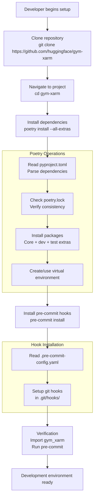
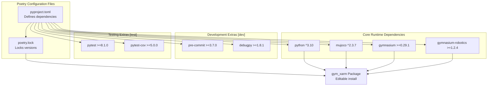
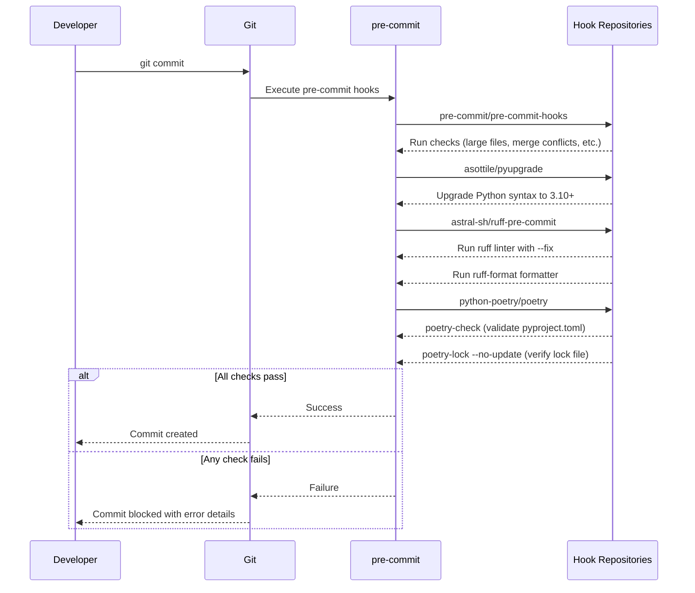
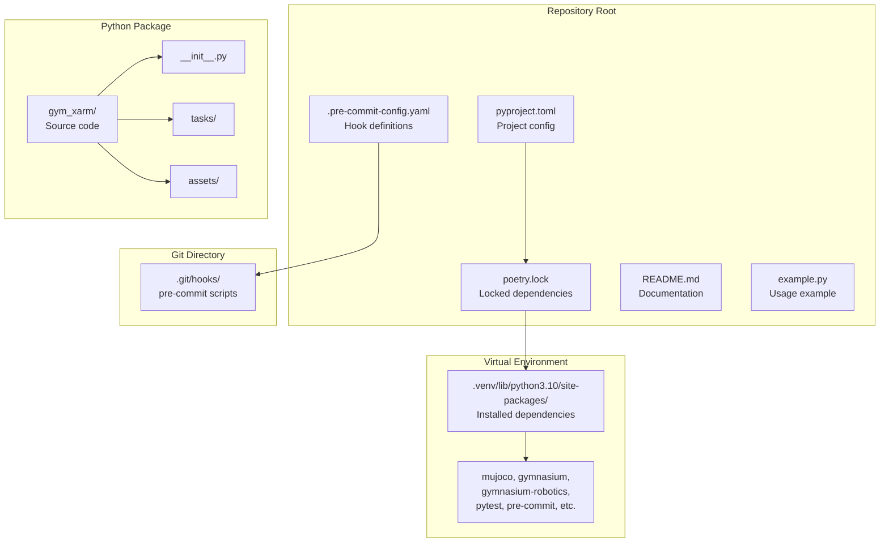

<!-- source: DeepWiki mcp.deepwiki.com · repo huggingface/gym-xarm · page 5.1 Development Setup · fetched 2026-10-26 -->

# Development Setup

<details>
<summary>Relevant source files</summary>

The following files were used as context for generating this wiki page:

- [.pre-commit-config.yaml](.pre-commit-config.yaml)
- [README.md](README.md)
- [example.py](example.py)
- [poetry.lock](poetry.lock)
- [pyproject.toml](pyproject.toml)

</details>


## Purpose and Scope

This page provides instructions for setting up a development environment for gym-xarm. It covers installing the project with Poetry, configuring development dependencies, and enabling pre-commit hooks for code quality enforcement. For information about running tests, see [Testing](#5.2). For details on CI/CD workflows and automated checks, see [CI/CD Workflows](#5.3). For code quality standards and tools, see [Code Quality Standards](#5.4).

---

## Prerequisites

Development work on gym-xarm requires:

| Requirement | Version | Purpose |
|------------|---------|---------|
| Python | `^3.10` | Core language requirement |
| Poetry | `>=1.8.0` | Dependency management and packaging |
| Git | Any recent version | Version control and pre-commit hooks |

**Installing Poetry**: If Poetry is not installed, follow the [official installation instructions](https://python-poetry.org/docs/#installation). The recommended method is:

```bash
curl -sSL https://install.python-poetry.org | python3 -
```

**Python Environment**: Create and activate a Python 3.10 virtual environment before proceeding. Using conda:

```bash
conda create -y -n xarm-dev python=3.10
conda activate xarm-dev
```

Sources: [README.md:10-13](), [pyproject.toml:25]()

---

## Development Installation Workflow

The following diagram illustrates the complete development setup process from repository cloning to verification:



Sources: [README.md:67-83](), [pyproject.toml:1-77](), [.pre-commit-config.yaml:1-34]()

---

## Installation Steps

### 1. Clone the Repository

```bash
git clone https://github.com/huggingface/gym-xarm
cd gym-xarm
```

### 2. Install Dependencies with Poetry

Install the project with all development extras:

```bash
poetry install --all-extras
```

This command:
- Reads [pyproject.toml:1-77]() to determine dependencies
- Verifies consistency with [poetry.lock:1-end]()
- Creates or uses an existing virtual environment
- Installs runtime dependencies: `mujoco`, `gymnasium`, `gymnasium-robotics`
- Installs development extras: `pre-commit`, `debugpy`
- Installs test extras: `pytest`, `pytest-cov`
- Installs the `gym_xarm` package in editable mode

**Alternative Installation Methods**:

Install only core dependencies (no dev tools):
```bash
poetry install
```

Install with specific extras:
```bash
poetry install --extras dev    # Only development tools
poetry install --extras test   # Only testing tools
```

### 3. Configure Pre-commit Hooks

Install pre-commit hooks to enforce code quality on every commit:

```bash
pre-commit install
```

This configures Git hooks in `.git/hooks/` to automatically run checks before commits. The hooks are defined in [.pre-commit-config.yaml:1-34]().

Sources: [README.md:70-83](), [pyproject.toml:24-38]()

---

## Development Dependencies Architecture

The following diagram shows the dependency structure defined in `pyproject.toml` and how different extras groups relate:



Sources: [pyproject.toml:24-38]()

### Core Runtime Dependencies

These dependencies are always installed:

| Package | Version Constraint | Purpose |
|---------|-------------------|---------|
| `python` | `^3.10` | Base language runtime |
| `mujoco` | `^2.3.7` | Physics simulation engine |
| `gymnasium` | `>=0.29.1` | RL environment API |
| `gymnasium-robotics` | `>=1.2.4` | Robotics environment extensions |

Sources: [pyproject.toml:24-28]()

### Development Extras (`--extras dev`)

Optional dependencies for development:

| Package | Version Constraint | Purpose |
|---------|-------------------|---------|
| `pre-commit` | `>=3.7.0` | Git hook management for code quality |
| `debugpy` | `>=1.8.1` | Python debugging adapter (VS Code, etc.) |

Sources: [pyproject.toml:29-30](), [pyproject.toml:36]()

### Testing Extras (`--extras test`)

Optional dependencies for running tests:

| Package | Version Constraint | Purpose |
|---------|-------------------|---------|
| `pytest` | `>=8.1.0` | Test framework |
| `pytest-cov` | `>=5.0.0` | Coverage reporting plugin |

Sources: [pyproject.toml:31-32](), [pyproject.toml:37]()

---

## Pre-commit Hook Configuration

The [.pre-commit-config.yaml:1-34]() file defines automated code quality checks that run before each commit.

### Pre-commit Hook Execution Flow



Sources: [.pre-commit-config.yaml:1-34]()

### Hook Repositories and Checks

The following table details each pre-commit hook repository and its purpose:

| Repository | Version | Hooks | Purpose |
|-----------|---------|-------|---------|
| `pre-commit/pre-commit-hooks` | v4.6.0 | `check-added-large-files`<br/>`debug-statements`<br/>`check-merge-conflict`<br/>`check-case-conflict`<br/>`check-yaml`<br/>`check-toml`<br/>`end-of-file-fixer`<br/>`trailing-whitespace` | General code hygiene checks |
| `asottile/pyupgrade` | v3.15.2 | `pyupgrade` | Modernize Python syntax to 3.10+ |
| `astral-sh/ruff-pre-commit` | v0.4.3 | `ruff`<br/>`ruff-format` | Fast Python linter and formatter |
| `python-poetry/poetry` | 1.8.0 | `poetry-check`<br/>`poetry-lock` | Validate Poetry configuration |

Sources: [.pre-commit-config.yaml:4-33]()

### Configuration Details

**Python Version**: [.pre-commit-config.yaml:2-3]()
```yaml
default_language_version:
    python: python3.10
```

**Exclusions**: [.pre-commit-config.yaml:1]()
```yaml
exclude: ^(example.py)
```
The `example.py` file is excluded from pre-commit checks.

**Ruff Arguments**: [.pre-commit-config.yaml:24-26]()
```yaml
- id: ruff
  args: [--fix]  # Automatically fix issues
```

**Poetry Lock Arguments**: [.pre-commit-config.yaml:31-33]()
```yaml
- id: poetry-lock
  args:
    - "--no-update"  # Verify lock file without updating dependencies
```

Sources: [.pre-commit-config.yaml:1-34]()

---

## Manual Pre-commit Execution

Run pre-commit hooks manually without committing:

```bash
# Run on all staged files
pre-commit

# Run on all files in repository
pre-commit run --all-files

# Run specific hook
pre-commit run ruff --all-files
pre-commit run poetry-check
```

**First-time Execution**: The first run will download and cache hook dependencies, which may take a few moments.

Sources: [README.md:77-83]()

---

## Verification Steps

After installation, verify the development environment is configured correctly:

### 1. Verify Python Package Installation

```bash
# Activate the Poetry-managed virtual environment
poetry shell

# Import and check gym_xarm
python -c "import gym_xarm; print('gym_xarm imported successfully')"

# Verify environment registration
python -c "import gymnasium as gym; env = gym.make('gym_xarm/XarmLift-v0'); print('Environment created successfully')"
```

### 2. Verify Pre-commit Hooks

```bash
# Test hook execution without making a commit
pre-commit run --all-files
```

Expected output includes:
- ✅ All checks passing (green checkmarks)
- ⚠️ Files modified by auto-formatters (ruff-format)
- ❌ Any errors that need manual fixing

### 3. Run Example Script

```bash
# Run the example with human rendering
MUJOCO_GL=glfw python example.py
```

This verifies:
- MuJoCo rendering works
- Environment can be created and stepped
- Action space sampling functions correctly

Sources: [README.md:42-45](), [example.py:1-16]()

---

## Development Environment Structure

The following diagram illustrates the file structure and how development tools interact:



Sources: [pyproject.toml:1-77](), [.pre-commit-config.yaml:1-34]()

---

## Common Development Commands

| Command | Purpose |
|---------|---------|
| `poetry shell` | Activate the virtual environment |
| `poetry install --all-extras` | Install/update all dependencies |
| `poetry add <package>` | Add a new runtime dependency |
| `poetry add --group dev <package>` | Add a new development dependency |
| `poetry update` | Update dependencies within version constraints |
| `poetry show` | List installed packages |
| `poetry run python <script>` | Run Python script in Poetry environment |
| `pre-commit run --all-files` | Run all pre-commit hooks |
| `pre-commit autoupdate` | Update hook versions in config |

Sources: [pyproject.toml:24-38](), [.pre-commit-config.yaml:1-34]()

---

## Troubleshooting

### Poetry Installation Issues

**Problem**: `poetry: command not found`

**Solution**: Ensure Poetry's bin directory is in your PATH. Add to `~/.bashrc` or `~/.zshrc`:
```bash
export PATH="$HOME/.local/bin:$PATH"
```

### Pre-commit Hook Failures

**Problem**: Pre-commit hooks fail with `poetry-lock` errors

**Solution**: The lock file may be out of sync with `pyproject.toml`. Update it:
```bash
poetry lock --no-update
```

**Problem**: Ruff reports unfixable issues

**Solution**: Review the output and manually fix the reported issues. Common issues include:
- Unused imports (remove them)
- Undefined names (fix typos or add imports)
- Line length violations (split long lines)

### MuJoCo Rendering Issues

**Problem**: `GLEW initialization error` when running examples

**Solution**: Set the MuJoCo GL backend environment variable:
```bash
export MUJOCO_GL=glfw
```

Sources: [README.md:42-45](), [.pre-commit-config.yaml:1-34]()

---

## Next Steps

After setting up your development environment:

1. **Run Tests**: See [Testing](#5.2) to learn how to run the test suite
2. **Understand CI/CD**: See [CI/CD Workflows](#5.3) for automated checks on pull requests
3. **Follow Code Standards**: See [Code Quality Standards](#5.4) for detailed style guidelines
4. **Create Custom Tasks**: See [Creating Custom Tasks](#5.5) to extend gym-xarm with new manipulation tasks

Sources: [README.md:1-94](), [pyproject.toml:1-77]()

---

