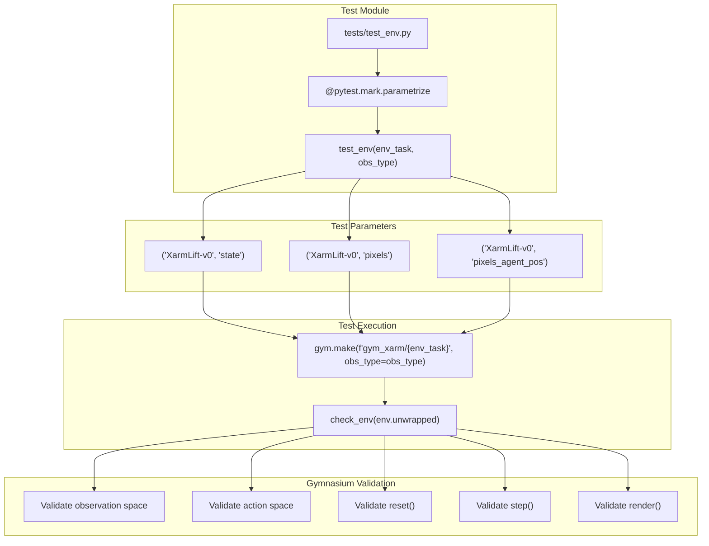
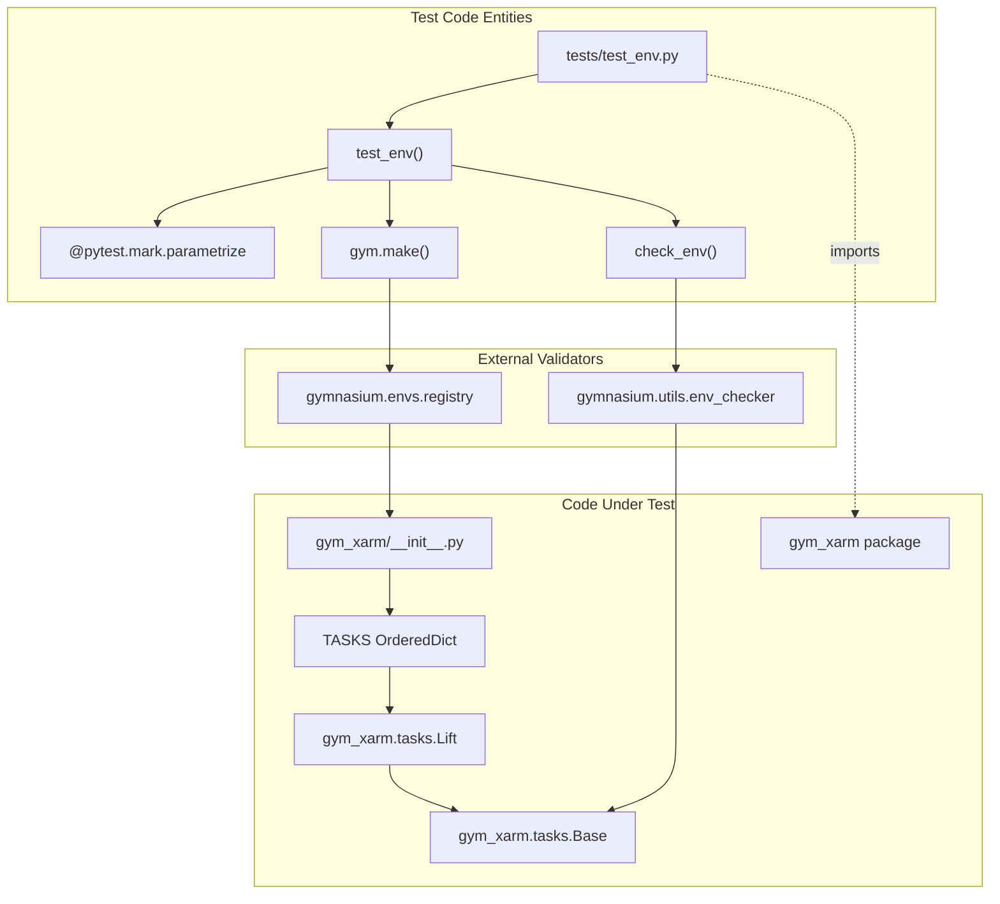

<!-- source: DeepWiki mcp.deepwiki.com · repo huggingface/gym-xarm · page 5.2 Testing · fetched 2026-10-26 -->

# Testing

<details>
<summary>Relevant source files</summary>

The following files were used as context for generating this wiki page:

- [.github/workflows/test.yml](.github/workflows/test.yml)
- [tests/test_env.py](tests/test_env.py)

</details>


## Purpose and Scope

This document covers the testing infrastructure for gym-xarm, including how to run tests locally, what is tested, test organization, and how to write new tests. For information about automated testing in GitHub Actions CI/CD pipelines, see [CI/CD Workflows](#5.3). For information about code quality tools and linting, see [Code Quality Standards](#5.4).

The testing strategy for gym-xarm focuses on ensuring Gymnasium API compliance across all observation types, validating that environments can be successfully instantiated, reset, and stepped through episodes.

## Test Infrastructure

The gym-xarm test suite uses the following components:

| Component | Purpose | Version Constraint |
|-----------|---------|-------------------|
| `pytest` | Test runner and framework | Development dependency |
| `pytest-cov` | Code coverage measurement | Development dependency |
| `gymnasium.utils.env_checker` | Validates Gymnasium API compliance | From gymnasium package |
| `pytest.mark.parametrize` | Enables testing multiple configurations | Built-in pytest feature |

The test infrastructure leverages Gymnasium's own validation utilities to ensure that gym-xarm environments properly implement the standard Gymnasium API. The `check_env` function from `gymnasium.utils.env_checker` performs comprehensive validation including:

- Observation space consistency
- Action space validation
- Reset functionality
- Step functionality
- Rendering capabilities
- Info dictionary structure

**Sources:** [tests/test_env.py:1-19](), [.github/workflows/test.yml:1-54]()

## Running Tests

### Local Execution

To run the full test suite locally:

```bash
# Run all tests with verbose output and coverage
pytest tests -v --cov=./gym_xarm --durations=0

# Run tests without coverage
pytest tests -v

# Run specific test file
pytest tests/test_env.py -v

# Run tests for specific observation type
pytest tests/test_env.py -v -k "pixels"
```

**Environment Variables:**

The `MUJOCO_GL` environment variable must be set to specify the OpenGL rendering backend:

```bash
# For headless environments (CI, servers)
export MUJOCO_GL=egl

# For systems with display
export MUJOCO_GL=glfw

# Run tests with environment variable inline
MUJOCO_GL=egl pytest tests -v
```

The `egl` backend is used in CI environments and requires EGL libraries to be installed. On Ubuntu/Debian systems:

```bash
sudo apt-get install -y libegl1-mesa-dev
```

**Coverage Options:**

The `--cov=./gym_xarm` flag generates coverage reports for the gym_xarm package. The `--durations=0` flag shows execution time for all tests, helping identify slow tests.

**Sources:** [.github/workflows/test.yml:28-53](), [tests/test_env.py:1-19]()

### CI Execution

Tests are automatically executed in GitHub Actions when code is pushed or pull requests are created. See [CI/CD Workflows](#5.3) for details about the automated testing pipeline.

## Test Suite Organization

The test suite is organized as follows:

```
tests/
├── test_env.py          # Main environment tests
└── data/                # Test data directory (if needed)
```

Currently, the test suite consists of a single test module `test_env.py` that performs parametrized testing across multiple environment configurations.

**Sources:** [tests/test_env.py:1-19](), [.github/workflows/test.yml:28]()

## Test Structure and Parametrization



**Diagram:** Test execution flow showing parametrization and validation

The test suite uses pytest's parametrization feature to test multiple environment configurations with a single test function. The parametrization is defined at [tests/test_env.py:8-14]():

```python
@pytest.mark.parametrize(
    "env_task, obs_type",
    [
        ("XarmLift-v0", "state"),
        ("XarmLift-v0", "pixels"),
        ("XarmLift-v0", "pixels_agent_pos"),
    ],
)
```

This creates three separate test cases, one for each observation type.

**Sources:** [tests/test_env.py:8-19]()

## What Is Tested

The test suite validates the following:

| Test Case | Environment | Observation Type | Purpose |
|-----------|-------------|------------------|---------|
| `test_env[XarmLift-v0-state]` | XarmLift-v0 | `state` | Validates 28-dimensional state vector observation |
| `test_env[XarmLift-v0-pixels]` | XarmLift-v0 | `pixels` | Validates 84×84 RGB image observation |
| `test_env[XarmLift-v0-pixels_agent_pos]` | XarmLift-v0 | `pixels_agent_pos` | Validates hybrid observation (pixels + robot state) |

Each test case performs the following validations through `gymnasium.utils.env_checker.check_env`:

1. **Environment Instantiation:** Verifies the environment can be created with specified parameters
2. **Observation Space Consistency:** Ensures observations match the declared observation space
3. **Action Space Validation:** Verifies actions are properly validated against the action space
4. **Reset Functionality:** Confirms `reset()` returns valid observations and info dictionaries
5. **Step Functionality:** Ensures `step()` returns the correct tuple structure and valid values
6. **Rendering:** Validates rendering capabilities match the declared render modes
7. **Info Dictionary:** Checks that info dictionaries contain expected keys and value types

The test implementation at [tests/test_env.py:16-18]() is deliberately simple:

```python
def test_env(env_task, obs_type):
    env = gym.make(f"gym_xarm/{env_task}", obs_type=obs_type)
    check_env(env.unwrapped)
```

This leverages Gymnasium's comprehensive validation rather than implementing custom checks, ensuring consistency with Gymnasium standards.

**Sources:** [tests/test_env.py:8-19]()

## Code Entity Mapping



**Diagram:** Mapping between test code entities and production code entities

**Sources:** [tests/test_env.py:1-19]()

## Writing New Tests

### Adding Test Cases for New Tasks

When a new task is added to gym-xarm, add it to the parametrization list:

```python
@pytest.mark.parametrize(
    "env_task, obs_type",
    [
        ("XarmLift-v0", "state"),
        ("XarmLift-v0", "pixels"),
        ("XarmLift-v0", "pixels_agent_pos"),
        # Add new task:
        ("XarmNewTask-v0", "state"),
        ("XarmNewTask-v0", "pixels"),
        ("XarmNewTask-v0", "pixels_agent_pos"),
    ],
)
```

### Adding Test Cases for New Observation Types

If a new observation type is added, add test cases for all tasks:

```python
@pytest.mark.parametrize(
    "env_task, obs_type",
    [
        ("XarmLift-v0", "state"),
        ("XarmLift-v0", "pixels"),
        ("XarmLift-v0", "pixels_agent_pos"),
        ("XarmLift-v0", "new_obs_type"),  # Add for existing tasks
    ],
)
```

### Testing Task-Specific Functionality

For task-specific tests that go beyond API compliance, create additional test functions:

```python
def test_lift_reward_function():
    """Test Lift task reward calculation."""
    env = gym.make("gym_xarm/XarmLift-v0", obs_type="state")
    env.reset()
    # Test reward calculation logic
    obs, reward, terminated, truncated, info = env.step(env.action_space.sample())
    assert isinstance(reward, float)
    assert -1.0 <= reward <= 0.0  # Lift uses negative distance rewards

def test_lift_success_criterion():
    """Test Lift task success detection."""
    env = gym.make("gym_xarm/XarmLift-v0", obs_type="state")
    env.reset()
    # Test success conditions
    # ...
```

### Best Practices

1. **Import gym_xarm:** Always import `gym_xarm` (even if not directly used) to ensure environment registration: [tests/test_env.py:5]()
2. **Use parametrization:** Leverage `@pytest.mark.parametrize` to test multiple configurations without duplicating code
3. **Test unwrapped environments:** Pass `env.unwrapped` to `check_env` to validate the actual environment class rather than wrappers
4. **Set MUJOCO_GL:** Always set the `MUJOCO_GL` environment variable when running tests locally
5. **Use verbose mode:** Run tests with `-v` flag to see which specific parameter combinations pass or fail
6. **Check coverage:** Use `--cov` to ensure new code is tested

**Sources:** [tests/test_env.py:1-19]()

## Test Coverage

The current test suite provides:

**Covered:**
- ✓ Environment registration and instantiation
- ✓ All three observation types (`state`, `pixels`, `pixels_agent_pos`)
- ✓ Gymnasium API compliance
- ✓ Reset and step functionality
- ✓ Observation space consistency
- ✓ Action space validation
- ✓ Rendering capabilities

**Potential Coverage Gaps:**
- Task-specific reward function correctness
- Task-specific success criterion logic
- Edge cases in action limiting ([gym_xarm/tasks.py]() `_limit_gripper` method)
- Mocap control system behavior
- Goal sampling distributions
- Collision detection and handling
- Multi-episode stability

To check current coverage:

```bash
# Generate coverage report
pytest tests -v --cov=./gym_xarm --cov-report=html

# View HTML report
open htmlcov/index.html
```

The coverage report shows which lines of code in the `gym_xarm` package are executed during testing, helping identify untested code paths.

**Sources:** [.github/workflows/test.yml:51-53](), [tests/test_env.py:1-19]()

## Test Execution in CI

The test workflow is automatically triggered on:

- Pull requests to `main` branch affecting:
  - `gym_xarm/**`
  - `tests/**`
  - `examples.py`
  - `.github/**`
  - `poetry.lock`

- Pushes to `main` branch affecting the same paths

The CI environment is configured at [.github/workflows/test.yml:27-29]():
- `DATA_DIR: tests/data`
- `MUJOCO_GL: egl`

CI-specific setup includes:
1. EGL library installation ([.github/workflows/test.yml:33-34]())
2. Poetry installation and configuration ([.github/workflows/test.yml:36-39]())
3. Python 3.10 setup with Poetry cache ([.github/workflows/test.yml:41-45]())
4. Dependency installation with `--all-extras` ([.github/workflows/test.yml:47-49]())

For detailed information about the CI/CD workflows, see [CI/CD Workflows](#5.3).

**Sources:** [.github/workflows/test.yml:1-54]()

---

