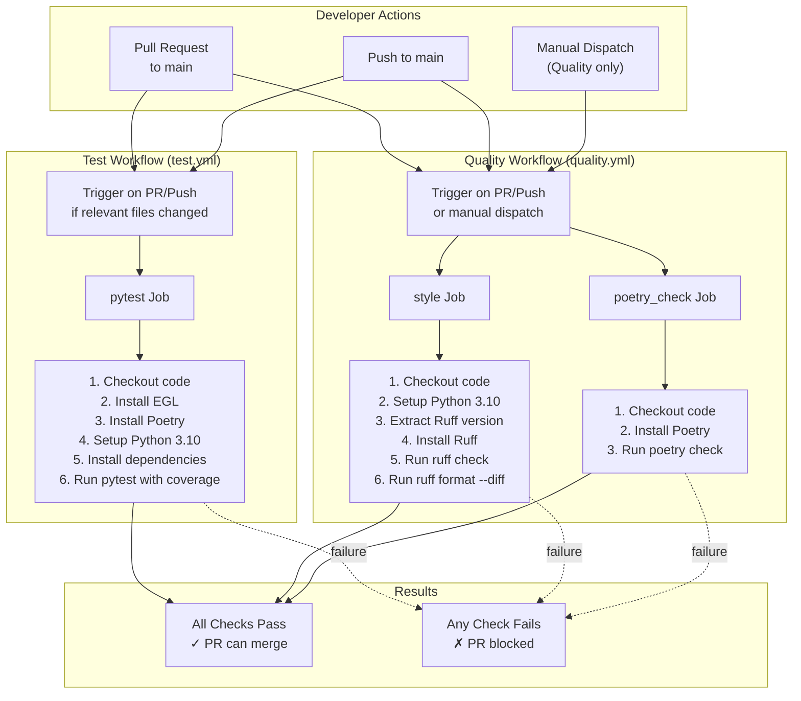
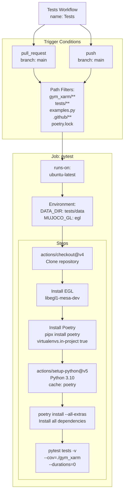
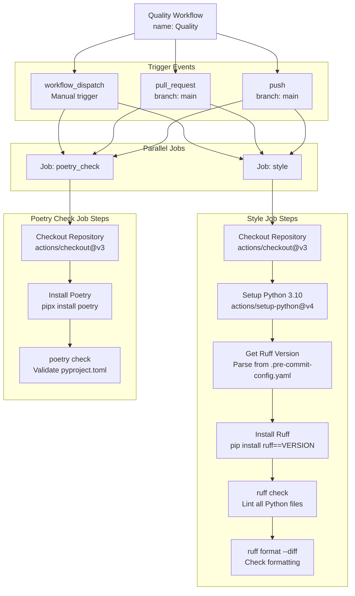
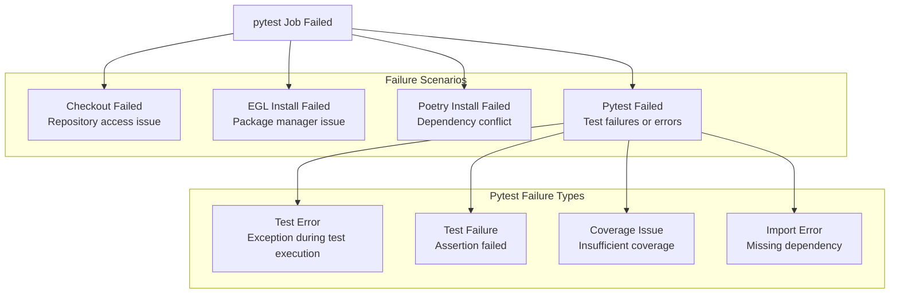
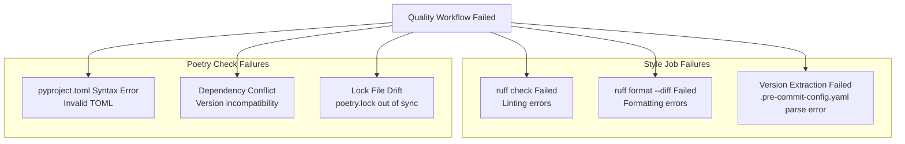

<!-- source: DeepWiki mcp.deepwiki.com · repo huggingface/gym-xarm · page 5.3 CI/CD Workflows · fetched 2026-10-26 -->

# CI/CD Workflows

<details>
<summary>Relevant source files</summary>

The following files were used as context for generating this wiki page:

- [.github/workflows/quality.yml](.github/workflows/quality.yml)
- [.github/workflows/test.yml](.github/workflows/test.yml)

</details>


## Purpose and Scope

This document provides comprehensive documentation of the automated Continuous Integration and Continuous Deployment (CI/CD) workflows that maintain code quality and prevent regressions in gym-xarm. These workflows execute automatically on pull requests and pushes to the main branch, providing a quality gate before code is merged.

For information about setting up these tools locally, see [Development Setup](#5.1). For details on running tests manually, see [Testing](#5.2). For the code quality standards enforced by these workflows, see [Code Quality Standards](#5.4).

---

## CI/CD Overview

The gym-xarm repository implements a two-workflow CI/CD pipeline that validates both functional correctness and code quality standards:

| Workflow | File | Primary Purpose | Run Time |
|----------|------|----------------|----------|
| Tests | `.github/workflows/test.yml` | Execute pytest suite with coverage reporting | ~2-3 minutes |
| Quality | `.github/workflows/quality.yml` | Validate code style and dependency integrity | ~1 minute |

Both workflows must pass before pull requests can be merged, ensuring that all changes meet the project's quality standards.



**Sources:** [.github/workflows/test.yml:1-54](), [.github/workflows/quality.yml:1-56]()

---

## Test Workflow

The test workflow (`test.yml`) executes the complete pytest test suite with code coverage reporting. This workflow ensures that all environment implementations comply with the Gymnasium API and that core functionality works correctly across all observation types.

### Workflow Configuration



**Sources:** [.github/workflows/test.yml:1-54]()

### Trigger Conditions

The test workflow executes when changes are made to specific paths, preventing unnecessary test runs when only documentation or non-code files are modified:

| Event | Branches | Paths Monitored |
|-------|----------|-----------------|
| `pull_request` | `main` | `gym_xarm/**`, `tests/**`, `examples.py`, `.github/**`, `poetry.lock` |
| `push` | `main` | `gym_xarm/**`, `tests/**`, `examples.py`, `.github/**`, `poetry.lock` |

This path filtering is defined in [.github/workflows/test.yml:3-21]() and ensures the workflow only runs when functional code or test infrastructure changes.

### Environment Setup

The test workflow configures a specialized environment to support headless MuJoCo rendering:

**Environment Variables:**
- `DATA_DIR: tests/data` - Directory for test data storage [.github/workflows/test.yml:28]()
- `MUJOCO_GL: egl` - Configures MuJoCo to use EGL for headless rendering [.github/workflows/test.yml:29]()

**System Dependencies:**
The workflow installs EGL (Embedded-System Graphics Library) support to enable headless rendering without a display server [.github/workflows/test.yml:33-34]():
```yaml
- name: Install EGL
  run: sudo apt-get update && sudo apt-get install -y libegl1-mesa-dev
```

This is critical because MuJoCo requires OpenGL context for rendering observations, even when running in CI without a graphical display.

**Sources:** [.github/workflows/test.yml:27-34]()

### Test Execution

The pytest job runs the complete test suite with coverage reporting [.github/workflows/test.yml:51-53]():

```bash
pytest tests -v --cov=./gym_xarm --durations=0
```

**Command Options:**
| Option | Purpose |
|--------|---------|
| `tests` | Test directory to execute |
| `-v` | Verbose output showing individual test names |
| `--cov=./gym_xarm` | Measure code coverage for the gym_xarm package |
| `--durations=0` | Report execution time for all tests (not just slowest) |

The coverage report helps identify untested code paths and ensures that new features include appropriate test coverage. For details on what tests are executed, see [Testing](#5.2).

**Sources:** [.github/workflows/test.yml:51-53]()

---

## Quality Workflow

The quality workflow (`quality.yml`) validates code style and dependency integrity through two parallel jobs: `style` and `poetry_check`. This workflow ensures consistency with project coding standards and catches dependency issues before they cause runtime problems.

### Workflow Structure



**Sources:** [.github/workflows/quality.yml:1-56]()

### Trigger Conditions

The quality workflow has broader trigger conditions than the test workflow, running on all pull requests and pushes regardless of which files changed:

| Event | Branches | Path Filtering |
|-------|----------|----------------|
| `workflow_dispatch` | N/A | Manual trigger from GitHub UI |
| `pull_request` | `main` | No path filtering - all PRs |
| `push` | `main` | No path filtering - all pushes |

This ensures code quality standards are enforced across all changes, including documentation-only PRs. The workflow is defined in [.github/workflows/quality.yml:3-10]().

**Sources:** [.github/workflows/quality.yml:3-10]()

### Style Job

The `style` job enforces code formatting and linting standards using Ruff, a fast Python linter and formatter:

**Version Management:**
The workflow dynamically extracts the Ruff version from `.pre-commit-config.yaml` to ensure CI uses the same version as local pre-commit hooks [.github/workflows/quality.yml:28-32]():

```yaml
- name: Get Ruff Version from pre-commit-config.yaml
  id: get-ruff-version
  run: |
    RUFF_VERSION=$(awk '/repo: https:\/\/github.com\/astral-sh\/ruff-pre-commit/{flag=1;next}/rev:/{if(flag){print $2;exit}}' .pre-commit-config.yaml)
    echo "RUFF_VERSION=${RUFF_VERSION}" >> $GITHUB_ENV
```

This AWK script parses the pre-commit configuration file to extract the version tag, ensuring version consistency between local and CI environments.

**Quality Checks:**

1. **Ruff Check** [.github/workflows/quality.yml:37-38]() - Lints all Python files for style violations, unused imports, undefined variables, and other code quality issues:
   ```bash
   ruff check
   ```

2. **Ruff Format** [.github/workflows/quality.yml:40-41]() - Validates that all files are properly formatted according to Ruff's formatting rules:
   ```bash
   ruff format --diff
   ```
   
   The `--diff` flag reports formatting differences without modifying files, causing the job to fail if any files are incorrectly formatted.

**Sources:** [.github/workflows/quality.yml:16-42]()

### Poetry Check Job

The `poetry_check` job validates the `pyproject.toml` file for dependency consistency and integrity [.github/workflows/quality.yml:44-55]():

```bash
poetry check
```

This command verifies:
- The `pyproject.toml` syntax is valid
- Dependencies are correctly specified with valid version constraints
- No circular dependencies exist
- The lock file (`poetry.lock`) is consistent with `pyproject.toml`

This catch issues like invalid version specifiers, missing dependencies, or lock file drift before they cause runtime failures. The job runs independently of the style job, allowing both to execute in parallel and report failures independently.

**Sources:** [.github/workflows/quality.yml:44-56]()

---

## Workflow Dependencies and Caching

Both workflows leverage GitHub Actions caching to reduce execution time and bandwidth:

### Poetry Caching

The test workflow uses Poetry's built-in caching mechanism [.github/workflows/test.yml:42-46]():

```yaml
- name: Set up Python 3.10
  uses: actions/setup-python@v5
  with:
    python-version: "3.10"
    cache: "poetry"
```

The `cache: "poetry"` parameter instructs `actions/setup-python` to cache the Poetry virtual environment based on the hash of `poetry.lock`. This cache is automatically invalidated when dependencies change [.github/workflows/test.yml:13-21]() (note `poetry.lock` is in the path filter).

### Virtual Environment Configuration

The test workflow configures Poetry to create the virtual environment inside the project directory [.github/workflows/test.yml:36-39]():

```yaml
- name: Install poetry
  run: |
    pipx install poetry && poetry config virtualenvs.in-project true
    echo "${{ github.workspace }}/.venv/bin" >> $GITHUB_PATH
```

This configuration:
- Sets `virtualenvs.in-project true` to create `.venv/` in the repository root
- Adds `.venv/bin` to `$GITHUB_PATH` so subsequent steps can execute installed binaries without activation

**Sources:** [.github/workflows/test.yml:36-46]()

---

## Interpreting Workflow Failures

When a workflow fails, the output provides specific information about what failed and why:

### Test Workflow Failures



**Common Test Failures:**

| Failure Type | Symptom | Solution |
|-------------|---------|----------|
| Import Error | `ModuleNotFoundError` or `ImportError` | Check `poetry.lock` is committed; verify dependencies in `pyproject.toml` |
| Test Assertion | `AssertionError` in test output | Review test code and implementation; check if API changed |
| MuJoCo GL Error | `ERROR: GLEW initialization error: Missing GL version` | Verify `MUJOCO_GL=egl` is set; check EGL installation step |
| Coverage Drop | Coverage percentage below threshold | Add tests for new code; check if coverage config changed |

The `-v` flag in the pytest command [.github/workflows/test.yml:53]() provides detailed output showing which specific test failed, making it easier to identify the problem.

**Sources:** [.github/workflows/test.yml:51-54]()

### Quality Workflow Failures



**Common Quality Failures:**

| Failure Type | Symptom | Solution |
|-------------|---------|----------|
| Ruff Check | Linting violations (unused imports, style issues) | Run `ruff check --fix` locally to auto-fix |
| Ruff Format | Files not formatted correctly | Run `ruff format` locally to format files |
| Poetry Check | `poetry.lock` inconsistent with `pyproject.toml` | Run `poetry lock` to regenerate lock file |
| TOML Syntax | `Invalid pyproject.toml` | Check syntax in `pyproject.toml` around error line |

To prevent these failures, developers should run pre-commit hooks locally (see [Development Setup](#5.1)) which execute the same checks before code is pushed.

**Sources:** [.github/workflows/quality.yml:16-56]()

---

## Manual Workflow Execution

The quality workflow supports manual triggering through GitHub's UI via `workflow_dispatch` [.github/workflows/quality.yml:4]():

1. Navigate to **Actions** tab in the GitHub repository
2. Select **Quality** workflow from the left sidebar
3. Click **Run workflow** button
4. Select branch to run workflow on
5. Click **Run workflow** to start execution

This is useful for:
- Testing workflow changes before pushing
- Re-running quality checks without making new commits
- Validating fixes after dependency updates

The test workflow does not support manual dispatch and only runs on pull requests or pushes.

**Sources:** [.github/workflows/quality.yml:4]()

---

## Workflow Status Badges

Workflow status can be monitored through GitHub's Actions interface, which displays:
- Current status of each workflow (passing/failing)
- Historical run data
- Execution time trends
- Success/failure rates

Both workflows are required to pass before pull requests can be merged into the `main` branch, enforcing the quality standards documented in [Code Quality Standards](#5.4).

**Sources:** [.github/workflows/test.yml:1-54](), [.github/workflows/quality.yml:1-56]()

---

