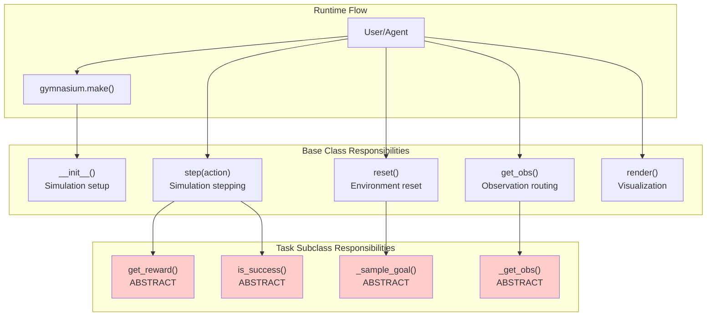
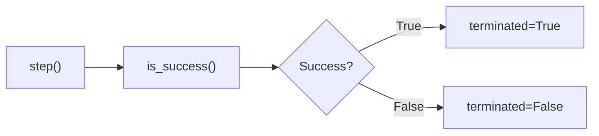
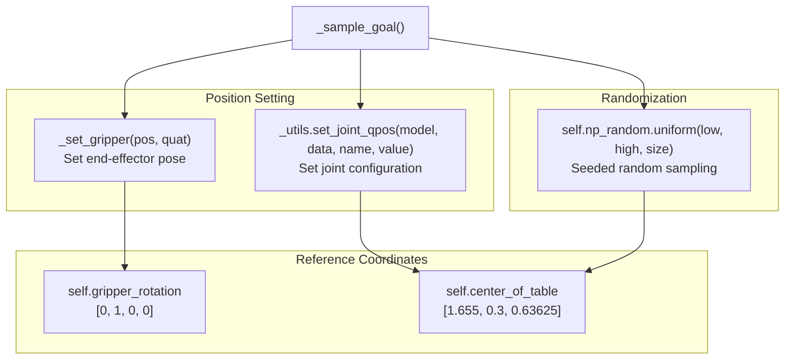
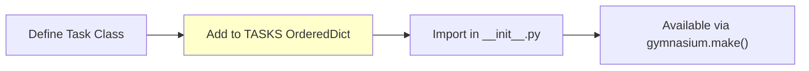
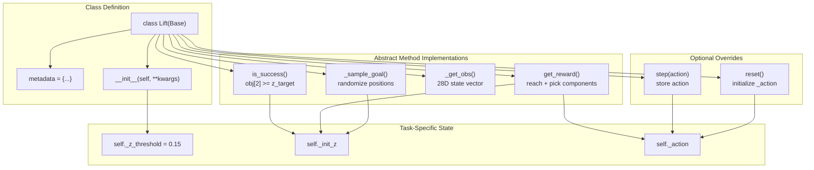
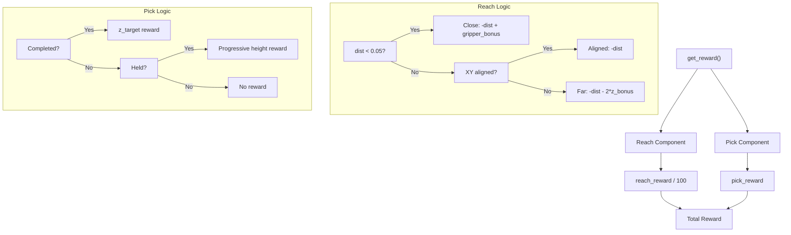

<!-- source: DeepWiki mcp.deepwiki.com · repo huggingface/gym-xarm · page 5.5 Creating Custom Tasks · fetched 2026-10-26 -->

# Creating Custom Tasks

<details>
<summary>Relevant source files</summary>

The following files were used as context for generating this wiki page:

- [gym_xarm/tasks/__init__.py](gym_xarm/tasks/__init__.py)
- [gym_xarm/tasks/base.py](gym_xarm/tasks/base.py)
- [gym_xarm/tasks/lift.py](gym_xarm/tasks/lift.py)
- [gym_xarm/tasks/mocap.py](gym_xarm/tasks/mocap.py)

</details>


This document guides developers through the process of creating new manipulation tasks for the gym-xarm environment by extending the `Base` class. It covers the required abstract methods, optional customization points, task registration, and best practices based on the existing `Lift` implementation.

For information about the overall task system architecture and how tasks are loaded, see [Task System](#3.2). For API documentation of the `Base` class and its methods, see [Base Class API](#8.1).

## Overview of Task Creation

Creating a custom task involves:

1. Extending the `Base` class from [gym_xarm/tasks/base.py]()
2. Implementing four required abstract methods
3. Defining task metadata (action space, episode length, description)
4. Registering the task in the task registry
5. Creating a corresponding MuJoCo XML scene file

The `Base` class implements the complete Gymnasium environment interface and handles all simulation mechanics, rendering, and observation generation. Task subclasses only need to define task-specific logic like reward computation and success criteria.

## Task Architecture: Template Method Pattern

The gym-xarm task system uses the template method pattern, where the `Base` class provides the algorithmic skeleton and delegates task-specific steps to subclass methods.

### Architectural Flow



**Sources:** [gym_xarm/tasks/base.py:18-335](), [gym_xarm/tasks/lift.py:6-102]()

### Method Delegation Table

| Base Class Method | Delegates To | Purpose |
|------------------|--------------|---------|
| `reset()` | `_sample_goal()` | Initialize episode with randomized initial state |
| `step()` | `get_reward()`, `is_success()` | Compute reward and check termination |
| `get_obs()` | `_get_obs()` | Build state vector observation |
| N/A | N/A | Subclass defines task metadata |

**Sources:** [gym_xarm/tasks/base.py:189-198](), [gym_xarm/tasks/base.py:200-273]()

## Required Implementation: Abstract Methods

Every task subclass **must** implement these four abstract methods:

### 1. `is_success()` → bool

Determines if the current state satisfies the task's success criteria.



**Implementation Requirements:**
- Return `True` if task goal is achieved, `False` otherwise
- Called once per `step()` to determine episode termination
- Should be deterministic based on current simulation state

**Example from Lift:**
```python
def is_success(self):
    return self.obj[2] >= self.z_target
```
[gym_xarm/tasks/lift.py:22-23]()

**Sources:** [gym_xarm/tasks/base.py:189-191](), [gym_xarm/tasks/lift.py:22-23]()

### 2. `get_reward()` → float

Computes the scalar reward signal for the current state and last action.

**Implementation Requirements:**
- Return a float representing the reward for the current timestep
- Called once per `step()` after action is applied
- Has access to all environment state via `Base` properties:
  - `self.eef` - End-effector position (relative to table center)
  - `self.obj` - Object position (relative to table center)
  - `self.gripper_angle` - Current gripper opening angle
  - `self._action` - Most recent action (if stored)

**Common Reward Patterns:**

| Pattern | Purpose | Example |
|---------|---------|---------|
| Distance-based | Encourage approaching goal | `-np.linalg.norm(self.eef - self.obj)` |
| Sparse completion | Reward only on success | `1.0 if self.is_success() else 0.0` |
| Dense shaping | Guide exploration | Multiple reward components combined |

**Example from Lift (Dense Reward):**
```python
def get_reward(self):
    reach_dist = np.linalg.norm(self.obj - self.eef)
    pick_completed = self.obj[2] >= (self.z_target - 0.01)
    
    # Reach component
    if reach_dist < 0.05:
        reach_reward = -reach_dist + max(self._action[-1], 0) / 50
    else:
        reach_reward = -reach_dist
    
    # Pick component
    if pick_completed:
        pick_reward = self.z_target
    elif self.obj[2] > (self._init_z + 0.005):
        pick_reward = min(self.z_target, self.obj[2])
    else:
        pick_reward = 0
    
    return reach_reward / 100 + pick_reward
```
[gym_xarm/tasks/lift.py:25-48]()

**Sources:** [gym_xarm/tasks/base.py:193-194](), [gym_xarm/tasks/lift.py:25-48]()

### 3. `_sample_goal()` → Any

Randomizes the initial state for each episode by setting object positions and gripper pose.

**Implementation Requirements:**
- Called during `reset()` to initialize episode
- Must use `self.np_random` for all randomization (seeded RNG)
- Should set gripper position using `self._set_gripper(pos, quat)`
- Should set object positions using `self._utils.set_joint_qpos()`
- Can return goal information (optional, currently unused)

**Available Utility Methods:**



**Example from Lift:**
```python
def _sample_goal(self):
    # Randomize gripper start position
    gripper_pos = np.array([1.280, 0.295, 0.735]) + \
                  self.np_random.uniform(-0.05, 0.05, size=3)
    super()._set_gripper(gripper_pos, self.gripper_rotation)
    
    # Randomize object position on table
    object_pos = self.center_of_table - np.array([0.15, 0.10, 0.07])
    object_pos[0] += self.np_random.uniform(-0.05, 0.05)
    object_pos[1] += self.np_random.uniform(-0.05, 0.05)
    object_qpos = self._utils.get_joint_qpos(self.model, self.data, "object_joint0")
    object_qpos[:3] = object_pos
    self._utils.set_joint_qpos(self.model, self.data, "object_joint0", object_qpos)
    
    self._init_z = object_pos[2]  # Store initial height
    
    return object_pos + np.array([0, 0, self._z_threshold])
```
[gym_xarm/tasks/lift.py:74-89]()

**Sources:** [gym_xarm/tasks/base.py:196-198](), [gym_xarm/tasks/base.py:308-314](), [gym_xarm/tasks/lift.py:74-89]()

### 4. `_get_obs()` → np.ndarray

Constructs the state vector observation for `obs_type="state"`.

**Implementation Requirements:**
- Return a 1D numpy array of floats
- Called by `get_obs()` when `obs_type="state"`
- Not used for pixel-based observations (`obs_type="pixels"` or `obs_type="pixels_agent_pos"`)
- Should include task-relevant state information

**Available State Properties:**

| Property | Type | Description |
|----------|------|-------------|
| `self.eef` | `(3,)` | End-effector position relative to table |
| `self.eef_velp` | `(3,)` | End-effector linear velocity |
| `self.obj` | `(3,)` | Object position relative to table |
| `self.obj_rot` | `(4,)` | Object rotation quaternion |
| `self.obj_velp` | `(3,)` | Object linear velocity |
| `self.obj_velr` | `(3,)` | Object angular velocity |
| `self.gripper_angle` | `(1,)` | Gripper opening angle |
| `self.robot_state` | `(4,)` | Concatenation of `eef` and `gripper_angle` |

**Example from Lift (28-dimensional state):**
```python
def _get_obs(self):
    return np.concatenate([
        self.eef,                                    # (3,) position
        self.eef_velp,                               # (3,) velocity
        self.obj,                                    # (3,) object pos
        self.obj_rot,                                # (4,) object rotation
        self.obj_velp,                               # (3,) object velocity
        self.obj_velr,                               # (3,) object angular vel
        self.eef - self.obj,                         # (3,) relative position
        np.array([
            np.linalg.norm(self.eef - self.obj),     # (1,) distance
            np.linalg.norm(self.eef[:-1] - self.obj[:-1]),  # (1,) xy distance
            self.z_target,                           # (1,) goal height
            self.z_target - self.obj[-1],            # (1,) object to goal
            self.z_target - self.eef[-1],            # (1,) eef to goal
        ]),
        self.gripper_angle,                          # (1,) gripper state
    ], axis=0)  # Total: 28 dimensions
```
[gym_xarm/tasks/lift.py:50-72]()

**Sources:** [gym_xarm/tasks/base.py:152-188](), [gym_xarm/tasks/lift.py:50-72]()

## Task Metadata Definition

Every task must define class-level metadata by extending `Base.metadata`:

```python
class MyCustomTask(Base):
    metadata = {
        **Base.metadata,
        "action_space": "xyzw",      # Required: action dimensions
        "episode_length": 50,        # Required: max steps per episode
        "description": "Task description",  # Required: human-readable
    }
```

### Metadata Fields

| Field | Type | Purpose | Example Values |
|-------|------|---------|----------------|
| `action_space` | str | Defines which action dimensions are used | `"xyz"` (position only), `"xyzw"` (position + gripper) |
| `episode_length` | int | Maximum timesteps before truncation | `50`, `100` |
| `description` | str | Human-readable task description | `"Lift a cube above a height threshold"` |

**Action Space Encoding:**
- `"xyz"` → 3D action space (position control only, gripper fixed open)
- `"xyzw"` → 4D action space (position + gripper control)

**Sources:** [gym_xarm/tasks/lift.py:7-12](), [gym_xarm/tasks/__init__.py:40-48]()

## Task Registration

After implementing your task class, register it in the task registry:

### Registration Process



**1. Add to TASKS Registry**

Edit [gym_xarm/tasks/__init__.py]() to add your task:

```python
from gym_xarm.tasks.my_task import MyCustomTask

TASKS = OrderedDict(
    (
        ("lift", {
            "env": Lift,
            "action_space": "xyzw",
            "episode_length": 50,
            "description": "Lift a cube above a height threshold",
        }),
        ("my_task", {  # New task entry
            "env": MyCustomTask,
            "action_space": "xyz",
            "episode_length": 100,
            "description": "My custom manipulation task",
        }),
    )
)
```

**2. Environment Registration**

The task will be automatically registered as a Gymnasium environment with ID:
```
gym_xarm/Xarm<TaskName>-v0
```

For example, `"my_task"` becomes `"gym_xarm/XarmMyTask-v0"`.

**Sources:** [gym_xarm/tasks/__init__.py:1-51](), [gym_xarm/__init__.py]()

## Optional Customization Points

Beyond the required abstract methods, you can override these `Base` class methods for advanced customization:

### Override `reset()` for Custom Initialization

```python
def reset(self, seed=None, options: dict | None = None):
    # Initialize task-specific state
    self._action = np.zeros(4)
    self._episode_counter = 0
    
    # Call parent reset
    return super().reset(seed=seed, options=options)
```

**Use Cases:**
- Initialize episode counters or state trackers
- Reset task-specific cached values
- Store the initial action (as done in Lift)

**Sources:** [gym_xarm/tasks/lift.py:91-97]()

### Override `step()` for Action Logging

```python
def step(self, action):
    # Store action for use in reward computation
    self._action = action.copy()
    self._action_history.append(action)
    
    # Call parent step
    return super().step(action)
```

**Use Cases:**
- Log action history for reward shaping
- Track action statistics
- Implement action-dependent rewards

**Sources:** [gym_xarm/tasks/lift.py:99-101]()

### Override `_reset_sim()` for Custom Reset Logic

```python
def _reset_sim(self):
    # Standard reset
    success = super()._reset_sim()
    
    # Additional custom validation
    if self._check_collision():
        return False  # Trigger re-reset
    
    return success
```

**Use Cases:**
- Validate initial configurations
- Reject invalid randomizations
- Add custom physics warmup

**Sources:** [gym_xarm/tasks/base.py:231-243]()

## Complete Example: Anatomy of the Lift Task

This section dissects the `Lift` task implementation to demonstrate all concepts:



### Task-Specific State Variables

The `Lift` task maintains three task-specific instance variables:

```python
def __init__(self, **kwargs):
    self._z_threshold = 0.15  # Height threshold for success
    super().__init__("lift", **kwargs)

# Set during _sample_goal():
self._init_z = object_pos[2]  # Initial object height

# Set during reset()/step():
self._action = np.zeros(4)  # Most recent action
```

**Purpose:**
- `_z_threshold`: Defines success criterion (lift 15cm)
- `_init_z`: Stores initial object height for relative measurements
- `_action`: Enables action-dependent reward shaping

**Sources:** [gym_xarm/tasks/lift.py:14-16](), [gym_xarm/tasks/lift.py:86](), [gym_xarm/tasks/lift.py:96-101]()

### Reward Function Structure

The `Lift` task uses a two-component reward:



**Design Rationale:**
1. **Reach component** guides gripper toward object with dense feedback
2. **Pick component** rewards vertical lift progress
3. Reach scaled to `/100` to balance with pick rewards
4. Gripper bonus encourages closing when near object

**Sources:** [gym_xarm/tasks/lift.py:25-48]()

## MuJoCo Scene File Requirements

Each task requires a corresponding XML scene file in [gym_xarm/tasks/assets/]():

### Required XML Structure

```
gym_xarm/tasks/assets/
├── my_task.xml          # Main scene file
├── xarm/                # Robot model (shared)
│   └── xarm.xml
└── ...                  # Meshes and other assets
```

**Minimal Scene Requirements:**
1. Include xArm robot model
2. Define `robot0:mocap2` body for mocap control
3. Define `grasp` site on end-effector
4. Define `camera0` for rendering
5. Define object bodies with sites for observation

**Example: Lift Scene Structure**
```xml
<mujoco>
  <include file="xarm/xarm.xml"/>  <!-- Robot -->
  
  <worldbody>
    <body name="object0">  <!-- Object to manipulate -->
      <site name="object_site"/>  <!-- For position tracking -->
    </body>
  </worldbody>
</mujoco>
```

**Sources:** [gym_xarm/tasks/base.py:64-67]()

## Best Practices

### 1. State Property Usage

Use `Base` properties instead of direct MuJoCo access:

```python
# Good: Use Base properties
distance = np.linalg.norm(self.eef - self.obj)

# Avoid: Direct MuJoCo access
eef_pos = self._utils.get_site_xpos(self.model, self.data, "grasp")
obj_pos = self._utils.get_site_xpos(self.model, self.data, "object_site")
distance = np.linalg.norm(eef_pos - obj_pos)
```

**Rationale:** Properties handle coordinate transformations and provide consistent API.

**Sources:** [gym_xarm/tasks/base.py:157-188]()

### 2. Randomization with Seeded RNG

Always use `self.np_random` for reproducibility:

```python
# Good: Seeded randomization
offset = self.np_random.uniform(-0.05, 0.05, size=3)

# Bad: Non-seeded randomization
offset = np.random.uniform(-0.05, 0.05, size=3)
```

**Rationale:** Enables reproducible experiments when `reset(seed=...)` is called.

**Sources:** [gym_xarm/tasks/lift.py:76]()

### 3. Coordinate Frame Consistency

All positions are relative to `self.center_of_table`:

```python
# Base properties automatically apply offset
self.eef  # Already relative to table center
self.obj  # Already relative to table center

# When setting positions, add center_of_table back
absolute_pos = self.center_of_table + relative_offset
```

**Sources:** [gym_xarm/tasks/base.py:50](), [gym_xarm/tasks/base.py:157-188]()

### 4. Dense vs Sparse Rewards

| Reward Type | Advantages | Disadvantages | Use When |
|-------------|------------|---------------|----------|
| **Dense** (Lift) | Faster learning, smoother gradients | May not generalize | Complex manipulation |
| **Sparse** | Better generalization | Slower learning, exploration challenges | Simple goals, curriculum learning |

**Sources:** [gym_xarm/tasks/lift.py:25-48]()

### 5. Success Criteria Design

```python
# Good: Use tolerance for robustness
def is_success(self):
    return self.obj[2] >= (self.z_target - 0.01)

# Avoid: Exact equality (numerical instability)
def is_success(self):
    return self.obj[2] == self.z_target
```

**Sources:** [gym_xarm/tasks/lift.py:22-23]()

## Testing Your Custom Task

After implementing a custom task, validate it using:

### 1. Gymnasium Environment Checker

```python
import gymnasium as gym
from gymnasium.utils.env_checker import check_env

env = gym.make("gym_xarm/XarmMyTask-v0")
check_env(env.unwrapped)
```

This validates Gymnasium API compliance across all observation types.

**Sources:** Referenced in [Development Guide](#5)

### 2. Manual Episode Execution

```python
env = gym.make("gym_xarm/XarmMyTask-v0", obs_type="state")
obs, info = env.reset(seed=42)

for _ in range(50):
    action = env.action_space.sample()
    obs, reward, terminated, truncated, info = env.step(action)
    if terminated:
        break
```

**Validate:**
- Observation shape matches `_get_obs()` output
- Reward values are reasonable
- Success detection works correctly
- Episode terminates appropriately

### 3. Observation Type Testing

Test all three observation modes:

```python
for obs_type in ["state", "pixels", "pixels_agent_pos"]:
    env = gym.make("gym_xarm/XarmMyTask-v0", obs_type=obs_type)
    obs, _ = env.reset()
    print(f"{obs_type}: {type(obs)}, shape={getattr(obs, 'shape', 'N/A')}")
```

**Expected Outputs:**
- `state`: numpy array with shape from `_get_obs()`
- `pixels`: numpy array with shape `(84, 84, 3)`
- `pixels_agent_pos`: dict with `"pixels"` and `"agent_pos"` keys

**Sources:** [gym_xarm/tasks/base.py:110-131](), [gym_xarm/tasks/base.py:245-259]()

## Summary

Creating a custom task requires:

1. **Extend `Base` class** and implement 4 abstract methods
2. **Define metadata** with action space, episode length, and description
3. **Register task** in `TASKS` OrderedDict
4. **Create XML scene** in `assets/` directory
5. **Test thoroughly** with Gymnasium checker and manual validation

The template method pattern ensures all simulation infrastructure is handled by `Base`, allowing task implementations to focus purely on task-specific logic like rewards, success criteria, and initial state sampling.

**Sources:** [gym_xarm/tasks/base.py:18-335](), [gym_xarm/tasks/lift.py:6-102](), [gym_xarm/tasks/__init__.py:1-51]()

---

