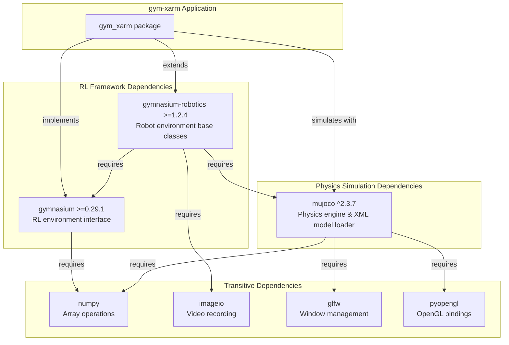
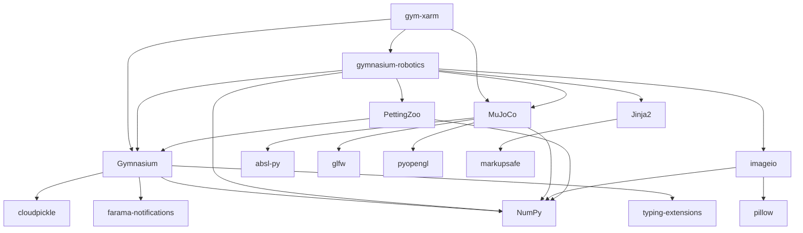
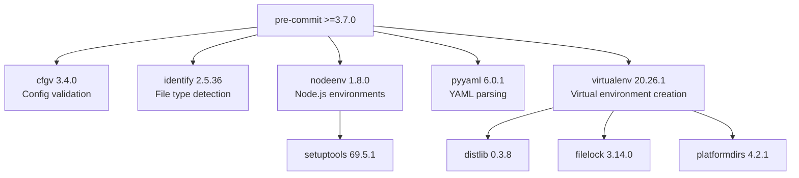
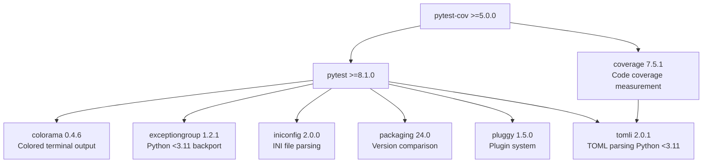
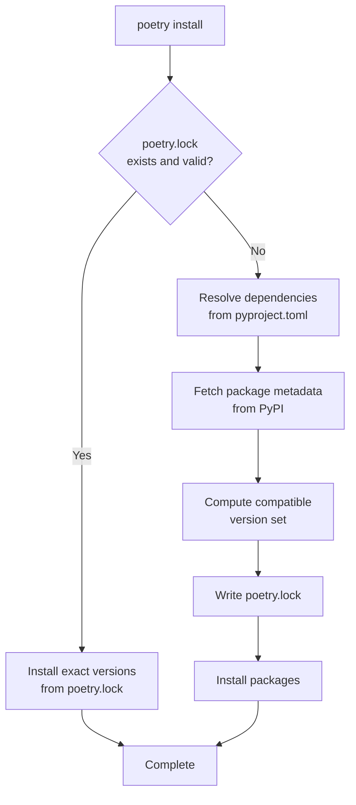

<!-- source: DeepWiki mcp.deepwiki.com · repo huggingface/gym-xarm · page 6 Dependencies and Requirements · fetched 2026-10-26 -->

# Dependencies and Requirements

<details>
<summary>Relevant source files</summary>

The following files were used as context for generating this wiki page:

- [poetry.lock](poetry.lock)
- [pyproject.toml](pyproject.toml)

</details>


This page documents all dependencies required by gym-xarm, their versions, purposes, and relationships. It covers both direct dependencies declared in the project configuration and transitive dependencies resolved during installation.

For installation instructions and setup procedures, see [Installation](#2.1). For details on development tools and workflows, see [Development Setup](#5.1).

---

## Overview

The gym-xarm package has a carefully managed dependency stack organized into four layers:

1. **Application Layer**: gym-xarm itself
2. **RL Framework Layer**: Gymnasium and robotics extensions
3. **Physics Simulation Layer**: MuJoCo and rendering backends
4. **Core Data Processing Layer**: NumPy, image processing utilities

Dependencies are managed using Poetry, which ensures reproducible builds through the lock file and provides optional dependency groups for development and testing workflows.

**Sources:** [pyproject.toml:1-77](), [poetry.lock:1-860]()

---

## Python Version Requirement

```
Python: ^3.10
```

The caret constraint (`^3.10`) allows any version `>=3.10.0` and `<4.0.0`, enabling patch and minor version updates while preventing breaking major version changes. This requirement is specified in [pyproject.toml:25]().

Python 3.10 was chosen as the minimum version to leverage:
- Structural pattern matching (match statements)
- Type hint improvements (PEP 604 union syntax)
- Better error messages
- Performance improvements in the interpreter

**Sources:** [pyproject.toml:25]()

---

## Direct Runtime Dependencies

These are the dependencies explicitly declared as required for running gym-xarm environments.

### Dependency Version Table

| Package | Version Constraint | Purpose |
|---------|-------------------|---------|
| `mujoco` | `^2.3.7` | Physics simulation engine |
| `gymnasium` | `>=0.29.1` | Standard RL environment API |
| `gymnasium-robotics` | `>=1.2.4` | Robotics-specific extensions |

**Sources:** [pyproject.toml:24-28]()

### Dependency Roles Diagram



**Sources:** [pyproject.toml:24-28](), [poetry.lock:219-270](), [poetry.lock:415-453]()

---

## MuJoCo: Physics Simulation Engine

```
mujoco: ^2.3.7
```

MuJoCo (Multi-Joint dynamics with Contact) is the core physics simulation engine. The caret constraint allows versions `>=2.3.7` and `<3.0.0`.

### MuJoCo's Direct Dependencies

From [poetry.lock:448-453]():

| Package | Purpose |
|---------|---------|
| `absl-py` | Abseil Python common libraries |
| `glfw` | Cross-platform window and input management |
| `numpy` | Numerical array operations |
| `pyopengl` | OpenGL bindings for rendering |

### Role in gym-xarm

MuJoCo provides:
- Physics simulation stepping (`mj_step`)
- XML model loading (`lift.xml`, `xarm.xml`)
- Collision detection and contact resolution
- Forward/inverse kinematics
- Rendering infrastructure (both offscreen and interactive)
- Mocap body control for end-effector positioning

The Base environment class interfaces with MuJoCo through the `mujoco` module to load models, step simulations, and extract state information.

**Sources:** [poetry.lock:415-453](), [pyproject.toml:26]()

---

## Gymnasium: RL Environment Interface

```
gymnasium: >=0.29.1
```

The greater-than-or-equal constraint allows any version `>=0.29.1`, enabling minor and patch updates without breaking compatibility.

### Gymnasium's Direct Dependencies

From [poetry.lock:229-234]():

| Package | Purpose |
|---------|---------|
| `cloudpickle` | Serialization of complex Python objects |
| `farama-notifications` | Update notifications for Farama libraries |
| `numpy` | Array operations |
| `typing-extensions` | Type hint backports |

### Role in gym-xarm

Gymnasium provides:
- The `Env` base class that all tasks inherit from
- Standard methods: `reset()`, `step()`, `render()`, `close()`
- Space definitions: `Box`, `Dict` for observation/action spaces
- Environment checkers for API compliance validation
- Registration system via `gymnasium.register()`

The gym-xarm environments implement the Gymnasium API to ensure compatibility with standard RL frameworks.

**Sources:** [poetry.lock:219-246](), [pyproject.toml:27]()

---

## Gymnasium-Robotics: Robotics Extensions

```
gymnasium-robotics: >=1.2.4
```

### Gymnasium-Robotics Dependencies

From [poetry.lock:259-265]():

| Package | Purpose |
|---------|---------|
| `gymnasium` | Base RL environment framework |
| `imageio` | Image and video I/O |
| `Jinja2` | Template rendering |
| `mujoco` | Physics simulation |
| `numpy` | Numerical operations |
| `PettingZoo` | Multi-agent environment support |

### Role in gym-xarm

While gymnasium-robotics is listed as a dependency, gym-xarm's current implementation does not heavily rely on its features. The dependency exists because:

1. It provides robotics-specific utilities that may be used for future extensions
2. It ensures MuJoCo compatibility through version alignment
3. It includes standard robot manipulation task patterns

However, the Base class in [gym_xarm/tasks/base.py]() implements most functionality directly rather than inheriting from gymnasium-robotics base classes.

**Sources:** [poetry.lock:248-269](), [pyproject.toml:28]()

---

## Transitive Dependency Graph

The following diagram shows the complete dependency tree resolved by Poetry, including all transitive dependencies.



**Sources:** [poetry.lock:1-860]()

---

## Critical Transitive Dependencies

### NumPy: Universal Data Layer

```
numpy: 1.26.4
```

NumPy appears as a dependency of virtually every component:
- Gymnasium uses it for observation/action array representation
- MuJoCo uses it for state vectors, matrices, and physics data
- ImageIO uses it for pixel arrays
- gymnasium-robotics uses it for robot state

The locked version `1.26.4` (from [poetry.lock:469-511]()) ensures consistency across all consumers.

### ImageIO: Media Processing

```
imageio: 2.34.1
```

From [poetry.lock:286-315]():

ImageIO provides:
- Video recording capabilities for environment episodes
- Image format conversions
- Frame saving for visualization

It depends on:
- `numpy` for array operations
- `pillow >=8.3.2` for image processing

### GLFW: Window Management

```
glfw: 2.7.0
```

From [poetry.lock:198-216]():

GLFW provides cross-platform window and input management for MuJoCo rendering. It's required for:
- Human rendering mode (`render_mode='human'`)
- Interactive visualization
- Window creation and event handling

Note: The environment variable `MUJOCO_GL=glfw` must be set when using human rendering mode.

### PyOpenGL: Rendering Backend

```
pyopengl: 3.1.7
```

From [poetry.lock:685-693]():

PyOpenGL provides Python bindings to OpenGL for:
- Offscreen rendering via `render_mode='rgb_array'`
- Visual geometry rendering
- Texture mapping for MuJoCo meshes

**Sources:** [poetry.lock:469-511](), [poetry.lock:286-315](), [poetry.lock:198-216](), [poetry.lock:685-693]()

---

## Development Dependencies

These dependencies are only required for development workflows and are not installed by default. They are organized into optional groups.

### Development Extras

From [pyproject.toml:36]():

```toml
[tool.poetry.extras]
dev = ["pre-commit", "debugpy"]
```

Install with: `poetry install --extras dev`

| Package | Version | Purpose |
|---------|---------|---------|
| `pre-commit` | `>=3.7.0` | Git hook management for code quality checks |
| `debugpy` | `>=1.8.1` | Debug adapter for VS Code and other IDEs |

### Testing Extras

From [pyproject.toml:37]():

```toml
[tool.poetry.extras]
test = ["pytest", "pytest-cov"]
```

Install with: `poetry install --extras test`

| Package | Version | Purpose |
|---------|---------|---------|
| `pytest` | `>=8.1.0` | Test framework and runner |
| `pytest-cov` | `>=5.0.0` | Coverage plugin for pytest |

**Sources:** [pyproject.toml:29-37]()

---

## Pre-commit Dependencies

When `pre-commit` is installed, it manages additional tools via hooks defined in [.pre-commit-config.yaml]().

### Pre-commit Dependency Tree



### Pre-commit Managed Tools

Pre-commit automatically installs and manages:
- **Ruff** (linter and formatter) - configured in [pyproject.toml:40-72]()
- **Poetry check** - validates `pyproject.toml` and `poetry.lock` consistency

**Sources:** [poetry.lock:667-683](), [pyproject.toml:29]()

---

## Testing Dependencies

### Pytest and Coverage Stack



### Coverage Configuration

Coverage is configured to use TOML format via the `coverage[toml]` extra, which adds `tomli` for Python versions <3.11. This allows coverage settings to be stored in `pyproject.toml`.

**Sources:** [poetry.lock:696-733](), [pyproject.toml:31-32]()

---

## Debugging Dependencies

```
debugpy: >=1.8.1
```

From [poetry.lock:115-143]():

Debugpy is the Debug Adapter Protocol implementation for Python, used by:
- Visual Studio Code
- PyCharm (via DAP)
- Other DAP-compatible IDEs

It enables:
- Breakpoint debugging
- Variable inspection
- Step-through execution
- Remote debugging

Install with: `poetry install --extras dev`

**Sources:** [poetry.lock:115-143](), [pyproject.toml:30]()

---

## Version Constraint Semantics

### Caret Constraint (^)

Used in [pyproject.toml:25-26]():

```toml
python = "^3.10"
mujoco = "^2.3.7"
```

Semantics:
- `^3.10` → `>=3.10.0, <4.0.0` (allows minor and patch updates)
- `^2.3.7` → `>=2.3.7, <3.0.0` (allows patch updates in 2.x)

This follows semantic versioning: allow updates that don't break backward compatibility.

### Greater-Than-Or-Equal Constraint (>=)

Used in [pyproject.toml:27-28]():

```toml
gymnasium = ">=0.29.1"
gymnasium-robotics = ">=1.2.4"
```

Semantics:
- Allows any version at or above the specified version
- More permissive than caret
- Used when package follows strict semantic versioning

This gives flexibility to use newer versions while ensuring minimum feature requirements are met.

### Exact Versions in poetry.lock

The lock file [poetry.lock:1-860]() records exact versions for all dependencies and transitive dependencies, ensuring reproducible installations:

```
numpy = "1.26.4"
gymnasium = "0.29.1"
mujoco = "2.3.7"
```

**Sources:** [pyproject.toml:25-28](), [poetry.lock:1-860]()

---

## Dependency Resolution and Lock File

### Poetry Lock File

The [poetry.lock:1-860]() file contains:

```
lock-version = "2.0"
python-versions = "^3.10"
content-hash = "2a5938a513bfcae887dc23b065827687fb96f0708874713234a9ce7a931741b8"
```

From [poetry.lock:857-859]():

- **lock-version**: Poetry's lock file format version
- **python-versions**: Python constraint from `pyproject.toml`
- **content-hash**: Hash of `pyproject.toml` to detect changes

### Resolution Process



### Lock File Benefits

1. **Reproducibility**: Same versions installed on all machines
2. **Security**: Prevents supply chain attacks via version pinning
3. **CI/CD consistency**: Same dependencies in testing and production
4. **Dependency tracking**: Complete visibility of transitive dependencies

**Sources:** [poetry.lock:856-859]()

---

## Platform-Specific Considerations

### Operating System Support

All dependencies provide wheels for:
- **macOS**: x86_64 and ARM64 (Apple Silicon)
- **Linux**: x86_64 and aarch64 (via manylinux)
- **Windows**: x86_64 and ARM64

From [poetry.lock](), packages like MuJoCo provide platform-specific wheels:

```
mujoco-2.3.7-cp310-cp310-macosx_10_16_x86_64.whl
mujoco-2.3.7-cp310-cp310-macosx_11_0_arm64.whl
mujoco-2.3.7-cp310-cp310-manylinux_2_17_x86_64.whl
mujoco-2.3.7-cp310-cp310-win_amd64.whl
```

From [poetry.lock:421-426]()

### OpenGL Backend Configuration

For human rendering mode, the OpenGL backend must be configured via environment variable:

```bash
export MUJOCO_GL=glfw  # For window-based rendering
export MUJOCO_GL=egl   # For headless server rendering
```

This is required because MuJoCo supports multiple rendering backends through `glfw` and `pyopengl`.

**Sources:** [poetry.lock:421-446]()

---

## Dependency Installation Commands

### Standard Installation (Runtime Only)

```bash
pip install gym-xarm
```

Installs only runtime dependencies: `mujoco`, `gymnasium`, `gymnasium-robotics`, and their transitive dependencies.

### Development Installation

```bash
git clone https://github.com/huggingface/gym-xarm
cd gym-xarm
poetry install --all-extras
```

Installs all dependencies including dev and test extras.

### Selective Extra Installation

```bash
poetry install --extras dev    # Install dev tools only
poetry install --extras test   # Install testing tools only
```

### Updating Dependencies

```bash
poetry update              # Update all dependencies within constraints
poetry update mujoco       # Update specific package only
poetry lock --no-update    # Regenerate lock file without updating versions
```

**Sources:** [pyproject.toml:24-37]()

---

## Dependency Groups Summary Table

| Group | Installation | Packages | Use Case |
|-------|-------------|----------|----------|
| **Runtime** | `pip install gym-xarm` | mujoco, gymnasium, gymnasium-robotics, numpy, imageio, pillow, glfw, pyopengl | Running environments |
| **Dev** | `poetry install --extras dev` | pre-commit, debugpy, ruff | Code development |
| **Test** | `poetry install --extras test` | pytest, pytest-cov, coverage | Running tests |
| **All** | `poetry install --all-extras` | All above | Full development setup |

**Sources:** [pyproject.toml:24-37]()

---

