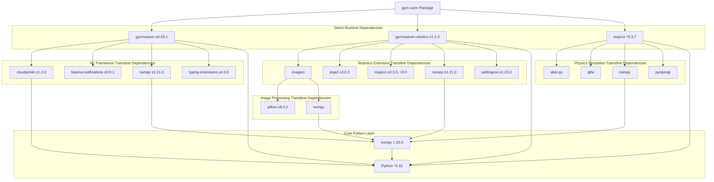
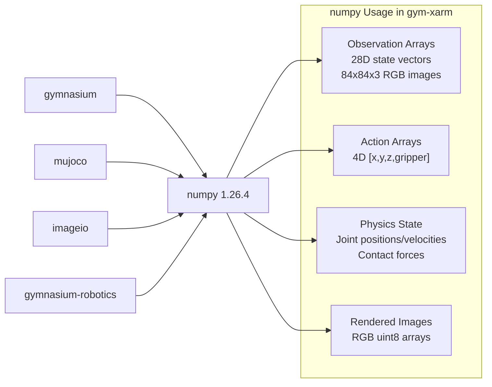
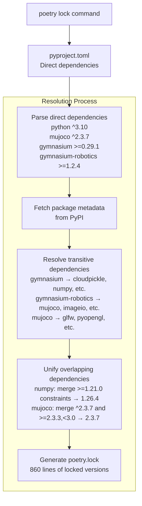

<!-- source: DeepWiki mcp.deepwiki.com · repo huggingface/gym-xarm · page 6.1 Runtime Dependencies · fetched 2026-10-26 -->

# Runtime Dependencies

Relevant source files

The following files were used as context for generating this wiki page:

- [poetry.lock](poetry.lock)
- [pyproject.toml](pyproject.toml)

This page documents the core runtime dependencies required for gym-xarm to function. These are the packages that must be installed for the environment to operate, as distinct from development-only dependencies covered in [Development Dependencies](#6.2).

**Scope**: This page covers the direct runtime dependencies specified in [pyproject.toml:24-28]() and their transitive dependencies as locked in [poetry.lock](). For information about development tools like pytest and pre-commit, see [Development Dependencies](#6.2). For installation instructions, see [Installation](#2.1).

---

## Dependency Overview

gym-xarm requires Python 3.10 or higher and depends on four main categories of runtime dependencies:

| Category | Primary Packages | Purpose |
|----------|------------------|---------|
| RL Framework | `gymnasium`, `gymnasium-robotics` | Standard RL environment API and robotics extensions |
| Physics Simulation | `mujoco`, `pyopengl`, `glfw` | Physics engine, rendering backend, and window management |
| Data Processing | `numpy`, `imageio`, `pillow` | Array operations, image I/O, and image manipulation |
| Supporting Libraries | `cloudpickle`, `farama-notifications`, `typing-extensions`, `jinja2`, `pettingzoo` | Serialization, notifications, type hints, templating, multi-agent support |

**Sources**: [pyproject.toml:24-28](), [poetry.lock:1-860]()

---

## Dependency Stack Architecture

This diagram shows the complete dependency tree where `numpy` serves as the universal data interchange format across all layers of the stack.

**Sources**: [pyproject.toml:24-28](), [poetry.lock:219-246](), [poetry.lock:249-269](), [poetry.lock:415-453]()

---

## Core RL Framework Dependencies

### gymnasium

**Version**: `>=0.29.1`  
**Lock Version**: `0.29.1`  
**Purpose**: Provides the standard reinforcement learning environment API that gym-xarm implements.

gymnasium is the maintained fork of OpenAI Gym and defines the core environment interface with methods like `reset()`, `step()`, `render()`, and `close()`. The Base class in gym-xarm inherits from gymnasium's API to ensure compatibility with standard RL training libraries.

**Key Transitive Dependencies**:
- `cloudpickle >=1.2.0` - Enables serialization of environment instances for parallel training
- `numpy >=1.21.0` - Array operations for observations and actions
- `typing-extensions >=4.3.0` - Type hint support for Python <3.11
- `farama-notifications >=0.0.1` - User notifications for library updates

**Sources**: [pyproject.toml:27](), [poetry.lock:219-246]()

### gymnasium-robotics

**Version**: `>=1.2.4`  
**Lock Version**: `1.2.4`  
**Purpose**: Provides robotics-specific extensions and utilities that gym-xarm builds upon.

This package extends gymnasium with robotics-specific features including:
- Built-in MuJoCo integration (requires `mujoco >=2.3.3, <3.0`)
- Multi-goal environment abstractions
- Robotics-specific rendering utilities
- Image/video recording capabilities via `imageio`

**Key Transitive Dependencies**:
- `gymnasium >=0.26` - RL framework dependency
- `mujoco >=2.3.3, <3.0` - Physics simulation (overlaps with gym-xarm's direct requirement)
- `imageio` - Image and video I/O for rendering observations
- `jinja2 >=3.0.3` - Template engine for environment configuration
- `pettingzoo >=1.23.0` - Multi-agent support (unused by gym-xarm but required by gymnasium-robotics)

**Sources**: [pyproject.toml:28](), [poetry.lock:249-269]()

---

## Physics Simulation Dependencies

### mujoco

**Version**: `^2.3.7` (allows >=2.3.7, <2.4.0)  
**Lock Version**: `2.3.7`  
**Purpose**: The MuJoCo physics engine that simulates the xArm robot and its environment.

MuJoCo (Multi-Joint dynamics with Contact) is a physics engine designed for robotics research. gym-xarm uses it to:
- Load and simulate the xArm robot model from XML files ([gym_xarm/assets/lift.xml](), [gym_xarm/assets/xarm/xarm.xml]())
- Perform physics stepping with configurable substeps (20 substeps per action in Base class)
- Generate visual observations through built-in rendering
- Apply mocap (motion capture) control to the robot's end-effector

**Key Transitive Dependencies**:
- `absl-py` - Google's Python utilities used by MuJoCo
- `glfw` - Window and OpenGL context management for rendering
- `numpy` - Array interface for physics state
- `pyopengl` - OpenGL bindings for 3D rendering

**Version Constraint Rationale**: The `^2.3.7` constraint ensures compatibility with the version required by gymnasium-robotics (`>=2.3.3, <3.0`) while allowing patch updates. The major version is locked to 2.x to avoid breaking API changes in MuJoCo 3.0.

**Sources**: [pyproject.toml:26](), [poetry.lock:415-453]()

### pyopengl

**Version**: `*` (any version, transitively required)  
**Lock Version**: `3.1.7`  
**Purpose**: Python bindings for OpenGL, used by MuJoCo for hardware-accelerated 3D rendering.

Provides the low-level graphics API that MuJoCo uses to render observations and visualizations. Supports both `rgb_array` mode (programmatic rendering) and `human` mode (window display).

**Sources**: [poetry.lock:685-693]()

### glfw

**Version**: `*` (any version, transitively required)  
**Lock Version**: `2.7.0`  
**Purpose**: Creates and manages OpenGL contexts and windows for MuJoCo rendering.

GLFW handles platform-specific window creation and input handling. When using `render_mode="human"`, users must set the `MUJOCO_GL=glfw` environment variable to enable window display.

**Sources**: [poetry.lock:198-216]()

---

## Data Processing Dependencies

### numpy

**Version**: `>=1.21.0` (transitively required by multiple packages)  
**Lock Version**: `1.26.4`  
**Purpose**: Universal array computation library used across all components.

numpy is the foundational data structure used throughout gym-xarm:

**Multiple Dependency Sources**: numpy is required by `gymnasium` (>=1.21.0), `gymnasium-robotics` (>=1.21.0), `mujoco` (no version specified), and `imageio` (no version specified). Poetry resolves this to a single installation of version 1.26.4.

**Sources**: [poetry.lock:469-511](), [poetry.lock:232](), [poetry.lock:264](), [poetry.lock:451](), [poetry.lock:297]()

### imageio

**Version**: `*` (any version, transitively required by gymnasium-robotics)  
**Lock Version**: `2.34.1`  
**Purpose**: Image and video file I/O for saving rendered observations.

imageio enables saving environment renderings to disk formats like PNG or MP4. Used by gymnasium-robotics for video recording functionality, though gym-xarm primarily uses it indirectly.

**Key Transitive Dependencies**:
- `numpy` - Array representation of images
- `pillow >=8.3.2` - Image format decoding/encoding

**Sources**: [poetry.lock:286-315]()

### pillow

**Version**: `>=8.3.2` (transitively required by imageio)  
**Lock Version**: `10.3.0`  
**Purpose**: Python Imaging Library for image format support.

Provides the underlying image codec support for imageio, enabling reading and writing various image formats (PNG, JPEG, etc.).

**Sources**: [poetry.lock:550-633](), [poetry.lock:298]()

---

## Supporting Dependencies

### cloudpickle

**Version**: `>=1.2.0` (transitively required by gymnasium)  
**Lock Version**: `3.0.0`  
**Purpose**: Extended pickle protocol for serializing Python objects including lambda functions and closures.

Enables pickling of gymnasium environments for parallel training setups (e.g., using vectorized environments). More robust than standard `pickle` for RL use cases.

**Sources**: [poetry.lock:26-34](), [poetry.lock:230]()

### farama-notifications

**Version**: `>=0.0.1` (transitively required by gymnasium)  
**Lock Version**: `0.0.4`  
**Purpose**: Notification system for Farama Foundation libraries (including gymnasium).

Displays version update notifications and announcements to users. Minimal runtime overhead.

**Sources**: [poetry.lock:171-179](), [poetry.lock:231]()

### typing-extensions

**Version**: `>=4.3.0` (transitively required by gymnasium)  
**Lock Version**: `4.11.0`  
**Purpose**: Backported type hint features for Python versions before 3.11.

Provides modern type hint syntax (e.g., `Self`, `TypeAlias`) to support Python 3.10. Required by gymnasium for its typed API.

**Sources**: [poetry.lock:822-830](), [poetry.lock:233]()

### jinja2

**Version**: `>=3.0.3` (transitively required by gymnasium-robotics)  
**Lock Version**: `3.1.4`  
**Purpose**: Template engine used by gymnasium-robotics for generating XML configurations.

Enables dynamic MuJoCo XML model generation. gym-xarm uses static XML files, but this is a required dependency of gymnasium-robotics.

**Key Transitive Dependencies**:
- `markupsafe >=2.0` - Safe string handling for template rendering

**Sources**: [poetry.lock:329-343](), [poetry.lock:262]()

### pettingzoo

**Version**: `>=1.23.0` (transitively required by gymnasium-robotics)  
**Lock Version**: `1.24.3`  
**Purpose**: Multi-agent reinforcement learning environment framework.

Required by gymnasium-robotics but unused by gym-xarm (which is single-agent). Adds minimal overhead as it only imports if explicitly used.

**Key Transitive Dependencies**:
- `gymnasium >=0.28.0`
- `numpy >=1.21.0`

**Sources**: [poetry.lock:525-547](), [poetry.lock:265]()

### absl-py

**Version**: `*` (any version, transitively required by mujoco)  
**Lock Version**: `2.1.0`  
**Purpose**: Abseil Python common libraries used by MuJoCo for logging and flags.

Google's collection of Python utilities. MuJoCo uses it for internal logging and command-line flag parsing.

**Sources**: [poetry.lock:4-12](), [poetry.lock:449]()

---

## Version Constraints and Compatibility

### Direct Dependency Constraints

The following table shows the version constraints specified in [pyproject.toml:24-28]():

| Package | Constraint | Constraint Type | Rationale |
|---------|-----------|----------------|-----------|
| `python` | `^3.10` | Caret (>=3.10, <4.0) | Requires Python 3.10+ features; locks major version for stability |
| `mujoco` | `^2.3.7` | Caret (>=2.3.7, <2.4.0) | Ensures compatibility with gymnasium-robotics; avoids MuJoCo 3.0 breaking changes |
| `gymnasium` | `>=0.29.1` | Minimum version | Requires v0.29 API changes; allows newer versions |
| `gymnasium-robotics` | `>=1.2.4` | Minimum version | Requires v1.2 robotics features; allows newer versions |

**Constraint Notation**:
- `^X.Y.Z` (caret): Allows >=X.Y.Z, <(X+1).0.0 (patch and minor updates, no major updates)
- `>=X.Y.Z` (minimum): Allows any version >=X.Y.Z (all updates permitted)

**Sources**: [pyproject.toml:25-28]()

### Dependency Resolution Flow

The dependency resolution ensures that:
1. All version constraints are satisfied simultaneously
2. Overlapping dependencies (like `numpy` required by multiple packages) use a single compatible version
3. The resolved versions are locked in [poetry.lock]() for reproducible installations

**Sources**: [poetry.lock:856-860](), [pyproject.toml:24-28]()

---

## Installation and Lock File

### poetry.lock Structure

The [poetry.lock]() file (lock version 2.0, 860 lines) contains:
- **Package metadata**: Name, version, description, Python version requirements
- **File hashes**: SHA256 checksums for verifying package integrity
- **Dependency trees**: Complete transitive dependency graphs
- **Extras configuration**: Optional dependency groups (lines 852-854)

**Lock Content Hash**: `2a5938a513bfcae887dc23b065827687fb96f0708874713234a9ce7a931741b8`

This hash ensures the lock file matches the `pyproject.toml` dependency specification.

**Sources**: [poetry.lock:856-860]()

### Installation Modes

Users can install dependencies in different modes:

| Mode | Command | Installs | Use Case |
|------|---------|----------|----------|
| Runtime only | `pip install gym-xarm` | Core runtime deps only | End users running environments |
| Runtime only (Poetry) | `poetry install` | Core runtime deps only | Development without extras |
| With dev extras | `poetry install --extras dev` | Runtime + pre-commit, debugpy | Active development |
| With test extras | `poetry install --extras test` | Runtime + pytest, pytest-cov | Running tests |
| All extras | `poetry install --all-extras` | Everything | Full development setup |

The extras are defined in [pyproject.toml:35-37](), but only include development dependencies. All runtime dependencies are always installed.

**Sources**: [pyproject.toml:35-37]()

---

## Platform Support

### Platform-Specific Builds

Many dependencies provide platform-specific wheel files. For example, `mujoco 2.3.7` includes separate wheels for:

- **macOS**: x86_64 (`macosx_10_16_x86_64`), ARM64 (`macosx_11_0_arm64`)
- **Linux**: x86_64 (`manylinux_2_17_x86_64`), ARM64 (`manylinux_2_17_aarch64`)
- **Windows**: x86_64 (`win_amd64`)

This ensures native performance on each platform without requiring compilation from source.

**Sources**: [poetry.lock:421-445]()

### Minimum Python Version

All runtime dependencies support **Python >=3.8**, but gym-xarm requires **Python ^3.10** ([pyproject.toml:25]()). This constraint is the most restrictive and determines the actual minimum Python version.

**Sources**: [pyproject.toml:25](), [poetry.lock:223](), [poetry.lock:253](), [poetry.lock:419]()

---

## Summary

gym-xarm's runtime dependency stack consists of:
- **4 direct dependencies**: python, mujoco, gymnasium, gymnasium-robotics
- **~20 transitive dependencies**: Including numpy, imageio, glfw, pyopengl, and others
- **Locked versions**: All versions frozen in poetry.lock for reproducibility
- **Version constraints**: Carefully chosen to ensure compatibility while allowing updates

The dependency tree is designed to provide:
1. Standard RL environment API via gymnasium
2. Robotics-specific features via gymnasium-robotics  
3. Physics simulation via MuJoCo
4. Efficient array operations via numpy (shared across all components)

For information about development-only dependencies like pytest and pre-commit, see [Development Dependencies](#6.2).

**Sources**: [pyproject.toml:24-28](), [poetry.lock:1-860]()

---

