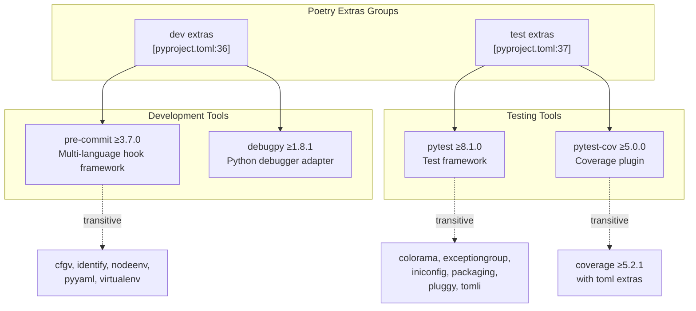
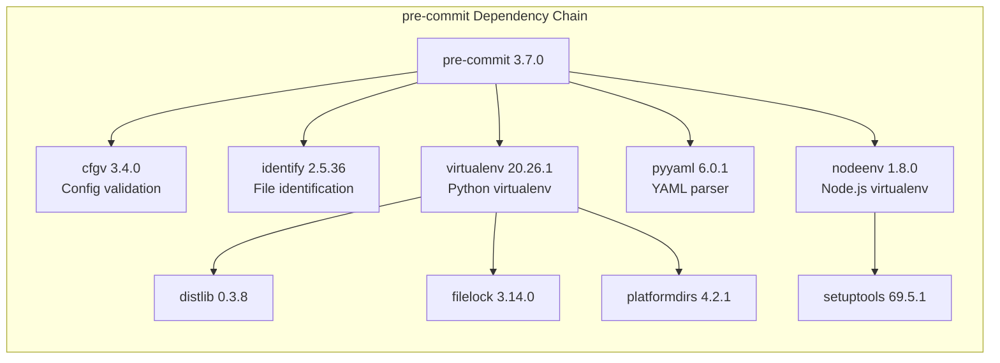
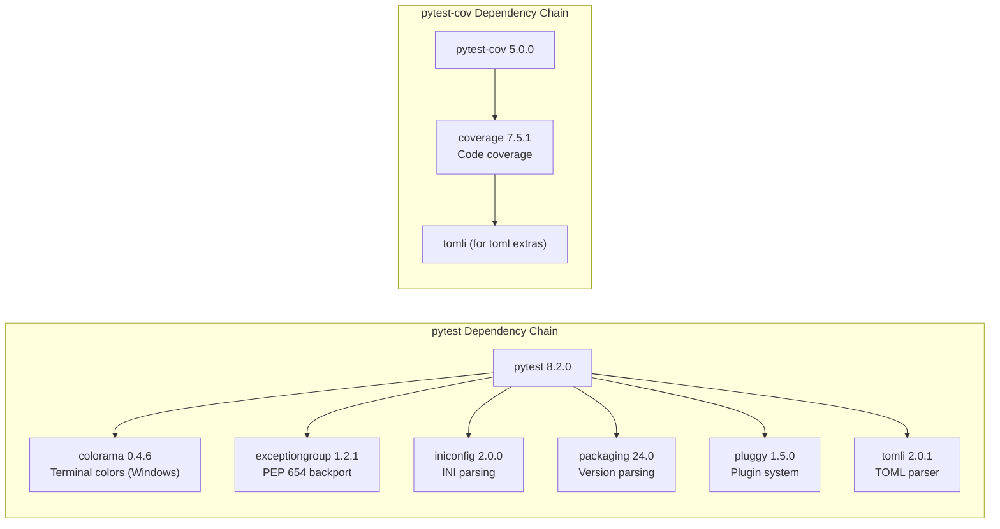
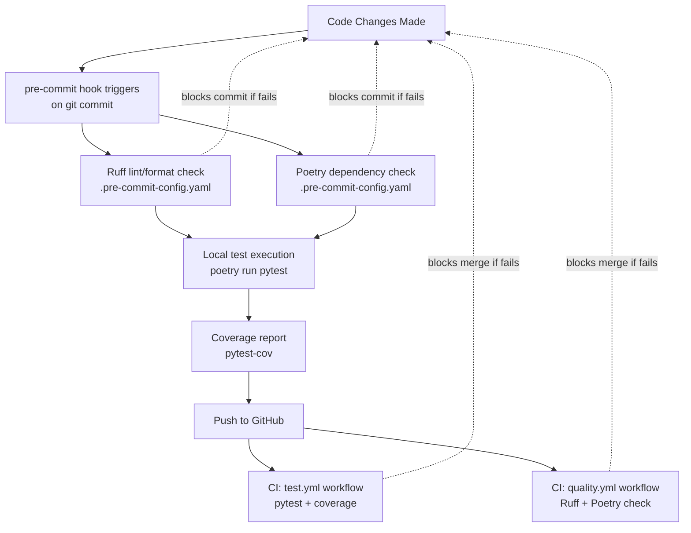
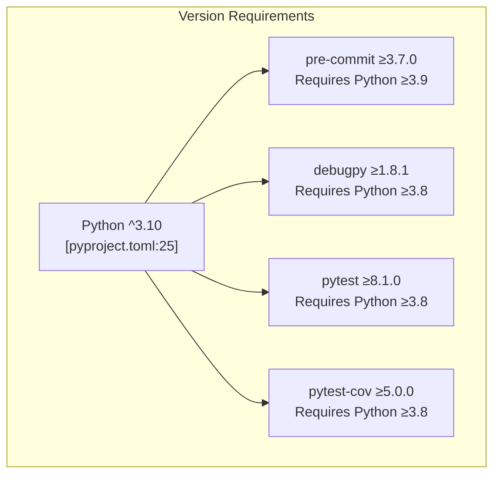

<!-- source: DeepWiki mcp.deepwiki.com · repo huggingface/gym-xarm · page 6.2 Development Dependencies · fetched 2026-10-26 -->

# Development Dependencies

<details>
<summary>Relevant source files</summary>

The following files were used as context for generating this wiki page:

- [poetry.lock](poetry.lock)
- [pyproject.toml](pyproject.toml)

</details>


This page documents the dependencies required for developing and testing gym-xarm, but not needed for runtime usage. These dependencies support code quality enforcement, debugging, and testing workflows. For information about runtime dependencies required to use gym-xarm environments, see [Runtime Dependencies](#6.1). For information about setting up a development environment, see [Development Setup](#5.1).

## Overview

Development dependencies in gym-xarm are organized into two Poetry extras groups defined in `pyproject.toml`: the `dev` extras for development tooling and the `test` extras for testing infrastructure. These dependencies are only installed when explicitly requested during development setup and are not included in standard user installations.



**Sources:** [pyproject.toml:24-37](), [poetry.lock:667-854]()

## Direct Development Dependencies

### pre-commit (≥3.7.0)

**Purpose:** Framework for managing and maintaining multi-language pre-commit hooks that enforce code quality standards before commits reach the repository.

**Key Capabilities:**
- Executes configured hooks automatically on `git commit`
- Manages hook installation and updates across development environments
- Supports multiple programming languages and hook types
- Integrates with the repository's `.pre-commit-config.yaml` configuration

**Version Details:**
- Installed version: 3.7.0
- Python compatibility: ≥3.9
- Package type: Optional (`dev` extras group)

The pre-commit framework is central to gym-xarm's quality assurance workflow. When installed, it runs the Ruff formatter/linter and Poetry dependency validation on every commit, catching issues before they enter the codebase. See [Pre-commit Hooks](#5.4) for configuration details.

**Sources:** [pyproject.toml:29](), [poetry.lock:667-683]()

### debugpy (≥1.8.1)

**Purpose:** Implementation of the Debug Adapter Protocol (DAP) for Python, enabling debugging capabilities in various IDEs and editors.

**Key Capabilities:**
- Provides debugging interface for VSCode, PyCharm, and other DAP-compatible editors
- Supports breakpoints, step execution, variable inspection, and call stack navigation
- Enables remote debugging for containerized or server-based development
- Cross-platform support (macOS, Linux, Windows on multiple architectures)

**Version Details:**
- Installed version: 1.8.1
- Python compatibility: ≥3.8
- Package type: Optional (`dev` extras group)
- Platform-specific wheels available for macOS (x86_64/arm64), Linux (x86_64/aarch64), Windows (32/64-bit)

While not directly invoked by any gym-xarm scripts, debugpy is included to support IDE-based debugging workflows when developing custom tasks or troubleshooting environment behavior.

**Sources:** [pyproject.toml:30](), [poetry.lock:115-143]()

### pytest (≥8.1.0)

**Purpose:** Testing framework that provides the foundation for gym-xarm's automated test suite, enabling unit tests, integration tests, and environment validation.

**Key Capabilities:**
- Simple, scalable test discovery and execution
- Powerful assertion introspection for clear failure messages
- Fixture system for test setup/teardown and dependency injection
- Plugin architecture for extensibility (used with pytest-cov)

**Version Details:**
- Installed version: 8.2.0
- Python compatibility: ≥3.8
- Package type: Optional (`test` extras group)
- Required dependencies: colorama (Windows), exceptiongroup (<3.11), iniconfig, packaging, pluggy, tomli (<3.11)

Pytest executes the test suite in `tests/test_env.py`, which validates environment API compliance using `gymnasium.utils.env_checker` and tests all three observation modes. See [Testing](#5.2) for test execution details.

**Sources:** [pyproject.toml:31](), [poetry.lock:696-716]()

### pytest-cov (≥5.0.0)

**Purpose:** Pytest plugin that measures code coverage during test execution, generating reports to identify untested code paths.

**Key Capabilities:**
- Integrates coverage measurement directly into pytest workflows
- Supports multiple report formats (terminal, HTML, XML)
- TOML configuration support via `pyproject.toml`
- Subprocess coverage tracking for complex test scenarios

**Version Details:**
- Installed version: 5.0.0
- Python compatibility: ≥3.8
- Package type: Optional (`test` extras group)
- Required dependency: coverage ≥5.2.1 with toml extras

The pytest-cov plugin is used in CI/CD workflows to ensure adequate test coverage. It extends pytest with the `--cov` flag for coverage tracking and `--cov-report` for report generation.

**Sources:** [pyproject.toml:32](), [poetry.lock:718-734]()

## Transitive Dependencies

Development dependencies bring in additional transitive dependencies that provide supporting functionality. Understanding these dependencies helps troubleshoot installation issues and manage the development environment.





**Sources:** [poetry.lock:15-851]()

### Pre-commit Transitive Dependencies

| Package | Version | Purpose |
|---------|---------|---------|
| **cfgv** | 3.4.0 | Validates pre-commit configuration files and produces human-readable error messages |
| **identify** | 2.5.36 | File identification library used by pre-commit to determine file types and applicable hooks |
| **nodeenv** | 1.8.0 | Creates Node.js virtual environments for JavaScript/TypeScript-based hooks |
| **pyyaml** | 6.0.1 | YAML parser for reading `.pre-commit-config.yaml` configuration |
| **virtualenv** | 20.26.1 | Creates isolated Python environments for hook execution |
| **distlib** | 0.3.8 | Distribution utilities required by virtualenv |
| **filelock** | 3.14.0 | Platform-independent file locking for concurrent hook execution |
| **platformdirs** | 4.2.1 | Platform-specific directory paths for cache and config storage |
| **setuptools** | 69.5.1 | Package utilities required by nodeenv |

**Sources:** [poetry.lock:15-23, 146-155, 272-283, 455-467, 514-523, 636-649, 182-195, 795-809, 833-851]()

### Pytest Transitive Dependencies

| Package | Version | Purpose | Conditional |
|---------|---------|---------|-------------|
| **colorama** | 0.4.6 | Cross-platform colored terminal text output | Windows only |
| **exceptiongroup** | 1.2.1 | Backport of PEP 654 exception groups | Python <3.11 |
| **iniconfig** | 2.0.0 | Simple INI file parser for pytest configuration |  |
| **packaging** | 24.0 | Version parsing and comparison utilities |  |
| **pluggy** | 1.5.0 | Plugin system that enables pytest's hook architecture |  |
| **tomli** | 2.0.1 | TOML parser for `pyproject.toml` configuration | Python <3.11 |

**Sources:** [poetry.lock:37-46, 157-169, 318-327, 514-523, 652-665, 811-820]()

### Coverage Dependency

The `coverage` package (version 7.5.1) is the core dependency of pytest-cov, providing the actual code coverage measurement engine. It includes the `toml` extras for reading coverage configuration from `pyproject.toml`:

- **coverage[toml]**: Includes `tomli` dependency for TOML parsing on Python ≤3.11
- Platform-specific wheels available for all major platforms and Python versions
- Supports parallel execution, subprocess tracking, and multiple report formats

**Sources:** [poetry.lock:48-113]()

## Installation

Development dependencies are installed using Poetry's extras mechanism. The recommended installation approach varies by use case:

### Full Development Setup

Install all development and testing dependencies for active development:

```bash
poetry install --all-extras
```

This installs both `dev` and `test` extras, equivalent to:

```bash
poetry install --extras "dev test"
```

### Selective Installation

Install only specific dependency groups:

**Development tools only:**
```bash
poetry install --extras dev
```
Installs: pre-commit, debugpy, and their transitive dependencies

**Testing tools only:**
```bash
poetry install --extras test
```
Installs: pytest, pytest-cov, coverage, and their transitive dependencies

### Verification

After installation, verify development dependencies are available:

```bash
# Verify pre-commit installation
poetry run pre-commit --version

# Verify pytest installation
poetry run pytest --version

# Check all installed packages
poetry show
```

**Sources:** [pyproject.toml:35-37]()

## Development Workflow Integration

Development dependencies integrate at specific points in the development lifecycle:



**Sources:** [pyproject.toml:29-32]()

### Pre-commit Hook Execution

When `pre-commit install` has been run, the pre-commit framework intercepts `git commit` commands:

1. **cfgv** validates the `.pre-commit-config.yaml` structure
2. **identify** determines which files have changed and their types
3. **virtualenv** creates isolated environments for each hook
4. Configured hooks execute (Ruff, Poetry check)
5. If all hooks pass, the commit proceeds; otherwise it's blocked

This ensures code quality standards are enforced before code enters the repository. See [Pre-commit Hooks](#5.4) for configuration details.

**Sources:** [poetry.lock:667-683]()

### Pytest Test Execution

The pytest framework orchestrates test discovery and execution:

1. **pluggy** enables pytest's plugin architecture
2. **iniconfig** and **tomli** read configuration from `pyproject.toml`
3. **packaging** handles version comparisons for conditional tests
4. Test discovery finds all `test_*.py` files in the `tests/` directory
5. **pytest-cov** instruments code for coverage measurement
6. **coverage** tracks executed code paths during test runs
7. Reports generate showing test results and coverage metrics

Tests run both locally during development and in CI/CD workflows via the `test.yml` workflow. See [Testing](#5.2) for test execution details.

**Sources:** [poetry.lock:696-734]()

### Debugger Integration

The `debugpy` adapter enables IDE debugging:

1. IDE (VSCode, PyCharm, etc.) launches debugpy server
2. Debugpy attaches to the Python interpreter running gym-xarm code
3. Developer sets breakpoints in task implementations or environment logic
4. Debugger halts execution at breakpoints, allowing variable inspection
5. Step execution and call stack navigation aid troubleshooting

This is particularly useful when developing custom tasks or debugging reward functions. See [Creating Custom Tasks](#5.5) for task development workflows.

**Sources:** [poetry.lock:115-143]()

## Version Constraints and Compatibility

Development dependencies specify minimum versions to ensure compatibility with gym-xarm's Python 3.10+ requirement:



The `≥` (greater than or equal) constraint on development dependencies allows patch and minor version updates while ensuring baseline functionality. This is less restrictive than runtime dependencies like `mujoco ^2.3.7`, which use caret (`^`) constraints to prevent breaking changes.

**Lock File Versions:**
- All dependencies are locked to specific versions in `poetry.lock`
- Lock file ensures reproducible builds across development environments
- `poetry update` refreshes to latest compatible versions within constraints
- Lock file version: 2.0 (Poetry 1.8.2)

**Sources:** [pyproject.toml:24-32](), [poetry.lock:857-860]()

## Platform-Specific Considerations

Several development dependencies provide platform-specific wheels to ensure compatibility across operating systems:

### Cross-Platform Dependencies

**debugpy** provides separate wheels for:
- macOS: x86_64 and Apple Silicon (arm64)
- Linux: x86_64 and aarch64 (manylinux2014)
- Windows: 32-bit and 64-bit

**coverage** provides extensive platform coverage:
- macOS: 10.9+ (x86_64), 11.0+ (arm64)
- Linux: manylinux2014 and manylinux2_28 (x86_64, aarch64, i686)
- Windows: 32-bit and 64-bit
- musllinux: aarch64, i686, x86_64

**pytest** and other pure-Python dependencies provide universal wheels compatible with all platforms.

### Platform-Conditional Dependencies

**colorama** (pytest dependency) is only required on Windows:
- Provides ANSI color code support for Windows terminals
- Not needed on Unix-like systems with native terminal color support
- Installed conditionally based on `sys_platform == "win32"`

**Sources:** [poetry.lock:115-143, 48-113, 696-716, 37-46]()

## Excluding Development Dependencies

When deploying gym-xarm in production or distributing as a library, development dependencies should be excluded:

### User Installation

Standard pip installation does not include development dependencies:

```bash
pip install gym-xarm
```

Only runtime dependencies (gymnasium, mujoco, gymnasium-robotics) are installed.

### Docker/Container Builds

For containerized environments, use production dependency installation:

```bash
poetry install --only main
```

This installs only the main dependency group, excluding all extras.

### CI/CD Production Pipelines

Production deployment pipelines should avoid development dependencies to minimize image size and attack surface:

```bash
# Install without dev dependencies
poetry export -f requirements.txt --without-hashes --only main > requirements.txt
pip install -r requirements.txt
```

Development dependencies remain in the project for contributors while staying isolated from production deployments.

**Sources:** [pyproject.toml:24-37]()

---

