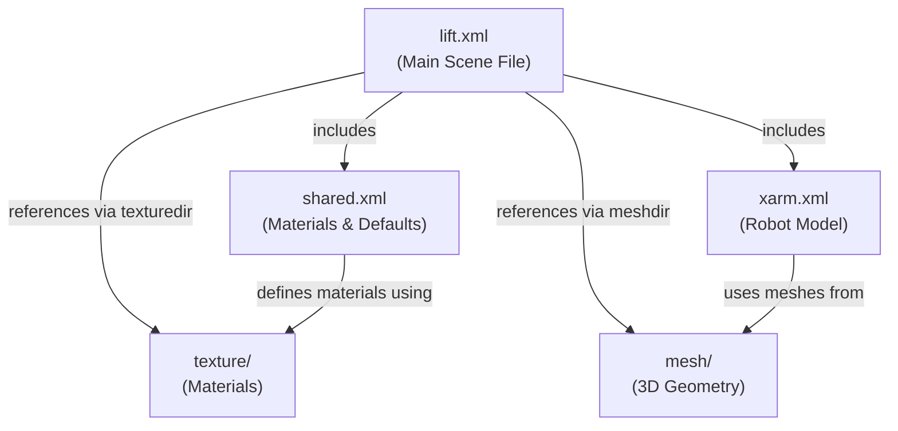
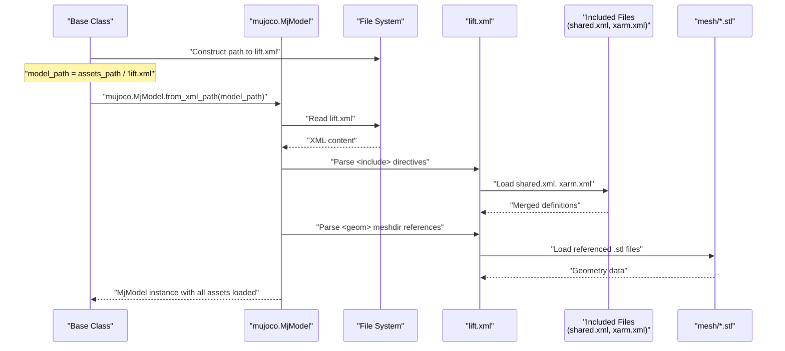
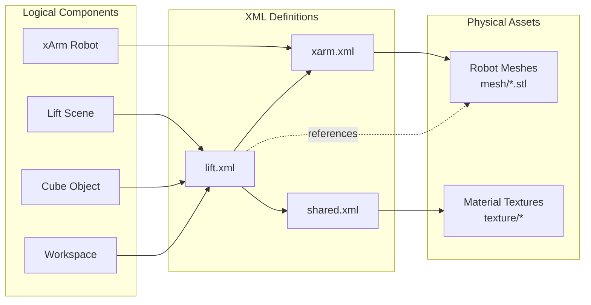

<!-- source: DeepWiki mcp.deepwiki.com · repo huggingface/gym-xarm · page 7 Assets and Resources · fetched 2026-10-26 -->

# Assets and Resources

<details>
<summary>Relevant source files</summary>

The following files were used as context for generating this wiki page:

- [README.md](README.md)
- [example.py](example.py)
- [gym_xarm/tasks/assets/lift.xml](gym_xarm/tasks/assets/lift.xml)
- [gym_xarm/tasks/assets/mesh/base_link.stl](gym_xarm/tasks/assets/mesh/base_link.stl)

</details>


This page documents the physical assets and resource files used by gym-xarm to define the MuJoCo simulation environment. These assets include XML model files that specify the robot and scene structure, 3D mesh files for visual and collision geometry, and texture resources.

For detailed documentation of the XML model structure, see [MuJoCo XML Models](#7.1). For information about the 3D mesh files, see [3D Mesh Assets](#7.2). For information about how these assets are loaded and used at runtime, see [MuJoCo Integration](#3.3).

## Asset Organization

All simulation assets are located in the `gym_xarm/tasks/assets/` directory. The assets are organized into a hierarchical structure where a primary XML file includes secondary XML files and references external mesh and texture resources.

### Asset Directory Structure

```
gym_xarm/tasks/assets/
├── lift.xml              # Main scene file for Lift task
├── shared.xml            # Shared definitions (materials, defaults)
├── xarm.xml              # Robot model definition
├── mesh/                 # 3D geometry files (.stl)
│   ├── [robot components]
│   └── [scene objects]
└── texture/              # Texture image files
    └── [material textures]
```

The directory structure separates concerns: task-specific scene definitions (`lift.xml`), reusable robot definitions (`xarm.xml`), shared resources (`shared.xml`), and binary assets (meshes and textures).

**Sources:** [gym_xarm/tasks/assets/lift.xml:1-4]()

## XML File Inclusion Hierarchy

The XML model files use MuJoCo's `<include>` directive to compose the complete simulation model from modular components.



**Diagram: XML Inclusion and Resource Reference Hierarchy**

The `lift.xml` file acts as the root of the inclusion hierarchy. It specifies the resource directories using compiler directives:

```xml
<compiler angle="radian" coordinate="local" meshdir="mesh" texturedir="texture"></compiler>
```

This configuration tells MuJoCo to resolve mesh references relative to `gym_xarm/tasks/assets/mesh/` and texture references relative to `gym_xarm/tasks/assets/texture/`.

**Sources:** [gym_xarm/tasks/assets/lift.xml:4](), [gym_xarm/tasks/assets/lift.xml:11](), [gym_xarm/tasks/assets/lift.xml:18]()

## Asset Loading Pipeline

The following diagram shows how assets flow from disk into the running simulation:



**Diagram: Asset Loading Sequence from Code to MuJoCo**

The Base class constructs the path to the primary XML file and passes it to MuJoCo's model loader. MuJoCo then recursively resolves all includes and external references, loading the complete scene into memory.

**Sources:** [gym_xarm/tasks/assets/lift.xml:1-54]()

## Primary Scene Components

The `lift.xml` file defines the complete scene for the Lift task. The following table summarizes the major components:

| Component | Element Name | Purpose | Position |
|-----------|-------------|---------|----------|
| Floor | `floor0` | Ground plane for physics | `[1.2, -2.0, 0]` |
| Pedestal | `pedestal0` | Robot mounting platform | `[0.75, 0, 0.6325]` |
| Table | `table0` | Workspace surface | `[1.5, 0.075, 0.3425]` |
| Object | `object` | Manipulable cube (free joint) | `[1.405, 0.3, 0.58625]` |
| Robot | (from xarm.xml) | xArm robot arm | Mounted on pedestal |
| Camera | `camera0` | Default viewpoint | `[0.9559, 1.0, 1.1]` |
| Lights | `light0-3` | Scene illumination | Various positions |

**Sources:** [gym_xarm/tasks/assets/lift.xml:14-40]()

## Simulation Configuration

The XML files also specify critical simulation parameters:

| Parameter | Value | Location | Purpose |
|-----------|-------|----------|---------|
| `timestep` | `0.002` | `lift.xml:7` | 2ms physics timestep (500 Hz) |
| `nconmax` | `2000` | `lift.xml:5` | Maximum number of contacts |
| `njmax` | `500` | `lift.xml:5` | Maximum number of constraints |
| `angle` | `radian` | `lift.xml:4` | Angle units for all values |
| `coordinate` | `local` | `lift.xml:4` | Use local coordinate frames |

The 2ms timestep combined with 20 substeps per environment step (from the Base class) results in a 40ms (25 Hz) control frequency for the agent.

**Sources:** [gym_xarm/tasks/assets/lift.xml:4-9]()

## Object and Robot Configuration

### Manipulable Object

The object (cube) is defined with specific physical properties:

```xml
<body name="object" pos="1.405 0.3 0.58625">
    <joint name="object_joint0" type="free" limited="false"></joint>
    <geom size="0.035 0.035 0.035" type="box" name="object0" 
          material="block_mat" density="50000" condim="4" 
          friction="1 1 1" solimp="1 1 1" solref="0.02 1"></geom>
    <site name="object_site" pos="0 0 0" size="0.035 0.035 0.035" 
          rgba="1 0 0 0" type="box"></site>
</body>
```

Key properties:
- **Size:** 0.035m × 0.035m × 0.035m (35mm cube)
- **Joint:** Free joint allows unconstrained 6-DOF motion
- **Density:** 50000 kg/m³ (very dense for stable grasping)
- **Friction:** Coefficient of 1.0 in all directions
- **Site:** `object_site` used for position tracking in observations

**Sources:** [gym_xarm/tasks/assets/lift.xml:29-33]()

### Gripper Constraints

The gripper mechanism uses equality constraints to couple finger motion:

```xml
<equality>
    <connect body2="left_finger" body1="left_inner_knuckle" 
             anchor="0.0 0.035 0.042" solimp="0.9 0.95 0.001 0.5 2" 
             solref="0.0002 1.0" ></connect>
    <connect body2="right_finger" body1="right_inner_knuckle" 
             anchor="0.0 -0.035 0.042" solimp="0.9 0.95 0.001 0.5 2" 
             solref="0.0002 1.0" ></connect>
    <joint joint1="left_inner_knuckle_joint" 
           joint2="right_inner_knuckle_joint"></joint>
</equality>
```

These constraints ensure synchronized gripper movement and realistic finger kinematics.

**Sources:** [gym_xarm/tasks/assets/lift.xml:43-47]()

## Asset Reference Map

The following diagram maps logical simulation components to their asset definitions:



**Diagram: Mapping from Conceptual Components to Asset Files**

This mapping allows the Base class to load the entire scene by specifying only the primary task XML file. The inclusion and reference system automatically resolves all dependencies.

**Sources:** [gym_xarm/tasks/assets/lift.xml:11](), [gym_xarm/tasks/assets/lift.xml:18](), [gym_xarm/tasks/assets/lift.xml:4]()

## Actuator Configuration

The gripper is controlled through two coupled motors:

| Actuator | Joint | Control Range | Gear Ratio |
|----------|-------|---------------|------------|
| Motor 1 | `left_inner_knuckle_joint` | `[-1.0, 1.0]` | 200.0 |
| Motor 2 | `right_inner_knuckle_joint` | `[-1.0, 1.0]` | 200.0 |

The joint equality constraint ensures these motors move symmetrically, with the control value representing the gripper state (negative = closed, positive = open).

**Sources:** [gym_xarm/tasks/assets/lift.xml:49-52]()

## Camera and Lighting

### Default Camera

The primary camera (`camera0`) is positioned to provide a third-person view of the manipulation workspace:
- **Position:** `[0.9559, 1.0, 1.1]`
- **Orientation:** Euler angles `[-1.1, -0.6, 3.4]` radians
- **Field of View:** 50 degrees

This camera is used by the rendering system to generate pixel observations and human-mode visualizations.

### Lighting Setup

Four directional lights illuminate the scene from different angles to minimize shadows and ensure good visibility of the object and gripper:

| Light | Position | Direction | Purpose |
|-------|----------|-----------|---------|
| `light0` | `[1.65, 0, 10]` | `[-0.57, -0.57, -0.57]` | Primary overhead |
| `light1` | `[0, -4, 4]` | `[0, 1, -0.1]` | Front illumination |
| `light2` | `[2.13, 1.6, 2.5]` | N/A | Side fill light |
| `light3` | `[0, 0, 2]` | `[0.2, 0.2, -0.8]` | Additional diffuse |

All lights use `castshadow="false"` to improve rendering performance and visual consistency.

**Sources:** [gym_xarm/tasks/assets/lift.xml:35-40]()

## Asset Versioning and Compatibility

The XML files use MuJoCo XML format version 2.x. The asset structure is compatible with MuJoCo versions ≥2.3.7 as specified in the project dependencies (see [Runtime Dependencies](#6.1)).

Key version considerations:
- **Angle units:** All angles specified in radians
- **Coordinate system:** Local coordinates (not global)
- **Physics parameters:** Tuned for MuJoCo's default solver settings

**Sources:** [gym_xarm/tasks/assets/lift.xml:1-9]()

---

