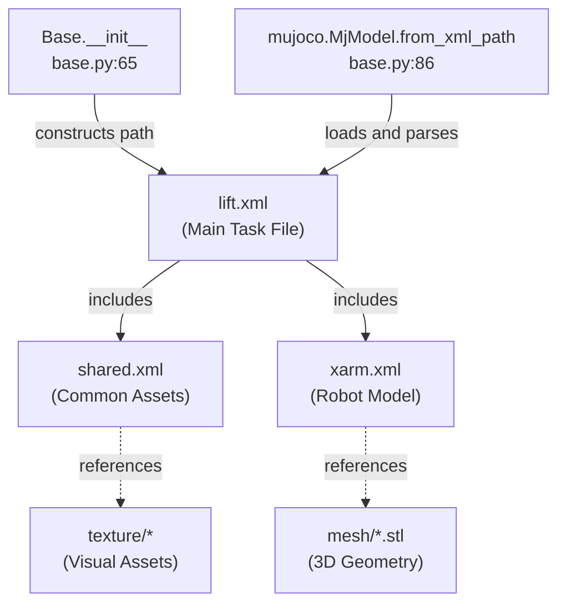
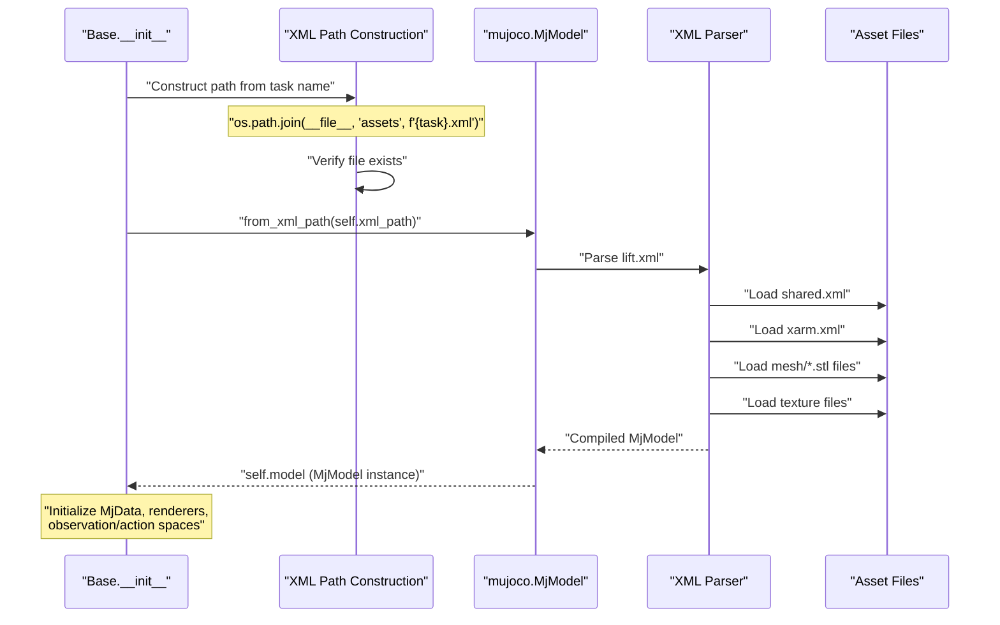
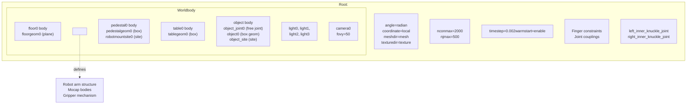
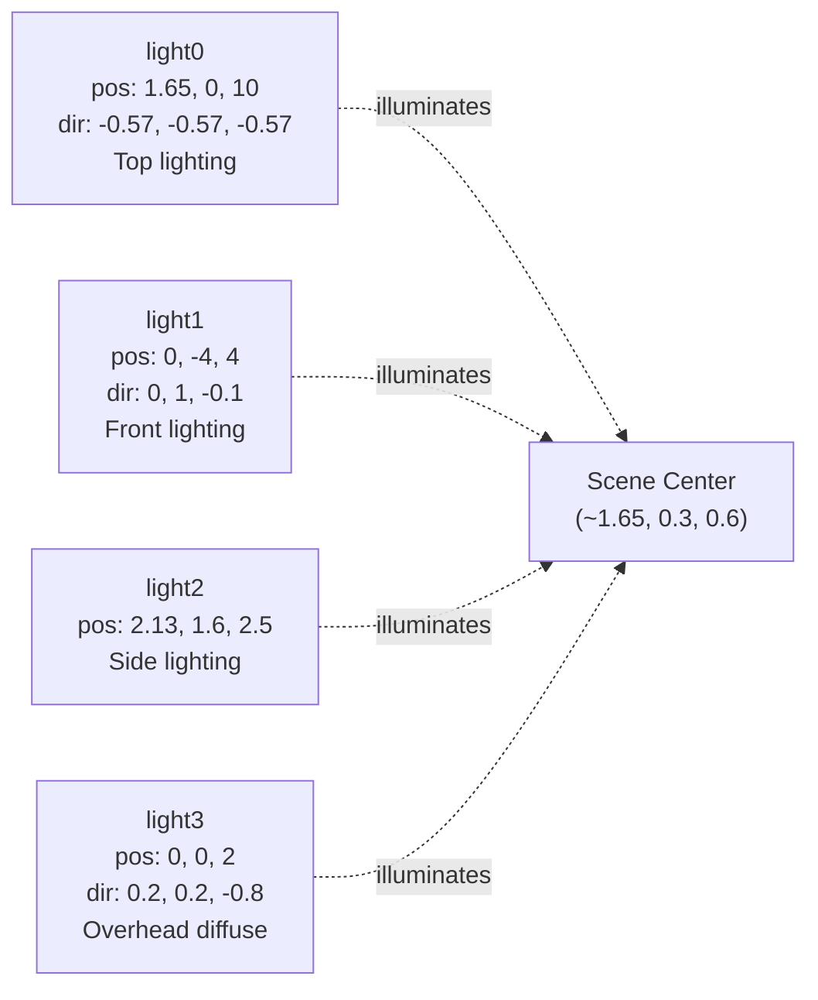
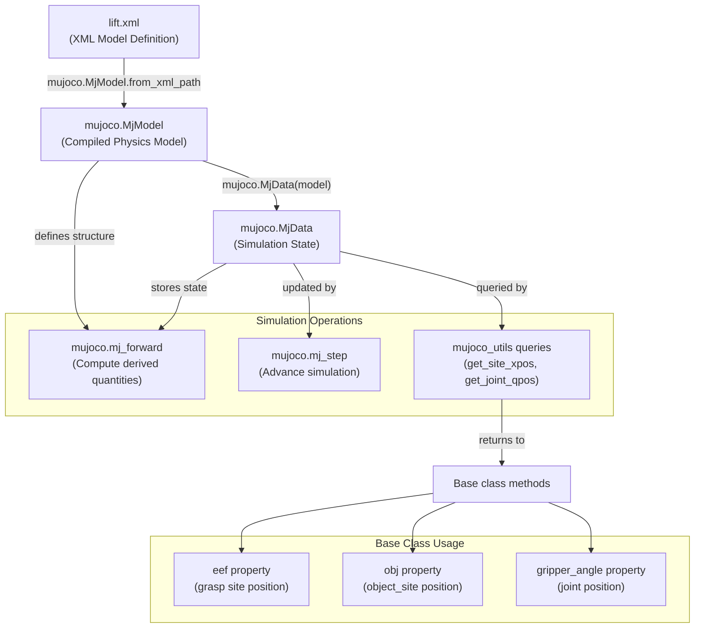

<!-- source: DeepWiki mcp.deepwiki.com · repo huggingface/gym-xarm · page 7.1 MuJoCo XML Models · fetched 2026-10-26 -->

# MuJoCo XML Models

<details>
<summary>Relevant source files</summary>

The following files were used as context for generating this wiki page:

- [gym_xarm/tasks/assets/lift.xml](gym_xarm/tasks/assets/lift.xml)
- [gym_xarm/tasks/base.py](gym_xarm/tasks/base.py)
- [gym_xarm/tasks/mocap.py](gym_xarm/tasks/mocap.py)

</details>


This document describes the MuJoCo XML model files that define the robot, environment, and objects in the gym-xarm simulation. These XML files configure the physics simulation, visual appearance, and structural composition of the xArm manipulation environment.

For information about the 3D mesh assets referenced by these XML files, see [3D Mesh Assets](#7.2). For details on how the simulation is initialized and used at runtime, see [MuJoCo Integration](#3.3).

## Overview

The gym-xarm package uses MuJoCo's XML format (MJCF) to define simulation environments. The XML models specify:

- Robot structure and kinematics (xArm robotic arm with gripper)
- Environment geometry (table, floor, pedestal)
- Task-specific objects (cube for lifting)
- Physical properties (mass, friction, constraints)
- Visual elements (lights, camera positions, materials)
- Simulation parameters (timestep, solver settings)

XML files are located in `gym_xarm/tasks/assets/` and are loaded dynamically based on the task name specified during environment initialization.

**Sources:** [gym_xarm/tasks/assets/lift.xml:1-54](), [gym_xarm/tasks/base.py:65-67]()

## XML File Hierarchy

The XML models use MuJoCo's `<include>` directive to compose environments from modular components:



**File Inclusion Structure:**
- `lift.xml` - Root file defining the Lift task environment
- `shared.xml` - Shared assets (materials, textures) included via `<include file="shared.xml">`
- `xarm.xml` - Robot model included via `<include file="xarm.xml">`
- Mesh directory specified in compiler: `meshdir="mesh"`
- Texture directory specified in compiler: `texturedir="texture"`

**Sources:** [gym_xarm/tasks/assets/lift.xml:4](), [gym_xarm/tasks/assets/lift.xml:11](), [gym_xarm/tasks/assets/lift.xml:18](), [gym_xarm/tasks/base.py:65-67]()

## XML Loading Process



The Base class constructs the XML path in `__init__` and loads it during `_initialize_simulation()`:

| Step | Code Location | Action |
|------|---------------|---------|
| 1 | [gym_xarm/tasks/base.py:65]() | Construct path: `os.path.join(os.path.dirname(__file__), "assets", f"{task}.xml")` |
| 2 | [gym_xarm/tasks/base.py:66-67]() | Verify file exists with `os.path.exists()` check |
| 3 | [gym_xarm/tasks/base.py:70]() | Call `_initialize_simulation()` |
| 4 | [gym_xarm/tasks/base.py:86]() | Load model: `self._mujoco.MjModel.from_xml_path(self.xml_path)` |
| 5 | [gym_xarm/tasks/base.py:87]() | Create data: `self._mujoco.MjData(self.model)` |

**Sources:** [gym_xarm/tasks/base.py:65-67](), [gym_xarm/tasks/base.py:84-88]()

## Lift Task XML Structure

The `lift.xml` file defines the complete Lift task environment:



**Sources:** [gym_xarm/tasks/assets/lift.xml:1-54]()

### Compiler Configuration

The `<compiler>` element [gym_xarm/tasks/assets/lift.xml:4]() configures parsing and coordinate systems:

| Attribute | Value | Purpose |
|-----------|-------|---------|
| `angle` | `"radian"` | All angle values in XML specified in radians |
| `coordinate` | `"local"` | Body positions relative to parent frame |
| `meshdir` | `"mesh"` | Directory for `.stl` mesh files |
| `texturedir` | `"texture"` | Directory for texture assets |

### Size Limits

The `<size>` element [gym_xarm/tasks/assets/lift.xml:5]() sets simulation array sizes:

| Parameter | Value | Meaning |
|-----------|-------|---------|
| `nconmax` | `2000` | Maximum number of contacts |
| `njmax` | `500` | Maximum number of scalar constraints |

These limits accommodate complex contact scenarios during manipulation tasks.

### Simulation Options

The `<option>` element [gym_xarm/tasks/assets/lift.xml:7-9]() configures the physics engine:

```xml
<option timestep="0.002">
    <flag warmstart="enable"></flag>
</option>
```

- **timestep**: `0.002` seconds (500 Hz base simulation rate)
- **warmstart**: Enabled for faster constraint solver convergence

The Base class performs `n_substeps = 20` MuJoCo steps per Gymnasium step [gym_xarm/tasks/base.py:30](), resulting in an effective timestep of `0.04` seconds (25 Hz) per environment step.

**Sources:** [gym_xarm/tasks/assets/lift.xml:7-9](), [gym_xarm/tasks/base.py:30]()

## Worldbody Components

The `<worldbody>` section defines the physical scene:

### Floor Geometry

```xml
<body name="floor0" pos="0 0 0">
    <geom name="floorgeom0" pos="1.2 -2.0 0" size="20.0 20.0 1" 
          type="plane" condim="3" material="floor_mat"></geom>
</body>
```

The floor is an infinite plane positioned at z=0 with `condim="3"` (friction in all directions).

**Sources:** [gym_xarm/tasks/assets/lift.xml:14-16]()

### Robot Pedestal

```xml
<body pos="0.75 0 0.6325" name="pedestal0">
    <geom name="pedestalgeom0" size="0.1 0.1 0.01" pos="0.32 0.27 0" 
          type="box" mass="2000" material="pedestal_mat"></geom>
    <site pos="0.30 0.30 0" size="0.075 0.075 0.002" type="box" 
          name="robotmountsite0" rgba="0.55 0.54 0.53 1" />
</body>
```

The pedestal provides a mounting surface for the robot with:
- Heavy mass (2000 kg) for stability
- Site marker `robotmountsite0` for visual reference

**Sources:** [gym_xarm/tasks/assets/lift.xml:20-23]()

### Table

```xml
<body pos="1.5 0.075 0.3425" name="table0">
    <geom name="tablegeom0" size="0.3 0.6 0.2" pos="0 0 0" type="box" 
          material="table_mat" density="2000" friction="1 1 1"></geom>
</body>
```

The table provides the workspace surface with high friction (`1 1 1`) for object stability.

**Sources:** [gym_xarm/tasks/assets/lift.xml:25-27]()

### Manipulated Object

```xml
<body name="object" pos="1.405 0.3 0.58625">
    <joint name="object_joint0" type="free" limited="false"></joint>
    <geom size="0.035 0.035 0.035" type="box" name="object0" 
          material="block_mat" density="50000" condim="4" 
          friction="1 1 1" solimp="1 1 1" solref="0.02 1"></geom>
    <site name="object_site" pos="0 0 0" size="0.035 0.035 0.035" 
          rgba="1 0 0 0" type="box"></site>
</body>
```

The cube object has:
- **Free joint** (`object_joint0`): 6-DOF unconstrained motion
- **Box geometry**: 0.035m cube (35mm)
- **High density** (`50000`): Creates substantial mass for realistic manipulation
- **Contact dimension** (`condim="4"`): Enables torsional friction
- **Site marker** (`object_site`): Used for position queries in Base class

The Base class accesses the object position via `object_site` [gym_xarm/tasks/base.py:175]():
```python
def obj(self):
    return self._utils.get_site_xpos(self.model, self.data, "object_site") - self.center_of_table
```

**Sources:** [gym_xarm/tasks/assets/lift.xml:29-33](), [gym_xarm/tasks/base.py:174-175]()

## Lighting and Camera Configuration

### Lighting Setup

Four directional lights provide illumination [gym_xarm/tasks/assets/lift.xml:35-38]():



All lights have `castshadow="false"` for computational efficiency during rendering.

### Camera

```xml
<camera fovy="50" name="camera0" pos="0.9559 1.0 1.1" euler="-1.1 -0.6 3.4" />
```

The camera `camera0` [gym_xarm/tasks/assets/lift.xml:40]() is positioned to view the workspace from an angled perspective. The Base class renders using this camera [gym_xarm/tasks/base.py:320]():

```python
render = renderer.render(self.render_mode, camera_name="camera0")
```

**Sources:** [gym_xarm/tasks/assets/lift.xml:35-40](), [gym_xarm/tasks/base.py:320]()

## Equality Constraints and Actuators

### Gripper Finger Constraints

The `<equality>` section [gym_xarm/tasks/assets/lift.xml:43-47]() couples the gripper fingers:

```xml
<equality>
    <connect body2="left_finger" body1="left_inner_knuckle" 
             anchor="0.0 0.035 0.042" solimp="0.9 0.95 0.001 0.5 2" 
             solref="0.0002 1.0"></connect>
    <connect body2="right_finger" body1="right_inner_knuckle" 
             anchor="0.0 -0.035 0.042" solimp="0.9 0.95 0.001 0.5 2" 
             solref="0.0002 1.0"></connect>
    <joint joint1="left_inner_knuckle_joint" joint2="right_inner_knuckle_joint"></joint>
</equality>
```

These constraints:
- Connect finger segments to knuckles via point constraints
- Couple left and right gripper joints for symmetric motion
- Use soft constraints (`solimp`, `solref`) for realistic finger dynamics

### Gripper Actuators

```xml
<actuator>
    <motor ctrllimited="true" ctrlrange="-1.0 1.0" 
           joint="left_inner_knuckle_joint" gear="200.0"/>
    <motor ctrllimited="true" ctrlrange="-1.0 1.0" 
           joint="right_inner_knuckle_joint" gear="200.0"/>
</actuator>
```

The actuators [gym_xarm/tasks/assets/lift.xml:49-52]() control gripper opening/closing:
- Control range: `[-1.0, 1.0]`
- Gear ratio: `200.0` for sufficient gripper force
- Applied via `data.ctrl` in mocap module [gym_xarm/tasks/mocap.py:10-11]()

**Sources:** [gym_xarm/tasks/assets/lift.xml:43-52](), [gym_xarm/tasks/mocap.py:9-11]()

## Robot Model (xarm.xml)

The robot structure is defined in `xarm.xml` (included at [gym_xarm/tasks/assets/lift.xml:18]()), which specifies:

- **xArm kinematic chain**: Joint limits, link geometries, masses
- **Gripper mechanism**: Parallel-jaw gripper with coupled fingers  
- **Mocap body**: `robot0:mocap2` for motion capture control
- **Grasp site**: Used by Base class for end-effector position queries

The Base class accesses robot-specific elements:

```python
# End-effector position via grasp site
def eef(self):
    return self._utils.get_site_xpos(self.model, self.data, "grasp") - self.center_of_table

# Gripper state via joint position
def gripper_angle(self):
    return self._utils.get_joint_qpos(self.model, self.data, "right_outer_knuckle_joint")
```

**Sources:** [gym_xarm/tasks/assets/lift.xml:18](), [gym_xarm/tasks/base.py:158-159](), [gym_xarm/tasks/base.py:166-167]()

## Named Elements Used by Base Class

The Base class queries specific named elements from the XML model:

| XML Element Name | Type | Used By | Purpose |
|------------------|------|---------|---------|
| `grasp` | Site | [base.py:159]() | End-effector position (`eef` property) |
| `object_site` | Site | [base.py:175]() | Object position (`obj` property) |
| `right_outer_knuckle_joint` | Joint | [base.py:167]() | Gripper angle (`gripper_angle` property) |
| `object_joint0` | Joint | [base.py:179]() | Object rotation (`obj_rot` property) |
| `robot0:mocap2` | Mocap body | [base.py:309-310]() | Motion capture control target |
| `left_inner_knuckle_joint` | Joint | [base.py:311]() | Gripper position setting |
| `camera0` | Camera | [base.py:320]() | Rendering viewpoint |

The mocap module also references specific body names [gym_xarm/tasks/mocap.py:38]():
```python
if body2 == "B0" or body2 == "B9" or body2 == "B1":
    continue  # Skip certain bodies during mocap reset
```

**Sources:** [gym_xarm/tasks/base.py:158-179](), [gym_xarm/tasks/base.py:309-311](), [gym_xarm/tasks/base.py:320](), [gym_xarm/tasks/mocap.py:38]()

## XML Model to Simulation Data Flow



The XML model is compiled into an immutable `MjModel` containing structural information (sizes, names, parameters). The `MjData` instance holds the mutable simulation state (positions, velocities, forces) that changes over time.

**Sources:** [gym_xarm/tasks/base.py:84-96](), [gym_xarm/tasks/base.py:158-179]()

---

