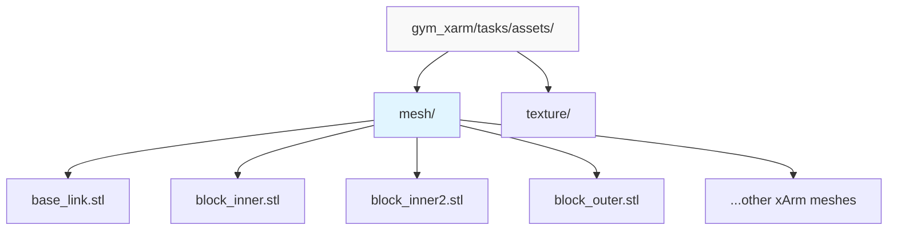
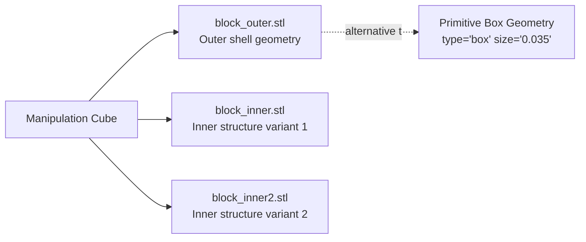
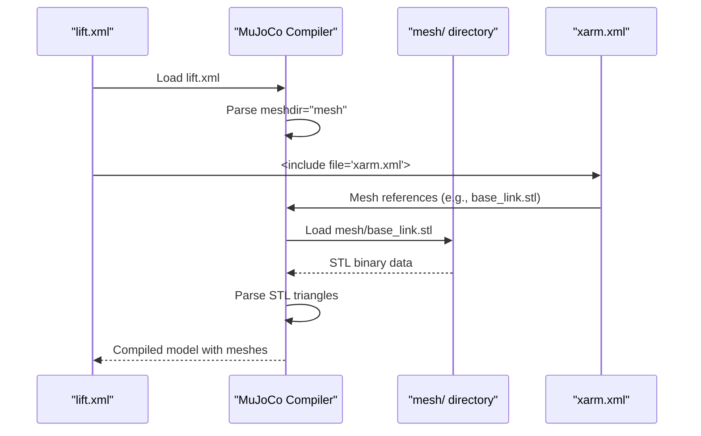
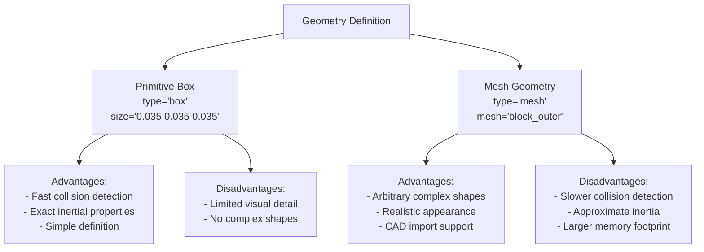
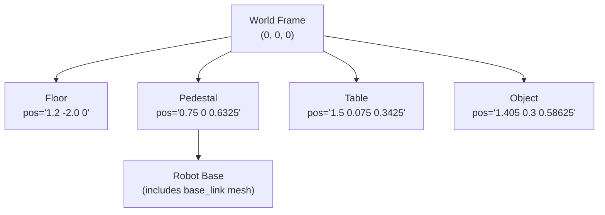

<!-- source: DeepWiki mcp.deepwiki.com · repo huggingface/gym-xarm · page 7.2 3D Mesh Assets · fetched 2026-10-26 -->

# 3D Mesh Assets

<details>
<summary>Relevant source files</summary>

The following files were used as context for generating this wiki page:

- [gym_xarm/tasks/assets/lift.xml](gym_xarm/tasks/assets/lift.xml)
- [gym_xarm/tasks/assets/mesh/base_link.stl](gym_xarm/tasks/assets/mesh/base_link.stl)
- [gym_xarm/tasks/assets/mesh/block_inner.stl](gym_xarm/tasks/assets/mesh/block_inner.stl)
- [gym_xarm/tasks/assets/mesh/block_inner2.stl](gym_xarm/tasks/assets/mesh/block_inner2.stl)
- [gym_xarm/tasks/assets/mesh/block_outer.stl](gym_xarm/tasks/assets/mesh/block_outer.stl)

</details>


This page documents the 3D mesh files (`.stl` format) used by the MuJoCo simulation for visual and collision geometry. For information about the XML model files that reference these meshes, see [MuJoCo XML Models](#7.1). For the overall simulation architecture, see [MuJoCo Integration](#3.3).

## Overview

The gym-xarm simulation uses 3D mesh files to define the visual and collision geometry of the xArm robot and manipulation objects. These meshes are stored in STL (STereoLithography) format, a standard file format widely used in CAD and robotics for representing triangulated surface geometry. MuJoCo loads these meshes during simulation initialization and uses them for both rendering and physics calculations.

**Sources:** [gym_xarm/tasks/assets/lift.xml:4]()

## Mesh Directory Structure

All mesh assets are organized in a dedicated directory structure:



**Directory Organization:**

| Directory | Path | Purpose |
|-----------|------|---------|
| Root assets | `gym_xarm/tasks/assets/` | Container for all simulation assets |
| Meshes | `gym_xarm/tasks/assets/mesh/` | STL mesh files for 3D geometry |
| Textures | `gym_xarm/tasks/assets/texture/` | Texture files for materials |

The mesh directory is specified in the MuJoCo compiler directive: `<compiler meshdir="mesh">`, which tells MuJoCo to search for mesh files in the `mesh/` subdirectory relative to the XML file location.

**Sources:** [gym_xarm/tasks/assets/lift.xml:4]()

## Mesh File Inventory

### Robot Meshes

The xArm robot geometry is composed of multiple mesh files referenced in the included `xarm.xml` model:

| Mesh File | Component | Purpose |
|-----------|-----------|---------|
| `base_link.stl` | Robot base | Base platform and mounting structure |
| Additional meshes | Robot links | Arm segments, joints, end-effector (defined in xarm.xml) |

The `base_link.stl` file contains 22,400+ triangular faces defining the complex geometry of the robot's base platform, including mounting points and structural features.

**Sources:** [gym_xarm/tasks/assets/mesh/base_link.stl:1-2]()

### Manipulation Object Meshes

Three mesh files define the manipulation object (cube) with varying levels of detail:



| Mesh File | Faces | Purpose |
|-----------|-------|---------|
| `block_outer.stl` | 124 triangles | Outer shell of cube object |
| `block_inner.stl` | 40 triangles | Inner structure variant |
| `block_inner2.stl` | 80 triangles | Alternative inner structure |

**Note:** The current Lift task implementation uses a primitive box geometry (`type="box"`) rather than these mesh files for the manipulation object. The mesh files provide an alternative representation with more detailed geometry.

**Sources:** [gym_xarm/tasks/assets/lift.xml:29-33](), [gym_xarm/tasks/assets/mesh/block_outer.stl:1](), [gym_xarm/tasks/assets/mesh/block_inner.stl:1](), [gym_xarm/tasks/assets/mesh/block_inner2.stl:1]()

## STL File Format

### Format Specification

All mesh files use the binary STL format, which stores geometry as a collection of triangular facets:

```
Binary STL Structure:
├── 80-byte header (ASCII text or binary data)
├── 4-byte unsigned integer (number of triangles)
└── For each triangle:
    ├── 12 bytes: Normal vector (3 floats)
    ├── 12 bytes: Vertex 1 (3 floats)
    ├── 12 bytes: Vertex 2 (3 floats)
    ├── 12 bytes: Vertex 3 (3 floats)
    └── 2 bytes: Attribute byte count
```

### Example: Block Outer Mesh

The `block_outer.stl` begins with:
- **Header:** `"Exported from Blender-2.79 (sub 0)"` (80 bytes)
- **Triangle count:** 124 faces
- **Coordinate system:** Right-handed, units in meters

Each triangle defines a facet of the cube's outer surface with:
- Normal vector for lighting calculations
- Three vertices in counter-clockwise winding order
- Coordinates in the local object frame

**Sources:** [gym_xarm/tasks/assets/mesh/block_outer.stl:1]()

## Mesh Integration with MuJoCo

### Compiler Configuration

The MuJoCo XML model specifies how to locate and load mesh files:

```xml
<compiler angle="radian" coordinate="local" meshdir="mesh" texturedir="texture"></compiler>
```

| Attribute | Value | Meaning |
|-----------|-------|---------|
| `meshdir` | `"mesh"` | Mesh files located in `./mesh/` subdirectory |
| `texturedir` | `"texture"` | Texture files in `./texture/` subdirectory |
| `coordinate` | `"local"` | Use local coordinate frames for each body |
| `angle` | `"radian"` | Angular measurements in radians |

**Sources:** [gym_xarm/tasks/assets/lift.xml:4]()

### Mesh References in XML



The included `xarm.xml` file contains mesh references like:
```xml
<mesh file="base_link.stl"/>
<geom type="mesh" mesh="base_link"/>
```

MuJoCo resolves `"base_link.stl"` to `gym_xarm/tasks/assets/mesh/base_link.stl` using the configured `meshdir`.

**Sources:** [gym_xarm/tasks/assets/lift.xml:4](), [gym_xarm/tasks/assets/lift.xml:18]()

## Primitive vs Mesh Geometry

The Lift task demonstrates two approaches to defining object geometry:



### Current Implementation: Primitive Box

```xml
<geom size="0.035 0.035 0.035" type="box" name="object0" 
      material="block_mat" density="50000" condim="4" 
      friction="1 1 1" solimp="1 1 1" solref="0.02 1"></geom>
```

**Dimensions:** 7cm × 7cm × 7cm cube (0.035m half-extents)

**Properties:**
- **Density:** 50,000 kg/m³ (very dense for stable grasping)
- **Friction:** `[1, 1, 1]` (sliding, torsional, rolling)
- **Contact dimensions:** 4 (pyramid friction cone)

The primitive box provides optimal physics performance for the manipulation task while the mesh files offer an alternative for visual realism.

**Sources:** [gym_xarm/tasks/assets/lift.xml:31]()

## Mesh Coordinate Frames

All meshes are defined in their local coordinate frames, which are then positioned in the world via the XML body definitions:



**Key Positions in World Frame:**

| Body | X (m) | Y (m) | Z (m) | Description |
|------|-------|-------|-------|-------------|
| Floor | 1.2 | -2.0 | 0.0 | Ground plane |
| Pedestal | 0.75 | 0.0 | 0.6325 | Robot mounting platform |
| Table | 1.5 | 0.075 | 0.3425 | Manipulation surface |
| Object | 1.405 | 0.3 | 0.58625 | Initial cube position |

The `coordinate="local"` compiler setting means each mesh uses its own local origin, which is then transformed by the body position and orientation.

**Sources:** [gym_xarm/tasks/assets/lift.xml:14-29]()

## Usage in Simulation

### Loading Process

When the simulation initializes:

1. **XML parsing:** MuJoCo parses `lift.xml` and encounters `meshdir="mesh"`
2. **Include resolution:** Loads `xarm.xml` which references robot meshes
3. **Mesh loading:** For each `<mesh file="...">` directive, loads the STL file from `mesh/` directory
4. **Triangle processing:** Converts STL triangles to internal collision geometry
5. **Rendering setup:** Creates display lists or GPU buffers for visualization

### Memory Footprint

**Approximate mesh sizes:**

| Mesh | Triangles | Vertices | Approx Size |
|------|-----------|----------|-------------|
| `base_link.stl` | ~22,400 | ~67,200 | ~3.2 MB binary |
| `block_outer.stl` | 124 | 372 | ~6 KB binary |
| `block_inner.stl` | 40 | 120 | ~2 KB binary |
| `block_inner2.stl` | 80 | 240 | ~4 KB binary |

The robot base mesh dominates memory usage due to its detailed geometry representing mounting holes, structural features, and surface details.

**Sources:** [gym_xarm/tasks/assets/mesh/base_link.stl:1-2](), [gym_xarm/tasks/assets/mesh/block_outer.stl:1]()

## Extending with Custom Meshes

To add custom mesh geometry:

1. **Export mesh:** Create STL file from CAD software (Blender, SolidWorks, etc.)
2. **Place file:** Copy to `gym_xarm/tasks/assets/mesh/`
3. **Define in XML:**
   ```xml
   <asset>
       <mesh name="custom_object" file="custom_object.stl"/>
   </asset>
   ```
4. **Reference in body:**
   ```xml
   <geom type="mesh" mesh="custom_object" ... />
   ```

**Best Practices:**
- Use binary STL for smaller file size
- Keep triangle count reasonable (< 10,000 for real-time physics)
- Ensure watertight geometry (no holes or non-manifold edges)
- Use consistent units (meters) and coordinate frame (Z-up, right-handed)
- Consider using primitive shapes when possible for performance

**Sources:** [gym_xarm/tasks/assets/lift.xml:4](), [gym_xarm/tasks/assets/lift.xml:18]()

---

