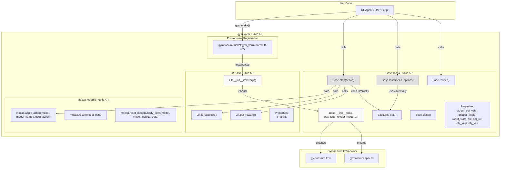
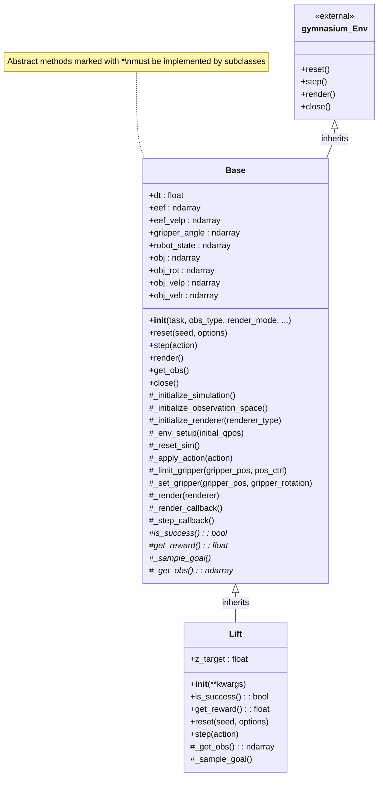
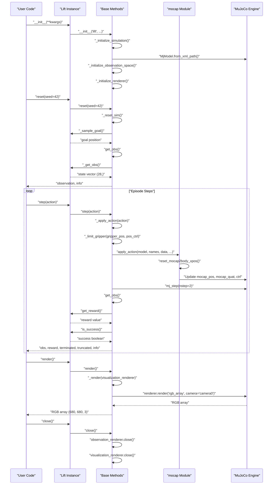
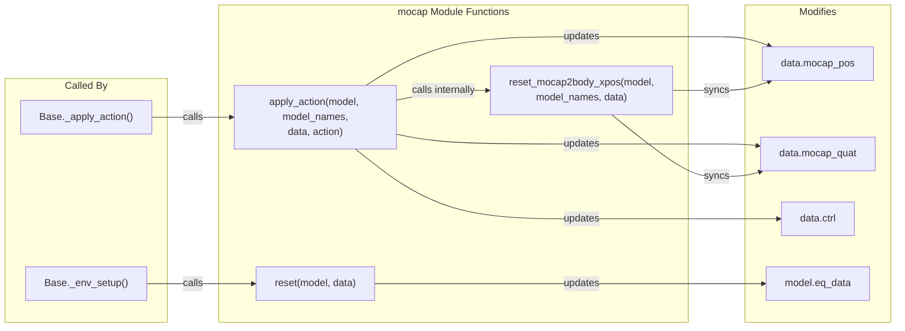

<!-- source: DeepWiki mcp.deepwiki.com · repo huggingface/gym-xarm · page 8 API Reference · fetched 2026-10-26 -->

# API Reference

<details>
<summary>Relevant source files</summary>

The following files were used as context for generating this wiki page:

- [gym_xarm/tasks/base.py](gym_xarm/tasks/base.py)
- [gym_xarm/tasks/lift.py](gym_xarm/tasks/lift.py)
- [gym_xarm/tasks/mocap.py](gym_xarm/tasks/mocap.py)

</details>


This section provides detailed technical documentation of all public classes, methods, properties, and functions in the gym-xarm package. This reference is intended for developers who need precise information about method signatures, parameters, return values, and behavior.

For usage examples and tutorials, see [Quick Start Tutorial](#2.2). For understanding the overall system architecture, see [Core Architecture](#3).

---

## API Overview

The gym-xarm API is organized into three main components:

1. **Base Environment Class** - The core environment implementation providing Gymnasium interface, MuJoCo integration, and observation/action processing ([gym_xarm/tasks/base.py]())
2. **Lift Task** - The active manipulation task implementing reward logic and goal sampling ([gym_xarm/tasks/lift.py]())
3. **Mocap Module** - Utility functions for motion capture control in MuJoCo ([gym_xarm/tasks/mocap.py]())

The following diagram shows the public API surface and how components relate:



**Sources:** [gym_xarm/tasks/base.py](), [gym_xarm/tasks/lift.py](), [gym_xarm/tasks/mocap.py]()

---

## Core API Components

### Base Environment Class

The `Base` class ([gym_xarm/tasks/base.py:18]()) is the foundational environment implementation. It provides:

- **Lifecycle Management**: `__init__`, `reset`, `step`, `close`
- **Observation Generation**: `get_obs` with three modes (`state`, `pixels`, `pixels_agent_pos`)
- **Action Processing**: `_apply_action` with mocap control integration
- **Rendering**: Dual renderer system (`render` for visualization, internal observation renderer)
- **Robot State Properties**: `eef`, `eef_velp`, `gripper_angle`, `robot_state`, `obj`, `obj_rot`, `obj_velp`, `obj_velr`

See [Base Class API](#8.1) for complete method signatures and detailed documentation.

### Lift Task

The `Lift` class ([gym_xarm/tasks/lift.py:6]()) extends `Base` and implements:

- **Task Configuration**: Metadata defining action space (`"xyzw"`), episode length (50), and task description
- **Success Criteria**: `is_success` checking if object height exceeds threshold
- **Reward Function**: `get_reward` combining reach and pick components
- **Observation Space**: `_get_obs` returning 28-dimensional state vector
- **Goal Sampling**: `_sample_goal` randomizing initial positions

See [Lift Task API](#8.2) for complete task-specific documentation.

### Mocap Module

The `mocap` module ([gym_xarm/tasks/mocap.py]()) provides three utility functions for motion capture control:

- `apply_action(model, model_names, data, action)` - Applies actions to mocap bodies and gripper
- `reset(model, data)` - Resets mocap weld constraints
- `reset_mocap2body_xpos(model, model_names, data)` - Synchronizes mocap positions with welded bodies

See [Mocap Module API](#8.3) for function signatures and usage.

**Sources:** [gym_xarm/tasks/base.py](), [gym_xarm/tasks/lift.py](), [gym_xarm/tasks/mocap.py]()

---

## Class Hierarchy



**Sources:** [gym_xarm/tasks/base.py:18-335](), [gym_xarm/tasks/lift.py:6-102]()

---

## Action and Observation Spaces

### Action Space

The action space is defined by the task's metadata and constructed in [gym_xarm/tasks/base.py:74]():

| Property | Type | Shape | Range | Description |
|----------|------|-------|-------|-------------|
| `action_space` | `gym.spaces.Box` | `(4,)` | `[-1.0, 1.0]` | Continuous actions for x, y, z, gripper |

The action vector components (for Lift task with `action_space="xyzw"`):
- `action[0:3]` - Delta position control for end-effector (x, y, z)
- `action[3]` - Gripper control (-1 = open, 1 = close)

### Observation Spaces

Three observation types are supported, configured via the `obs_type` parameter:

| obs_type | Space Type | Shape/Contents | Description |
|----------|-----------|----------------|-------------|
| `"state"` | `Box` | `(28,)` float64 | State vector containing robot and object states |
| `"pixels"` | `Box` | `(84, 84, 3)` uint8 | RGB image from camera |
| `"pixels_agent_pos"` | `Dict` | `{"pixels": (84,84,3), "agent_pos": (4,)}` | Hybrid observation combining image and robot state |

The state vector (28 dimensions) contains:
- End-effector position (3)
- End-effector linear velocity (3)
- Object position (3)
- Object rotation quaternion (4)
- Object linear velocity (3)
- Object angular velocity (3)
- End-effector to object delta (3)
- Distance metrics (5: 3D distance, XY distance, z_target, z_target-obj_z, z_target-eef_z)
- Gripper angle (1)

**Sources:** [gym_xarm/tasks/base.py:74-131](), [gym_xarm/tasks/lift.py:50-72]()

---

## Data Flow Through API Methods

The following diagram shows how data flows through the API during a typical episode:



**Sources:** [gym_xarm/tasks/base.py:35-335](), [gym_xarm/tasks/lift.py:14-102](), [gym_xarm/tasks/mocap.py:6-51]()

---

## Properties Reference

The `Base` class provides several read-only properties for accessing simulation state:

| Property | Return Type | Shape | Description | Code Reference |
|----------|-------------|-------|-------------|----------------|
| `dt` | `float` | scalar | Timestep duration (n_substeps × model timestep) | [gym_xarm/tasks/base.py:153-155]() |
| `eef` | `ndarray` | (3,) | End-effector position relative to table center | [gym_xarm/tasks/base.py:158-159]() |
| `eef_velp` | `ndarray` | (3,) | End-effector linear velocity | [gym_xarm/tasks/base.py:162-163]() |
| `gripper_angle` | `ndarray` | (1,) | Right outer knuckle joint position | [gym_xarm/tasks/base.py:166-167]() |
| `robot_state` | `ndarray` | (4,) | Concatenation of eef and gripper_angle | [gym_xarm/tasks/base.py:170-171]() |
| `obj` | `ndarray` | (3,) | Object position relative to table center | [gym_xarm/tasks/base.py:174-175]() |
| `obj_rot` | `ndarray` | (4,) | Object rotation quaternion | [gym_xarm/tasks/base.py:178-179]() |
| `obj_velp` | `ndarray` | (3,) | Object linear velocity | [gym_xarm/tasks/base.py:182-183]() |
| `obj_velr` | `ndarray` | (3,) | Object angular velocity | [gym_xarm/tasks/base.py:186-187]() |

The `Lift` class adds:

| Property | Return Type | Shape | Description | Code Reference |
|----------|-------------|-------|-------------|----------------|
| `z_target` | `float` | scalar | Target height threshold (init_z + 0.15) | [gym_xarm/tasks/lift.py:19-20]() |

**Sources:** [gym_xarm/tasks/base.py:153-187](), [gym_xarm/tasks/lift.py:19-20]()

---

## Constants and Metadata

### Base Class Constants

Defined in [gym_xarm/tasks/base.py:26-33]():

```python
metadata = {
    "render_modes": ["rgb_array"] or ["rgb_array", "human"],  # Depends on MUJOCO_GL
    "render_fps": 25,
}
n_substeps = 20
initial_qpos = {}
```

### Lift Task Metadata

Defined in [gym_xarm/tasks/lift.py:7-12]():

```python
metadata = {
    **Base.metadata,
    "action_space": "xyzw",
    "episode_length": 50,
    "description": "Lift a cube above a height threshold",
}
```

### Default Configuration Values

Defined in `Base.__init__` [gym_xarm/tasks/base.py:35-83]():

| Parameter | Default Value | Description |
|-----------|---------------|-------------|
| `gripper_rotation` | `[0, 1, 0, 0]` | Quaternion for gripper orientation |
| `center_of_table` | `[1.655, 0.3, 0.63625]` | Table center position |
| `max_z` | `1.2` | Maximum allowed z position |
| `min_z` | `0.2` | Minimum allowed z position |
| `observation_width` | `84` | Width of observation renderer |
| `observation_height` | `84` | Height of observation renderer |
| `visualization_width` | `680` | Width of visualization renderer |
| `visualization_height` | `680` | Height of visualization renderer |

**Sources:** [gym_xarm/tasks/base.py:26-83](), [gym_xarm/tasks/lift.py:7-12]()

---

## Method Categories

### Lifecycle Methods (Public)

| Method | Class | Description |
|--------|-------|-------------|
| `__init__(task, obs_type, render_mode, ...)` | Base | Initialize environment with configuration |
| `reset(seed, options)` | Base | Reset simulation to initial state |
| `step(action)` | Base | Execute one timestep |
| `render()` | Base | Generate visualization frame |
| `close()` | Base | Clean up resources |

### Task-Specific Methods (Abstract/Implemented)

| Method | Base | Lift | Description |
|--------|------|------|-------------|
| `is_success()` | Abstract | ✓ | Check if goal achieved |
| `get_reward()` | Abstract | ✓ | Calculate reward for current state |
| `_get_obs()` | Abstract | ✓ | Generate state observation |
| `_sample_goal()` | Abstract | ✓ | Sample new goal/initial positions |

### Internal Methods (Protected)

| Method | Purpose | Reference |
|--------|---------|-----------|
| `_initialize_simulation()` | Load MuJoCo model and create data structures | [gym_xarm/tasks/base.py:84-96]() |
| `_initialize_observation_space()` | Create Gymnasium space based on obs_type | [gym_xarm/tasks/base.py:110-131]() |
| `_initialize_renderer(renderer_type)` | Create observation or visualization renderer | [gym_xarm/tasks/base.py:133-150]() |
| `_env_setup(initial_qpos)` | Configure initial environment state | [gym_xarm/tasks/base.py:98-108]() |
| `_reset_sim()` | Reset simulation state | [gym_xarm/tasks/base.py:231-243]() |
| `_apply_action(action)` | Process and apply action to simulation | [gym_xarm/tasks/base.py:293-306]() |
| `_limit_gripper(gripper_pos, pos_ctrl)` | Enforce workspace boundaries | [gym_xarm/tasks/base.py:278-291]() |
| `_set_gripper(gripper_pos, gripper_rotation)` | Set gripper pose directly | [gym_xarm/tasks/base.py:308-313]() |
| `_render(renderer)` | Internal rendering with specified renderer | [gym_xarm/tasks/base.py:318-321]() |

**Sources:** [gym_xarm/tasks/base.py](), [gym_xarm/tasks/lift.py]()

---

## Mocap Module Functions

The mocap module ([gym_xarm/tasks/mocap.py]()) provides three functions for motion capture control:



### Function Signatures

**`apply_action(model, model_names, data, action)`**
- Splits action into position/quaternion deltas and gripper commands
- Updates mocap positions and gripper control values
- Reference: [gym_xarm/tasks/mocap.py:6-16]()

**`reset(model, data)`**
- Resets weld constraint data to default values
- Called during environment setup
- Reference: [gym_xarm/tasks/mocap.py:19-24]()

**`reset_mocap2body_xpos(model, model_names, data)`**
- Synchronizes mocap body positions/quaternions with welded bodies
- Called before applying position deltas
- Reference: [gym_xarm/tasks/mocap.py:27-50]()

**Sources:** [gym_xarm/tasks/mocap.py:6-51](), [gym_xarm/tasks/base.py:105,301]()

---

## Navigation

For detailed documentation of specific API components:
- [Base Class API](#8.1) - Complete method signatures and parameters for the Base class
- [Lift Task API](#8.2) - Reward function, success criteria, and task-specific methods
- [Mocap Module API](#8.3) - Detailed mocap function parameters and usage

For understanding how to use this API:
- [Quick Start Tutorial](#2.2) - Basic usage examples
- [Configuration Options](#2.3) - Environment configuration parameters
- [Core Architecture](#3) - System design and component interactions

**Sources:** [gym_xarm/tasks/base.py](), [gym_xarm/tasks/lift.py](), [gym_xarm/tasks/mocap.py]()

---

