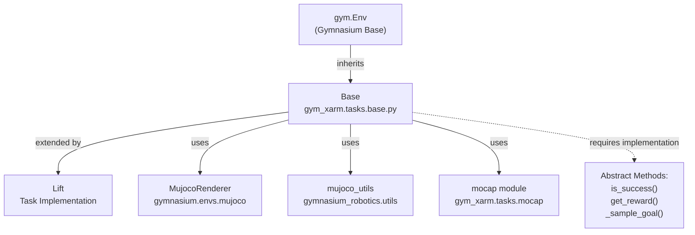
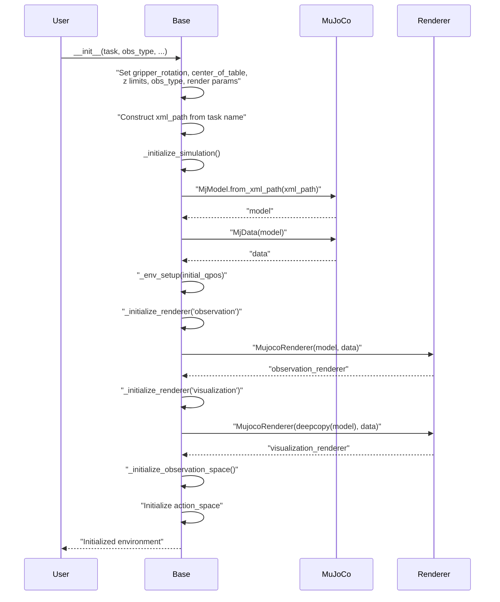
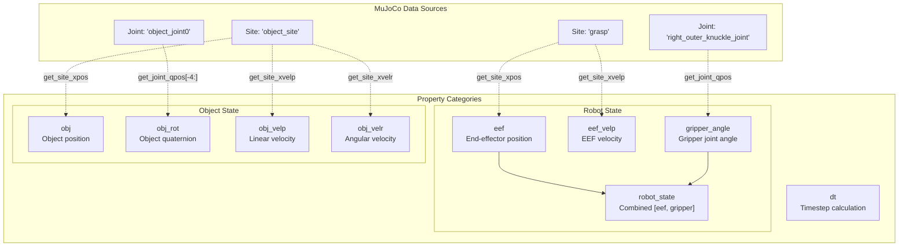
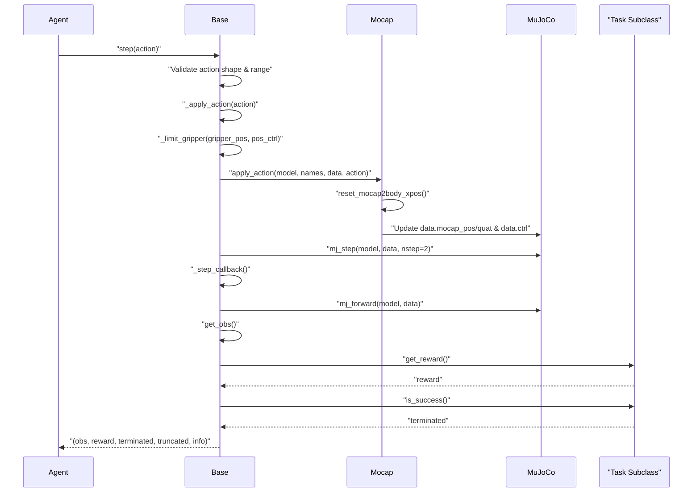
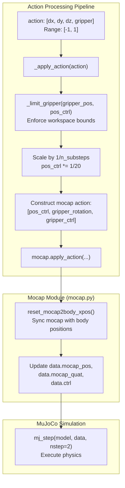
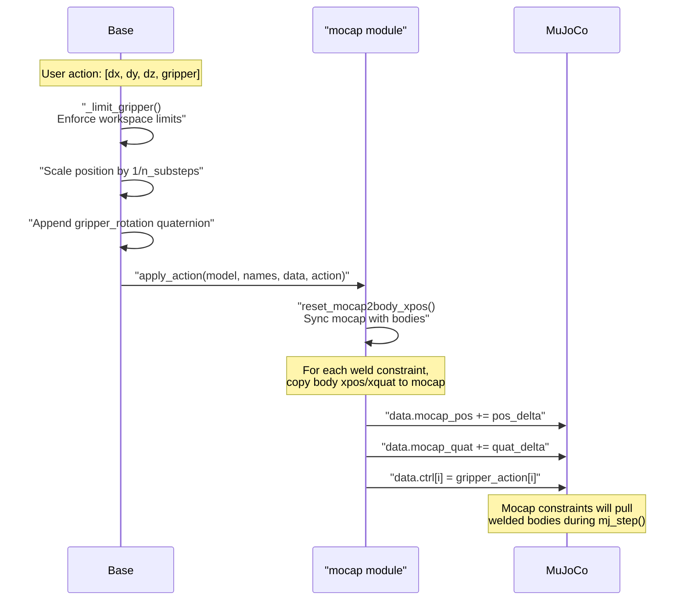

<!-- source: DeepWiki mcp.deepwiki.com · repo huggingface/gym-xarm · page 8.1 Base Class API · fetched 2026-10-26 -->

# Base Class API

<details>
<summary>Relevant source files</summary>

The following files were used as context for generating this wiki page:

- [gym_xarm/tasks/base.py](gym_xarm/tasks/base.py)
- [gym_xarm/tasks/mocap.py](gym_xarm/tasks/mocap.py)

</details>


This page provides complete API reference documentation for the `Base` class, which is the foundation of all gym-xarm environments. The `Base` class implements the core Gymnasium environment interface and handles all simulation, observation, action processing, and rendering logic.

For architectural understanding of how the Base class fits into the overall system, see [Core Architecture](#3). For task-specific implementations that extend this class, see [Tasks Reference](#4). For guidance on creating custom tasks using this API, see [Creating Custom Tasks](#5.5).

---

## Class Overview

The `Base` class is defined in [gym_xarm/tasks/base.py:18-334]() and serves as the abstract superclass for all gym-xarm manipulation tasks. It inherits from `gymnasium.Env` and provides the complete infrastructure for:

- MuJoCo physics simulation management
- Dual renderer architecture (observation vs. visualization)
- Three observation modalities (state, pixels, pixels_agent_pos)
- Mocap-based action processing
- Environment reset and stepping logic



**Sources:** [gym_xarm/tasks/base.py:18-24]()

---

## Constructor

### Signature

```python
def __init__(
    self,
    task,
    obs_type="state",
    render_mode="rgb_array",
    gripper_rotation=None,
    observation_width=84,
    observation_height=84,
    visualization_width=680,
    visualization_height=680,
)
```

[gym_xarm/tasks/base.py:35-75]()

### Parameters

| Parameter | Type | Default | Description |
|-----------|------|---------|-------------|
| `task` | `str` | *required* | Name of the XML environment file (without .xml extension). Used to construct path to XML model in assets directory. |
| `obs_type` | `str` | `"state"` | Observation type. Must be one of: `"state"`, `"pixels"`, or `"pixels_agent_pos"`. |
| `render_mode` | `str` | `"rgb_array"` | Rendering mode. Must be one of: `"rgb_array"` or `"human"` (human mode requires `MUJOCO_GL=glfw`). |
| `gripper_rotation` | `list` or `None` | `None` | Initial rotation of the gripper as quaternion `[x, y, z, w]`. Defaults to `[0, 1, 0, 0]`. |
| `observation_width` | `int` | `84` | Width of observation renderer output in pixels. |
| `observation_height` | `int` | `84` | Height of observation renderer output in pixels. |
| `visualization_width` | `int` | `680` | Width of visualization renderer output in pixels. |
| `visualization_height` | `int` | `680` | Height of visualization renderer output in pixels. |

### Initialization Sequence



**Sources:** [gym_xarm/tasks/base.py:35-83](), [gym_xarm/tasks/base.py:84-108](), [gym_xarm/tasks/base.py:133-150]()

---

## Class Attributes

The `Base` class defines several class-level attributes:

| Attribute | Type | Value | Description |
|-----------|------|-------|-------------|
| `metadata` | `dict` | See below | Environment metadata including render modes and FPS. |
| `n_substeps` | `int` | `20` | Number of physics substeps per Gymnasium step. |
| `initial_qpos` | `dict` | `{}` | Initial joint positions (overridden by subclasses). |
| `_mujoco` | `module` | `mujoco` | Reference to MuJoCo module. |
| `_utils` | `module` | `mujoco_utils` | Reference to gymnasium_robotics utilities. |

The `metadata` dictionary is constructed dynamically based on available renderers [gym_xarm/tasks/base.py:11-29]():

```python
metadata = {
    "render_modes": RENDER_MODES,  # ["rgb_array"] or ["rgb_array", "human"]
    "render_fps": 25,
}
```

**Sources:** [gym_xarm/tasks/base.py:26-33]()

---

## Properties

The `Base` class exposes several read-only properties that provide access to simulation state:

### Timing

#### `dt`

```python
@property
def dt(self) -> float
```

Returns the timestep of each Gymnasium step in seconds. Calculated as `n_substeps * model.opt.timestep`.

[gym_xarm/tasks/base.py:152-155]()

### End-Effector State

#### `eef`

```python
@property
def eef(self) -> np.ndarray
```

Returns the end-effector position relative to the center of the table as a 3D vector `[x, y, z]`. Retrieves position of the "grasp" site.

[gym_xarm/tasks/base.py:157-159]()

#### `eef_velp`

```python
@property
def eef_velp(self) -> np.ndarray
```

Returns the end-effector linear velocity scaled by `dt`. 3D vector.

[gym_xarm/tasks/base.py:161-163]()

### Gripper State

#### `gripper_angle`

```python
@property
def gripper_angle(self) -> float
```

Returns the current gripper angle by querying the "right_outer_knuckle_joint" position.

[gym_xarm/tasks/base.py:165-167]()

### Combined Robot State

#### `robot_state`

```python
@property
def robot_state(self) -> np.ndarray
```

Returns concatenated end-effector position and gripper angle: `[eef_x, eef_y, eef_z, gripper_angle]`.

[gym_xarm/tasks/base.py:169-171]()

### Object State

#### `obj`

```python
@property
def obj(self) -> np.ndarray
```

Returns the object position relative to the center of the table. Retrieves position of the "object_site" site.

[gym_xarm/tasks/base.py:173-175]()

#### `obj_rot`

```python
@property
def obj_rot(self) -> np.ndarray
```

Returns the object rotation as a quaternion. Extracts the last 4 elements of "object_joint0" position.

[gym_xarm/tasks/base.py:177-179]()

#### `obj_velp`

```python
@property
def obj_velp(self) -> np.ndarray
```

Returns the object linear velocity scaled by `dt`.

[gym_xarm/tasks/base.py:181-183]()

#### `obj_velr`

```python
@property
def obj_velr(self) -> np.ndarray
```

Returns the object angular velocity scaled by `dt`.

[gym_xarm/tasks/base.py:185-187]()



**Sources:** [gym_xarm/tasks/base.py:152-187]()

---

## Abstract Methods

Subclasses must implement these three abstract methods to define task-specific behavior:

### `is_success()`

```python
def is_success(self) -> bool
```

Indicates whether the achieved goal successfully satisfies the task success criteria. Called during `step()` to determine episode termination.

[gym_xarm/tasks/base.py:189-191]()

### `get_reward()`

```python
def get_reward(self) -> float
```

Computes and returns the reward for the current state. Called during `step()`.

[gym_xarm/tasks/base.py:193-194]()

### `_sample_goal()`

```python
def _sample_goal(self) -> None
```

Samples a new goal configuration and applies it to the simulation. Called during `reset()` and `_env_setup()`. May modify MuJoCo data structures to set goal positions.

[gym_xarm/tasks/base.py:196-198]()

**Sources:** [gym_xarm/tasks/base.py:189-198]()

---

## Public Methods

### `reset()`

```python
def reset(
    self,
    *,
    seed: int | None = None,
    options: dict | None = None,
) -> tuple[observation, dict]
```

Resets the MuJoCo simulation to an initial state. Repeatedly calls `_reset_sim()` until a valid initial configuration is achieved (important for randomized initial conditions that may cause numerical issues).

**Parameters:**
- `seed`: Optional integer to initialize the environment's PRNG (`np_random`)
- `options`: Optional dictionary for additional reset configuration (currently unused)

**Returns:**
- `observation`: Observation of the initial state (format depends on `obs_type`)
- `info`: Dictionary containing auxiliary information (currently empty)

[gym_xarm/tasks/base.py:200-229]()

### `step()`

```python
def step(self, action: np.ndarray) -> tuple[observation, float, bool, bool, dict]
```

Executes one environment step with the given action.

**Parameters:**
- `action`: 4D action vector `[delta_x, delta_y, delta_z, gripper]` in range `[-1, 1]`

**Returns:**
- `observation`: Current observation (format depends on `obs_type`)
- `reward`: Scalar reward value from `get_reward()`
- `terminated`: Boolean indicating if episode ended due to success
- `truncated`: Always `False` (episodes end only on success)
- `info`: Dictionary containing `{"is_success": bool}`

**Process:**
1. Validates action shape and range
2. Applies action via `_apply_action()`
3. Steps physics simulation 2 times via `mj_step()`
4. Calls `_step_callback()` for forward kinematics
5. Generates observation, computes reward, checks success

[gym_xarm/tasks/base.py:261-273]()

### `render()`

```python
def render(self) -> np.ndarray | None
```

Renders the environment using the visualization renderer. Returns RGB array with dimensions `(visualization_height, visualization_width, 3)` or `None` depending on render mode.

[gym_xarm/tasks/base.py:315-316]()

### `get_obs()`

```python
def get_obs(self) -> observation
```

Generates and returns the current observation. The return type and format depend on `obs_type`:

| `obs_type` | Return Type | Description |
|------------|-------------|-------------|
| `"state"` | `np.ndarray` | Returns `_get_obs()` (implemented by subclass) |
| `"pixels"` | `np.ndarray` | RGB array with shape `(obs_height, obs_width, 3)` |
| `"pixels_agent_pos"` | `dict` | `{"pixels": rgb_array, "agent_pos": robot_state}` |

[gym_xarm/tasks/base.py:245-259]()

### `close()`

```python
def close(self) -> None
```

Cleans up the environment by terminating WindowViewer instances in both renderers. Should be called when the environment is no longer needed.

[gym_xarm/tasks/base.py:326-334]()



**Sources:** [gym_xarm/tasks/base.py:200-273](), [gym_xarm/tasks/base.py:315-334]()

---

## Internal Methods

### Simulation Management

#### `_initialize_simulation()`

```python
def _initialize_simulation(self) -> None
```

Initializes MuJoCo `MjModel` and `MjData` structures from the XML file. Sets offscreen rendering dimensions, calls `_env_setup()`, and stores initial simulation state.

[gym_xarm/tasks/base.py:84-96]()

#### `_env_setup()`

```python
def _env_setup(self, initial_qpos: dict) -> None
```

Configures the initial environment state. Sets joint positions from `initial_qpos`, resets mocap system, and samples initial goal.

[gym_xarm/tasks/base.py:98-108]()

#### `_reset_sim()`

```python
def _reset_sim(self) -> bool
```

Resets simulation state to initial configuration. Copies initial `qpos` and `qvel`, samples new goal, steps simulation 10 times for settling. Returns `True` on success.

[gym_xarm/tasks/base.py:231-243]()

### Observation Management

#### `_initialize_observation_space()`

```python
def _initialize_observation_space(self) -> gym.spaces.Space
```

Constructs the observation space based on `obs_type`:
- `"state"`: `Box(-1000, 1000, shape=obs.shape)`
- `"pixels"`: `Box(0, 255, shape=(height, width, 3), dtype=uint8)`
- `"pixels_agent_pos"`: `Dict` with "pixels" and "agent_pos" keys

[gym_xarm/tasks/base.py:110-131]()

### Rendering

#### `_initialize_renderer()`

```python
def _initialize_renderer(self, renderer_type: str) -> MujocoRenderer
```

Creates a `MujocoRenderer` for either "observation" or "visualization". The visualization renderer uses a deep-copied model with different resolution settings to enable dual-resolution rendering.

[gym_xarm/tasks/base.py:133-150]()

#### `_render()`

```python
def _render(self, renderer: MujocoRenderer) -> np.ndarray | None
```

Internal rendering method. Calls `_render_callback()`, then renders using specified renderer and "camera0" camera.

[gym_xarm/tasks/base.py:318-321]()

#### `_render_callback()`

```python
def _render_callback(self) -> None
```

Called before rendering to update forward kinematics via `mj_forward()`.

[gym_xarm/tasks/base.py:323-324]()

### Action Processing

#### `_apply_action()`

```python
def _apply_action(self, action: np.ndarray) -> None
```

Processes a 4D action vector and applies it to the simulation:
1. Splits action into position control `[x, y, z]` and gripper control
2. Applies workspace limits via `_limit_gripper()`
3. Scales position control by `1/n_substeps`
4. Constructs full mocap action with gripper rotation
5. Calls `mocap.apply_action()` to update MuJoCo state

[gym_xarm/tasks/base.py:293-306]()

#### `_limit_gripper()`

```python
def _limit_gripper(
    self, 
    gripper_pos: np.ndarray, 
    pos_ctrl: np.ndarray
) -> np.ndarray
```

Enforces workspace limits by clamping position control commands. Prevents the gripper from exceeding defined x, y, z boundaries relative to the table center.

**Workspace Limits:**
- X: `[center_x - 0.405, center_x + 0.045]`
- Y: `[center_y - 0.3, center_y + 0.3]`
- Z: `[min_z, max_z]` (0.2 to 1.2 by default)

[gym_xarm/tasks/base.py:278-291]()

#### `_set_gripper()`

```python
def _set_gripper(
    self,
    gripper_pos: np.ndarray,
    gripper_rotation: np.ndarray
) -> None
```

Directly sets the gripper pose and joint positions. Sets mocap position/quaternion and resets gripper joints to open position.

[gym_xarm/tasks/base.py:308-313]()

#### `_step_callback()`

```python
def _step_callback(self) -> None
```

Called after each simulation step to update forward kinematics via `mj_forward()`.

[gym_xarm/tasks/base.py:275-276]()



**Sources:** [gym_xarm/tasks/base.py:84-108](), [gym_xarm/tasks/base.py:110-150](), [gym_xarm/tasks/base.py:231-243](), [gym_xarm/tasks/base.py:275-324]()

---

## Integration with Mocap Module

The `Base` class integrates with the `mocap` module [gym_xarm/tasks/mocap.py]() for motion capture-based control. This module provides three key functions:

### Mocap Functions

| Function | Purpose | Called By |
|----------|---------|-----------|
| `mocap.reset()` | Initializes weld constraints and forward kinematics | `_env_setup()` [line 105]() |
| `mocap.reset_mocap2body_xpos()` | Synchronizes mocap positions with welded body positions | `mocap.apply_action()` [line 14]() |
| `mocap.apply_action()` | Applies action deltas to mocap positions/quaternions and gripper controls | `_apply_action()` [line 301]() |

### Action Translation Flow



The mocap system uses MuJoCo's mocap bodies (motion capture bodies) which are kinematic bodies that can be directly positioned. These mocap bodies are connected to the robot via weld constraints, allowing high-level position/orientation commands to be translated into joint torques by MuJoCo's constraint solver.

**Sources:** [gym_xarm/tasks/base.py:293-306](), [gym_xarm/tasks/mocap.py:1-51]()

---

## Instance Attributes

The following instance attributes are set during initialization and used throughout the environment lifecycle:

### Coordinate System

| Attribute | Type | Value | Description |
|-----------|------|-------|-------------|
| `gripper_rotation` | `np.ndarray` | `[0, 1, 0, 0]` | Gripper orientation quaternion |
| `center_of_table` | `np.ndarray` | `[1.655, 0.3, 0.63625]` | Table center in world coordinates |
| `max_z` | `float` | `1.2` | Maximum z-coordinate for end-effector |
| `min_z` | `float` | `0.2` | Minimum z-coordinate for end-effector |

### Configuration

| Attribute | Type | Description |
|-----------|------|-------------|
| `obs_type` | `str` | Observation type: "state", "pixels", or "pixels_agent_pos" |
| `render_mode` | `str` | Render mode: "rgb_array" or "human" |
| `observation_width` | `int` | Observation renderer width |
| `observation_height` | `int` | Observation renderer height |
| `visualization_width` | `int` | Visualization renderer width |
| `visualization_height` | `int` | Visualization renderer height |
| `xml_path` | `str` | Full path to MuJoCo XML model file |

### Simulation State

| Attribute | Type | Description |
|-----------|------|-------------|
| `model` | `mujoco.MjModel` | MuJoCo model structure |
| `data` | `mujoco.MjData` | MuJoCo simulation data |
| `_model_names` | `MujocoModelNames` | Name-to-ID mapping utility |
| `initial_time` | `float` | Initial simulation time |
| `initial_qpos` | `np.ndarray` | Initial joint positions |
| `initial_qvel` | `np.ndarray` | Initial joint velocities |

### Rendering

| Attribute | Type | Description |
|-----------|------|-------------|
| `observation_renderer` | `MujocoRenderer` | Renderer for observation generation |
| `visualization_renderer` | `MujocoRenderer` | Renderer for human/visualization |

### Spaces

| Attribute | Type | Description |
|-----------|------|-------------|
| `observation_space` | `gym.spaces.Space` | Observation space definition |
| `action_space` | `gym.spaces.Box` | Action space: Box(-1, 1, shape=(n,)) |
| `action_padding` | `np.ndarray` | Padding for actions when using xyz (not xyzw) |

**Sources:** [gym_xarm/tasks/base.py:35-83]()

---

## Usage Example

```python
import gymnasium as gym
import gym_xarm

# Create environment with state observations
env = gym.make(
    "gym_xarm/XarmLift-v0",
    obs_type="state",
    render_mode="rgb_array"
)

# Reset environment
obs, info = env.reset(seed=42)
print(f"Observation shape: {obs.shape}")  # (state_dim,)

# Take a step
action = env.action_space.sample()
obs, reward, terminated, truncated, info = env.step(action)

# Access properties
print(f"End-effector position: {env.eef}")
print(f"Object position: {env.obj}")
print(f"Gripper angle: {env.gripper_angle}")

# Render
rgb_array = env.render()

# Clean up
env.close()
```

**Sources:** [gym_xarm/tasks/base.py:18-334]()

---

