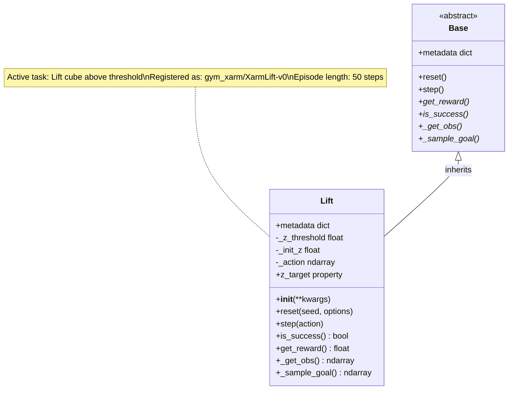
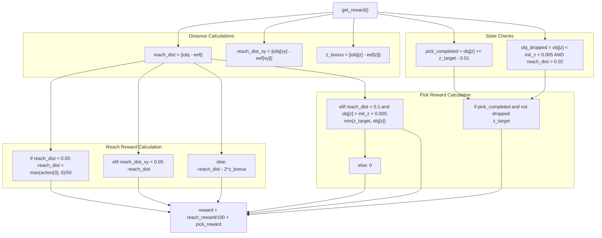
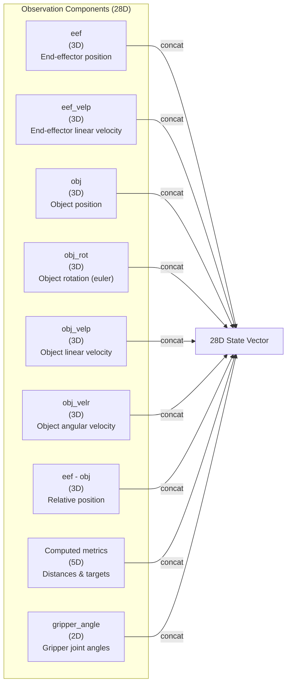
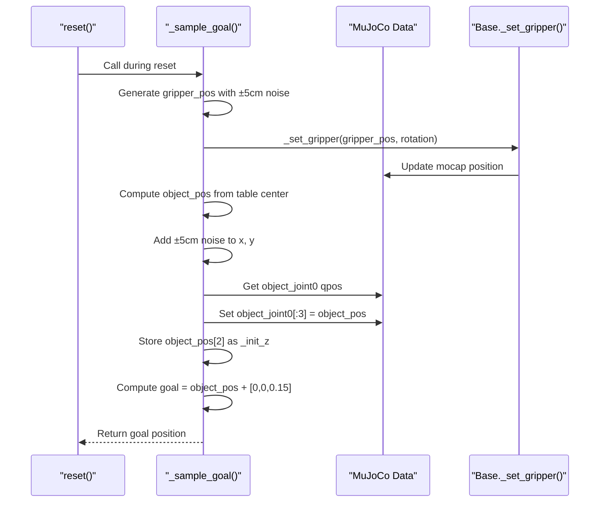

<!-- source: DeepWiki mcp.deepwiki.com · repo huggingface/gym-xarm · page 8.2 Lift Task API · fetched 2026-10-26 -->

# Lift Task API

<details>
<summary>Relevant source files</summary>

The following files were used as context for generating this wiki page:

- [gym_xarm/tasks/lift.py](gym_xarm/tasks/lift.py)

</details>


## Purpose and Scope

This page provides comprehensive API reference documentation for the `Lift` task class, which implements the active manipulation task in gym-xarm. The `Lift` class defines the task where the robot must pick up a cube and lift it above a height threshold. This documentation covers all public and protected methods, properties, metadata, reward function components, and observation space details.

For high-level task overview and usage examples, see [Lift Task](#4.1). For the base class API that `Lift` inherits from, see [Base Class API](#8.1). For general task system architecture, see [Task System](#3.2).

## Class Overview

The `Lift` class is defined in [gym_xarm/tasks/lift.py:6-102]() and inherits from the `Base` environment class. It is the only active task implementation in gym-xarm, as all other tasks (Reach, Push, PegInBox) are deprecated.



**Diagram: Lift Class Inheritance and Structure**

Sources: [gym_xarm/tasks/lift.py:6-16]()

## Metadata

The `Lift` class extends the base metadata dictionary with task-specific configuration:

| Metadata Key | Value | Description |
|-------------|-------|-------------|
| `action_space` | `"xyzw"` | 4-dimensional action space: (x, y, z) position delta and gripper width |
| `episode_length` | `50` | Maximum episode length in steps |
| `description` | `"Lift a cube above a height threshold"` | Human-readable task description |

The metadata also inherits all entries from `Base.metadata`, which includes renderer configurations and observation parameters.

Sources: [gym_xarm/tasks/lift.py:7-12]()

## Constructor

### `__init__(self, **kwargs)`

Initializes the Lift task environment.

**Parameters:**
- `**kwargs`: Keyword arguments passed through to the `Base` class constructor. Common parameters include:
  - `obs_type`: Observation type (`"state"`, `"pixels"`, or `"pixels_agent_pos"`)
  - `render_mode`: Rendering mode (`"rgb_array"` or `"human"`)
  - `observation_width`: Width of pixel observations (default: 84)
  - `observation_height`: Height of pixel observations (default: 84)
  - `visualization_width`: Width of human rendering (default: 680)
  - `visualization_height`: Height of human rendering (default: 680)

**Implementation Details:**
- Sets `_z_threshold` to `0.15` meters, defining the height the object must be lifted above its initial position
- Calls `super().__init__("lift", **kwargs)` to initialize the base environment with the task name `"lift"`
- The task name is used to load the corresponding MuJoCo XML model file (`lift.xml`)

**Example:**
```python
from gym_xarm.tasks.lift import Lift

# Create with default state observations
env = Lift(obs_type="state", render_mode="rgb_array")

# Create with pixel observations
env = Lift(obs_type="pixels", observation_width=84, observation_height=84)
```

Sources: [gym_xarm/tasks/lift.py:14-16]()

## Properties

### `z_target` (property)

Returns the target z-coordinate (height) that the object must reach for task success.

**Returns:**
- `float`: Target height in meters, calculated as `_init_z + _z_threshold`

**Description:**
The target height is computed relative to the object's initial z-coordinate at the start of each episode. With `_z_threshold = 0.15`, the object must be lifted 15 centimeters above its starting position.

**Note:** The `_init_z` value is set during `_sample_goal()` and varies slightly between episodes due to randomization.

Sources: [gym_xarm/tasks/lift.py:18-20]()

## Public Methods

### `reset(self, seed=None, options=None)`

Resets the environment to a new episode, randomizing initial positions and returning the initial observation.

**Parameters:**
- `seed` (int, optional): Random seed for reproducibility. If provided, sets the environment's random number generator state.
- `options` (dict, optional): Additional reset options. Currently unused but included for Gymnasium API compatibility.

**Returns:**
- `observation` (np.ndarray or dict): Initial observation based on `obs_type`:
  - `"state"`: 28-dimensional state vector
  - `"pixels"`: RGB image array of shape `(observation_height, observation_width, 3)`
  - `"pixels_agent_pos"`: Dictionary with `"pixels"` and `"agent_pos"` keys
- `info` (dict): Information dictionary with task-specific metadata

**Implementation Details:**
- Initializes `_action` to zero vector of length 4 [gym_xarm/tasks/lift.py:96]()
- Calls `super().reset(seed=seed, options=options)` which triggers the full reset sequence including `_sample_goal()`, `_reset_sim()`, and `_get_obs()`

**Example:**
```python
observation, info = env.reset(seed=42)
# observation shape depends on obs_type:
# state: (28,)
# pixels: (84, 84, 3) 
# pixels_agent_pos: dict with 'pixels' and 'agent_pos'
```

Sources: [gym_xarm/tasks/lift.py:91-97]()

### `step(self, action)`

Executes one environment step with the given action.

**Parameters:**
- `action` (np.ndarray): 4-dimensional action vector `[x, y, z, gripper_width]`
  - `x, y, z`: Position delta for end-effector in meters (scaled internally)
  - `gripper_width`: Target gripper width (0.0 = closed, positive = open)

**Returns:**
- `observation` (np.ndarray or dict): Next observation
- `reward` (float): Reward for this transition
- `terminated` (bool): True if episode ended due to success or failure condition
- `truncated` (bool): True if episode ended due to time limit (50 steps)
- `info` (dict): Dictionary containing `"is_success"` boolean

**Implementation Details:**
- Makes a copy of the action vector and stores it in `_action` [gym_xarm/tasks/lift.py:100]()
- The stored action is used in reward calculation for gripper bonus
- Delegates to `super().step(action)` which handles action processing, simulation stepping, reward computation, and observation generation

Sources: [gym_xarm/tasks/lift.py:99-101]()

## Task Implementation Methods

These methods implement the abstract interface defined by the `Base` class and are called internally during environment operation.

### `is_success(self)`

Determines whether the task has been successfully completed.

**Returns:**
- `bool`: True if the object's z-coordinate is at or above the target height

**Implementation:**
```python
return self.obj[2] >= self.z_target
```

**Description:**
Success is achieved when the object's current height (`self.obj[2]`) meets or exceeds `z_target`. This is a binary criterion based purely on object position, not considering gripper state or movement stability.

Sources: [gym_xarm/tasks/lift.py:22-23]()

### `get_reward(self)`

Computes the reward signal for the current state.

**Returns:**
- `float`: Scalar reward value combining reach and pick components

**Reward Structure:**

The reward function is a composite of two main components: reaching and picking.



**Diagram: Reward Calculation Flow**

**Reach Reward Component:**

The reach reward encourages the gripper to approach the object. It has three cases based on distance:

1. **Close reach** (`reach_dist < 0.05`): 
   - Reward: `-reach_dist + max(action[-1], 0) / 50`
   - Provides small gripper opening bonus to encourage grasping
   
2. **Close in XY plane** (`reach_dist_xy < 0.05`):
   - Reward: `-reach_dist`
   - Encourages vertical alignment
   
3. **Far from object**:
   - Reward: `-reach_dist - 2 * z_bonus`
   - Double penalty for z-axis misalignment to prioritize xy approach

**Pick Reward Component:**

The pick reward provides strong positive signal for lifting the object:

1. **Pick completed** (`pick_completed and not obj_dropped`):
   - Reward: `z_target` (0.15)
   - Large positive reward for achieving target height
   
2. **Pick in progress** (`reach_dist < 0.1 and obj[z] > init_z + 0.005`):
   - Reward: `min(z_target, obj[z])`
   - Shaped reward proportional to current lift height
   
3. **No pick progress**:
   - Reward: `0`

**Final Reward:**
- `reward = reach_reward / 100 + pick_reward`
- Reach component scaled down by factor of 100 to give picking stronger weight
- Typical range: approximately -0.05 to 0.20

Sources: [gym_xarm/tasks/lift.py:25-48]()

### `_get_obs(self)`

Constructs the state observation vector from the current simulation state.

**Returns:**
- `np.ndarray`: 28-dimensional state vector

**Observation Vector Composition:**



**Diagram: Observation Vector Structure**

**Detailed Breakdown:**

| Indices | Dimensions | Component | Description | Source Property |
|---------|-----------|-----------|-------------|----------------|
| 0-2 | 3 | End-effector position | (x, y, z) coordinates in meters | `self.eef` |
| 3-5 | 3 | End-effector linear velocity | (vx, vy, vz) in m/s | `self.eef_velp` |
| 6-8 | 3 | Object position | (x, y, z) coordinates in meters | `self.obj` |
| 9-11 | 3 | Object rotation | Euler angles (rx, ry, rz) in radians | `self.obj_rot` |
| 12-14 | 3 | Object linear velocity | (vx, vy, vz) in m/s | `self.obj_velp` |
| 15-17 | 3 | Object angular velocity | (wx, wy, wz) in rad/s | `self.obj_velr` |
| 18-20 | 3 | Relative position | eef - obj displacement vector | `self.eef - self.obj` |
| 21 | 1 | 3D distance to object | Euclidean distance in meters | `np.linalg.norm(self.eef - self.obj)` |
| 22 | 1 | XY distance to object | 2D distance ignoring z-axis | `np.linalg.norm(self.eef[:-1] - self.obj[:-1])` |
| 23 | 1 | Target height | Goal z-coordinate | `self.z_target` |
| 24 | 1 | Object height deficit | How far object is below target | `self.z_target - self.obj[-1]` |
| 25 | 1 | Gripper height deficit | How far gripper is below target | `self.z_target - self.eef[-1]` |
| 26-27 | 2 | Gripper angles | Joint angles of gripper fingers | `self.gripper_angle` |

**Note:** All position and velocity values are provided by properties inherited from the `Base` class, which extract them from the MuJoCo simulation state.

Sources: [gym_xarm/tasks/lift.py:50-72]()

### `_sample_goal(self)`

Randomizes the initial configuration at the start of each episode.

**Returns:**
- `np.ndarray`: 3D goal position (object_pos + [0, 0, z_threshold])

**Implementation Details:**

The method randomizes three components:

1. **Gripper Initial Position:**
   - Base position: `[1.280, 0.295, 0.735]` meters
   - Randomization: ±5 cm uniform in all three axes
   - Uses `self.np_random.uniform(-0.05, 0.05, size=3)`
   - Position set via `super()._set_gripper(gripper_pos, self.gripper_rotation)`

2. **Object Initial Position:**
   - Base position: `center_of_table - [0.15, 0.10, 0.07]`
   - X-axis randomization: ±5 cm uniform
   - Y-axis randomization: ±5 cm uniform
   - Z-axis: Fixed (determined by table height)
   - Position set via MuJoCo joint: `object_joint0`
   - Stores initial z-coordinate in `self._init_z` for reward calculations

3. **Goal Position:**
   - Computed as: `object_pos + [0, 0, _z_threshold]`
   - Always 15 cm directly above the object's initial position

**Sequence Diagram:**



**Diagram: Goal Sampling Sequence**

**Coordinate System:**
- All positions are in the global MuJoCo world frame
- Units are meters
- The table is centered in the workspace with `center_of_table` provided by the base class

Sources: [gym_xarm/tasks/lift.py:74-89]()

## Method Call Hierarchy

The following diagram shows how methods are called during typical environment operation:

```mermaid
graph TB
    subgraph "Initialization"
        Init["__init__(**kwargs)"]
        BaseInit["Base.__init__('lift', **kwargs)"]
        LoadModel["Load lift.xml model"]
    end
    
    subgraph "Episode Reset"
        Reset["reset(seed, options)"]
        ResetAction["_action = zeros(4)"]
        BaseReset["Base.reset()"]
        SampleGoal["_sample_goal()"]
        ResetSim["Base._reset_sim()"]
        GetObsReset["_get_obs()"]
    end
    
    subgraph "Step Execution"
        Step["step(action)"]
        CopyAction["_action = action.copy()"]
        BaseStep["Base.step(action)"]
        ApplyAction["Base._apply_action()"]
        MJStep["MuJoCo physics step"]
        GetObsStep["_get_obs()"]
        GetReward["get_reward()"]
        IsSuccess["is_success()"]
    end
    
    Init --> BaseInit
    BaseInit --> LoadModel
    
    Reset --> ResetAction
    ResetAction --> BaseReset
    BaseReset --> SampleGoal
    SampleGoal --> ResetSim
    ResetSim --> GetObsReset
    
    Step --> CopyAction
    CopyAction --> BaseStep
    BaseStep --> ApplyAction
    ApplyAction --> MJStep
    MJStep --> GetObsStep
    GetObsStep --> GetReward
    GetReward --> IsSuccess
    
    style SampleGoal fill:#f9f9f9
    style GetObsReset fill:#f9f9f9
    style GetObsStep fill:#f9f9f9
    style GetReward fill:#f9f9f9
    style IsSuccess fill:#f9f9f9
```



**Diagram: Method Call Hierarchy**

The shaded boxes indicate methods implemented by the `Lift` class that override or implement the `Base` class interface.

Sources: [gym_xarm/tasks/lift.py:6-102]()

## Usage Example

Complete example demonstrating the Lift task API:

```python
import gymnasium as gym
import gym_xarm
import numpy as np

# Create environment with state observations
env = gym.make("gym_xarm/XarmLift-v0", obs_type="state", render_mode="rgb_array")

# Reset to initial state
observation, info = env.reset(seed=42)

# observation is 28D state vector
print(f"Observation shape: {observation.shape}")  # (28,)
print(f"End-effector position: {observation[0:3]}")
print(f"Object position: {observation[6:9]}")
print(f"Target height: {observation[23]}")

# Run episode
episode_reward = 0.0
for step in range(50):
    # Random action: small position delta + gripper control
    action = np.random.uniform(-1, 1, size=4)
    action[3] = 0.5  # Open gripper
    
    observation, reward, terminated, truncated, info = env.step(action)
    episode_reward += reward
    
    if info["is_success"]:
        print(f"Success! Lifted object above threshold at step {step}")
        break
    
    if terminated or truncated:
        break

print(f"Episode reward: {episode_reward:.4f}")
env.close()
```

Sources: [gym_xarm/tasks/lift.py:6-102]()

## Implementation Notes

### Action Caching

The `step()` method stores a copy of the action in `self._action` [gym_xarm/tasks/lift.py:100](). This cached action is used in `get_reward()` to access the gripper command (`action[-1]`) for computing the gripper opening bonus. This design allows the reward function to consider the agent's intended gripper state even after the action has been processed by the base class.

### Threshold Tolerance

The success criterion uses exact comparison (`obj[2] >= z_target`), but the reward function uses a slightly lower threshold (`z_target - 0.01`) for the `pick_completed` check [gym_xarm/tasks/lift.py:28](). This 1 cm tolerance provides positive reward signal slightly before official success, helping with credit assignment.

### Object Drop Detection

The reward function includes drop detection logic: an object is considered dropped if its height falls below `init_z + 0.005` (0.5 cm above initial) AND the gripper is more than 2 cm away [gym_xarm/tasks/lift.py:29](). This prevents reward when the object falls after being released.

### Distance Metrics

The reward function computes both 3D Euclidean distance and 2D XY-plane distance [gym_xarm/tasks/lift.py:26-27](). The XY distance is used to differentiate reaching behavior: when the gripper is close in XY but far in Z, the agent is encouraged to maintain XY position while adjusting Z.

Sources: [gym_xarm/tasks/lift.py:25-48](), [gym_xarm/tasks/lift.py:99-101]()

---

