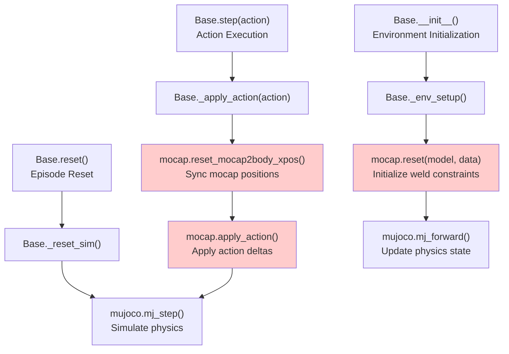
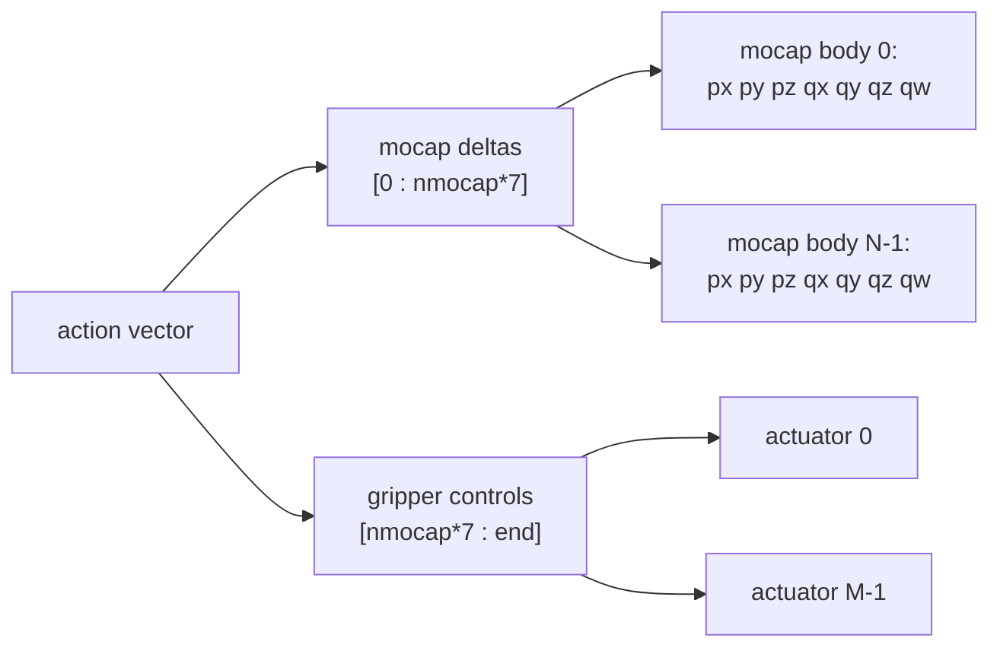
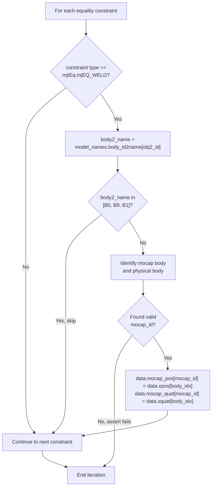
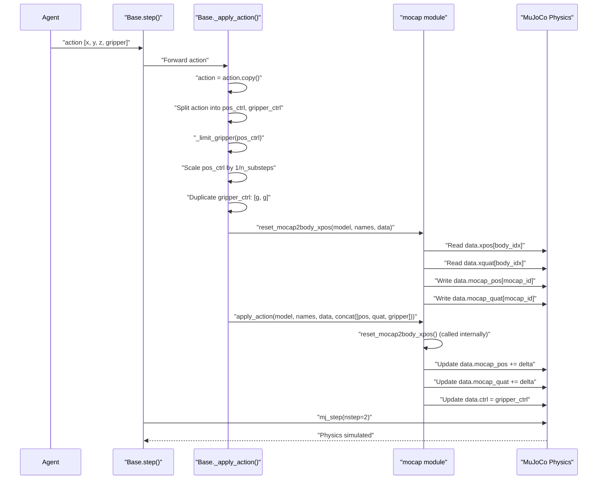

<!-- source: DeepWiki mcp.deepwiki.com · repo huggingface/gym-xarm · page 8.3 Mocap Module API · fetched 2026-10-26 -->

# Mocap Module API

<details>
<summary>Relevant source files</summary>

The following files were used as context for generating this wiki page:

- [gym_xarm/tasks/base.py](gym_xarm/tasks/base.py)
- [gym_xarm/tasks/mocap.py](gym_xarm/tasks/mocap.py)

</details>


## Purpose and Scope

This page documents the API of the `gym_xarm.tasks.mocap` module, which provides utility functions for motion capture (mocap) control in MuJoCo simulations. The mocap system translates high-level robot actions into low-level physics updates by manipulating virtual mocap bodies that are welded to physical robot bodies.

For information about how the Base class uses these functions during action processing, see [Action Processing and Mocap Control](#3.5). For the complete Base class API that calls these functions, see [Base Class API](#8.1).

**Sources:** [gym_xarm/tasks/mocap.py:1-51]()

---

## Module Overview

The mocap module consists of three functions that manage the motion capture control system:

| Function | Purpose | Called By |
|----------|---------|-----------|
| `apply_action()` | Apply action deltas to mocap bodies and gripper actuators | Base class during `step()` |
| `reset()` | Initialize mocap-to-body weld constraints to neutral state | Base class during environment setup |
| `reset_mocap2body_xpos()` | Synchronize mocap body positions with their welded physical bodies | Base class during action application |

The mocap system enables position-based control by using MuJoCo's mocap (motion capture) bodies, which can be directly positioned without computing inverse kinematics. These virtual bodies are connected to physical robot bodies through equality constraints (welds).

**Sources:** [gym_xarm/tasks/mocap.py:1-51](), [gym_xarm/tasks/base.py:9](), [gym_xarm/tasks/base.py:105](), [gym_xarm/tasks/base.py:301-306]()

---

## Function Call Flow



**Diagram: Mocap Function Call Hierarchy** - Shows when each mocap function is invoked during the environment lifecycle.

**Sources:** [gym_xarm/tasks/base.py:93-109](), [gym_xarm/tasks/base.py:231-243](), [gym_xarm/tasks/base.py:261-273](), [gym_xarm/tasks/base.py:293-306]()

---

## apply_action()

### Signature

```python
def apply_action(model, model_names, data, action):
```

### Description

Applies an action vector to the MuJoCo simulation by updating mocap body positions/orientations and gripper actuator controls. This function splits the action into mocap position/orientation deltas and gripper commands, then applies them to the appropriate MuJoCo data structures.

### Parameters

| Parameter | Type | Description |
|-----------|------|-------------|
| `model` | `mujoco.MjModel` | MuJoCo model containing simulation structure and configuration |
| `model_names` | `gymnasium_robotics.utils.mujoco_utils.MujocoModelNames` | Name mapping utility for accessing MuJoCo entities by name |
| `data` | `mujoco.MjData` | MuJoCo data containing current simulation state (positions, velocities, controls) |
| `action` | `numpy.ndarray` | Action vector with shape `(model.nmocap * 7 + n_actuators,)` where first `model.nmocap * 7` elements are mocap deltas (3 position + 4 quaternion per mocap body) and remaining elements are gripper controls |

### Behavior

1. **Action Splitting**: Divides the action vector at index `model.nmocap * 7` to separate mocap commands from gripper commands [gym_xarm/tasks/mocap.py:8]()
2. **Gripper Control**: Applies gripper commands directly to `data.ctrl` array if it exists [gym_xarm/tasks/mocap.py:9-11]()
3. **Mocap Reshaping**: Reshapes mocap portion to `(model.nmocap, 7)` for per-body processing [gym_xarm/tasks/mocap.py:12]()
4. **Position/Quaternion Split**: Separates each mocap action into 3D position delta and 4D quaternion delta [gym_xarm/tasks/mocap.py:13]()
5. **Synchronization**: Calls `reset_mocap2body_xpos()` to sync mocap positions with physical bodies [gym_xarm/tasks/mocap.py:14]()
6. **Delta Application**: Adds deltas to current mocap positions and quaternions [gym_xarm/tasks/mocap.py:15-16]()

### Action Vector Structure



**Diagram: Action Vector Structure** - Shows how the action vector is split and interpreted.

### Usage Example

The Base class calls this function in `_apply_action()` after computing position and gripper controls:

```python
# From gym_xarm/tasks/base.py:301-306
mocap.apply_action(
    self.model,
    self._model_names,
    self.data,
    np.concatenate([pos_ctrl, self.gripper_rotation, gripper_ctrl]),
)
```

The action contains 3D position delta, 4D quaternion (gripper rotation), and 2D gripper control (one value per gripper finger).

**Sources:** [gym_xarm/tasks/mocap.py:6-16](), [gym_xarm/tasks/base.py:301-306]()

---

## reset()

### Signature

```python
def reset(model, data):
```

### Description

Initializes all weld equality constraints in the MuJoCo model to a neutral state. This function resets the relative pose between mocap bodies and their welded physical bodies to identity (zero position offset, identity quaternion, zero reference position).

### Parameters

| Parameter | Type | Description |
|-----------|------|-------------|
| `model` | `mujoco.MjModel` | MuJoCo model containing equality constraint definitions |
| `data` | `mujoco.MjData` | MuJoCo data structure (passed to `mj_forward()` after reset) |

### Behavior

1. **Constraint Check**: Verifies that the model has mocap bodies (`model.nmocap > 0`) and equality constraint data exists [gym_xarm/tasks/mocap.py:20]()
2. **Weld Constraint Reset**: Iterates through all equality constraints and resets weld constraints (`mjtEq.mjEQ_WELD`) to identity [gym_xarm/tasks/mocap.py:21-23]()
3. **Forward Kinematics**: Calls `mujoco.mj_forward()` to update the simulation state after constraint modification [gym_xarm/tasks/mocap.py:24]()

### Equality Constraint Data Format

The `model.eq_data` array stores constraint parameters. For weld constraints, the 8-element format is:
- Elements 0-2: Relative position offset `[0.0, 0.0, 0.0]`
- Elements 3-6: Relative quaternion `[0.0, 0.0, 0.0, 1.0]` (identity)
- Element 7: Reference position `0`

**Sources:** [gym_xarm/tasks/mocap.py:19-24]()

### Usage Example

Called during environment initialization to establish proper mocap-to-body relationships:

```python
# From gym_xarm/tasks/base.py:105
mocap.reset(self.model, self.data)
```

**Sources:** [gym_xarm/tasks/base.py:105]()

---

## reset_mocap2body_xpos()

### Signature

```python
def reset_mocap2body_xpos(model, model_names, data):
```

### Description

Synchronizes mocap body positions and orientations with their corresponding welded physical bodies. This ensures that mocap bodies start from the current physical body state before applying action deltas, preventing drift between mocap and physical body positions.

### Parameters

| Parameter | Type | Description |
|-----------|------|-------------|
| `model` | `mujoco.MjModel` | MuJoCo model containing equality constraint definitions |
| `model_names` | `gymnasium_robotics.utils.mujoco_utils.MujocoModelNames` | Name mapping utility for body name lookups |
| `data` | `mujoco.MjData` | MuJoCo data containing current body positions (`xpos`) and orientations (`xquat`) |

### Behavior

1. **Constraint Validation**: Returns early if equality constraint arrays are not initialized [gym_xarm/tasks/mocap.py:28-29]()
2. **Weld Constraint Iteration**: Loops through all equality constraints, processing only weld constraints [gym_xarm/tasks/mocap.py:32-35]()
3. **Body Name Filtering**: Skips specific bodies ("B0", "B9", "B1") that should not be synchronized [gym_xarm/tasks/mocap.py:37-39]()
4. **Mocap Body Identification**: Determines which constraint object is the mocap body and which is the physical body [gym_xarm/tasks/mocap.py:40-47]()
5. **Position Synchronization**: Copies physical body position to mocap body position [gym_xarm/tasks/mocap.py:49]()
6. **Orientation Synchronization**: Copies physical body quaternion to mocap body quaternion [gym_xarm/tasks/mocap.py:50]()

### Weld Constraint Processing Flow



**Diagram: reset_mocap2body_xpos() Logic Flow** - Shows the constraint processing algorithm.

**Sources:** [gym_xarm/tasks/mocap.py:27-50]()

### Usage Example

Called before applying action deltas to ensure mocap bodies track physical bodies:

```python
# From gym_xarm/tasks/mocap.py:14 (within apply_action)
reset_mocap2body_xpos(model, model_names, data)
```

This prevents accumulation of numerical errors and ensures the mocap control remains stable over long episodes.

**Sources:** [gym_xarm/tasks/mocap.py:14]()

---

## Integration with Base Class

The mocap module integrates tightly with the Base environment class action processing pipeline:



**Diagram: Action Processing with Mocap Integration** - Shows the complete data flow from agent action to physics update.

**Sources:** [gym_xarm/tasks/base.py:261-273](), [gym_xarm/tasks/base.py:293-306](), [gym_xarm/tasks/mocap.py:6-16]()

---

## Technical Details

### Mocap Body Control Mechanism

MuJoCo's mocap (motion capture) bodies are special bodies that:
- Can be positioned directly via `data.mocap_pos` and `data.mocap_quat` without inverse kinematics
- Are typically connected to physical bodies through equality constraints (welds)
- Allow position-based control instead of force/torque-based control

The weld constraint creates a spring-damper system that pulls the physical body toward the mocap body position, providing compliant position control.

### Action Scaling and Substeps

The Base class scales position deltas by `1/n_substeps` (where `n_substeps=20`) before passing to `apply_action()`:

```python
# From gym_xarm/tasks/base.py:299
pos_ctrl = self._limit_gripper(...) * (1 / self.n_substeps)
```

This scaling ensures smooth motion across multiple physics substeps, as `mj_step()` is called with `nstep=2` per Gymnasium step [gym_xarm/tasks/base.py:265]().

### Gripper Control Format

The gripper control is duplicated from a single value to two values (one per finger) before being concatenated into the action vector:

```python
# From gym_xarm/tasks/base.py:300
gripper_ctrl = np.array([gripper_ctrl, gripper_ctrl])
```

This creates symmetric gripper motion where both fingers move together.

**Sources:** [gym_xarm/tasks/base.py:293-306](), [gym_xarm/tasks/mocap.py:6-16]()

---

## Return Values

All three mocap functions have `None` return type (implicit). They modify the MuJoCo `data` structure in-place:

| Function | Modified Data Structures |
|----------|-------------------------|
| `reset()` | `model.eq_data` (equality constraint parameters) |
| `reset_mocap2body_xpos()` | `data.mocap_pos`, `data.mocap_quat` |
| `apply_action()` | `data.mocap_pos`, `data.mocap_quat`, `data.ctrl` |

**Sources:** [gym_xarm/tasks/mocap.py:1-51]()

---

## Error Handling

The `reset_mocap2body_xpos()` function includes an assertion to ensure valid mocap body identification:

```python
# From gym_xarm/tasks/mocap.py:48
assert mocap_id != -1
```

This assertion fires if a weld constraint references bodies without a valid mocap body, indicating a model configuration error. No other explicit error handling exists in the module; invalid inputs may cause MuJoCo errors or silent failures.

**Sources:** [gym_xarm/tasks/mocap.py:48]()

---

