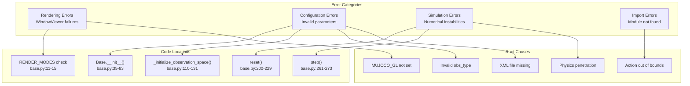
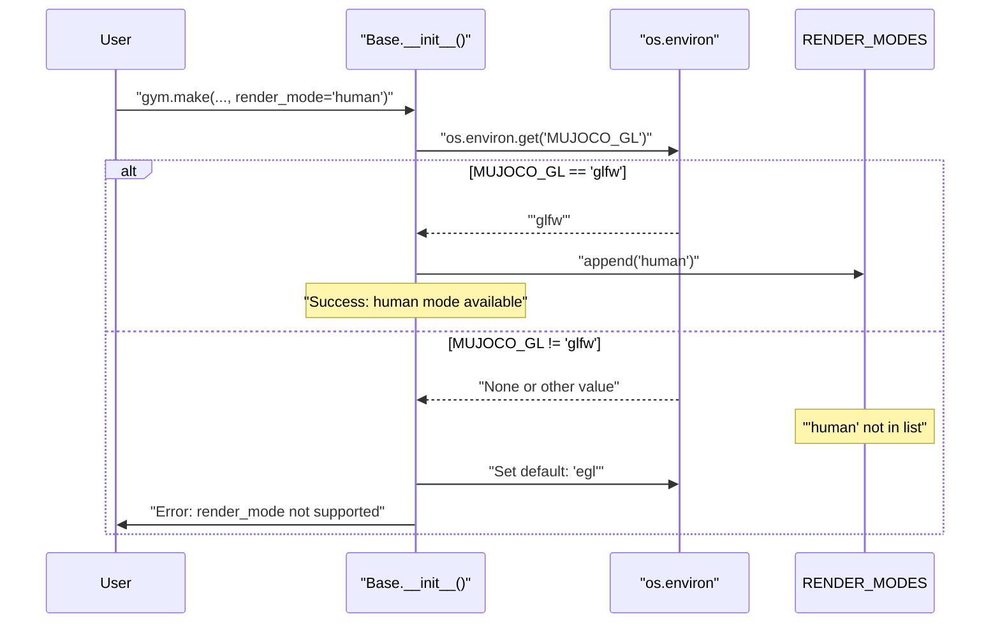
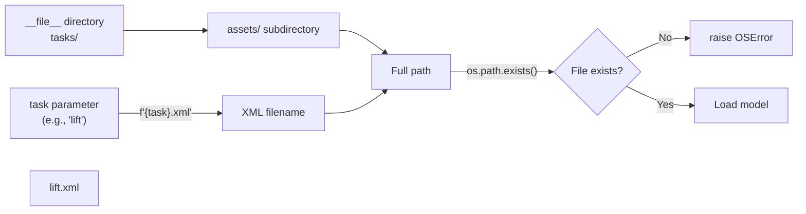
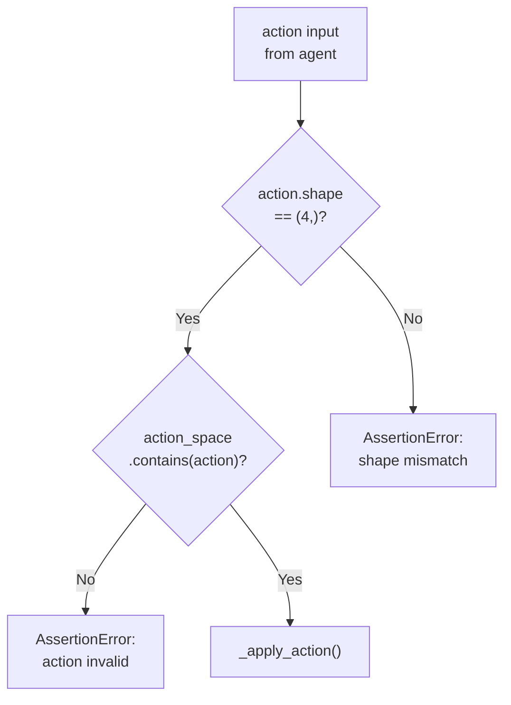
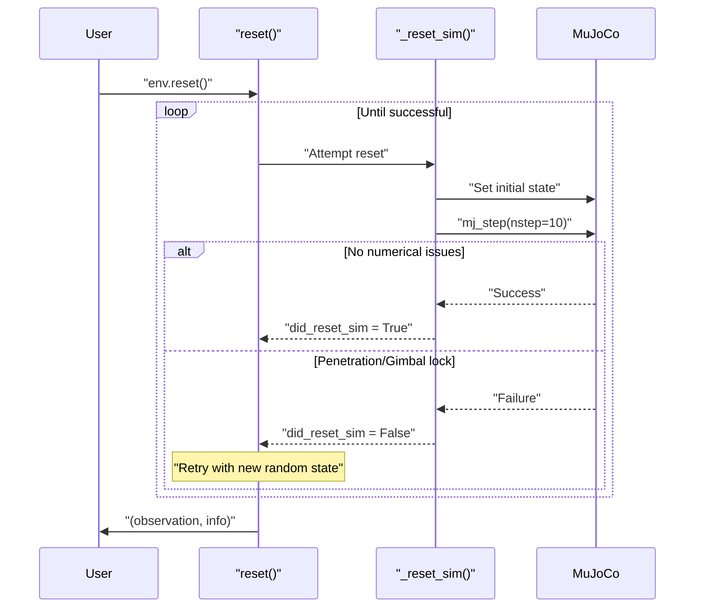
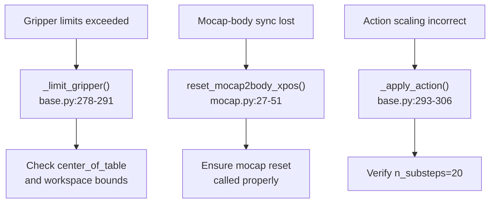
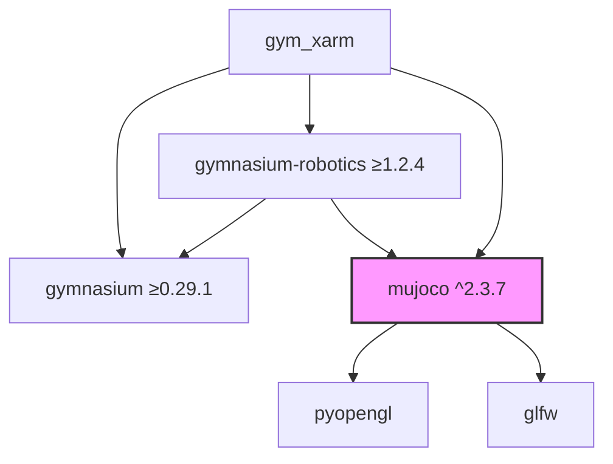
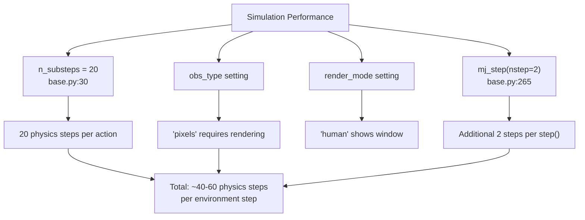
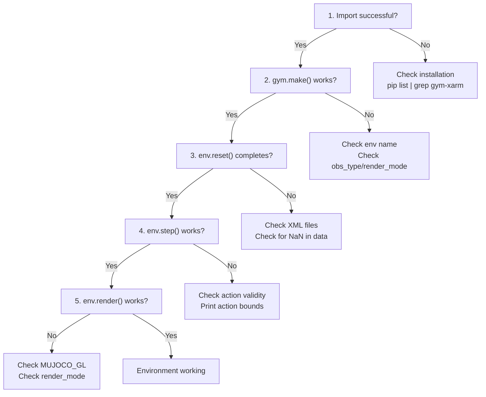

<!-- source: DeepWiki mcp.deepwiki.com · repo huggingface/gym-xarm · page 9 Troubleshooting · fetched 2026-10-26 -->

# Troubleshooting

<details>
<summary>Relevant source files</summary>

The following files were used as context for generating this wiki page:

- [README.md](README.md)
- [example.py](example.py)
- [gym_xarm/tasks/base.py](gym_xarm/tasks/base.py)
- [gym_xarm/tasks/mocap.py](gym_xarm/tasks/mocap.py)
- [tests/test_env.py](tests/test_env.py)

</details>


This page documents common issues encountered when using gym-xarm, their symptoms, root causes, and solutions. It covers runtime errors, configuration problems, rendering issues, and installation failures. For general usage instructions, see [Getting Started](#2). For environment configuration details, see [Configuration Options](#2.3).

## Common Error Categories

The following diagram maps common error messages to their locations in the codebase and typical causes:



Sources: [gym_xarm/tasks/base.py:11-15](), [gym_xarm/tasks/base.py:35-83](), [gym_xarm/tasks/base.py:110-131](), [gym_xarm/tasks/base.py:200-273]()

## Rendering Issues

### MUJOCO_GL Environment Variable

**Symptom**: When using `render_mode="human"`, you encounter errors related to OpenGL or window creation, or `"human"` is not available in the render_modes list.

**Root Cause**: The `MUJOCO_GL` environment variable must be set to `"glfw"` for human rendering mode. The code explicitly checks this condition:

[gym_xarm/tasks/base.py:11-15]()

**Error Flow**:



**Solution**:

Set the environment variable before running your script:
```bash
MUJOCO_GL=glfw python your_script.py
```

Or set it programmatically in Python (must be done before importing gym_xarm):
```python
import os
os.environ['MUJOCO_GL'] = 'glfw'

import gymnasium as gym
import gym_xarm
```

**Note**: If `MUJOCO_GL` is not set or set to a value not in `_ALL_RENDERERS`, the code defaults to `"egl"` mode [gym_xarm/tasks/base.py:14-15](), which only supports `render_mode="rgb_array"`.

Sources: [gym_xarm/tasks/base.py:11-15](), [README.md:42-45]()

### EGL vs GLFW Rendering

**Available Render Modes by Backend**:

| MUJOCO_GL Value | Available render_modes | Use Case |
|-----------------|------------------------|----------|
| `"glfw"` | `["rgb_array", "human"]` | Interactive visualization, development |
| `"egl"` | `["rgb_array"]` | Headless servers, training on clusters |
| `"osmesa"` | `["rgb_array"]` | CPU-only rendering (slower) |

**Symptoms of Backend Mismatch**:
- Window fails to open (GLFW not available)
- Black/empty renders (incorrect backend for environment)
- "Display not found" errors on headless systems

**Solution**: Choose the appropriate backend for your environment. On headless servers, use `"egl"` and `render_mode="rgb_array"` only.

Sources: [gym_xarm/tasks/base.py:11-15]()

## Configuration Errors

### Invalid obs_type Parameter

**Symptom**: `ValueError: Unknown obs_type {value}. Must be one of [pixels, state, pixels_agent_pos]`

**Occurs At**:
- During observation space initialization [gym_xarm/tasks/base.py:127-129]()
- During observation retrieval [gym_xarm/tasks/base.py:257-259]()

**Valid Values**:
- `"state"`: 28-dimensional state vector (default, fastest)
- `"pixels"`: 84×84 RGB image
- `"pixels_agent_pos"`: Dictionary with both pixels and agent position

**Solution**:
```python
# Correct
env = gym.make("gym_xarm/XarmLift-v0", obs_type="state")
env = gym.make("gym_xarm/XarmLift-v0", obs_type="pixels")
env = gym.make("gym_xarm/XarmLift-v0", obs_type="pixels_agent_pos")

# Incorrect - will raise ValueError
env = gym.make("gym_xarm/XarmLift-v0", obs_type="image")  # Wrong!
```

Sources: [gym_xarm/tasks/base.py:110-131](), [gym_xarm/tasks/base.py:245-259]()

### XML Model File Not Found

**Symptom**: `OSError: File {path} does not exist`

**Root Cause**: The XML file path construction fails when the task name is invalid or files are missing [gym_xarm/tasks/base.py:65-67]().

**File Path Construction**:



**Common Causes**:
1. Package not properly installed (assets missing)
2. Custom task name provided without corresponding XML file
3. File permissions preventing access

**Solution**:
- Reinstall the package: `pip install --force-reinstall gym-xarm`
- For Poetry development: `poetry install --all-extras`
- Verify assets exist in: `gym_xarm/tasks/assets/`

Sources: [gym_xarm/tasks/base.py:64-67]()

### Action Space Violations

**Symptom**: `AssertionError` with message about invalid action during `step()`

**Occurs At**: [gym_xarm/tasks/base.py:262-263]()

**Action Space Requirements**:

| Constraint | Value | Code Check |
|------------|-------|------------|
| Shape | `(4,)` | `action.shape == (4,)` |
| Range | `[-1.0, 1.0]` for all dimensions | `action_space.contains(action)` |
| Components | `[x, y, z, gripper]` | - |

**Error Diagram**:



**Solution**:
```python
# Ensure action is numpy array with correct shape
action = np.array([x, y, z, gripper], dtype=np.float32)

# Clip to valid range
action = np.clip(action, -1.0, 1.0)

# Then step
obs, reward, terminated, truncated, info = env.step(action)
```

Sources: [gym_xarm/tasks/base.py:261-263]()

## Simulation and Physics Errors

### Reset Failures and Numerical Instabilities

**Symptom**: Environment reset takes multiple attempts or hangs.

**Root Cause**: The reset method includes a retry loop to handle numerical instabilities [gym_xarm/tasks/base.py:224-226]():



**Why This Happens**:
- Random initial configurations may cause object penetration
- Gimbal lock in orientation constraints
- Joint limits violated during initialization
- Welded constraint violations

**If Reset Hangs**:
1. Check for corrupted XML files
2. Verify joint limits in model are reasonable
3. Ensure initial_qpos values are valid
4. Check for NaN values in data arrays

**Debugging**:
```python
import numpy as np

# Add timeout to reset
import signal

def timeout_handler(signum, frame):
    raise TimeoutError("Reset took too long")

signal.signal(signal.SIGALRM, timeout_handler)
signal.alarm(10)  # 10 second timeout

try:
    obs, info = env.reset()
    signal.alarm(0)  # Cancel alarm
except TimeoutError:
    print("Reset failed - check MuJoCo model configuration")
    # Inspect env.data for NaN values
    print("qpos has NaN:", np.any(np.isnan(env.data.qpos)))
    print("qvel has NaN:", np.any(np.isnan(env.data.qvel)))
```

Sources: [gym_xarm/tasks/base.py:200-243]()

### Mocap Control Issues

**Symptom**: Robot behaves erratically or gripper doesn't respond to actions.

**Common Causes**:



**Gripper Position Limits**:

| Axis | Constraint | Code Location |
|------|-----------|---------------|
| X | `[center-0.405, center+0.045]` | [gym_xarm/tasks/base.py:279-282]() |
| Y | `[center-0.3, center+0.3]` | [gym_xarm/tasks/base.py:283-286]() |
| Z | `[0.2, 1.2]` | [gym_xarm/tasks/base.py:287-290]() |

Actions are clamped to prevent the gripper from exceeding workspace bounds. If your agent isn't reaching desired positions, verify these constraints aren't being violated.

Sources: [gym_xarm/tasks/base.py:278-306](), [gym_xarm/tasks/mocap.py:6-51]()

## Import and Module Errors

### Forgetting to Import gym_xarm

**Symptom**: `gymnasium.error.NameNotFound: Environment gym_xarm/XarmLift-v0 doesn't exist.`

**Root Cause**: The environment registration happens in `gym_xarm/__init__.py` when the module is imported. Simply importing `gymnasium` is not sufficient.

**Incorrect**:
```python
import gymnasium as gym

env = gym.make("gym_xarm/XarmLift-v0")  # NameNotFound error!
```

**Correct**:
```python
import gymnasium as gym
import gym_xarm  # Required! Registers environments

env = gym.make("gym_xarm/XarmLift-v0")  # Works
```

**Why**: The `import gym_xarm` statement executes registration code that adds gym-xarm environments to Gymnasium's registry.

Sources: [tests/test_env.py:1-5](), [example.py:1-3]()

### MuJoCo Installation Issues

**Symptoms**:
- `ImportError: cannot import name 'mujoco'`
- OpenGL/rendering library errors
- Segmentation faults during rendering

**Dependency Chain**:



**Solutions**:

1. **Clean reinstall**:
```bash
pip uninstall gym-xarm mujoco gymnasium gymnasium-robotics
pip install gym-xarm
```

2. **Poetry environment** (for development):
```bash
poetry install --all-extras
```

3. **System dependencies** (Linux):
```bash
# Ubuntu/Debian
sudo apt-get install libglfw3 libglfw3-dev libgl1-mesa-glx libosmesa6

# Fedora
sudo dnf install glfw glfw-devel mesa-libGL mesa-libOSMesa
```

4. **Verify installation**:
```python
import mujoco
print(f"MuJoCo version: {mujoco.__version__}")

import gymnasium
print(f"Gymnasium version: {gymnasium.__version__}")

import gym_xarm
# Should not raise errors
```

Sources: [README.md:8-18](), [README.md:66-73]()

## Testing and Validation

### Environment Checker Failures

**Symptom**: `gymnasium.utils.env_checker.check_env()` raises warnings or errors.

The test suite validates all observation types [tests/test_env.py:8-18]():

```python
# Testing pattern used
from gymnasium.utils.env_checker import check_env

env = gym.make(f"gym_xarm/{env_task}", obs_type=obs_type)
check_env(env.unwrapped)  # Validates Gymnasium API compliance
```

**Common Check Failures**:

| Check | Requirement | Fix Location |
|-------|------------|--------------|
| `step` return shape | Must match observation_space | Verify `_get_obs()` implementation |
| `reset` return shape | Must match observation_space | Verify `get_obs()` for all obs_types |
| Action bounds | Must respect action_space | Ensure `action_space.contains()` passes |
| Render return type | Correct dtype for render_mode | Check `_render()` output |

**Debug Failed Checks**:
```python
env = gym.make("gym_xarm/XarmLift-v0", obs_type="state")

# Check observation
obs, info = env.reset()
print(f"Observation shape: {obs.shape}")
print(f"Expected shape: {env.observation_space.shape}")
assert env.observation_space.contains(obs), "Observation out of bounds"

# Check action
action = env.action_space.sample()
print(f"Action: {action}")
assert env.action_space.contains(action), "Action out of bounds"
```

Sources: [tests/test_env.py:8-19]()

## Performance Issues

### Slow Simulation

**Symptom**: Environment runs slower than expected.

**Performance Factors**:



**Optimization Strategies**:

1. **Use state observations for training**:
```python
# Fastest
env = gym.make("gym_xarm/XarmLift-v0", obs_type="state")

# Slower - requires rendering
env = gym.make("gym_xarm/XarmLift-v0", obs_type="pixels")
```

2. **Disable visualization during training**:
```python
# Don't call env.render() unless necessary
env = gym.make("gym_xarm/XarmLift-v0", render_mode="rgb_array")
# Only render when needed, not every step
```

3. **Understand substep cost**: Each `env.step()` call executes:
   - 20 substeps for action application [gym_xarm/tasks/base.py:30]()
   - 2 additional physics steps [gym_xarm/tasks/base.py:265]()
   - Forward kinematics calls [gym_xarm/tasks/base.py:266](), [gym_xarm/tasks/base.py:324]()

**Typical Performance**:
- State observations: ~2000-3000 steps/second
- Pixel observations: ~500-1000 steps/second (depends on GPU)
- Human rendering: ~100-200 steps/second (capped by render_fps=25)

Sources: [gym_xarm/tasks/base.py:29-30](), [gym_xarm/tasks/base.py:261-273]()

## Debugging Strategies

### Enabling Detailed Logging

```python
import logging
logging.basicConfig(level=logging.DEBUG)

import gymnasium as gym
import gym_xarm

# Now gym operations will show detailed logs
env = gym.make("gym_xarm/XarmLift-v0")
```

### Inspecting Environment State

```python
env = gym.make("gym_xarm/XarmLift-v0", obs_type="state")
env.reset()

# Access internal state
print("End effector position:", env.eef)
print("Gripper angle:", env.gripper_angle)
print("Object position:", env.obj)
print("Object velocity:", env.obj_velp)

# Access MuJoCo data directly
print("Joint positions:", env.data.qpos)
print("Joint velocities:", env.data.qvel)
print("Simulation time:", env.data.time)

# Check for NaN values
import numpy as np
print("Data has NaN:", np.any(np.isnan(env.data.qpos)))
```

### Step-by-Step Debugging



### Common Debug Commands

```bash
# Check installation
pip list | grep -E "gym-xarm|gymnasium|mujoco"

# Check Python version
python --version  # Should be 3.10+

# Check MUJOCO_GL setting
echo $MUJOCO_GL

# Run with verbose output
python -v your_script.py

# Test environment directly
python -c "import gymnasium as gym; import gym_xarm; env = gym.make('gym_xarm/XarmLift-v0'); print('Success')"
```

Sources: [gym_xarm/tasks/base.py:158-188]()

## Getting Help

If issues persist after trying these solutions:

1. **Check the test suite**: Run `pytest tests/` to verify your installation
2. **Review closed issues**: https://github.com/huggingface/gym-xarm/issues
3. **Provide diagnostics** when reporting issues:
   - Python version
   - Output of `pip list | grep -E "gym-xarm|gymnasium|mujoco"`
   - Operating system
   - Full error traceback
   - Minimal code to reproduce

**Minimal Reproducible Example**:
```python
import gymnasium as gym
import gym_xarm

try:
    env = gym.make("gym_xarm/XarmLift-v0", obs_type="state", render_mode="rgb_array")
    obs, info = env.reset()
    print(f"Reset successful. Observation shape: {obs.shape}")
    
    for i in range(10):
        action = env.action_space.sample()
        obs, reward, terminated, truncated, info = env.step(action)
        print(f"Step {i}: reward={reward:.3f}, terminated={terminated}")
        
    env.close()
    print("All operations successful!")
    
except Exception as e:
    print(f"Error: {type(e).__name__}: {e}")
    import traceback
    traceback.print_exc()
```

Sources: [tests/test_env.py:16-18](), [example.py:1-15]()

---

