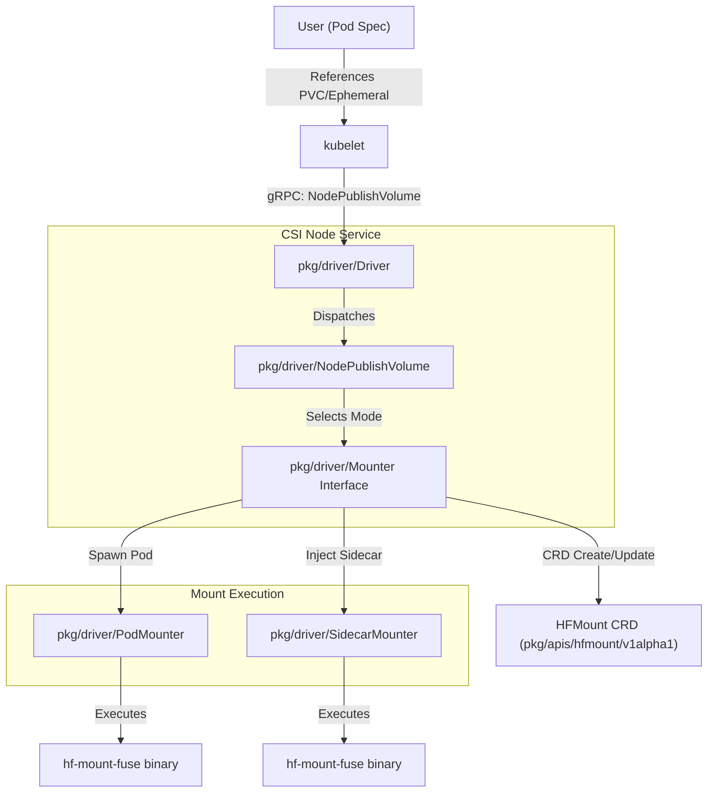
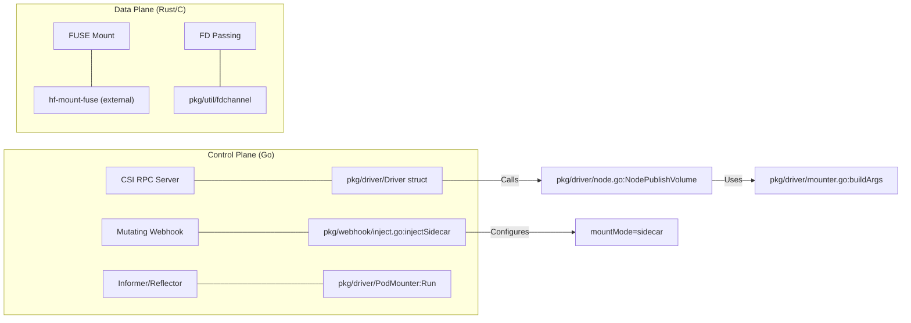

<!-- source: DeepWiki mcp.deepwiki.com · repo huggingface/hf-csi-driver · page 1 Overview · fetched 2026-10-26 -->

# Overview

Relevant source files

The following files were used as context for generating this wiki page:

- [.github/workflows/ci.yml](.github/workflows/ci.yml)
- [README.md](README.md)
- [deploy/helm/hf-csi-driver/Chart.yaml](deploy/helm/hf-csi-driver/Chart.yaml)

The `hf-csi-driver` is a Kubernetes Container Storage Interface (CSI) implementation designed to mount **Hugging Face Buckets** and **Model/Dataset Repositories** directly into Pods as FUSE filesystems. It acts as a bridge between the Kubernetes storage lifecycle and [hf-mount](https://github.com/huggingface/hf-mount), a Rust-based FUSE implementation [README.md:3-5]().

The driver allows data scientists and engineers to treat Hugging Face Hub resources as local directories, supporting both read-only model access and read-write bucket storage [README.md:91-164]().

## Key Architectural Concepts

The system consists of several moving parts that coordinate to manage the lifecycle of FUSE mounts:

1.  **CSI Driver (Go):** A DaemonSet running on every node that implements the CSI spec (Identity, Node services). It handles `NodePublishVolume` and `NodeUnpublishVolume` requests from the kubelet [pkg/driver/node.go:102-103]().
2.  **hf-mount-fuse (Rust):** The actual FUSE binary that performs the network I/O to the Hugging Face Hub.
3.  **HFMount CRD:** A Custom Resource Definition used as the "source of truth" for active mounts on a node. It allows the driver to recover mounts after a node or driver restart [README.md:14-16]().
4.  **Admission Webhook:** An optional component that injects `hf-mount` sidecar containers into Pods for high-performance, low-overhead mounting [README.md:212-215]().

### High-Level Interaction Flow

The following diagram illustrates how a user request for a volume results in a FUSE mount:

**User to Code Flow**

Sources: [pkg/driver/driver.go:27-45](), [pkg/driver/node.go:102-230](), [README.md:9-12]()

## Mount Modes

The driver supports two primary modes of operation, determined by the `mountMode` volume attribute:

| Mode | Description | Primary Use Case |
| :--- | :--- | :--- |
| **PodMount** | Each volume gets a dedicated "mount pod" on the node. The driver bind-mounts the FUSE path into the application pod. | Default; highly resilient; survives driver restarts. |
| **Sidecar** | The `hf-mount` process runs as a sidecar container within the application pod. Uses FD-passing for FUSE setup. | Performance; reduced resource overhead; better isolation. |

For details on selecting and configuring these modes, see **[Architecture Overview](#1.2)**.

## System Components Mapping

This diagram bridges the conceptual subsystems to their specific implementation packages and entry points.

**System to Code Entity Mapping**

Sources: [pkg/driver/driver.go:27-45](), [pkg/driver/node.go:102-120](), [pkg/driver/mounter.go:120-140](), [pkg/webhook/inject.go:45-60]()

## Child Pages

*   **[Getting Started](#1.1)**: Instructions for installing the driver via Helm or YAML manifests, and examples for mounting your first repository or bucket.
*   **[Architecture Overview](#1.2)**: A deep dive into the HFMount CRD lifecycle, the differences between PodMount and Sidecar modes, and how the admission webhook automates sidecar injection.

---
Sources: [README.md:1-211](), [.github/workflows/ci.yml:1-214](), [deploy/helm/hf-csi-driver/Chart.yaml:1-7]()

---

