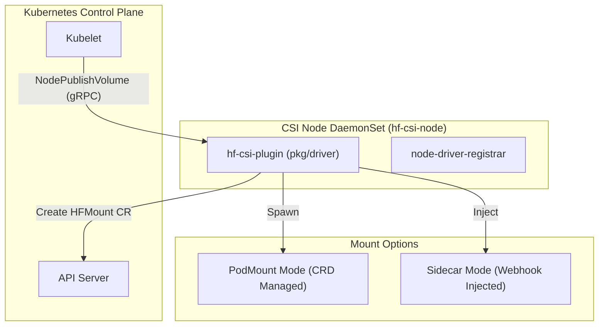
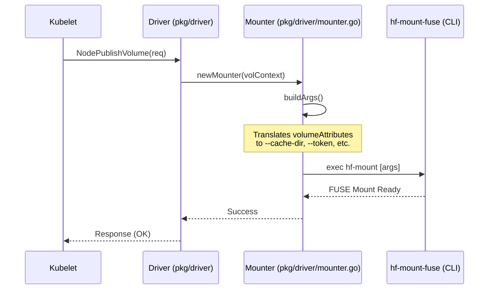

<!-- source: DeepWiki mcp.deepwiki.com · repo huggingface/hf-csi-driver · page 1.1 Getting Started · fetched 2026-10-26 -->

# Getting Started

<details>
<summary>Relevant source files</summary>

The following files were used as context for generating this wiki page:

- [deploy/helm/hf-csi-driver/Chart.yaml](deploy/helm/hf-csi-driver/Chart.yaml)
- [deploy/helm/hf-csi-driver/values.yaml](deploy/helm/hf-csi-driver/values.yaml)
- [deploy/kubernetes/csidriver.yaml](deploy/kubernetes/csidriver.yaml)
- [deploy/kubernetes/daemonset.yaml](deploy/kubernetes/daemonset.yaml)
- [deploy/kubernetes/examples/bucket.yaml](deploy/kubernetes/examples/bucket.yaml)
- [deploy/kubernetes/examples/repo.yaml](deploy/kubernetes/examples/repo.yaml)
- [deploy/kubernetes/rbac.yaml](deploy/kubernetes/rbac.yaml)
- [deploy/kubernetes/serviceaccount.yaml](deploy/kubernetes/serviceaccount.yaml)

</details>


The `hf-csi-driver` provides a Kubernetes Container Storage Interface (CSI) implementation for mounting Hugging Face repositories and S3-backed buckets as FUSE filesystems. This allows Kubernetes workloads to access model weights and datasets directly via standard file system operations.

## Installation

The driver can be installed either via Helm (recommended) or using raw Kubernetes manifests.

### Helm Chart Deployment
The Helm chart automates the deployment of the CSI driver, the sidecar injection webhook, and the necessary RBAC permissions.

1.  **Configure Values**: Review `deploy/helm/hf-csi-driver/values.yaml` to customize the image tags and cache directory [deploy/helm/hf-csi-driver/values.yaml:1-17]().
2.  **Install**:
    ```bash
    helm install hf-csi-driver ./deploy/helm/hf-csi-driver
    ```

The chart deploys a `DaemonSet` named `hf-csi-node` to every node [deploy/helm/hf-csi-driver/values.yaml:24-30](), along with a mutating admission webhook for sidecar injection [deploy/helm/hf-csi-driver/values.yaml:34-42]().

### Raw Kubernetes Manifests
For environments without Helm, apply the manifests located in `deploy/kubernetes/`:

1.  **CRDs and RBAC**:
    ```bash
    kubectl apply -f deploy/kubernetes/crd.yaml
    kubectl apply -f deploy/kubernetes/rbac.yaml
    kubectl apply -f deploy/kubernetes/serviceaccount.yaml
    ```
2.  **CSIDriver Object**: Registers `hf.csi.huggingface.co` with the cluster [deploy/kubernetes/csidriver.yaml:1-9]().
    ```bash
    kubectl apply -f deploy/kubernetes/csidriver.yaml
    ```
3.  **DaemonSet**:
    ```bash
    kubectl apply -f deploy/kubernetes/daemonset.yaml
    ```

**Sources:**
- [deploy/helm/hf-csi-driver/values.yaml:1-48]()
- [deploy/kubernetes/daemonset.yaml:1-110]()
- [deploy/kubernetes/csidriver.yaml:1-9]()
- [deploy/kubernetes/rbac.yaml:1-25]()

---

## Required Secrets

The driver requires a Hugging Face API token to authenticate requests to the Hub. This should be provided as a Kubernetes Secret.

```yaml
apiVersion: v1
kind: Secret
metadata:
  name: hf-token
  namespace: default
type: Opaque
stringData:
  token: hf_xxxxxxxxxxxxxxxxx 
```

The secret is referenced in the `PersistentVolume` (PV) spec via `nodePublishSecretRef` [deploy/kubernetes/examples/repo.yaml:17-19]().

**Sources:**
- [deploy/kubernetes/examples/repo.yaml:15-19]()
- [deploy/kubernetes/examples/bucket.yaml:15-17]()

---

## Configuration and Usage

### Mounting a Repository
To mount a Hugging Face repository (Model or Dataset), define a `PersistentVolume` with `sourceType: repo`.

```yaml
apiVersion: v1
kind: PersistentVolume
metadata:
  name: hf-repo-pv
spec:
  csi:
    driver: hf.csi.huggingface.co
    volumeHandle: my-repo-handle
    volumeAttributes:
      sourceType: repo
      sourceId: org/model-name
      revision: main
```

### Mounting a Bucket
To mount a Hugging Face Bucket (S3-compatible), use `sourceType: bucket`.

```yaml
apiVersion: v1
kind: PersistentVolume
metadata:
  name: hf-bucket-pv
spec:
  csi:
    driver: hf.csi.huggingface.co
    volumeHandle: my-bucket-handle
    volumeAttributes:
      sourceType: bucket
      sourceId: org/bucket-name
```

**Sources:**
- [deploy/kubernetes/examples/repo.yaml:1-24]()
- [deploy/kubernetes/examples/bucket.yaml:1-20]()

---

## Implementation Data Flow

The following diagram illustrates the interaction between the Kubernetes API, the CSI Driver, and the `hf-mount-fuse` utility during a volume mount operation.

### Deployment Architecture
The driver consists of a `hf-csi-plugin` container which handles CSI RPCs and orchestrates the FUSE mount via `hf-mount-fuse`.



**Sources:**
- [deploy/kubernetes/daemonset.yaml:24-50]()
- [deploy/kubernetes/csidriver.yaml:1-9]()

### Mount Process: Code Entity Mapping
This diagram maps the natural language "Mount Request" to specific code entities and CLI arguments used to invoke the FUSE mounter.



**Sources:**
- [deploy/kubernetes/daemonset.yaml:26-32]()
- [deploy/kubernetes/examples/repo.yaml:21-23]()
- [deploy/helm/hf-csi-driver/values.yaml:15-17]()

---

## Key Configuration Parameters

| Attribute | Description | Default |
| :--- | :--- | :--- |
| `sourceType` | Type of source: `repo` or `bucket`. | Required |
| `sourceId` | The HF repository or bucket ID (e.g., `gpt2`). | Required |
| `revision` | Git revision (branch/commit/tag) for `repo` types. | `main` |
| `cacheDir` | Host path for caching downloaded data. | `/var/lib/hf-csi-driver/cache` |
| `mountMode` | `sidecar` (default) or `mountpod`. | `sidecar` |

**Sources:**
- [deploy/helm/hf-csi-driver/values.yaml:17]()
- [deploy/kubernetes/daemonset.yaml:29-30]()
- [deploy/kubernetes/examples/repo.yaml:21-23]()

---

