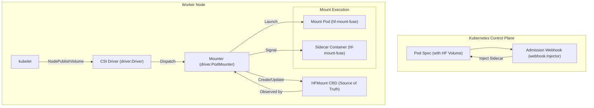
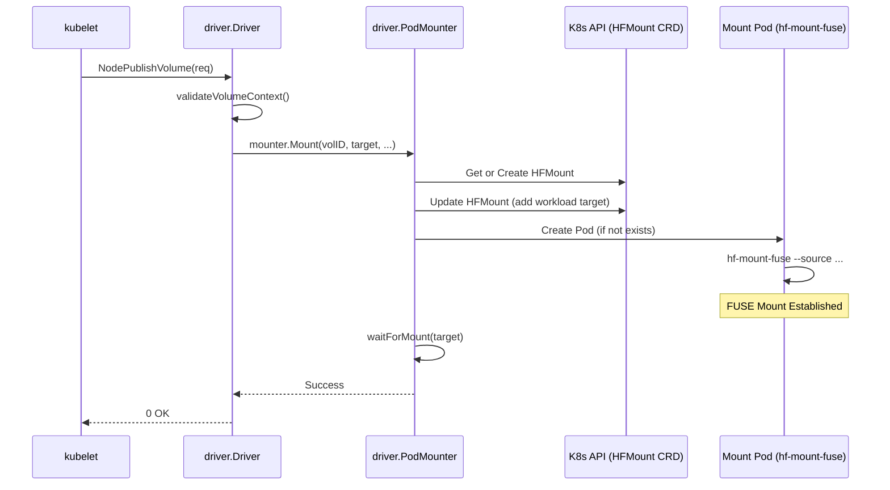

<!-- source: DeepWiki mcp.deepwiki.com · repo huggingface/hf-csi-driver · page 1.2 Architecture Overview · fetched 2026-10-26 -->

# Architecture Overview

Relevant source files

The following files were used as context for generating this wiki page:

- [.github/workflows/ci.yml](.github/workflows/ci.yml)
- [README.md](README.md)
- [cmd/hf-csi-driver/main.go](cmd/hf-csi-driver/main.go)
- [pkg/driver/driver.go](pkg/driver/driver.go)

The `hf-csi-driver` provides a Kubernetes-native way to mount Hugging Face repositories and S3-backed buckets into Pods using FUSE. It serves as a bridge between the [CSI (Container Storage Interface)](https://github.com/container-storage-interface/spec) and [hf-mount](https://github.com/huggingface/hf-mount), a Rust-based FUSE implementation [README.md:3-5]().

## System Components

The system consists of three primary binaries/roles:
1.  **CSI Driver (Node Mode)**: A DaemonSet running on every node. It implements the CSI `NodeServer` interface to handle volume lifecycle events [cmd/hf-csi-driver/main.go:58-59]().
2.  **Admission Webhook (Webhook Mode)**: A deployment that intercepts Pod creation to inject sidecar containers for high-performance mounting [cmd/hf-csi-driver/main.go:60-61]().
3.  **hf-mount-fuse**: The actual FUSE filesystem process. It runs either in a standalone **Mount Pod** or as a **Sidecar Container** [README.md:9-12]().

### High-Level Interaction Diagram

The following diagram illustrates how a user request for a volume flows through the system components.

**Sources:** [pkg/driver/driver.go:36-49](), [cmd/hf-csi-driver/main.go:57-65](), [pkg/driver/podmounter.go:103-104]()

---

## Mount Modes

The driver supports two distinct architectural patterns for running the FUSE process. The choice is governed by the `mountMode` attribute or the presence of the sidecar.

### 1. PodMount Mode (Default)
In this mode, the CSI driver creates a dedicated "Mount Pod" for every unique volume on a node. 
- **Isolation**: The FUSE process is decoupled from the lifecycle of the workload Pod. If the CSI driver restarts, the Mount Pod continues running [README.md:14]().
- **Self-Healing**: The `PodMounter` uses the `HFMount` CRD as the source of truth. If a Mount Pod is deleted or crashes, the driver detects the discrepancy and recreates it [README.md:15-16]().
- **Propagation**: The FUSE filesystem is mounted inside the Mount Pod and then bind-mounted to the target path on the host, which is then shared with the workload Pod [README.md:10]().

### 2. Sidecar Mode
Sidecar mode is optimized for performance and resource accounting. It requires the Admission Webhook to be enabled.
- **Injection**: The `webhook.Injector` adds an `hf-mount` container to the user's Pod [cmd/hf-csi-driver/main.go:148-151]().
- **FD Passing**: Instead of traditional mounting, the sidecar opens `/dev/fuse` and passes the file descriptor to the driver or handles the mount internally using `SCM_RIGHTS` over a Unix socket [pkg/driver/driver.go:17-26]().
- **Native Sidecars**: It utilizes Kubernetes native sidecar support (KEP-753) to ensure the mount is available before the main application starts.

| Feature | PodMount Mode | Sidecar Mode |
| :--- | :--- | :--- |
| **FUSE Process Location** | Dedicated Pod per Volume | Container within Workload Pod |
| **Resilience** | Survives Workload Restart | Tied to Workload Lifecycle |
| **Resource Attribution** | Cluster-level (System) | Pod-level (User) |
| **Implementation** | `driver.PodMounter` | `webhook.Injector` + `driver.sidecarMount` |

**Sources:** [README.md:9-20](), [pkg/driver/driver.go:17-26](), [cmd/hf-csi-driver/main.go:123-157]()

---

## The HFMount CRD

The `HFMount` Custom Resource Definition (CRD) acts as the "Source of Truth" for the `PodMounter` [README.md:16](). It stores the necessary state to recover mounts after a node reboot or driver crash.

Key fields in `HFMountSpec`:
- `sourceType`: `repo` or `bucket`.
- `sourceID`: The Hugging Face repository or bucket name.
- `mountArgs`: The CLI flags generated for `hf-mount-fuse`.
- `workloads`: A list of target paths and Pods currently using this mount.

**Sources:** [README.md:192-211](), [pkg/driver/podmounter.go:103-104]()

---

## Data Flow: NodePublishVolume

The following diagram maps the CSI RPC call to the internal Go entities.

**Sources:** [pkg/driver/driver.go:104-106](), [pkg/driver/driver.go:81-92](), [README.md:9-12]()

---

## Token Management and Security

The driver handles Hugging Face authentication tokens via Kubernetes Secrets.
- **Secret Reference**: Tokens are passed via `nodePublishSecretRef` in the PV or Pod spec [README.md:87-89]().
- **Live Refresh**: The driver implements `requiresRepublish`, allowing it to update the token file used by `hf-mount-fuse` without unmounting the volume [README.md:18]().
- **Privileges**: Both the CSI driver and the mount containers require `privileged: true` to perform FUSE mounts and manage mount propagation [README.md:25]().

**Sources:** [README.md:55-60](), [README.md:107-112](), [README.md:18-19]()

---

