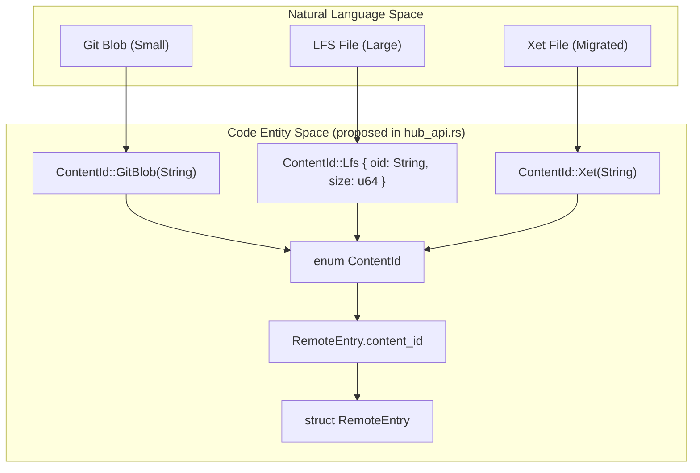
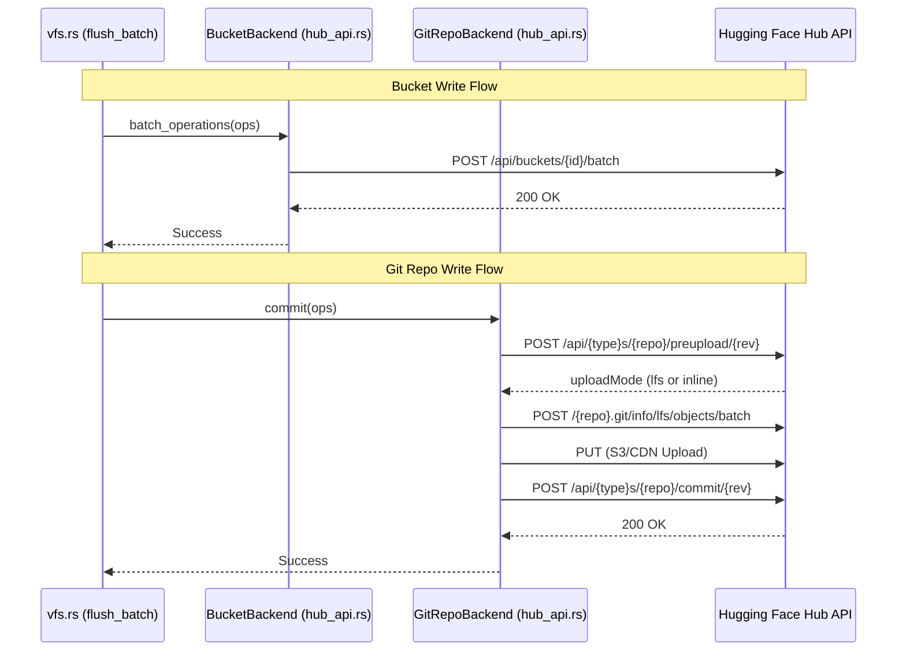

<!-- source: DeepWiki mcp.deepwiki.com · repo huggingface/hf-csi-driver · page 10 Design Notes: Git Repo Support Analysis · fetched 2026-10-26 -->

# Design Notes: Git Repo Support Analysis

<details>
<summary>Relevant source files</summary>

The following files were used as context for generating this wiki page:

- [README.md](README.md)
- [docs/git-repo-support-analysis.md](docs/git-repo-support-analysis.md)

</details>


This page summarizes the design analysis for extending `hf-mount` to support Hugging Face Git repositories (models, datasets, and spaces) alongside the existing support for Hugging Face Buckets.

## Purpose and Scope

The `hf-mount` utility was originally designed to mount **Hugging Face Buckets**, which are flat key-value stores backed by Xet CAS [docs/git-repo-support-analysis.md:3-5](). Extending support to **Git repositories** introduces complexity due to versioning, mixed storage backends (Git blobs, LFS, and Xet), and multi-step commit workflows [docs/git-repo-support-analysis.md:6-7](). The goal of this analysis is to define a unified `StorageBackend` trait that allows a single binary to handle both source types [docs/git-repo-support-analysis.md:9-10]().

## API Surface Comparison

The primary challenge in supporting both systems lies in the divergent API structures for tree listing, file identity, and authentication.

| Concern | Buckets (Current) | Git Repos (Target) |
| :--- | :--- | :--- |
| **Tree Listing** | `GET /api/buckets/{id}/tree[/{prefix}]` | `GET /api/{type}s/{repo_id}/tree/{revision}[/{path}]` |
| **File Identity** | `xet_hash` (Always) | Mixed: `oid` (Git SHA-1), `lfs.oid` (SHA-256), or `xetHash` |
| **mtime** | Native `mtime` field | Requires `expand=true` (Expensive) |
| **Download** | Xet CAS reconstruction | `/resolve/` URL → inline or 302 redirect (LFS/Xet) |
| **Auth Tokens** | Per-bucket CAS token | Repo-level `Authorization: Bearer hf_...` |
| **Revisions** | None (Mutable KV) | Every URL requires `{revision}` (branch/tag/SHA) |

Sources: [docs/git-repo-support-analysis.md:15-24]()

## Tree Entry and Content Identity

In the current implementation, every file is identified by a `xet_hash` [docs/git-repo-support-analysis.md:28-31](). To support Git repos, the system must handle three distinct file types:

1.  **Regular Git Blobs**: Identified by a Git `oid` (SHA-1). Small files stored directly in Git [docs/git-repo-support-analysis.md:33-36]().
2.  **LFS Files**: Identified by an `lfs.oid` (SHA-256). Large files stored in S3/CDN [docs/git-repo-support-analysis.md:38-41]().
3.  **Xet-Migrated Files**: Identified by a `xetHash`. Large files in repositories migrated to Xet storage [docs/git-repo-support-analysis.md:42-43]().

### Mapping Data Structures to Code Entities

The following diagram illustrates how the abstract concept of a "File" in a repository is translated into the proposed `ContentId` and `RemoteEntry` structures in the Rust codebase.

**Figure 1: Content Identity Mapping**

Sources: [docs/git-repo-support-analysis.md:124-136]()

## Download and Write Flows

### Download Flow Differences
The download mechanism must dispatch based on the `ContentId` type:
*   **Buckets**: Always use `FileDownloadSession` for Xet CAS reconstruction [docs/git-repo-support-analysis.md:52-53]().
*   **Git Repos**: 
    *   **Small blobs**: HTTP 200 (inline content) from `/resolve/` [docs/git-repo-support-analysis.md:55]() .
    *   **LFS (Legacy)**: HTTP 302 redirect to S3/CDN presigned URLs [docs/git-repo-support-analysis.md:57]().
    *   **LFS (Xet-migrated)**: HTTP 302 with `X-Xet-Hash` header, triggering Xet CAS reconstruction [docs/git-repo-support-analysis.md:56]().

### Write/Commit Flow Comparison
Writing to Git repositories is significantly more complex than the atomic batch operation used by Buckets.

**Figure 2: Commit Workflow Comparison**

Sources: [docs/git-repo-support-analysis.md:59-93](), [docs/git-repo-support-analysis.md:174-184]()

## Engineering Challenges and Impact

### Abstraction via StorageBackend Trait
To support both backends, the analysis proposes a `StorageBackend` trait to decouple the FUSE logic from the specific API implementations [docs/git-repo-support-analysis.md:109-110]().

```rust
#[async_trait]
pub trait StorageBackend: Send + Sync {
    async fn list_tree(&self, prefix: &str) -> Result<Vec<RemoteEntry>>;
    async fn download(&self, entry: &RemoteEntry, range: Option<Range<u64>>) -> Result<DownloadStream>;
    async fn commit(&self, ops: Vec<CommitOp>) -> Result<()>;
}
```
Sources: [docs/git-repo-support-analysis.md:112-122]()

### Impact on Existing Modules
*   **`hub_api.rs` (High Impact)**: Requires a full rewrite or extraction of logic into `BucketBackend` and `GitRepoBackend` [docs/git-repo-support-analysis.md:101-107]().
*   **`inode.rs` (Medium Impact)**: The `Inode` struct must replace the optional `xet_hash: String` with the new `content_id: ContentId` enum [docs/git-repo-support-analysis.md:144-147]().
*   **`cache.rs` (Medium Impact)**: `download_to_file()` must be updated to handle HTTP range requests for LFS/GitBlob targets instead of relying solely on Xet CAS [docs/git-repo-support-analysis.md:149-155]().
*   **`vfs.rs` (Medium Impact)**: `flush_batch()` must transition from the Xet-specific `FileUploadSession` to the multi-step Git commit process [docs/git-repo-support-analysis.md:169-184]().

Sources:
* `README.md`
* `docs/git-repo-support-analysis.md`

---

