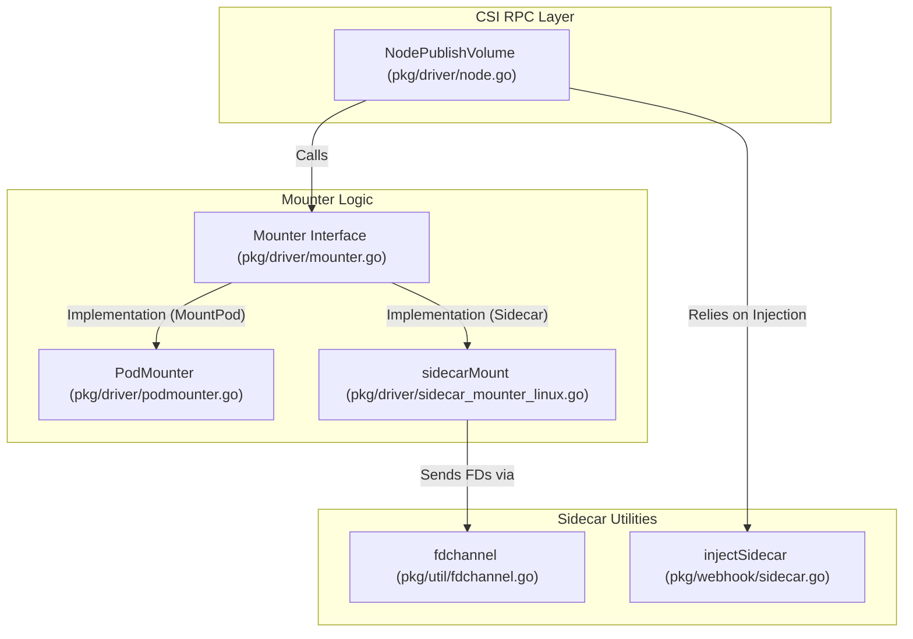
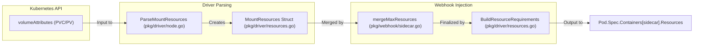

<!-- source: DeepWiki mcp.deepwiki.com · repo huggingface/hf-csi-driver · page 11 Glossary · fetched 2026-10-26 -->

# Glossary

Relevant source files

The following files were used as context for generating this wiki page:

- [.github/workflows/ci.yml](.github/workflows/ci.yml)
- [README.md](README.md)
- [deploy/helm/hf-csi-driver/templates/crd.yaml](deploy/helm/hf-csi-driver/templates/crd.yaml)
- [deploy/kubernetes/crd.yaml](deploy/kubernetes/crd.yaml)
- [pkg/driver/hfmount.go](pkg/driver/hfmount.go)
- [pkg/driver/mounter.go](pkg/driver/mounter.go)
- [pkg/driver/node.go](pkg/driver/node.go)
- [pkg/driver/podmounter.go](pkg/driver/podmounter.go)
- [pkg/driver/poduid_test.go](pkg/driver/poduid_test.go)
- [pkg/driver/sidecar_mounter_linux.go](pkg/driver/sidecar_mounter_linux.go)
- [pkg/util/fdchannel.go](pkg/util/fdchannel.go)
- [pkg/util/fdchannel_test.go](pkg/util/fdchannel_test.go)
- [pkg/webhook/sidecar.go](pkg/webhook/sidecar.go)
- [pkg/webhook/sidecar_test.go](pkg/webhook/sidecar_test.go)
- [test/e2e/sidecar/02-sidecar-injected.sh](test/e2e/sidecar/02-sidecar-injected.sh)

This page provides definitions for codebase-specific terms, domain concepts, and architectural components of the `hf-csi-driver`.

## Core Concepts

### hf-mount / hf-mount-fuse
The underlying FUSE (Filesystem in Userspace) implementation written in Rust. It performs the actual network I/O to Hugging Face Buckets or Repos and exposes them as a local filesystem [README.md:1-5](). The CSI driver acts as a manager for the lifecycle of this process.

### Mount Modes
The driver supports two primary ways of running the FUSE daemon:
*   **Sidecar Mode (`sidecar`)**: The FUSE daemon runs inside the workload pod as a native sidecar container (KEP-753) [pkg/driver/node.go:40-43]().
*   **MountPod Mode (`mountpod`)**: The FUSE daemon runs in a dedicated pod managed by the CSI driver, separate from the workload pod [pkg/driver/node.go:44-46]().

### HFMount CRD
A Custom Resource Definition used as the source of truth for mounts in `mountpod` mode. It tracks the `sourceType`, `sourceID`, and `mountPath`, allowing the driver to recover mounts after a restart [README.md:13-17](), [pkg/driver/podmounter.go:93]().

## Technical Terms

### SCM_RIGHTS / FD Passing
A mechanism used in **Sidecar Mode** to transfer open file descriptors over a Unix domain socket. The CSI driver opens `/dev/fuse`, performs the kernel-level mount, and then "ships" the file descriptor to the sidecar container [pkg/driver/sidecar_mounter_linux.go:120-130](). This allows the sidecar to run without `privileged` capabilities [pkg/webhook/sidecar.go:30-33]().

### FUSE_DEV_IOC_CLONE
An ioctl command (`0x8004E500`) used to create multiple file descriptors pointing to the same FUSE connection [pkg/driver/sidecar_mounter_linux.go:48-52](). This enables multi-threaded reading in the FUSE daemon by providing multiple independent channels to the kernel FUSE device [pkg/driver/sidecar_mounter_linux.go:81-96]().

### emptyDir Injection
In Sidecar Mode, a mutating admission webhook injects a shared `emptyDir` volume (named `hf-csi-tmp`) into the workload pod [pkg/webhook/sidecar.go:38-48](). This volume is used for:
1.  **Unix Socket**: Communication for FD passing.
2.  **Args File**: Passing CLI arguments to the sidecar.
3.  **Token File**: Passing the Hugging Face API token securely [pkg/driver/sidecar_mounter_linux.go:181-185]().

## Component Mapping

### Logic to Code Entity Space
The following diagram maps high-level system operations to specific functions and classes in the codebase.

**Mount Operation Flow**

**Sources:** [pkg/driver/node.go:49-54](), [pkg/driver/mounter.go:32-43](), [pkg/driver/podmounter.go:49-55](), [pkg/driver/sidecar_mounter_linux.go:130-131](), [pkg/webhook/sidecar.go:30-38]().

### Resource Management Mapping
This diagram shows how volume attributes from the Kubernetes API are transformed into internal resource requirements.

**Resource Data Flow**

**Sources:** [pkg/driver/node.go:177](), [pkg/driver/mounter.go:29](), [pkg/webhook/sidecar.go:98](), [pkg/webhook/sidecar_test.go:80-93]().

## Reference Table: Abbreviations & Constants

| Term | Definition | Code Pointer |
| :--- | :--- | :--- |
| **NPV** | `NodePublishVolume`: The CSI RPC that initiates a mount. | [pkg/driver/node.go:49]() |
| **NUV** | `NodeUnpublishVolume`: The CSI RPC that initiates an unmount. | [pkg/driver/node.go:211]() |
| **Hfm** | Short name for the `HFMount` CRD. | [deploy/kubernetes/crd.yaml]() |
| **fsGroup** | Kubernetes pod security field; mapped to FUSE `user_id`/`group_id`. | [pkg/driver/node.go:160-162]() |
| **TokenKey** | The key in a K8s Secret containing the HF API token. | [pkg/driver/node.go:21]() |
| **SourceID** | The HF identifier (e.g., `openai-community/gpt2`). | [pkg/driver/node.go:24]() |

**Sources:** [pkg/driver/node.go:19-47](), [pkg/driver/node.go:49-54](), [pkg/driver/node.go:160-162](), [pkg/driver/node.go:211]().