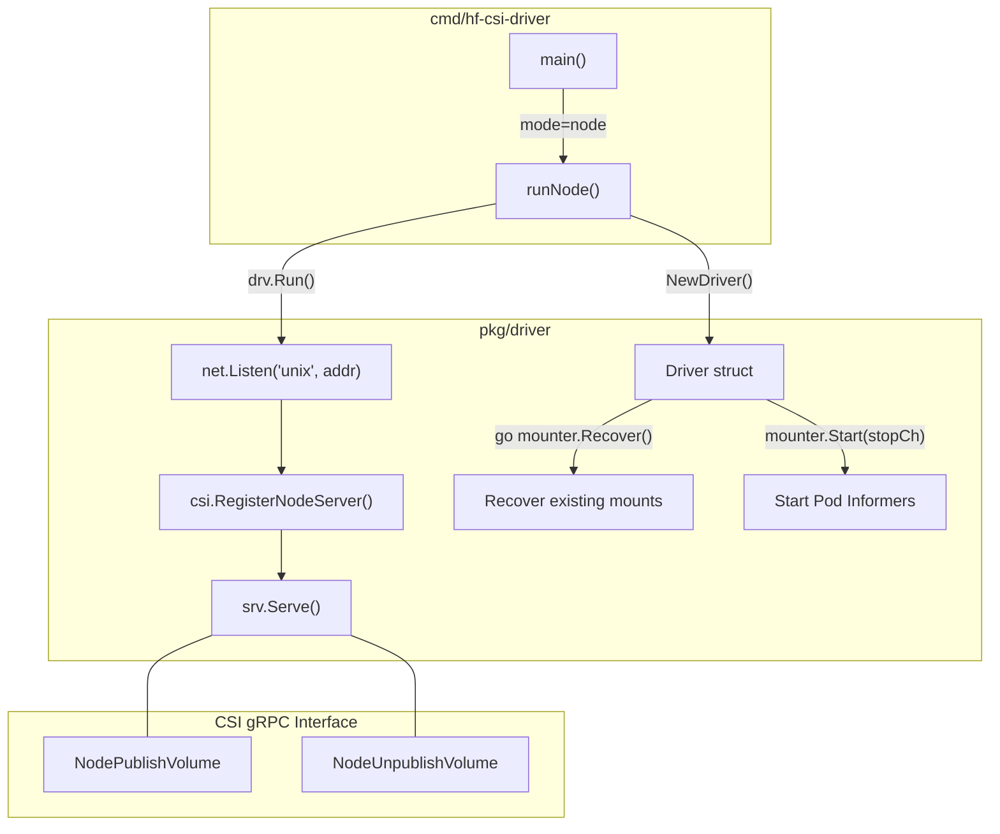
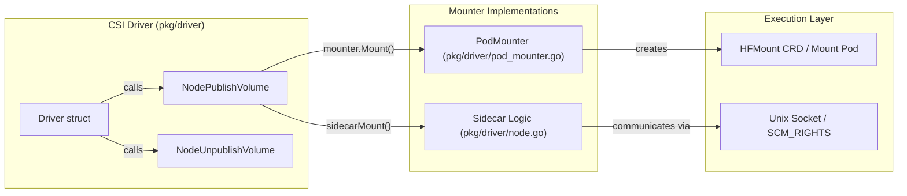

<!-- source: DeepWiki mcp.deepwiki.com · repo huggingface/hf-csi-driver · page 2 Core Driver · fetched 2026-10-26 -->

# Core Driver

Relevant source files

The following files were used as context for generating this wiki page:

- [cmd/hf-csi-driver/main.go](cmd/hf-csi-driver/main.go)
- [pkg/driver/controller.go](pkg/driver/controller.go)
- [pkg/driver/driver.go](pkg/driver/driver.go)
- [pkg/driver/identity.go](pkg/driver/identity.go)

The `hf-csi-driver` is a Container Storage Interface (CSI) implementation that enables Kubernetes workloads to mount Hugging Face repositories and buckets. The core driver logic resides in the `pkg/driver` package and is responsible for managing the gRPC server lifecycle, handling CSI RPC requests, and orchestrating volume mounts through various mounter backends.

## Driver Lifecycle and Initialization

The `Driver` struct [pkg/driver/driver.go:36-49]() serves as the central orchestrator. It implements the standard CSI `Identity`, `Controller`, and `Node` services. The driver is typically started in `node` mode by the `main` function [cmd/hf-csi-driver/main.go:58-59]().

### Initialization Sequence

The `Run()` method [pkg/driver/driver.go:65-110]() initializes the driver following these steps:
1. **Endpoint Parsing**: Parses the CSI endpoint (typically a Unix Domain Socket) [pkg/driver/driver.go:66-69]().
2. **Mounter Startup**: Starts the internal mounter's background processes (e.g., pod watchers) [pkg/driver/driver.go:81]().
3. **Async Recovery**: Triggers `mounter.Recover()` in a goroutine to restore existing mounts without blocking the gRPC server's availability [pkg/driver/driver.go:88-92]().
4. **gRPC Registration**: Registers the CSI service implementations and begins serving requests [pkg/driver/driver.go:103-109]().

### Graceful Shutdown
The driver handles `SIGINT` and `SIGTERM` signals [cmd/hf-csi-driver/main.go:106-112](). The `Stop()` function [pkg/driver/driver.go:112-132]() closes the `stopCh` to signal background routines and attempts a graceful gRPC shutdown with a 10-second timeout before forcing a stop.

### Driver Entry Point and Lifecycle
The following diagram illustrates how the `main` package initializes the `Driver` and its relationship with the gRPC server.

**Driver Startup Flow**

Sources: [pkg/driver/driver.go:36-110](), [cmd/hf-csi-driver/main.go:26-121]()

## CSI Service Implementation

The driver implements three primary CSI interfaces:

1.  **Identity Service**: Provides plugin information (`hf.csi.huggingface.co`) and capabilities.
    *   Defined in: [pkg/driver/identity.go:1-26]()
2.  **Controller Service**: Currently implements a minimal interface as the driver is primarily node-centric.
    *   Defined in: [pkg/driver/controller.go:1-12]()
3.  **Node Service**: The most critical component, handling the actual mounting and unmounting of volumes on specific nodes.
    *   For details, see [CSI Node Service](#2.1).

## Mounter Architecture

The `Driver` does not perform mounts directly. Instead, it delegates to a `Mounter` interface. This abstraction allows the driver to support different execution environments, specifically the **MountPod** mode (where FUSE runs in a dedicated pod) and the **Sidecar** mode (where FUSE runs inside the workload pod).

**System Component Mapping**

Sources: [pkg/driver/driver.go:36-49](), [pkg/driver/node.go:1-26]()

### Key Subsystems

*   **Node Service RPCs**: Manages the request flow for `NodePublishVolume` and `NodeUnpublishVolume`.
    *   For details, see [CSI Node Service](#2.1).
*   **Mounter Interface**: Defines how the driver communicates with the mount logic and how CLI arguments for `hf-mount-fuse` are constructed.
    *   For details, see [Mounter Interface and CLI Argument Construction](#2.2).
*   **PodMounter**: Manages the lifecycle of dedicated FUSE mount pods and the `HFMount` CRD.
    *   For details, see [PodMounter (MountPod Mode)](#2.3).
*   **Sidecar Mounter**: Implements the high-performance sidecar mode using file descriptor passing.
    *   For details, see [Sidecar Mounter (Sidecar Mode)](#2.4).
*   **Resource Management**: Handles the parsing and enforcement of CPU/Memory limits for FUSE processes.
    *   For details, see [Resource Management](#2.5).

## Configuration

The driver is configured via CLI flags in `main.go` [cmd/hf-csi-driver/main.go:31-40](), including:
*   `--endpoint`: The gRPC socket path.
*   `--node-id`: The unique identifier for the node (defaults to hostname).
*   `--cache-dir`: The base directory for FUSE caching [pkg/driver/driver.go:34]().
*   `--mount-image`: The container image used for mount pods.

| Parameter | Default | Description |
| :--- | :--- | :--- |
| `DriverName` | `hf.csi.huggingface.co` | The official CSI driver identifier [pkg/driver/driver.go:29](). |
| `DefaultCacheBase` | `/var/lib/hf-csi-driver/cache` | Default path for local file caching [pkg/driver/driver.go:34](). |
| `Version` | `dev` | The driver version, injected at build time [pkg/driver/driver.go:32](). |

Sources: [pkg/driver/driver.go:28-34](), [cmd/hf-csi-driver/main.go:31-40]()

---

