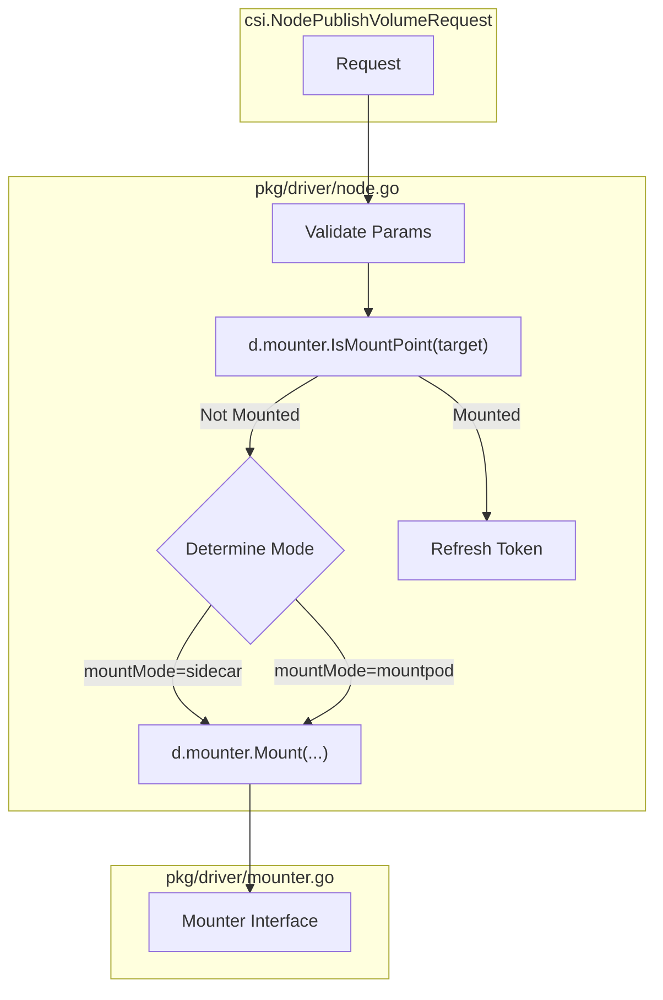
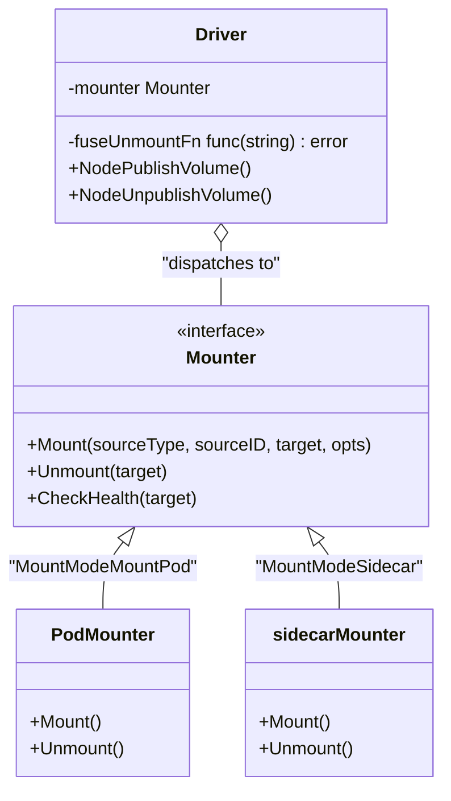

<!-- source: DeepWiki mcp.deepwiki.com · repo huggingface/hf-csi-driver · page 2.1 CSI Node Service · fetched 2026-10-26 -->

# CSI Node Service

Relevant source files

The following files were used as context for generating this wiki page:

- [pkg/driver/mount_linux.go](pkg/driver/mount_linux.go)
- [pkg/driver/mount_other.go](pkg/driver/mount_other.go)
- [pkg/driver/node.go](pkg/driver/node.go)
- [pkg/driver/node_test.go](pkg/driver/node_test.go)
- [pkg/driver/unmount_linux.go](pkg/driver/unmount_linux.go)
- [pkg/driver/unmount_other.go](pkg/driver/unmount_other.go)

The CSI Node Service is responsible for the lifecycle of volume mounts on individual worker nodes. It implements the `NodePublishVolume` and `NodeUnpublishVolume` gRPC endpoints, which Kubelet calls to mount and unmount Hugging Face repositories or buckets.

The service supports two distinct operation modes: **Sidecar Mode** (default) and **MountPod Mode**. It manages request validation, token rotation, and health monitoring for both modes.

## NodePublishVolume Workflow

`NodePublishVolume` is called by Kubelet when a pod is scheduled to a node and requires a volume. It is also called periodically for "republish" events to refresh secrets.

### 1. Request Validation
The driver first validates that the required fields are present in the `csi.NodePublishVolumeRequest`:
*   **Volume Capabilities**: Only `Mount` access type is supported [pkg/driver/node.go:64-66]().
*   **Volume Context**: Must contain `sourceType` (e.g., "bucket") and `sourceId` [pkg/driver/node.go:68-75]().
*   **Mount Mode**: Validates that `mountMode` is either `sidecar` or `mountpod` [pkg/driver/node.go:82-87]().

### 2. Mode Selection & Fallback
The driver determines the execution mode based on the `mountMode` attribute and the availability of the workload pod's UID:
*   **Sidecar Mode**: Requires the pod UID (passed via `csi.storage.k8s.io/pod.uid` in `VolumeContext`). If the UID is missing (e.g., `podInfoOnMount` is disabled in the `CSIDriver` object), the driver automatically falls back to **MountPod Mode** [pkg/driver/node.go:91-94]().

### 3. Token Management
Authentication tokens are retrieved from the CSI `Secrets` map using a configurable `tokenKey` (defaults to `token`) [pkg/driver/node.go:78-79]().
*   **Initial Mount**: The token is passed to the mounter implementation.
*   **Republish**: If the volume is already mounted, the driver refreshes the token. In Sidecar mode, it updates the token in the shared emptyDir; in MountPod mode, it overwrites the token file on disk [pkg/driver/node.go:120-128]().

### 4. Health Checks and Recovery
The driver checks the status of existing mounts before proceeding:
*   **Stale Mounts**: If a mount is detected as corrupted (e.g., FUSE daemon crashed), the driver performs a force unmount for MountPod mode [pkg/driver/node.go:107-111]().
*   **Sidecar Health**: In sidecar mode, it reads an error file from the shared emptyDir. If the sidecar is unhealthy, it unmounts the stale FUSE mount to allow the next retry to create a fresh socket [pkg/driver/node.go:133-145]().

### NodePublishVolume Logic Flow
This diagram maps the `NodePublishVolume` function logic to the internal system components.

**Sources:** [pkg/driver/node.go:49-150](), [pkg/driver/node.go:163-180]()

## NodeUnpublishVolume

`NodeUnpublishVolume` handles the teardown of mounts. The driver implements a "fast-path" for Sidecar mode to ensure clean cleanup of FUSE mounts.

### Sidecar Fast-Path Unmount
When a pod using Sidecar mode is deleted, the sidecar container may exit before the CSI driver is called. To prevent stale FUSE mounts that block Kubelet, the driver uses `fuseUnmount` (a lazy unmount via `MNT_DETACH` on Linux) [pkg/driver/unmount_linux.go:9]().

1.  The driver checks if the target path was registered as a sidecar volume in the `sidecarVolumes` map [pkg/driver/node.go:211-212]().
2.  If found, it executes `d.fuseUnmountFn(target)` immediately [pkg/driver/node.go:214]().
3.  It then proceeds to the standard `d.mounter.Unmount(target)` call to ensure all resources are cleared [pkg/driver/node.go:219]().

### MountPod Cleanup
For MountPod mode, the call is routed to the `PodMounter`, which:
1.  Removes the bind-mount at the `targetPath`.
2.  Updates or deletes the `HFMount` CRD associated with the volume, which triggers the controller to terminate the dedicated mount pod.

**Sources:** [pkg/driver/node.go:203-223](), [pkg/driver/unmount_linux.go:1-11]()

## Key Functions and Data Structures

### Volume Context Parameters
The driver parses the `VolumeContext` map into specific fields for the mounter.

| Key | Code Constant | Description |
| :--- | :--- | :--- |
| `sourceType` | `volumeCtxSourceType` | Repository type (e.g., `bucket`) |
| `sourceId` | `volumeCtxSourceID` | Repository ID (e.g., `org/name`) |
| `mountMode` | `volumeCtxMountMode` | `sidecar` or `mountpod` |
| `csi.storage.k8s.io/pod.uid` | `volumeCtxPodUID` | Required for Sidecar mode |

**Sources:** [pkg/driver/node.go:23-38]()

### Mounter Routing
The `Driver` struct delegates the actual mounting work to the `Mounter` interface.

**Sources:** [pkg/driver/node.go:49-54](), [pkg/driver/node_test.go:13-55]()

## Implementation Details

### Mount Health Checks
The driver uses `IsMountPoint` to determine if a path is already active. On Linux, it specifically detects "stale" mounts where the FUSE transport is broken (returning `ENOTCONN` or `EIO`) [pkg/driver/mount_linux.go:16-27]().

### Bind Mounts
In MountPod mode, the driver performs a bind mount from the source path (managed by the mount pod) to the target path (requested by Kubelet) using `syscall.MS_BIND` [pkg/driver/mount_linux.go:11-13]().

### Platform Support
The driver includes build-constrained files for non-Linux platforms (`mount_other.go`, `unmount_other.go`) which return errors or perform no-ops for Linux-specific features like bind mounts and lazy unmounts [pkg/driver/mount_other.go:8-10](), [pkg/driver/unmount_other.go:8-10]().

**Sources:** [pkg/driver/mount_linux.go:1-27](), [pkg/driver/mount_other.go:1-16](), [pkg/driver/unmount_linux.go:1-11](), [pkg/driver/unmount_other.go:1-11]()

---

