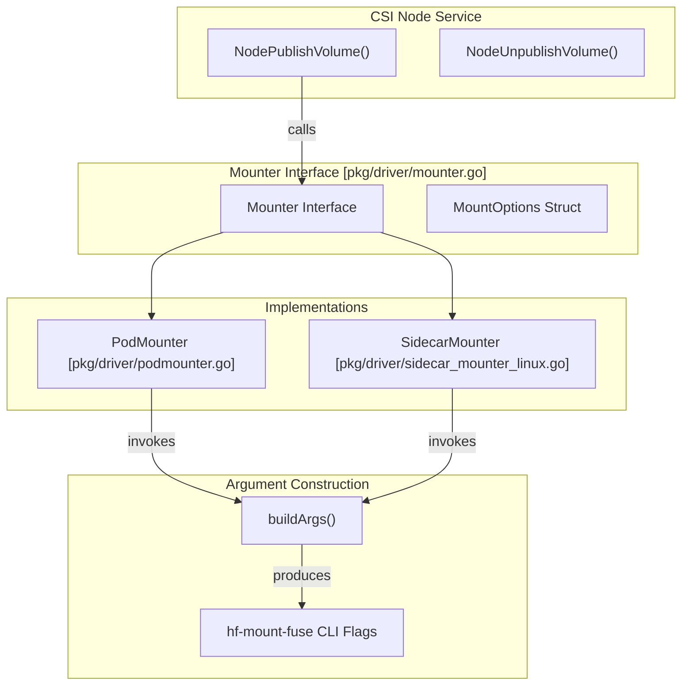
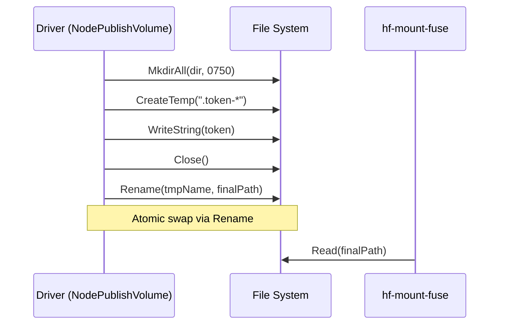

<!-- source: DeepWiki mcp.deepwiki.com · repo huggingface/hf-csi-driver · page 2.2 Mounter Interface and CLI Argument Construction · fetched 2026-10-26 -->

# Mounter Interface and CLI Argument Construction

Relevant source files

The following files were used as context for generating this wiki page:

- [pkg/driver/mounter.go](pkg/driver/mounter.go)
- [pkg/driver/mounter_test.go](pkg/driver/mounter_test.go)

This section describes the `Mounter` interface, which abstracts the volume mounting logic for the `hf-csi-driver`, and the mechanisms used to translate CSI volume attributes into CLI arguments for the `hf-mount-fuse` binary.

## The Mounter Interface

The `Mounter` interface serves as the primary abstraction layer between the CSI `NodeServer` and the specific mounting implementations (PodMount vs. Sidecar). It defines the lifecycle and health management contract that any mounting strategy must satisfy.

| Method | Description |
| :--- | :--- |
| `Mount` | Performs the mount operation using the provided `sourceType`, `sourceID`, and `MountOptions`. |
| `Unmount` | Tears down the mount at the specified target path. |
| `IsMountPoint` | Checks if the target path is currently an active mount point. |
| `CheckHealth` | Returns an error if the mount is unhealthy (e.g., a mount pod is in `CrashLoopBackOff`). |
| `Recover` | Re-adopts existing mounts from a previous driver instance (crucial for driver restarts). |
| `Start` | Launches background goroutines, such as Kubernetes informers or watchers. |

**Sources:** [pkg/driver/mounter.go:32-43]()

### Mounter Implementation Overview

The following diagram illustrates how the `Mounter` interface bridges the high-level CSI RPC calls to the low-level `hf-mount-fuse` execution.

**Mounter Interface and CLI Flow**

**Sources:** [pkg/driver/mounter.go:13-43](), [pkg/driver/mounter.go:49-96]()

---

## MountOptions and CLI Translation

The `MountOptions` struct encapsulates all configurable parameters for a Hugging Face volume. These options are typically parsed from `volumeAttributes` in the CSI request and then translated into CLI flags for `hf-mount-fuse` via the `buildArgs` function.

### MountOptions Struct Fields
The struct includes fields for performance tuning, authentication, and resource management:
*   **Performance:** `CacheSize`, `MetadataTtlMs`, `InodeSoftLimit`, `LruSweepIntervalMs`.
*   **Networking:** `HubEndpoint`, `PollIntervalSecs`, `PollListingConcurrency`.
*   **Security/Context:** `TokenFile`, `ReadOnly`, `VolumeMountGroup` (fsGroup), `WorkloadPodUID`.
*   **Passthrough:** `ExtraArgs` allows users to pass arbitrary flags directly to the FUSE binary.

**Sources:** [pkg/driver/mounter.go:13-30]()

### buildArgs Function Logic
The `buildArgs` function is the source of truth for how `MountOptions` are mapped to `hf-mount-fuse` flags. It performs validation and conditional logic based on the `sourceType` (`bucket` or `repo`).

1.  **Validation:** It strictly enforces that `sourceType` is either "bucket" or "repo" [pkg/driver/mounter.go:50-54]().
2.  **Flag Mapping:** Standard options like `--hub-endpoint`, `--cache-dir`, and `--token-file` are appended if present [pkg/driver/mounter.go:57-86]().
3.  **Source Specifics:** The `--revision` flag is only appended if the `sourceType` is "repo" [pkg/driver/mounter.go:91-93]().
4.  **Positional Arguments:** The function ensures the required positional arguments (`sourceType`, `sourceID`, `target`) are placed at the end of the argument list [pkg/driver/mounter.go:89]().

**Sources:** [pkg/driver/mounter.go:49-96]()

---

## Token Management

The driver supports live token refreshing. Instead of passing the Hugging Face token directly as a CLI argument (which would be visible in `ps` or container specs), the driver writes the token to a file and passes the `--token-file` flag to `hf-mount-fuse`.

### writeTokenFile
The `writeTokenFile` function ensures that token updates are atomic to prevent the FUSE process from reading a partial or corrupted token.

**Token Write Process**

**Sources:** [pkg/driver/mounter.go:99-119]()

---

## Technical Mapping: Attributes to Flags

The following table maps the `MountOptions` fields to the actual CLI flags generated by `buildArgs`.

| MountOptions Field | CLI Flag | Description |
| :--- | :--- | :--- |
| `HubEndpoint` | `--hub-endpoint` | The HF Hub URL (e.g., `https://huggingface.co`). |
| `CacheDir` | `--cache-dir` | Local path for disk caching. |
| `CacheSize` | `--cache-size` | Maximum size of the local cache. |
| `PollIntervalSecs` | `--poll-interval-secs` | Frequency to check for remote updates. |
| `MetadataTtlMs` | `--metadata-ttl-ms` | Time-to-live for cached file metadata. |
| `TokenFile` | `--token-file` | Path to the file containing the HF API token. |
| `Revision` | `--revision` | Git revision (only for `sourceType: repo`). |
| `ReadOnly` | `--read-only` | Mounts the FUSE filesystem in read-only mode. |
| `ExtraArgs` | (various) | Directly appended to the argument slice. |

**Sources:** [pkg/driver/mounter.go:57-93](), [pkg/driver/mounter_test.go:7-34]()

---

