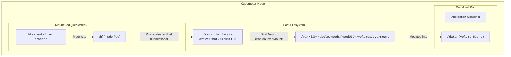
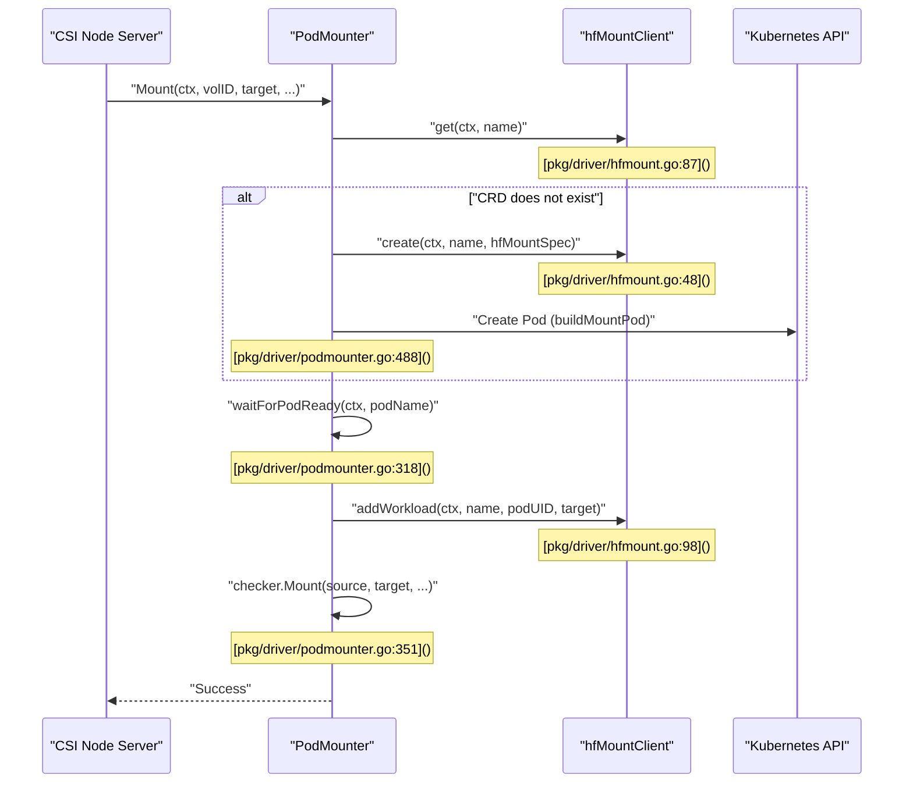

<!-- source: DeepWiki mcp.deepwiki.com · repo huggingface/hf-csi-driver · page 2.3 PodMounter (MountPod Mode) · fetched 2026-10-26 -->

# PodMounter (MountPod Mode)

Relevant source files

The following files were used as context for generating this wiki page:

- [deploy/helm/hf-csi-driver/templates/crd.yaml](deploy/helm/hf-csi-driver/templates/crd.yaml)
- [deploy/kubernetes/crd.yaml](deploy/kubernetes/crd.yaml)
- [pkg/driver/hfmount.go](pkg/driver/hfmount.go)
- [pkg/driver/podmounter.go](pkg/driver/podmounter.go)
- [pkg/driver/podmounter_test.go](pkg/driver/podmounter_test.go)
- [pkg/driver/poduid_test.go](pkg/driver/poduid_test.go)
- [pkg/driver/resources.go](pkg/driver/resources.go)
- [pkg/driver/resources_test.go](pkg/driver/resources_test.go)

The `PodMounter` is the implementation of the `Mounter` interface used when `mountMode` is set to `mountpod`. In this mode, the CSI driver delegates the execution of the FUSE binary (`hf-mount-fuse`) to dedicated, standalone Kubernetes Pods. This architecture ensures that FUSE mounts survive CSI driver restarts or upgrades, preventing I/O errors in workload pods.

## Architecture and Data Flow

The `PodMounter` manages a 1-to-N relationship between a "Mount Pod" (the FUSE source) and "Workload Pods" (the consumers). The driver uses a source-vs-target path model where the FUSE daemon mounts the remote repository into a private directory on the host, which is then bind-mounted into the specific Kubelet pod directories.

### Mount Pod Lifecycle

1.  **Creation**: When `NodePublishVolume` is called, the `PodMounter` checks for an existing `HFMount` CRD for that source. If none exists, it creates one and then spawns a Mount Pod [pkg/driver/podmounter.go:237-270]().
2.  **Ready Check**: The driver polls the Mount Pod until it is in the `Running` phase and the FUSE mount is visible on the host at `mountBaseDir` [pkg/driver/podmounter.go:34-38](), [pkg/driver/podmounter.go:318-345]().
3.  **Bind Mount**: Once the source is ready, the driver performs a bind-mount from the source path (e.g., `/var/lib/hf-csi-driver/mnt/<id>`) to the target path provided by Kubelet [pkg/driver/podmounter.go:347-355]().
4.  **Tracking**: The relationship is recorded in the `HFMount` CRD `spec.workloads` list [pkg/driver/hfmount.go:98-117]().

### Source vs Target Path Model Diagram

This diagram illustrates how the `PodMounter` bridges the FUSE mount from a dedicated pod to the application container.

"Source vs Target Path Model"

Sources: [pkg/driver/podmounter.go:34](), [pkg/driver/podmounter.go:347-355](), [pkg/driver/podmounter.go:488-518]()

## The HFMount CRD

The `HFMount` Custom Resource Definition acts as the source of truth for all mounts on a node. It allows the driver to recover state after a restart and ensures that Mount Pods are recreated if they are accidentally deleted while workloads are still active.

### Key CRD Fields
| Field | Description | Location |
| :--- | :--- | :--- |
| `spec.mountArgs` | The exact CLI flags used to launch `hf-mount-fuse`. | [deploy/kubernetes/crd.yaml:40-46]() |
| `spec.workloads` | List of active pod UIDs and target paths consuming this mount. | [deploy/kubernetes/crd.yaml:58-71]() |
| `spec.resources` | CPU/Memory requests and limits for the mount pod. | [deploy/kubernetes/crd.yaml:47-58]() |
| `status.phase` | Current state: `Pending`, `Mounted`, or `Failed`. | [deploy/kubernetes/crd.yaml:79-83]() |

Sources: [pkg/driver/hfmount.go:37-45](), [deploy/kubernetes/crd.yaml:1-104]()

## Event Handling and Recovery

The `PodMounter` runs a Pod Informer to react to changes in the cluster state [pkg/driver/podmounter.go:124-189]().

### Informer Logic
*   **Pod Restarts**: If a Mount Pod's container restarts (detected via `RestartCount`), the driver identifies all active bind-mounts for that source and re-establishes them to fix "Transport endpoint is not connected" errors [pkg/driver/podmounter.go:160-167](), [pkg/driver/podmounter.go:732-775]().
*   **Pod Deletion**: If a Mount Pod is deleted but the `HFMount` CRD still lists active workloads, the driver will automatically recreate the pod using the stored `mountArgs` [pkg/driver/podmounter.go:783-809]().
*   **Late Adoption**: If the driver starts and finds a running Mount Pod that isn't yet tracked in its internal `binds` map, it "adopts" it to ensure cleanup logic applies [pkg/driver/podmounter.go:136-159]().

### Periodic Cleanup Scan
The `periodicCleanup` goroutine runs every 2 minutes [pkg/driver/podmounter.go:197-210](). It performs two main tasks:
1.  **runCleanupScan**: Scans `/var/lib/hf-csi-driver/mnt` for directories that no longer have a corresponding running Pod or active `HFMount` CRD, and unmounts them [pkg/driver/podmounter.go:212-235]().
2.  **cleanupStaleCRDs**: Removes `HFMount` objects that have no active workloads and no running pods [pkg/driver/podmounter.go:207]().

## Code Entity Interaction

The following diagram maps the logical operations of the `PodMounter` to the specific functions and structures in the codebase.

"PodMounter Implementation Map"

Sources: [pkg/driver/podmounter.go:237-360](), [pkg/driver/hfmount.go:23-34]()

## Synchronization and Locking

To prevent race conditions when multiple pods on the same node request the same Hugging Face repository simultaneously, the `PodMounter` uses reference-counted mutexes:

*   **`sourceLocks`**: A map of `refMutex` keyed by the FUSE source ID [pkg/driver/podmounter.go:77]().
*   **`acquireSourceLock`**: Increments a reference count and returns a mutex for a specific source [pkg/driver/podmounter.go:101-111]().
*   **`releaseSourceLock`**: Decrements the count and deletes the mutex from the map when it reaches zero to save memory [pkg/driver/podmounter.go:114-121]().

This ensures that only one goroutine is creating or repairing a specific Mount Pod at any given time.

Sources: [pkg/driver/podmounter.go:42-47](), [pkg/driver/podmounter.go:101-121]()

---

