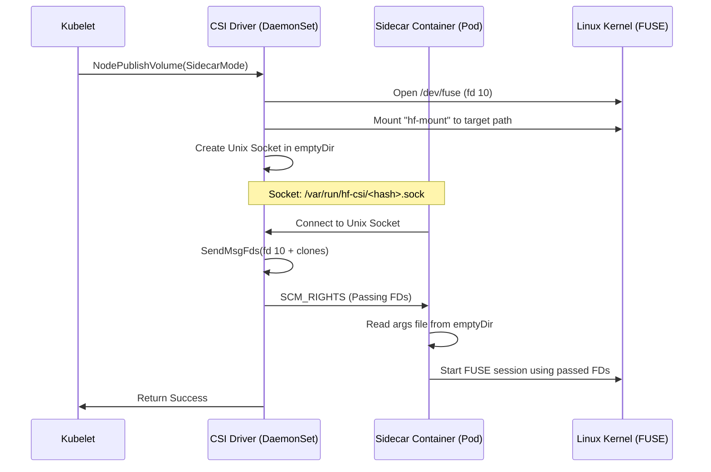

<!-- source: DeepWiki mcp.deepwiki.com · repo huggingface/hf-csi-driver · page 2.4 Sidecar Mounter (Sidecar Mode) · fetched 2026-10-26 -->

# Sidecar Mounter (Sidecar Mode)

Relevant source files

The following files were used as context for generating this wiki page:

- [.gitignore](.gitignore)
- [pkg/driver/sidecar_mounter_linux.go](pkg/driver/sidecar_mounter_linux.go)
- [pkg/driver/sidecar_mounter_linux_test.go](pkg/driver/sidecar_mounter_linux_test.go)
- [pkg/driver/sidecar_mounter_other.go](pkg/driver/sidecar_mounter_other.go)
- [pkg/util/fdchannel.go](pkg/util/fdchannel.go)
- [pkg/util/fdchannel_test.go](pkg/util/fdchannel_test.go)

In Sidecar Mode, the CSI driver does not manage external "Mount Pods." Instead, it performs the kernel-level FUSE mount itself and delegates the filesystem logic to a sidecar container running within the same Pod as the workload. This mode relies on a mutating admission webhook to inject the sidecar container and a shared `emptyDir` volume for inter-process communication.

## Architectural Overview

The `sidecarMount` implementation facilitates a hand-off of the FUSE device file descriptor (`/dev/fuse`) from the CSI driver (running as a DaemonSet on the host) to the sidecar container (running in the Pod's network/mount namespace). This allows the sidecar to serve FUSE requests without requiring `CAP_SYS_ADMIN` or privileged access to the host's `/dev` directory.

### Sidecar Mounting Flow

The logic is primarily contained in `sidecarMount` within [pkg/driver/sidecar_mounter_linux.go:130-130]().

| Step | Action | Description |
| :--- | :--- | :--- |
| **1** | **Open /dev/fuse** | The driver opens `/dev/fuse` to obtain a file descriptor [pkg/driver/sidecar_mounter_linux.go:136-139](). |
| **2** | **Kernel Mount** | The driver calls `syscall.Mount` to attach the FUSE device to the `target` path [pkg/driver/sidecar_mounter_linux.go:156-159](). |
| **3** | **Prepare emptyDir** | A volume-specific directory is created in the shared `hf-csi-tmp` `emptyDir` [pkg/driver/sidecar_mounter_linux.go:172-177](). |
| **4** | **Write Args** | CLI arguments for `hf-mount-fuse` are written to an `args` file in the `emptyDir` [pkg/driver/sidecar_mounter_linux.go:198-203](). |
| **5** | **FD Passing** | The driver creates a Unix socket and sends the FUSE file descriptor(s) to the sidecar via `SCM_RIGHTS` [pkg/driver/sidecar_mounter_linux.go:214-233](). |

### Data Flow Diagram: FD Passing

This diagram illustrates how the file descriptors and configuration move from the CSI Driver to the Sidecar Container.

**Sources:** [pkg/driver/sidecar_mounter_linux.go:130-240](), [pkg/util/fdchannel.go:22-42]()

---

## Implementation Details

### FUSE Device Cloning (Multi-threading)

To support high-concurrency reads, the driver utilizes the `FUSE_DEV_IOC_CLONE` ioctl. This allows multiple file descriptors to be bound to the same FUSE connection, enabling the sidecar to run multiple reader threads.

*   **Function:** `cloneFuseFd` [pkg/driver/sidecar_mounter_linux.go:84-96]()
*   **Default Count:** 4 fds (1 primary + 3 clones), configurable via `fuseFdCount` volume attribute or `HF_CSI_SIDECAR_FUSE_FD_COUNT` [pkg/driver/sidecar_mounter_linux.go:46-79]().
*   **Mechanism:** The driver opens `/dev/fuse` multiple times and calls `ioctl(dst, FUSE_DEV_IOC_CLONE, &srcFd)` to link them [pkg/driver/sidecar_mounter_linux.go:90-90]().

### Unix Socket Management and Symlinks

Unix domain socket paths are limited to 108 characters (`UNIX_PATH_MAX`). Because Kubelet's pod volume paths are often very long (e.g., `/var/lib/kubelet/pods/<uuid>/...`), the driver uses a symlink workaround:

1.  A hash is generated from the volume name [pkg/driver/sidecar_mounter_linux.go:172-172]().
2.  A short symlink is created in `/var/run/hf-csi/<hash>` pointing to the long `emptyDir` path [pkg/driver/sidecar_mounter_linux.go:214-222]().
3.  The Unix socket is created using this short symlink path [pkg/driver/sidecar_mounter_linux.go:223-223]().

### SCM_RIGHTS and `fdchannel`

The `pkg/util/fdchannel` package handles the low-level `sendmsg` system calls required to pass file descriptors across processes.

*   **`SendMsgFds`**: Packs a slice of integers (FDs) into a `syscall.UnixRights` structure and sends them as ancillary data [pkg/util/fdchannel.go:22-42]().
*   **`RecvMsg`**: Used primarily for testing or by the sidecar (if written in Go) to extract the FDs from the OOB (out-of-band) buffer [pkg/util/fdchannel.go:46-83]().

**Sources:** [pkg/driver/sidecar_mounter_linux.go:35-52](), [pkg/util/fdchannel.go:1-84]()

---

## Token Lifecycle

Sidecar mode supports dynamic token refresh without requiring a pod restart.

### Token Injection
The driver copies the Hugging Face token from the CSI-provided path to the shared `emptyDir` at `/.volumes/<hash>/token` [pkg/driver/sidecar_mounter_linux.go:184-196](). The `emptyDir` is typically backed by `tmpfs`, ensuring the token is never persisted to physical disk.

### Token Refresh
When `NodePublishVolume` is called for an existing mount (republish), the driver invokes `refreshSidecarToken`. This function overwrites the token file in the `emptyDir` with the new credentials [pkg/driver/sidecar_mounter_linux.go:294-311](). The `hf-mount-fuse` process in the sidecar monitors this file and reloads it automatically.

**Sources:** [pkg/driver/sidecar_mounter_linux.go:184-196](), [pkg/driver/sidecar_mounter_linux.go:294-311]()

---

## Code Entity Map

The following table maps conceptual operations to the specific functions and constants in the codebase.

| System Name | Code Entity | File |
| :--- | :--- | :--- |
| **FUSE Clone Ioctl** | `fuseDevIoctlClone` | [pkg/driver/sidecar_mounter_linux.go:51-51]() |
| **FD Sender** | `SendMsgFds` | [pkg/util/fdchannel.go:22-22]() |
| **FD Receiver** | `RecvMsg` | [pkg/util/fdchannel.go:46-46]() |
| **Mount Execution** | `sidecarMount` | [pkg/driver/sidecar_mounter_linux.go:130-130]() |
| **Path Translator** | `sidecarPath` | [pkg/driver/sidecar_mounter_linux.go:104-104]() |
| **Health Check** | `checkSidecarHealth` | [pkg/driver/sidecar_mounter_linux.go:261-261]() |
| **Accept Timeout** | `socketAcceptTimeout` | [pkg/driver/sidecar_mounter_linux.go:33-33]() |

**Sources:** [pkg/driver/sidecar_mounter_linux.go](), [pkg/util/fdchannel.go]()

---

