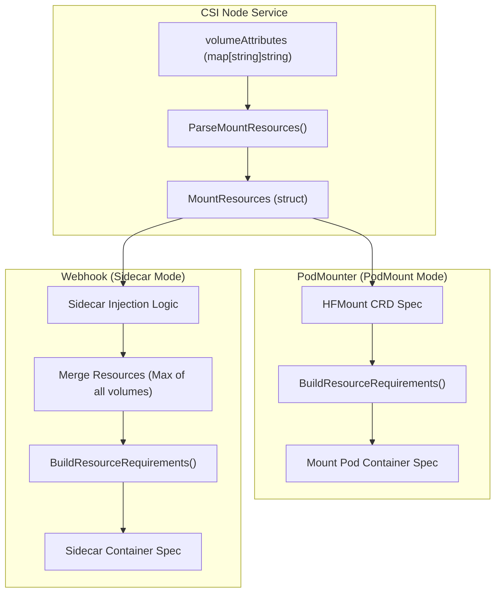

<!-- source: DeepWiki mcp.deepwiki.com · repo huggingface/hf-csi-driver · page 2.5 Resource Management · fetched 2026-10-26 -->

# Resource Management

<details>
<summary>Relevant source files</summary>

The following files were used as context for generating this wiki page:

- [pkg/driver/mounter.go](pkg/driver/mounter.go)
- [pkg/driver/podmounter_test.go](pkg/driver/podmounter_test.go)
- [pkg/driver/resources.go](pkg/driver/resources.go)
- [pkg/driver/resources_test.go](pkg/driver/resources_test.go)

</details>


The `hf-csi-driver` allows for granular control over the CPU and memory resources allocated to the FUSE daemon containers (`hf-mount-fuse`). Whether running in **PodMount** mode (dedicated pods) or **Sidecar** mode (injected containers), the driver ensures that resource requests and limits are correctly parsed, merged across multiple volumes, and clamped to prevent Kubernetes API rejections.

## Resource Lifecycle

Resource management follows a specific data flow from the CSI `volumeAttributes` to the final Pod specification:

1.  **Parsing**: Attributes provided in the StorageClass or PV are parsed from strings into `MountResources` structs containing `resource.Quantity` objects.
2.  **Storage**: For PodMount mode, these resources are persisted in the `HFMount` CRD.
3.  **Merging**: In Sidecar mode, if a pod uses multiple HF volumes, the resources for the single sidecar container are calculated by taking the **maximum** of all individual volume requirements.
4.  **Clamping**: To avoid `RequestExceedsLimit` errors from the kube-apiserver, the driver ensures that any calculated `Request` does not exceed the specified `Limit`.
5.  **Application**: The final `corev1.ResourceRequirements` are applied to the container spec.

### Data Flow: Attributes to Pod Spec

The following diagram illustrates how raw string attributes are transformed into Kubernetes resource objects.

**Resource Processing Pipeline**

**Sources:** [pkg/driver/resources.go:37-44](), [pkg/driver/resources.go:63-94]()

---

## Implementation Details

### Key Entities

| Entity | Role |
| :--- | :--- |
| `MountResources` | A struct holding optional `CPULimit`, `CPURequest`, `MemoryLimit`, and `MemoryRequest`. [pkg/driver/resources.go:28-33]() |
| `ParseMountResources` | Function that extracts and validates quantities from `volumeAttributes`. [pkg/driver/resources.go:37-44]() |
| `BuildResourceRequirements` | Merges user overrides with system defaults and applies clamping logic. [pkg/driver/resources.go:63-94]() |
| `clampRequestToLimit` | Ensures `Requests[R] <= Limits[R]` for a given resource. [pkg/driver/resources.go:143-159]() |

### Default Values
If no resource attributes are provided by the user, the driver applies minimal defaults to ensure the FUSE daemon has a baseline allocation:
*   **Default CPU Request**: `10m` [pkg/driver/resources.go:22]()
*   **Default Memory Request**: `32Mi` [pkg/driver/resources.go:23]()

*Note: Limits are not set by default. They are only applied if explicitly requested via volume attributes.* [pkg/driver/resources.go:58-62]()

### Resource Attribute Keys
The driver recognizes the following keys in the CSI `volumeAttributes` map:
*   `cpuLimit` [pkg/driver/resources.go:12]()
*   `cpuRequest` [pkg/driver/resources.go:13]()
*   `memoryLimit` [pkg/driver/resources.go:14]()
*   `memoryRequest` [pkg/driver/resources.go:15]()

**Sources:** [pkg/driver/resources.go:11-24]()

---

## Clamping and Validation

The driver prioritizes pod schedulability over strict adherence to conflicting resource requests. If a user provides a `cpuRequest` of `500m` but a `cpuLimit` of `200m`, the Kubernetes API would normally reject the Pod creation.

The `clampRequestToLimit` function detects this condition and automatically lowers the `Request` to match the `Limit`, issuing a warning in the logs:
[pkg/driver/resources.go:155-158]()

```go
if rq.Cmp(lim) > 0 {
    klog.Warningf("%s request %s exceeds limit %s; clamping request to limit", name, rq.String(), lim.String())
    req.Requests[name] = lim
}
```

**Sources:** [pkg/driver/resources.go:143-159]()

---

## Code Entity Mapping

The following diagram maps the logical resource management concepts to the specific functions and structures in the Go codebase.

**Code Entity Map**
```mermaid
classDiagram
    class "volumeAttributes" {
        cpuLimit: string
        cpuRequest: string
    }

    class MountResources {
        +CPULimit: *resource.Quantity
        +CPURequest: *resource.Quantity
        +ToStringMap() map[string]string
        +ToUnstructured() map[string]interface{}
    }

    class ResourceLogic {
        +ParseMountResources(map[string]string)
        +BuildResourceRequirements(MountResources, defaults)
        +clampRequestToLimit(ResourceRequirements, name)
    }

    class PodMounter {
        +buildMountPod(..., MountResources)
    }

    "volumeAttributes" --> ResourceLogic : "Parsed by"
    ResourceLogic --> MountResources : "Produces"
    MountResources --> PodMounter : "Passed to"
    PodMounter --> ResourceLogic : "Calls BuildResourceRequirements"
```
**Sources:** [pkg/driver/resources.go:28-44](), [pkg/driver/resources.go:63-94](), [pkg/driver/mounter.go:29]()

---

## Serialization for CRDs

In **PodMount** mode, the driver needs to store these resource requirements in the `HFMount` Custom Resource so that if the driver restarts, it can reconstruct the state.

The `MountResources` struct provides helper methods for this:
*   `ToStringMap()`: Converts the quantities back to strings for the CRD's `volumeAttributes` equivalent. [pkg/driver/resources.go:98-113]()
*   `ToUnstructured()`: Converts the map to `map[string]interface{}` for use with the `client-go` dynamic/unstructured client. [pkg/driver/resources.go:118-128]()
*   `MountResourcesFromUnstructured()`: Reconstructs the struct from a raw map retrieved from the Kubernetes API. [pkg/driver/resources.go:133-141]()

**Sources:** [pkg/driver/resources.go:98-141]()

---

