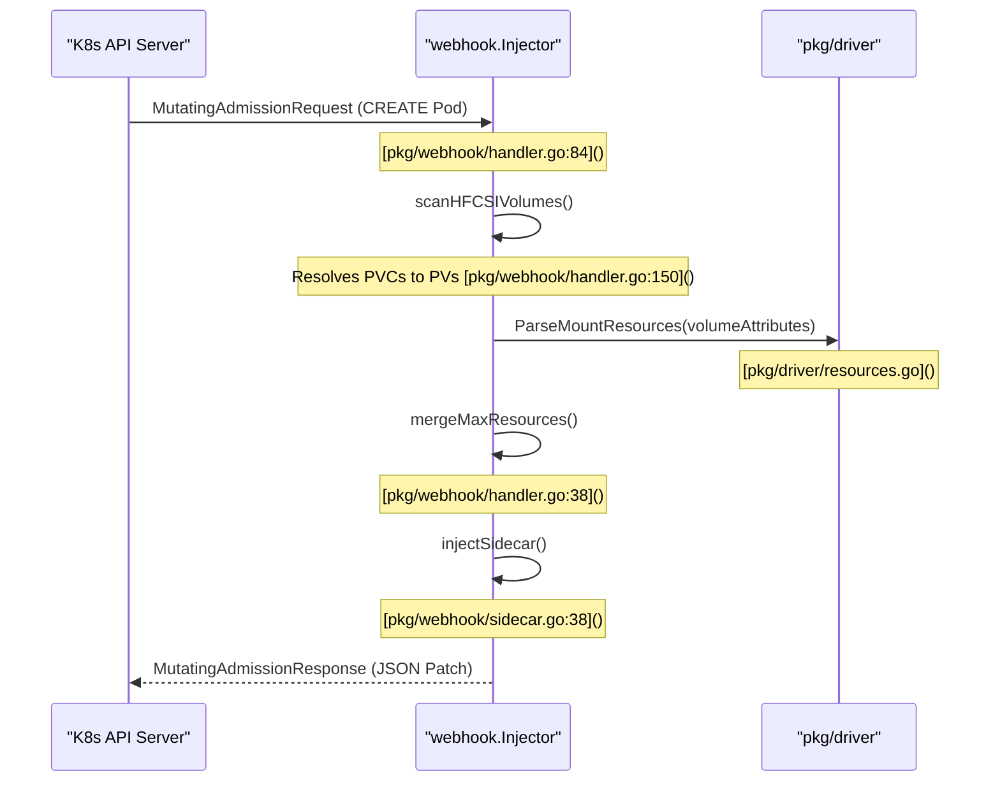
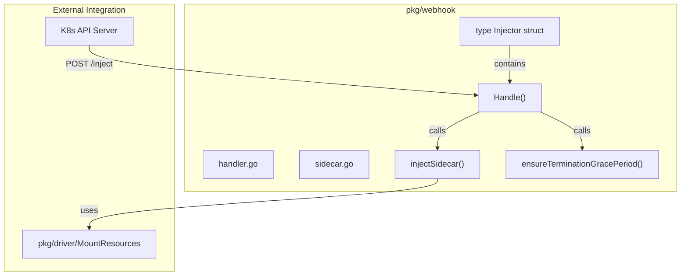

<!-- source: DeepWiki mcp.deepwiki.com · repo huggingface/hf-csi-driver · page 3 Admission Webhook (Sidecar Injection) · fetched 2026-10-26 -->

# Admission Webhook (Sidecar Injection)

Relevant source files

The following files were used as context for generating this wiki page:

- [pkg/webhook/handler.go](pkg/webhook/handler.go)
- [pkg/webhook/sidecar.go](pkg/webhook/sidecar.go)
- [pkg/webhook/sidecar_test.go](pkg/webhook/sidecar_test.go)
- [test/e2e/sidecar/02-sidecar-injected.sh](test/e2e/sidecar/02-sidecar-injected.sh)

The HF CSI Driver utilizes a Mutating Admission Webhook to facilitate "Sidecar Mode" mounts. This webhook intercepts Pod creation requests and automatically injects the necessary components—specifically the `hf-mount` sidecar container and shared communication volumes—required to run FUSE mounts within the Pod's own lifecycle.

## Overview

The webhook's primary responsibility is to detect Pods that reference the `hf.csi.huggingface.co` driver and prepare them for sidecar-based mounting. It operates as a standard Kubernetes Mutating Admission Webhook, typically listening on the `/inject` path [pkg/webhook/handler.go:19-21]().

### Core Responsibilities
*   **Volume Scanning**: It inspects both inline `csi` volumes and `persistentVolumeClaim` references to identify HF CSI volumes [pkg/webhook/handler.go:124-146]().
*   **Opt-out Detection**: It respects the `mountMode: mountpod` attribute, skipping injection for volumes that prefer the dedicated Mount Pod architecture [pkg/webhook/handler.go:130-132]().
*   **Spec Mutation**: It modifies the Pod spec by adding a "native sidecar" (an init container with `restartPolicy: Always`) and shared `emptyDir` volumes [pkg/webhook/sidecar.go:38-107]().
*   **Lifecycle Management**: It enforces a minimum `terminationGracePeriodSeconds` to ensure the FUSE daemon has sufficient time to flush writes to the Hugging Face Hub during Pod shutdown [pkg/webhook/sidecar.go:109-131]().

### Webhook Flow Diagram

The following diagram illustrates the interaction between the Kubernetes API Server, the Webhook `Injector`, and the resulting Pod specification.

**Webhook Admission Logic**

Sources: [pkg/webhook/handler.go:84-118](), [pkg/webhook/sidecar.go:38-107]()

## Sidecar Injection Logic

The injection logic transforms a standard Pod into one capable of running the `hf-mount-fuse` binary. It uses the KEP-753 "native sidecar" feature, which allows the sidecar to start before other containers and remain running throughout the Pod's life.

Key components injected include:
*   **The `hf-mount` Container**: An init container with `restartPolicy: Always` running the `hf-mount-fuse-sidecar` command [pkg/webhook/sidecar.go:60-65]().
*   **Communication Volume**: A `tmpfs` backed `emptyDir` named `hf-csi-tmp` used for passing FUSE file descriptors and mount arguments between the CSI driver and the sidecar [pkg/webhook/sidecar.go:41-48]().
*   **Resource Merging**: If multiple HF volumes are present, the webhook merges their resource requirements (CPU/Memory) by taking the maximum of each requested value to ensure the shared sidecar is adequately provisioned [pkg/webhook/handler.go:38-48]().

For details on the specific container configuration and volume mounting, see **[Sidecar Injection Logic (#3.1)]**.

Sources: [pkg/webhook/sidecar.go:30-107](), [pkg/webhook/handler.go:38-48]()

## Webhook Deployment and TLS

The webhook is deployed as a Service within the cluster, usually managed by the same Deployment as the CSI controller. Because Kubernetes requires HTTPS for admission webhooks, the deployment includes TLS certificate management.

*   **Endpoint**: The server registers the `/inject` handler via the `NewInjector` function [pkg/webhook/handler.go:79-81]().
*   **Security**: The sidecar itself is configured with a restrictive `SecurityContext`, running as non-root and dropping all capabilities, as it receives its FUSE file descriptor via SCM_RIGHTS rather than opening `/dev/fuse` directly [pkg/webhook/sidecar.go:70-78]().
*   **Graceful Shutdown**: The webhook automatically raises the Pod's `terminationGracePeriodSeconds` to a minimum of 60 seconds [pkg/webhook/sidecar.go:19](). This is tracked via the `hf.csi.huggingface.co/original-termination-grace-period-seconds` annotation [pkg/webhook/sidecar.go:28]().

For details on Helm templates and TLS configuration, see **[Webhook Deployment and TLS (#3.2)]**.

Sources: [pkg/webhook/handler.go:19-36](), [pkg/webhook/sidecar.go:12-28](), [pkg/webhook/sidecar.go:70-78]()

## Component Mapping

This diagram maps the logical webhook components to the specific Go entities and files that implement them.

**Code Entity Mapping**

Sources: [pkg/webhook/handler.go:72-84](), [pkg/webhook/sidecar.go:38-114]()

---

