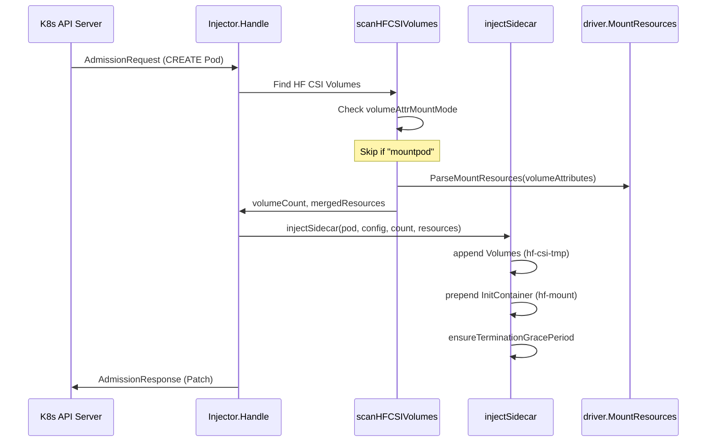
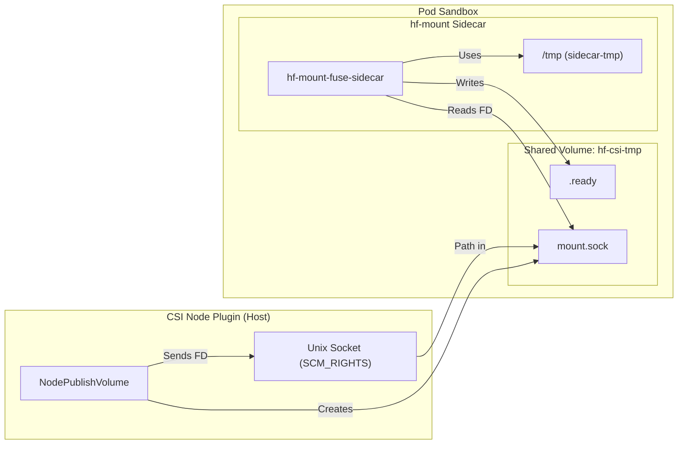

<!-- source: DeepWiki mcp.deepwiki.com · repo huggingface/hf-csi-driver · page 3.1 Sidecar Injection Logic · fetched 2026-10-26 -->

# Sidecar Injection Logic

Relevant source files

The following files were used as context for generating this wiki page:

- [pkg/webhook/handler.go](pkg/webhook/handler.go)
- [pkg/webhook/sidecar.go](pkg/webhook/sidecar.go)
- [pkg/webhook/sidecar_test.go](pkg/webhook/sidecar_test.go)
- [test/e2e/sidecar/02-sidecar-injected.sh](test/e2e/sidecar/02-sidecar-injected.sh)

The `hf-csi-driver` uses a mutating admission webhook to inject the `hf-mount` sidecar container into Pods that reference HF CSI volumes. This sidecar runs the `hf-mount-fuse` process, which performs the actual file system operations. The injection logic ensures that the sidecar is correctly configured, has sufficient resources, and is given enough time to flush data to Hugging Face Hub during Pod termination.

## Overview of `injectSidecar`

The core injection logic is encapsulated in the `injectSidecar` function within [pkg/webhook/sidecar.go:38-107](). When the webhook detects a Pod using the `hf.csi.huggingface.co` driver, it performs the following mutations:

1.  **Volume Injection**: Adds a shared `emptyDir` (backed by `tmpfs`) for communication between the CSI driver and the sidecar [pkg/webhook/sidecar.go:41-48]().
2.  **Container Injection**: Prepends a "native sidecar" (an init container with `restartPolicy: Always`) to the Pod spec [pkg/webhook/sidecar.go:60-104]().
3.  **Grace Period Enforcement**: Ensures the Pod's `terminationGracePeriodSeconds` is sufficient for FUSE write-back flushes [pkg/webhook/sidecar.go:106-106]().

### Data Flow and Code Entity Mapping

The following diagram illustrates how the `Injector` struct processes a Pod and interacts with the driver's resource management logic.

**Sidecar Injection Sequence**

**Sources:** [pkg/webhook/handler.go:84-118](), [pkg/webhook/handler.go:124-146](), [pkg/webhook/sidecar.go:38-107]()

---

## Volume Scanning and Opt-out

The webhook scans both inline ephemeral volumes and `PersistentVolumeClaim` (PVC) references to determine if injection is necessary.

*   **Detection**: It looks for `vol.CSI.Driver == "hf.csi.huggingface.co"` [pkg/webhook/handler.go:129-129]().
*   **PVC Resolution**: For PVCs, the `resolvePVFromPVC` function fetches the underlying `PersistentVolume` to check the driver name and attributes [pkg/webhook/handler.go:150-169]().
*   **Opt-out Mechanism**: If the `mountMode` attribute is set to `mountpod`, the volume is skipped for sidecar injection [pkg/webhook/handler.go:131-133](), [pkg/webhook/handler.go:138-140]().

**Sources:** [pkg/webhook/handler.go:124-146](), [pkg/webhook/handler.go:19-36]()

---

## Native Sidecar Configuration (KEP-753)

The driver utilizes Kubernetes "Native Sidecars" by defining the `hf-mount` container as an `initContainer` with a `restartPolicy` of `Always` [pkg/webhook/sidecar.go:64-64](). This ensures the FUSE daemon starts before any standard containers and remains running for the life of the Pod.

### Security and Isolation
The sidecar runs with a restricted `SecurityContext`:
*   **Unprivileged**: It does not need `privileged: true` or `CAP_SYS_ADMIN` because the CSI driver performs the kernel mount and passes the file descriptor via `SCM_RIGHTS` [pkg/webhook/sidecar.go:30-33]().
*   **Non-root**: Runs as user/group 65534 (nobody) [pkg/webhook/sidecar.go:71-73]().
*   **Read-only Root FS**: The container's root filesystem is read-only [pkg/webhook/sidecar.go:74-74]().

### Startup Probe
To prevent application containers from accessing the mount before it is ready, a `StartupProbe` checks for the existence of a `.ready` file in the shared communication volume [pkg/webhook/sidecar.go:89-97]().

**Sources:** [pkg/webhook/sidecar.go:58-99]()

---

## Resource Merging and Clamping

Since multiple HF volumes in a single Pod share one sidecar container, the webhook must merge resource requirements from all volumes.

| Feature | Implementation Detail |
| :--- | :--- |
| **Merging Strategy** | Uses `mergeMaxResources` to pick the largest `Request` and `Limit` across all volumes [pkg/webhook/handler.go:38-48](). |
| **Parsing** | `driver.ParseMountResources` converts volume attributes into `resource.Quantity` [pkg/webhook/sidecar_test.go:62-74](). |
| **Clamping** | `driver.BuildResourceRequirements` ensures that if a user sets a `Limit` lower than the default `Request`, the `Request` is clamped down to match the `Limit` to avoid Pod rejection [pkg/webhook/sidecar_test.go:117-131](). |

**Sources:** [pkg/webhook/handler.go:38-62](), [pkg/webhook/sidecar_test.go:80-112]()

---

## Termination Grace Period Enforcement

The FUSE process may need time to flush pending writes to the Hugging Face Hub. The FUSE flush queue uses a 2s debounce and can batch up to 30s of changes [pkg/webhook/sidecar.go:12-16]().

*   **Minimum Period**: The webhook enforces a minimum `terminationGracePeriodSeconds` of 60 seconds [pkg/webhook/sidecar.go:19-19]().
*   **Traceability**: If the value is raised, the original value is stored in the annotation `hf.csi.huggingface.co/original-termination-grace-period-seconds` [pkg/webhook/sidecar.go:28-28]().
*   **Zero-Grace Handling**: This is particularly critical for `Jobs`, which often default to 0s (immediate `SIGKILL`), leading to data loss without this enforcement [pkg/webhook/sidecar_test.go:177-180]().

**Sources:** [pkg/webhook/sidecar.go:109-131](), [test/e2e/sidecar/02-sidecar-injected.sh:16-25]()

---

## Communication Infrastructure

The CSI driver and the sidecar communicate via a shared `emptyDir` volume named `hf-csi-tmp`.

**Entity Mapping: Communication Bridge**

**Sources:** [pkg/webhook/handler.go:19-31](), [pkg/webhook/sidecar.go:39-56](), [pkg/webhook/sidecar.go:65-66]()

---

