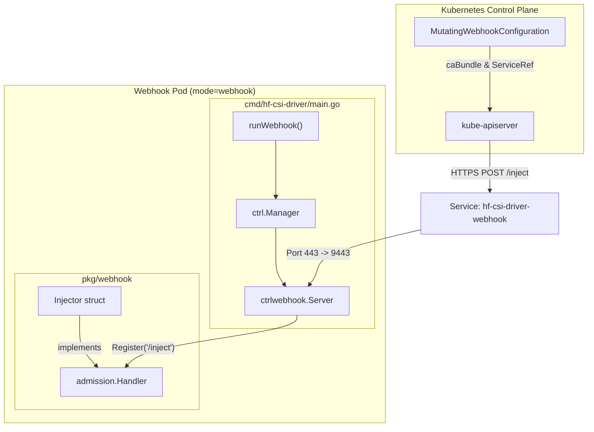
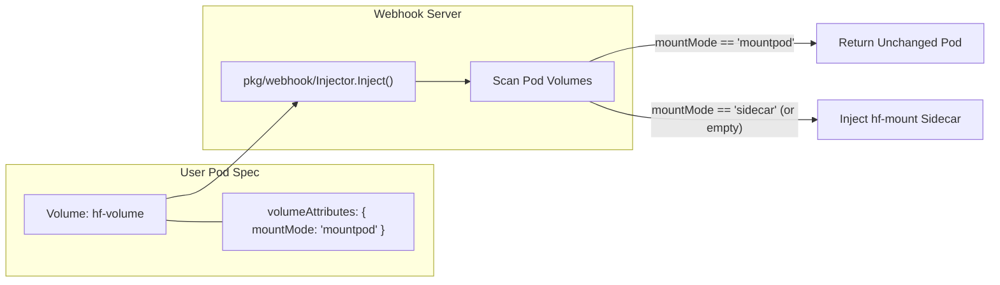

<!-- source: DeepWiki mcp.deepwiki.com · repo huggingface/hf-csi-driver · page 3.2 Webhook Deployment and TLS · fetched 2026-10-26 -->

# Webhook Deployment and TLS

<details>
<summary>Relevant source files</summary>

The following files were used as context for generating this wiki page:

- [cmd/hf-csi-driver/main.go](cmd/hf-csi-driver/main.go)
- [deploy/helm/hf-csi-driver/templates/webhook-certificate.yaml](deploy/helm/hf-csi-driver/templates/webhook-certificate.yaml)
- [deploy/helm/hf-csi-driver/templates/webhook-deployment.yaml](deploy/helm/hf-csi-driver/templates/webhook-deployment.yaml)
- [deploy/helm/hf-csi-driver/templates/webhook-service.yaml](deploy/helm/hf-csi-driver/templates/webhook-service.yaml)
- [deploy/helm/hf-csi-driver/values.yaml](deploy/helm/hf-csi-driver/values.yaml)

</details>


The `hf-csi-driver` utilizes a Mutating Admission Webhook to support "sidecar mode" volume mounts. This page details the deployment architecture of the webhook server, the automated TLS certificate management within the Helm chart, and the registration of the `/inject` endpoint.

## Webhook Server Lifecycle

The webhook is a secondary execution mode of the `hf-csi-driver` binary, triggered by the `--mode=webhook` flag [cmd/hf-csi-driver/main.go:28](). When running in this mode, the application initializes a `controller-runtime` manager to handle HTTPS requests and health probes.

### Initialization Sequence

1.  **Manager Setup**: The `runWebhook` function creates a `ctrl.Manager` configured with a `WebhookServer` [cmd/hf-csi-driver/main.go:130-137]().
2.  **Health Probes**: A readiness check is registered at `/readyz` on port `22031` [cmd/hf-csi-driver/main.go:132,142]().
3.  **Injector Registration**: A new `webhook.Injector` is instantiated and registered to the `/inject` path [cmd/hf-csi-driver/main.go:148-151]().
4.  **TLS Loading**: The server automatically loads certificates from the directory specified by `--webhook-cert-dir` (default `/etc/tls-certs`) [cmd/hf-csi-driver/main.go:43,135]().

### Webhook Component Interaction
The following diagram illustrates the relationship between the Kubernetes API server, the Webhook Service, and the Go code entities.

**Diagram: Webhook Registration and Request Flow**

**Sources:** [cmd/hf-csi-driver/main.go:123-157](), [deploy/helm/hf-csi-driver/templates/webhook-service.yaml:1-16]()

---

## TLS Configuration and Certificate Management

The webhook requires TLS for secure communication with the `kube-apiserver`. The `hf-csi-driver` Helm chart automates the generation and distribution of these certificates.

### Automated Certificate Generation
The chart uses a conditional logic block in `webhook-certificate.yaml` to manage the TLS Secret:
1.  **Lookup**: It first checks if a Secret named `{{ .Release.Name }}-webhook-tls` already exists [deploy/helm/hf-csi-driver/templates/webhook-certificate.yaml:3]().
2.  **Reuse**: If found, it reuses the existing `ca.crt`, `tls.crt`, and `tls.key` to prevent unnecessary certificate rotations on Helm upgrades [deploy/helm/hf-csi-driver/templates/webhook-certificate.yaml:4-19]().
3.  **Generation**: If not found, it uses the Helm `genSelfSignedCert` function to create a certificate valid for 3650 days, covering the service's internal DNS names (e.g., `svc-name.namespace.svc`) [deploy/helm/hf-csi-driver/templates/webhook-certificate.yaml:52-64]().

### MutatingWebhookConfiguration
The `MutatingWebhookConfiguration` resource instructs the API server on which pods to intercept.
-   **Path**: Requests are sent to `/inject` [deploy/helm/hf-csi-driver/templates/webhook-certificate.yaml:39]().
-   **Namespace Selector**: To avoid circular dependencies and system instability, the webhook excludes `kube-system`, `kube-public`, and `kube-node-lease` [deploy/helm/hf-csi-driver/templates/webhook-certificate.yaml:40-44]().
-   **Rules**: It only triggers on `CREATE` operations for `pods` [deploy/helm/hf-csi-driver/templates/webhook-certificate.yaml:46-49]().

**Sources:** [deploy/helm/hf-csi-driver/templates/webhook-certificate.yaml:1-96]()

---

## Deployment Specification

The webhook is deployed as a single-replica `Deployment` (configurable via `Values.webhook.replicas`) [deploy/helm/hf-csi-driver/templates/webhook-deployment.yaml:10]().

### Container Arguments
The container executes the same driver image but with specific flags:
-   `--mode=webhook`: Activates the admission controller logic [deploy/helm/hf-csi-driver/templates/webhook-deployment.yaml:30]().
-   `--sidecar-image`: Passes the `hf-mount-fuse` image reference that will be injected into user pods [deploy/helm/hf-csi-driver/templates/webhook-deployment.yaml:33]().
-   `--webhook-port`: Configures the listening port (default `9443`) [deploy/helm/hf-csi-driver/templates/webhook-deployment.yaml:31]().

### Volume Mounts
The TLS Secret is mounted into the pod at `/etc/tls-certs`:
```yaml
volumeMounts:
  - name: tls-certs
    mountPath: /etc/tls-certs
    readOnly: true
volumes:
  - name: tls-certs
    secret:
      secretName: {{ include "hf-csi-driver.fullname" . }}-webhook-tls
```
**Sources:** [deploy/helm/hf-csi-driver/templates/webhook-deployment.yaml:25-60](), [deploy/helm/hf-csi-driver/values.yaml:34-42]()

---

## Mount Mode Opt-out Mechanism

While the webhook is active globally for all non-system namespaces, it respects a per-volume opt-out mechanism. The driver supports two primary mount modes:
1.  **sidecar (Default)**: The webhook injects an `initContainer` into the Pod to perform the FUSE mount.
2.  **mountpod**: The CSI driver creates a separate, dedicated Pod on the node to manage the mount.

### Logic Flow for Opt-out
When the webhook receives an admission request, the `Injector` scans the Pod's volumes. If a volume's `CSI` attributes contain `mountMode: mountpod`, the webhook skips sidecar injection for that specific Pod, allowing the `PodMounter` in the Node driver to handle the lifecycle instead.

**Diagram: Opt-out Data Flow**

**Sources:** [deploy/helm/hf-csi-driver/values.yaml:32-33](), [cmd/hf-csi-driver/main.go:148-151]()

---

