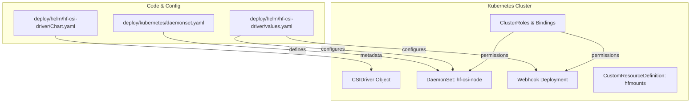

<!-- source: DeepWiki mcp.deepwiki.com · repo huggingface/hf-csi-driver · page 4 Deployment and Configuration · fetched 2026-10-26 -->

# Deployment and Configuration

Relevant source files

The following files were used as context for generating this wiki page:

- [deploy/helm/hf-csi-driver/Chart.yaml](deploy/helm/hf-csi-driver/Chart.yaml)
- [deploy/helm/hf-csi-driver/values.yaml](deploy/helm/hf-csi-driver/values.yaml)
- [deploy/kubernetes/daemonset.yaml](deploy/kubernetes/daemonset.yaml)

This section provides a high-level reference for the deployment artifacts and configuration mechanisms of the `hf-csi-driver`. The driver is designed to be deployed as a standard Kubernetes CSI plugin, utilizing a DaemonSet for node-level operations and a Mutating Admission Webhook for sidecar injection.

The deployment infrastructure supports two primary methods:
1.  **Helm Chart**: The recommended approach for production, offering full parameterization of images, resource limits, and cache settings.
2.  **Raw Manifests**: A collection of static YAML files for environments where Helm is not available or for manual inspection of the resource hierarchy.

## Deployment Architecture Overview

The `hf-csi-driver` deployment consists of several interconnected Kubernetes objects that facilitate FUSE mounting across different isolation modes.

### Code-to-Entity Mapping: Deployment Components

The following diagram maps the logical deployment components to their corresponding Kubernetes resource definitions and configuration keys.

**Deployment Component Map**

**Sources:**
- [deploy/kubernetes/daemonset.yaml:1-7]()
- [deploy/helm/hf-csi-driver/values.yaml:1-48]()
- [deploy/helm/hf-csi-driver/Chart.yaml:1-6]()

## Core Components

### 1. CSIDriver Object
The `CSIDriver` object registers `hf.csi.huggingface.co` within the cluster. It defines how Kubernetes should interact with the driver, specifically regarding volume lifecycle and whether the driver requires pod information during `NodePublishVolume`.

### 2. DaemonSet (`hf-csi-node`)
The DaemonSet runs on every worker node and contains three primary containers:
*   **`hf-csi-plugin`**: The main Go binary that implements the CSI Node service. It manages FUSE mounts, `HFMount` CRDs, and interacts with the `hf-mount-fuse` binary.
*   **`node-driver-registrar`**: Registers the CSI driver with the Kubelet.
*   **`liveness-probe`**: Monitors the health of the CSI plugin.

### 3. Mutating Admission Webhook
The webhook is responsible for `Sidecar Mode` operations. It intercepts Pod creation requests and injects the `hf-mount-fuse` sidecar container and required volumes (e.g., the shared FUSE device directory) when it detects a Hugging Face CSI volume.

### 4. RBAC and Permissions
The driver requires `ClusterRole` permissions to manage `HFMount` custom resources and to coordinate with the Kubernetes API for pod-mount lifecycle management.

**Sources:**
- [deploy/kubernetes/daemonset.yaml:23-88]()
- [deploy/helm/hf-csi-driver/values.yaml:34-41]()

## Configuration Parameters

The driver is configured primarily through CLI flags in the DaemonSet or values in the Helm chart. Key configuration areas include:

| Category | Key Parameters | Description |
| :--- | :--- | :--- |
| **Images** | `image.repository`, `hfMount.image.tag` | Defines the driver and FUSE mounter images. [deploy/helm/hf-csi-driver/values.yaml:1-12]() |
| **Storage** | `cacheDir` | Host path used for local caching of Hugging Face datasets. [deploy/helm/hf-csi-driver/values.yaml:17-17]() |
| **Networking** | `hostNetwork` | Whether the driver pods share the host network namespace. [deploy/helm/hf-csi-driver/values.yaml:22-22]() |
| **Scheduling** | `nodeSelector`, `tolerations` | Controls which nodes the driver is deployed on. [deploy/helm/hf-csi-driver/values.yaml:24-29]() |

**Sources:**
- [deploy/helm/hf-csi-driver/values.yaml:1-48]()
- [deploy/kubernetes/daemonset.yaml:26-32]()

## Detailed Reference Pages

For specific implementation details and configuration schemas, refer to the following child pages:

### [Helm Chart Reference](#4.1)
Detailed documentation on the `hf-csi-driver` Helm chart. Includes a full breakdown of `values.yaml`, instructions for customizing image tags for `hf-mount-fuse`, and configuring the admission webhook for sidecar injection.

### [Raw Kubernetes Manifests](#4.2)
A guide to the static YAML manifests located in `deploy/kubernetes/`. This section covers the manual setup of the `DaemonSet`, `ServiceAccount`, `CSIDriver` object, and the `HFMount` CRD for clusters not utilizing Helm.

---
**Sources:**
- [deploy/helm/hf-csi-driver/values.yaml:1-48]()
- [deploy/kubernetes/daemonset.yaml:1-110]()

---

