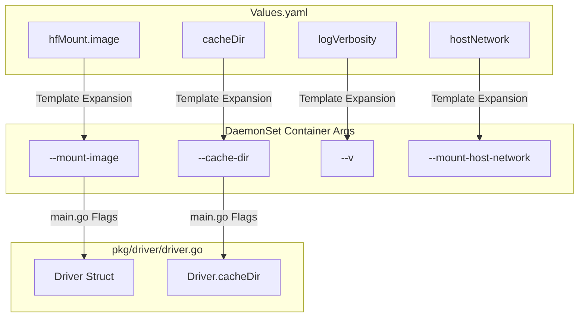
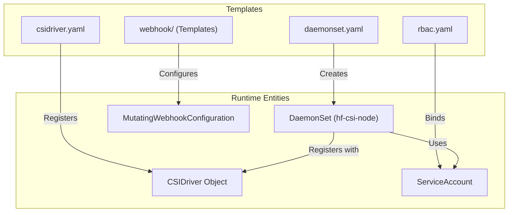

<!-- source: DeepWiki mcp.deepwiki.com · repo huggingface/hf-csi-driver · page 4.1 Helm Chart Reference · fetched 2026-10-26 -->

# Helm Chart Reference

Relevant source files

The following files were used as context for generating this wiki page:

- [.dockerignore](.dockerignore)
- [deploy/helm/hf-csi-driver/Chart.yaml](deploy/helm/hf-csi-driver/Chart.yaml)
- [deploy/helm/hf-csi-driver/templates/_helpers.tpl](deploy/helm/hf-csi-driver/templates/_helpers.tpl)
- [deploy/helm/hf-csi-driver/templates/csidriver.yaml](deploy/helm/hf-csi-driver/templates/csidriver.yaml)
- [deploy/helm/hf-csi-driver/templates/daemonset.yaml](deploy/helm/hf-csi-driver/templates/daemonset.yaml)
- [deploy/helm/hf-csi-driver/templates/rbac.yaml](deploy/helm/hf-csi-driver/templates/rbac.yaml)
- [deploy/helm/hf-csi-driver/templates/serviceaccount.yaml](deploy/helm/hf-csi-driver/templates/serviceaccount.yaml)
- [deploy/helm/hf-csi-driver/values.yaml](deploy/helm/hf-csi-driver/values.yaml)
- [go.mod](go.mod)
- [go.sum](go.sum)

The `hf-csi-driver` Helm chart provides a production-ready deployment for the Hugging Face CSI driver. It manages the lifecycle of the CSI Node service (via a DaemonSet), the sidecar injection webhook, necessary RBAC permissions, and the `CSIDriver` object registration.

### Chart Components and Templates

The chart is structured to deploy all required infrastructure for both `podmount` and `sidecar` mount modes.

#### 1. CSI Node DaemonSet
The primary component is the DaemonSet, which runs on every node in the cluster. It contains three containers:
*   **`hf-csi-plugin`**: The core driver binary that implements the CSI spec.
*   **`node-driver-registrar`**: Registers the CSI driver with the Kubelet.
*   **`liveness-probe`**: Monitors the health of the CSI driver.

The DaemonSet is configured with `hostNetwork: true` by default [deploy/helm/hf-csi-driver/templates/daemonset.yaml:32-32]() and requires `privileged: true` [deploy/helm/hf-csi-driver/templates/daemonset.yaml:61-61]() to manage FUSE mounts and bind-mounts into the Kubelet directory.

#### 2. Admission Webhook
The chart deploys a mutating admission webhook that handles sidecar injection for pods using HF volumes. This ensures that the `hf-mount-fuse` process can run within the same network/process namespace as the application when `mountMode: sidecar` is used.

#### 3. CSIDriver Object
The `CSIDriver` object [deploy/helm/hf-csi-driver/templates/csidriver.yaml:2-2]() defines the driver's capabilities:
*   **`podInfoOnMount: true`**: Required for the driver to receive pod metadata (like UID and namespace) to facilitate token management and sidecar coordination [deploy/helm/hf-csi-driver/templates/csidriver.yaml:9-9]().
*   **`requiresRepublish: true`**: Enables the driver to periodically refresh tokens or handle mount recovery [deploy/helm/hf-csi-driver/templates/csidriver.yaml:10-10]().
*   **`volumeLifecycleModes`**: Supports both `Ephemeral` and `Persistent` volumes [deploy/helm/hf-csi-driver/templates/csidriver.yaml:11-14]().

#### 4. RBAC and Permissions
The driver requires a `ClusterRole` [deploy/helm/hf-csi-driver/templates/rbac.yaml:2-2]() with permissions to:
*   Manage `HFMount` custom resources and their status [deploy/helm/hf-csi-driver/templates/rbac.yaml:17-19]().
*   Create and delete `Pods` (for the `podmount` mode) [deploy/helm/hf-csi-driver/templates/rbac.yaml:8-10]().
*   Read `PersistentVolume` and `PersistentVolumeClaim` objects [deploy/helm/hf-csi-driver/templates/rbac.yaml:11-16]().

Sources: [deploy/helm/hf-csi-driver/templates/daemonset.yaml:1-144](), [deploy/helm/hf-csi-driver/templates/csidriver.yaml:1-14](), [deploy/helm/hf-csi-driver/templates/rbac.yaml:1-35]().

### Configuration Values (`values.yaml`)

The following table describes the primary configuration knobs available in the Helm chart.

| Value | Description | Default |
| :--- | :--- | :--- |
| `image.repository` | Repository for the CSI driver binary. | `ghcr.io/huggingface/hf-csi-driver` |
| `image.tag` | Image tag for the CSI driver. | `latest` |
| `hfMount.image.repository`| Repository for the FUSE mounter. | `ghcr.io/huggingface/hf-mount-fuse` |
| `hfMount.image.tag` | Image tag for the FUSE mounter. | `latest` |
| `cacheDir` | Host path used for caching downloaded files. | `/var/lib/hf-csi-driver/cache` |
| `logVerbosity` | Log level for the driver (klog). | `4` |
| `webhook.port` | Port for the admission webhook service. | `9443` |
| `priorityClassName` | Priority class for the DaemonSet pods. | `system-node-critical` |

#### Customizing Cache and Mounts
The `cacheDir` value [deploy/helm/hf-csi-driver/values.yaml:17-17]() is passed to the CSI driver via the `--cache-dir` flag [deploy/helm/hf-csi-driver/templates/daemonset.yaml:45-45](). This directory is mounted from the host into the driver container to persist cached data across driver restarts [deploy/helm/hf-csi-driver/templates/daemonset.yaml:136-139]().

Sources: [deploy/helm/hf-csi-driver/values.yaml:1-48](), [deploy/helm/hf-csi-driver/templates/daemonset.yaml:40-54]().

### Data Flow: Helm to Code Entity Mapping

The following diagram bridges the Helm configuration space to the internal Go structs and command-line arguments used by the driver.

**Helm to Driver Argument Mapping**

Sources: [deploy/helm/hf-csi-driver/values.yaml:7-22](), [deploy/helm/hf-csi-driver/templates/daemonset.yaml:42-54]().

### Deployment Architecture

The chart orchestrates multiple Kubernetes resources to enable the CSI lifecycle. The diagram below illustrates how these templates relate to the runtime entities.

**Chart Resource Relationship**

Sources: [deploy/helm/hf-csi-driver/templates/daemonset.yaml:1-4](), [deploy/helm/hf-csi-driver/templates/rbac.yaml:1-35](), [deploy/helm/hf-csi-driver/templates/csidriver.yaml:1-4]().

### Implementation Details

#### Health and Startup Probes
The driver includes a specific `startupProbe` configuration [deploy/helm/hf-csi-driver/templates/daemonset.yaml:83-89]() to prevent the Kubelet from killing the driver during its initialization phase. The driver blocks on the Kubernetes API and the `mount-pod-watcher` initialization, which can take ~30s on cold starts [deploy/helm/hf-csi-driver/templates/daemonset.yaml:77-82]().

#### Mount Propagation
The DaemonSet uses `Bidirectional` mount propagation for two critical paths:
1.  **`/var/lib/kubelet`**: Allows the driver to make FUSE mounts visible to the Kubelet [deploy/helm/hf-csi-driver/templates/daemonset.yaml:63-65]().
2.  **`/var/lib/hf-csi-driver/mnt`**: Used as the global mount point for `podmount` mode [deploy/helm/hf-csi-driver/templates/daemonset.yaml:70-72]().

Sources: [deploy/helm/hf-csi-driver/templates/daemonset.yaml:63-72](), [deploy/helm/hf-csi-driver/templates/daemonset.yaml:83-95]().

---

