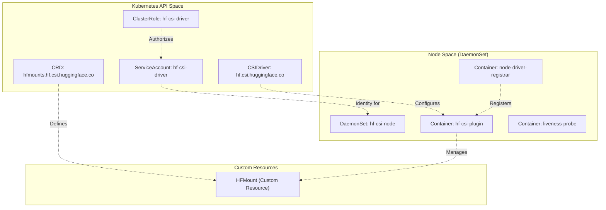
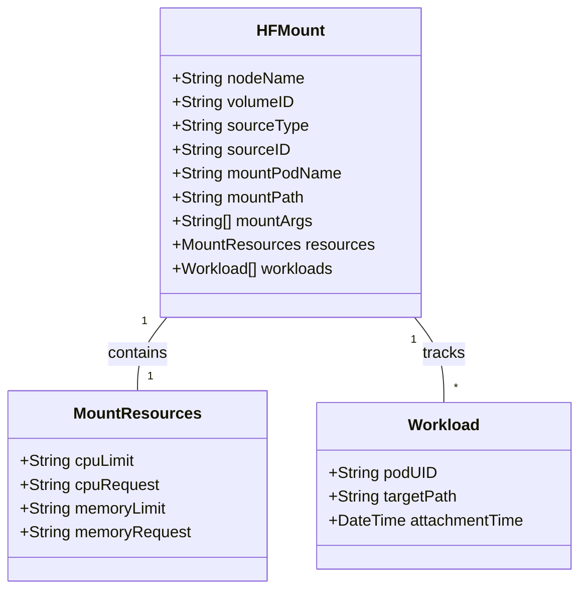

<!-- source: DeepWiki mcp.deepwiki.com · repo huggingface/hf-csi-driver · page 4.2 Raw Kubernetes Manifests · fetched 2026-10-26 -->

# Raw Kubernetes Manifests

Relevant source files

The following files were used as context for generating this wiki page:

- [deploy/helm/hf-csi-driver/templates/crd.yaml](deploy/helm/hf-csi-driver/templates/crd.yaml)
- [deploy/kubernetes/crd.yaml](deploy/kubernetes/crd.yaml)
- [deploy/kubernetes/csidriver.yaml](deploy/kubernetes/csidriver.yaml)
- [deploy/kubernetes/daemonset.yaml](deploy/kubernetes/daemonset.yaml)
- [deploy/kubernetes/rbac.yaml](deploy/kubernetes/rbac.yaml)
- [deploy/kubernetes/serviceaccount.yaml](deploy/kubernetes/serviceaccount.yaml)
- [pkg/driver/hfmount.go](pkg/driver/hfmount.go)

The `hf-csi-driver` provides a set of plain YAML manifests located under `deploy/kubernetes/`. These manifests are intended for environments where Helm is not used or where manual control over the deployment lifecycle is required. They define the core components necessary for the driver to function, including the `DaemonSet`, RBAC permissions, the `CSIDriver` object, and the `HFMount` Custom Resource Definition (CRD).

## Component Architecture and Data Flow

The following diagram illustrates how the raw manifests relate to the runtime entities and the flow of information between the Kubernetes API and the CSI driver components.

### Manifest to Runtime Entity Mapping

Sources: [deploy/kubernetes/daemonset.yaml:1-25](), [deploy/kubernetes/crd.yaml:1-14](), [deploy/kubernetes/rbac.yaml:1-25](), [deploy/kubernetes/csidriver.yaml:1-9]()

## DaemonSet Configuration

The `hf-csi-node` DaemonSet is the primary deployment mechanism for the driver. It ensures that an instance of the `hf-csi-plugin` runs on every Linux node in the cluster.

### Container Responsibilities
1.  **hf-csi-plugin**: The core driver binary. It handles CSI RPC calls and manages FUSE mounts. It requires `privileged: true` to perform mount operations and propagate them to the host [deploy/kubernetes/daemonset.yaml:24-39]().
2.  **node-driver-registrar**: A sidecar container that registers the CSI driver with the Kubelet using the Unix domain socket at `/csi/csi.sock` [deploy/kubernetes/daemonset.yaml:63-70]().
3.  **liveness-probe**: Monitors the health of the CSI driver via the `/healthz` endpoint on port `9808` [deploy/kubernetes/daemonset.yaml:77-84]().

### Host Path Mounts and Propagation
The driver relies on specific `hostPath` volumes to interact with the Kubelet and the host filesystem:
*   **kubelet-dir**: `/var/lib/kubelet` is mounted with `Bidirectional` propagation to allow the driver to make mounts visible to the Kubelet [deploy/kubernetes/daemonset.yaml:41-43](), [deploy/kubernetes/daemonset.yaml:90-93]().
*   **plugin-dir**: Used for the CSI socket communication [deploy/kubernetes/daemonset.yaml:94-97]().
*   **cache-dir**: Persistent storage for file chunks cached by `hf-mount-fuse` [deploy/kubernetes/daemonset.yaml:102-105]().
*   **mnt-dir**: The base directory for FUSE mounts in `podmount` mode [deploy/kubernetes/daemonset.yaml:106-109]().

Sources: [deploy/kubernetes/daemonset.yaml:24-110]()

## HFMount Custom Resource Definition (CRD)

The `HFMount` CRD is critical for the `podmount` mode. It serves as the source of truth for the state of FUSE mounts on a specific node, allowing the driver to recover mounts after a node or driver restart.

### HFMount Entity Mapping

Sources: [deploy/kubernetes/crd.yaml:26-70](), [pkg/driver/hfmount.go:37-45]()

### Key Fields in HFMount
| Field | Description | Source |
| :--- | :--- | :--- |
| `spec.mountArgs` | The exact CLI flags used for `hf-mount-fuse`, enabling pod recreation. | [deploy/kubernetes/crd.yaml:42-46]() |
| `spec.workloads` | A list of consumer pods (UIDs and target paths) currently using the mount. | [deploy/kubernetes/crd.yaml:59-71]() |
| `status.phase` | Current state: `Pending`, `Mounted`, or `Failed`. | [deploy/kubernetes/crd.yaml:79-83]() |

Sources: [deploy/kubernetes/crd.yaml:1-101](), [pkg/driver/hfmount.go:16-20]()

## RBAC and ServiceAccount

The driver operates under the `hf-csi-driver` `ServiceAccount` [deploy/kubernetes/serviceaccount.yaml:1-6](). It is granted permissions via a `ClusterRole` to manage its own resources and interact with Pods.

### Permissions
*   **Pods**: `get`, `list`, `watch`, `create`, `delete`. Required for managing mount pods in `podmount` mode [deploy/kubernetes/rbac.yaml:6-8]().
*   **HFMounts**: `get`, `list`, `watch`, `create`, `update`, `delete`. Required for maintaining the lifecycle of the custom resource and its status [deploy/kubernetes/rbac.yaml:9-11]().

Sources: [deploy/kubernetes/rbac.yaml:1-25]()

## CSIDriver Object

The `CSIDriver` object defines the capabilities of the driver to the Kubernetes control plane.

*   **attachRequired: false**: The driver does not use the standard Kubernetes `AttachVolume` flow (it is a mount-only driver) [deploy/kubernetes/csidriver.yaml:6]().
*   **podInfoOnMount: true**: Required for the driver to receive pod metadata (like UID and namespace) in the `NodePublishVolume` request, which is used for sidecar injection and workload tracking [deploy/kubernetes/csidriver.yaml:7]().
*   **requiresRepublish: true**: Ensures that `NodePublishVolume` is called periodically, allowing the driver to refresh tokens or update mount states [deploy/kubernetes/csidriver.yaml:8]().

Sources: [deploy/kubernetes/csidriver.yaml:1-9]()

---

