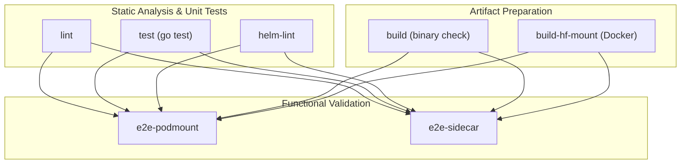
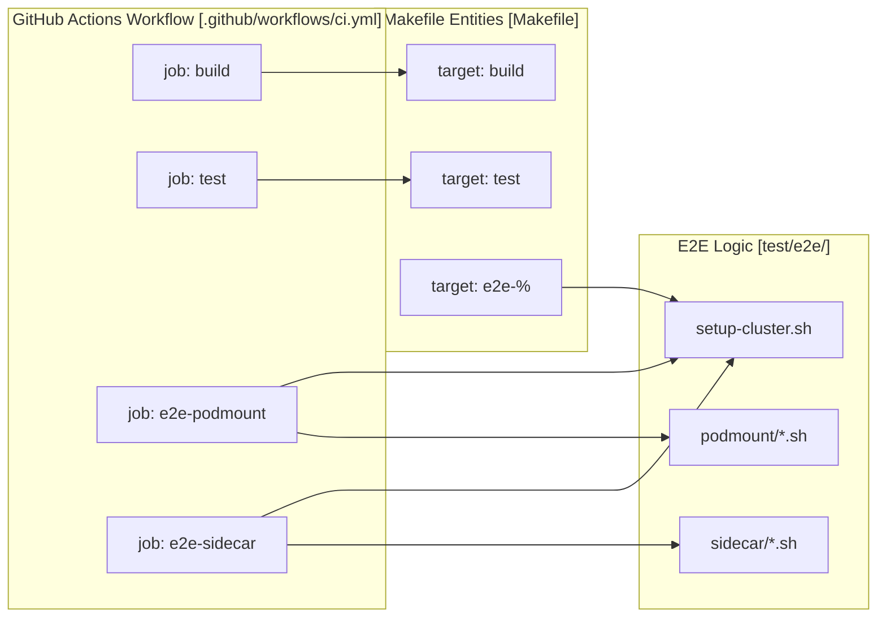

<!-- source: DeepWiki mcp.deepwiki.com · repo huggingface/hf-csi-driver · page 5.1 CI Pipeline · fetched 2026-10-26 -->

# CI Pipeline

Relevant source files

The following files were used as context for generating this wiki page:

- [.github/workflows/ci.yml](.github/workflows/ci.yml)
- [LICENSE](LICENSE)
- [Makefile](Makefile)
- [test/e2e/setup-cluster.sh](test/e2e/setup-cluster.sh)
- [test/e2e/teardown-cluster.sh](test/e2e/teardown-cluster.sh)

The `hf-csi-driver` utilizes GitHub Actions to ensure code quality, binary integrity, and functional correctness across both supported mount modes (**PodMount** and **Sidecar**). The pipeline automates linting, unit testing, container image construction for dependencies, and full-scale End-to-End (E2E) testing using `kind` clusters.

## Workflow Architecture

The CI workflow is defined in [.github/workflows/ci.yml:1-214](). It consists of several parallelized stages that culminate in two comprehensive E2E test suites.

### CI Data Flow and Dependency Graph

The following diagram illustrates how artifacts and dependencies flow through the GitHub Actions pipeline.

**CI Pipeline Stage Dependencies**

**Sources:** [.github/workflows/ci.yml:8-151](), [Makefile:9-43]()

---

## Pipeline Stages

### 1. Static Analysis and Unit Testing
The pipeline performs initial checks to ensure the codebase adheres to standards and passes isolated logic tests:
*   **Lint:** Executes `golangci-lint` to catch common Go mistakes and style issues [.github/workflows/ci.yml:9-21]().
*   **Test:** Runs `go test -race -v ./...` to execute all unit tests in the `pkg/` directory [.github/workflows/ci.yml:22-32](). This corresponds to the `test` target in the [Makefile:12-13]().
*   **Helm Lint:** Validates the Helm chart syntax in `deploy/helm/hf-csi-driver/` for both default and webhook-enabled configurations [.github/workflows/ci.yml:44-54]().

### 2. Binary and Dependency Building
*   **Build:** Performs a dry-run compilation of the `hf-csi-driver` binary for Linux to ensure no compilation errors exist [.github/workflows/ci.yml:33-43]().
*   **Build hf-mount image:** The driver depends on the `hf-mount-fuse` FUSE implementation. The CI clones the `huggingface/hf-mount` repository and builds its container image [.github/workflows/ci.yml:55-79]().
    *   **Ref Resolution:** By default, it uses the `main` branch of `hf-mount`. However, developers can override this by creating a `.hf-mount-ref` file in the repo root to test unmerged changes in the FUSE binary [.github/workflows/ci.yml:61-68]().
    *   **Artifact Sharing:** The resulting image is saved as a `.tar` file and uploaded as a GitHub Action artifact to be consumed by the E2E jobs [.github/workflows/ci.yml:72-76]().

### 3. End-to-End (E2E) Testing
The E2E stages are the most critical part of the pipeline, simulating real-world Kubernetes environments using `kind` (Kubernetes in Docker).

#### Cluster Setup
Both E2E jobs call `test/e2e/setup-cluster.sh` [.github/workflows/ci.yml:109,178](). This script:
1.  Creates a `kind` cluster with `/dev/fuse` mapped from the host to allow FUSE mounts inside the nodes [test/e2e/setup-cluster.sh:46-60]().
2.  Builds the local `hf-csi-driver` image [test/e2e/setup-cluster.sh:62-64]().
3.  Loads both the driver and the `hf-mount-fuse` images into the `kind` nodes [test/e2e/setup-cluster.sh:72-74]().
4.  Deploys the driver via Helm, configuring the `webhook.enabled` flag based on the test mode (PodMount vs. Sidecar) [test/e2e/setup-cluster.sh:81-101]().

#### Test Execution Logic
The E2E suites verify the driver's behavior across different scenarios. If any step fails, a `99-debug.sh` script runs to collect logs and cluster state [.github/workflows/ci.yml:145-147,211-213]().

| Suite | Focus Area | Key Scenarios Verified |
| :--- | :--- | :--- |
| **e2e-podmount** | `HFMount` CRD and Mount Pods | PV/PVC mounting, driver restart resilience, mount pod recovery, `fsgroup` support, and bucket R/W [.github/workflows/ci.yml:111-143](). |
| **e2e-sidecar** | Admission Webhook and FD-passing | Sidecar injection, Unix socket communication, token permissions, and multi-volume pod support [.github/workflows/ci.yml:180-209](). |

**Sources:** [.github/workflows/ci.yml:80-214](), [test/e2e/setup-cluster.sh:1-112]()

---

## Code Entity Mapping

The CI pipeline interacts with the codebase primarily through the `Makefile` and the `test/e2e` scripts. The following diagram maps CI concepts to specific code entities.

**CI Pipeline to Code Entity Mapping**

**Sources:** [.github/workflows/ci.yml:1-214](), [Makefile:1-43](), [test/e2e/setup-cluster.sh:1-112]()

## Infrastructure Requirements
The CI jobs run on `aws-general-8-plus` runners [.github/workflows/ci.yml:12,25,36,47,58,84,153](). This provides sufficient resources for:
*   Running a `kind` cluster.
*   Concurrent Docker builds.
*   Go race detection (which increases memory usage during `go test`).

**Sources:** [.github/workflows/ci.yml:1-214]()

---

