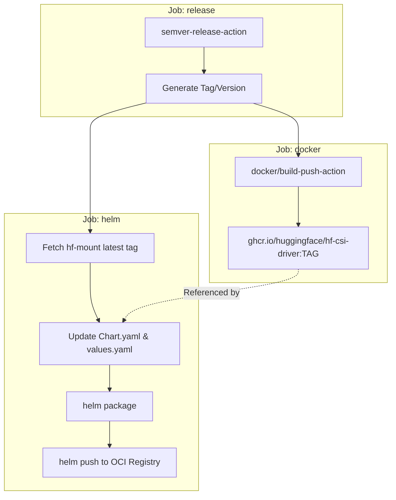
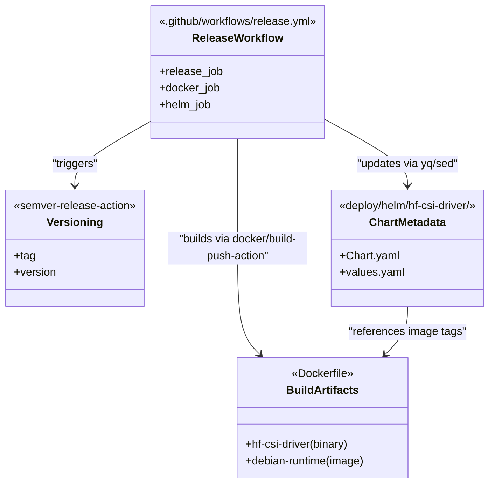

<!-- source: DeepWiki mcp.deepwiki.com · repo huggingface/hf-csi-driver · page 5.2 Release Workflow · fetched 2026-10-26 -->

# Release Workflow

Relevant source files

The following files were used as context for generating this wiki page:

- [.github/workflows/release.yml](.github/workflows/release.yml)
- [Dockerfile](Dockerfile)
- [deploy/helm/hf-csi-driver/Chart.yaml](deploy/helm/hf-csi-driver/Chart.yaml)

The release workflow for the `hf-csi-driver` is a fully automated process managed via GitHub Actions. It handles semantic versioning, multi-stage Docker image builds, and the publication of Helm charts to the GitHub Container Registry (GHCR). The workflow ensures that the CSI driver is packaged with the correct metadata and synchronized with the latest version of the `hf-mount` utility.

## Workflow Overview

The release process is defined in [.github/workflows/release.yml](). It is triggered manually via `workflow_dispatch` [.github/workflows/release.yml:4]() and consists of three primary stages: versioning, image construction, and chart distribution.

### Release Process Data Flow

The following diagram illustrates the flow of data and dependencies between the different jobs in the release pipeline.

**Diagram: Release Pipeline Data Flow**

**Sources:** [.github/workflows/release.yml:16-94]()

---

## 1. Versioning and Tagging

The `release` job serves as the entry point for the workflow. It utilizes the `huggingface/semver-release-action` to determine the next semantic version based on the repository's history [.github/workflows/release.yml:28]().

*   **Outputs:** The job exports three key variables: `tag`, `version`, and a boolean `released` [.github/workflows/release.yml:19-22]().
*   **Permissions:** The workflow requires `contents: write` to create tags/releases and `packages: write` to push artifacts [.github/workflows/release.yml:7-8]().

**Sources:** [.github/workflows/release.yml:6-31]()

---

## 2. Docker Image Build

The `docker` job builds the CSI driver binary and packages it into a production-ready container.

### Build Implementation
The build uses a multi-stage [Dockerfile]():
1.  **Builder Stage:** Uses `golang:1.25-bookworm` to compile the `hf-csi-driver` binary from `cmd/hf-csi-driver/` [Dockerfile:2-8]().
2.  **Runtime Stage:** Uses `debian:bookworm-slim`. It installs the `mount` package, which is a requirement for performing FUSE mounts via the Kubernetes `mount-utils` library [Dockerfile:11-12]().

### Distribution
The image is tagged with both the specific release tag and `latest` [.github/workflows/release.yml:52-54](). It is pushed to the GitHub Container Registry at `ghcr.io/huggingface/hf-csi-driver` [.github/workflows/release.yml:11-12]().

**Sources:** [Dockerfile:1-15](), [.github/workflows/release.yml:32-55]()

---

## 3. Helm Chart Publication

The `helm` job synchronizes the Kubernetes manifests with the newly released images and the external `hf-mount` dependency.

### External Dependency Fetching
The workflow queries the GitHub API to find the latest release tag of the `hf-mount` repository [.github/workflows/release.yml:71](). This tag is used to ensure that the `hf-mount` sidecar image used by the driver is up to date.

### Manifest Transformation
The workflow performs in-place updates to the Helm chart files using `sed` and `yq`:
*   **Chart.yaml:** Replaces the placeholder `0.0.0-latest` with the actual release version [.github/workflows/release.yml:80]().
*   **values.yaml:** Updates the image tags for the CSI driver, the admission webhook, and the `hf-mount` utility [.github/workflows/release.yml:81-83]().

### OCI Registry Push
The chart is packaged and pushed as an OCI artifact to `oci://ghcr.io/huggingface/charts` [.github/workflows/release.yml:93]().

**Sources:** [.github/workflows/release.yml:56-94](), [deploy/helm/hf-csi-driver/Chart.yaml:5-6]()

---

## Release Entities and Relationships

The following diagram maps the logical release components to the specific files and tools used in the workflow.

**Diagram: Release Logic to Code Entity Map**

**Sources:** [.github/workflows/release.yml:1-94](), [Dockerfile:1-15](), [deploy/helm/hf-csi-driver/Chart.yaml:1-6]()

---

