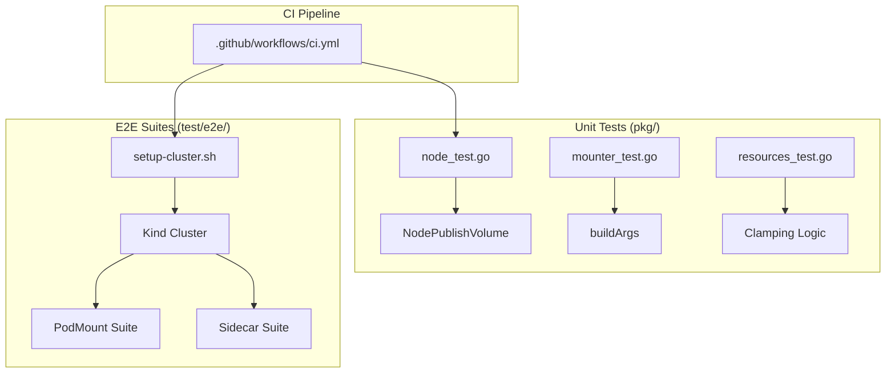
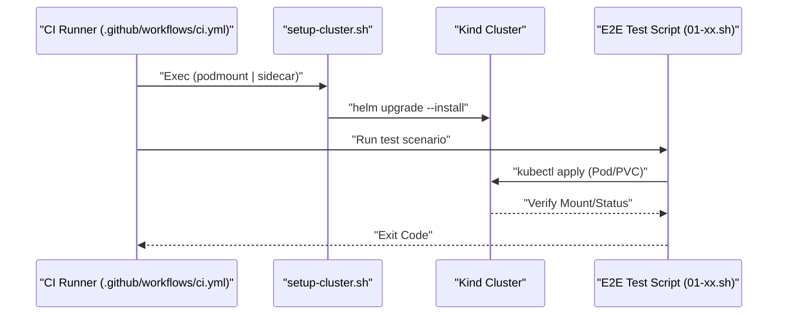

<!-- source: DeepWiki mcp.deepwiki.com · repo huggingface/hf-csi-driver · page 6 Testing · fetched 2026-10-26 -->

# Testing

Relevant source files

The following files were used as context for generating this wiki page:

- [.github/workflows/ci.yml](.github/workflows/ci.yml)
- [test/e2e/lib.sh](test/e2e/lib.sh)
- [test/e2e/setup-cluster.sh](test/e2e/setup-cluster.sh)

The `hf-csi-driver` employs a multi-tiered testing strategy to ensure the reliability of FUSE mounts, resource management, and sidecar injection. The suite ranges from standard Go unit tests for internal logic to comprehensive End-to-End (E2E) tests executed within `kind` (Kubernetes-in-Docker) clusters.

## Test Strategy Overview

The testing lifecycle is orchestrated via GitHub Actions and categorized into three main areas:

1.  **Unit Tests**: Validate individual components like CSI RPC handling, CLI argument construction, and resource clamping logic.
2.  **E2E PodMount Mode**: Validates the "Mount Pod" architecture where a dedicated pod manages the FUSE lifecycle.
3.  **E2E Sidecar Mode**: Validates the "Sidecar" architecture involving the mutating admission webhook and Unix socket file descriptor (fd) passing.

### Test Architecture

The following diagram maps the test categories to the specific code entities and scripts they validate.

**Diagram: Test Coverage Mapping**

Sources: [.github/workflows/ci.yml:1-150](), [test/e2e/setup-cluster.sh:1-20]()

---

## Unit Tests

Unit tests are located within the `pkg/` directory and focus on the core driver logic without requiring a live Kubernetes cluster. These tests are executed during the `test` job in the CI pipeline using `go test -race -v ./...` [.github/workflows/ci.yml:22-32]().

Key areas of coverage include:
*   **CSI RPC Logic**: Scenarios for `NodePublishVolume` and `NodeUnpublishVolume`.
*   **Mounter Validation**: Ensuring `buildArgs` correctly translates `MountOptions` into CLI flags for `hf-mount-fuse`.
*   **Resource Clamping**: Verifying that requested resources are clamped to limits to prevent scheduling failures.
*   **Internal Communication**: Testing the `fdchannel` package for passing file descriptors over Unix sockets.

For details, see [Unit Tests](#6.1).

---

## End-to-End (E2E) Testing

The E2E suites run in the CI pipeline using `kind` clusters [.github/workflows/ci.yml:94-100](). The environment is prepared by `test/e2e/setup-cluster.sh`, which builds the driver image, loads the `hf-mount-fuse` image, and installs the Helm chart with specific configurations for either `podmount` or `sidecar` mode [test/e2e/setup-cluster.sh:72-112]().

### E2E Suite Relationships

The following diagram illustrates how the E2E scripts interact with the cluster components.

**Diagram: E2E Execution Flow**

Sources: [.github/workflows/ci.yml:80-214](), [test/e2e/setup-cluster.sh:100-112]()

### End-to-End Tests: PodMount Mode
This suite focuses on the lifecycle of the `HFMount` Custom Resource and the resulting mount pods. It validates resilience against driver restarts, mount pod recovery, and cleanup of bind-mounts upon unprovisions.

For details, see [End-to-End Tests: PodMount Mode](#6.2).

### End-to-End Tests: Sidecar Mode
This suite validates the Mutating Admission Webhook. It ensures that sidecars are correctly injected, FUSE file descriptors are passed via the Unix socket, and that the driver handles "stuck" sidecars or token permission issues gracefully.

For details, see [End-to-End Tests: Sidecar Mode](#6.3).

---

## CI/CD Integration

The CI pipeline defined in `.github/workflows/ci.yml` automates the entire testing process:
*   **Linting**: Runs `golangci-lint` and `helm lint` [.github/workflows/ci.yml:9-54]().
*   **Artifact Building**: Builds the `hf-csi-driver` binary and pulls/builds the `hf-mount-fuse` image [.github/workflows/ci.yml:33-79]().
*   **Parallel E2E**: Runs `e2e-podmount` and `e2e-sidecar` jobs in parallel to minimize feedback time [.github/workflows/ci.yml:80-214]().

Sources: [.github/workflows/ci.yml:1-214](), [test/e2e/lib.sh:1-48](), [test/e2e/setup-cluster.sh:1-112]()

---

