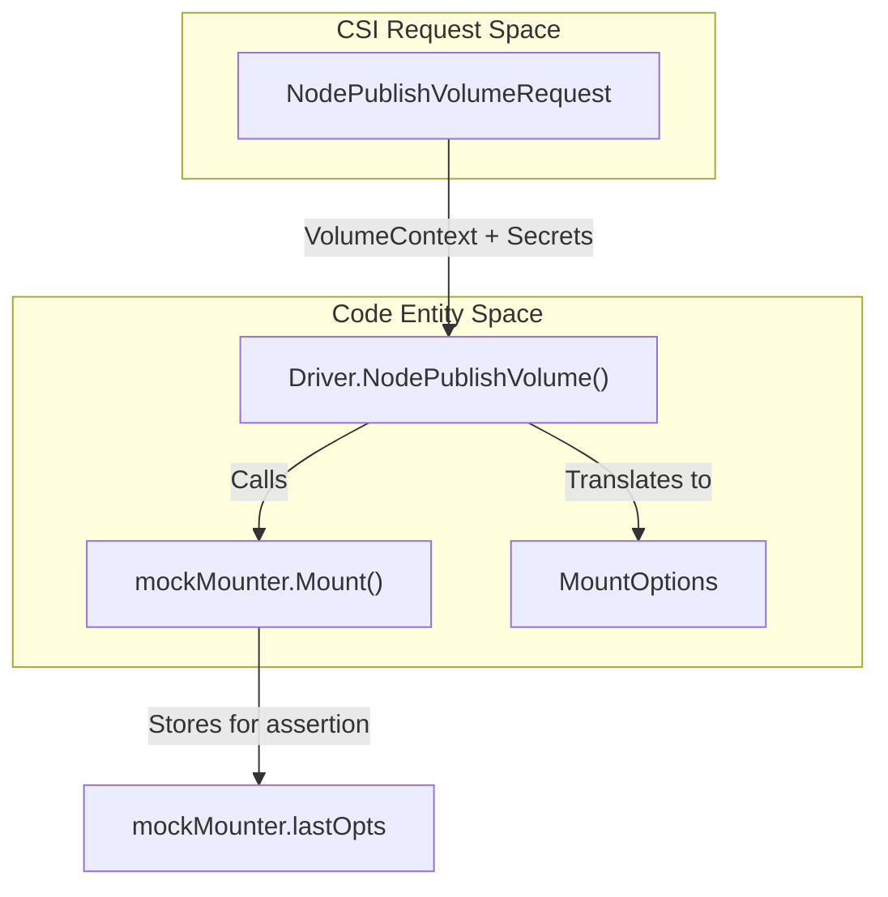
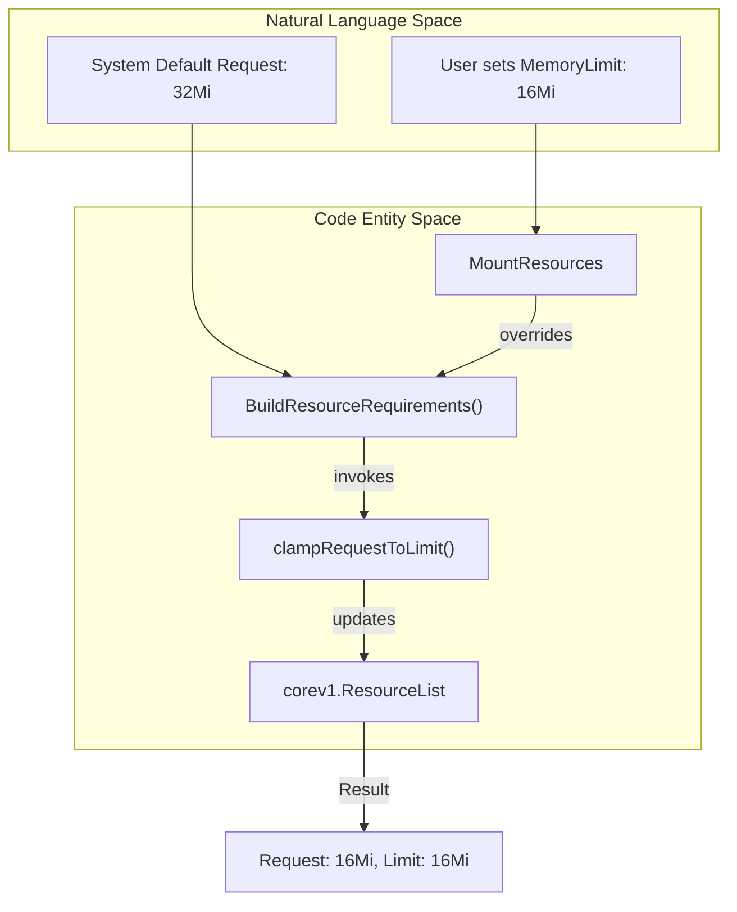

<!-- source: DeepWiki mcp.deepwiki.com · repo huggingface/hf-csi-driver · page 6.1 Unit Tests · fetched 2026-10-26 -->

# Unit Tests

Relevant source files

The following files were used as context for generating this wiki page:

- [.gitignore](.gitignore)
- [pkg/driver/mounter_test.go](pkg/driver/mounter_test.go)
- [pkg/driver/node_test.go](pkg/driver/node_test.go)
- [pkg/driver/podmounter_test.go](pkg/driver/podmounter_test.go)
- [pkg/driver/resources.go](pkg/driver/resources.go)
- [pkg/driver/resources_test.go](pkg/driver/resources_test.go)
- [pkg/driver/sidecar_mounter_linux_test.go](pkg/driver/sidecar_mounter_linux_test.go)
- [pkg/util/fdchannel.go](pkg/util/fdchannel.go)
- [pkg/util/fdchannel_test.go](pkg/util/fdchannel_test.go)
- [pkg/webhook/sidecar.go](pkg/webhook/sidecar.go)
- [pkg/webhook/sidecar_test.go](pkg/webhook/sidecar_test.go)
- [test/e2e/sidecar/02-sidecar-injected.sh](test/e2e/sidecar/02-sidecar-injected.sh)

The `hf-csi-driver` employs a comprehensive suite of Go unit tests to validate the core CSI driver logic, the `hf-mount-fuse` CLI argument construction, resource management, and the low-level inter-process communication (IPC) mechanisms used in sidecar mode.

## Node Service Validation

The `NodePublishVolume` and `NodeUnpublishVolume` RPCs are tested in `pkg/driver/node_test.go` using a `mockMounter` to simulate the actual mounting operations.

### Key Test Scenarios
*   **Request Validation**: Ensures that missing mandatory fields such as `volumeId`, `targetPath`, or `sourceType` result in an error [pkg/driver/node_test.go:72-131]().
*   **Idempotency**: Verifies that calling `NodePublishVolume` multiple times for the same volume succeeds and correctly updates the token file if secrets have changed [pkg/driver/node_test.go:179-210]().
*   **Token Management**: Validates that public repositories (those without CSI secrets) do not generate a token file [pkg/driver/node_test.go:212-240]().
*   **Fast-path Unmount**: Tests the optimization where the driver directly unmounts the FUSE mount in sidecar mode instead of waiting for a Pod deletion event [pkg/driver/node_test.go:57-70]().

### Mock Mounter Data Flow
The following diagram illustrates how the `mockMounter` is used to verify that the `Driver` correctly translates CSI requests into mounter calls.

**Title: Node Service to Mounter Routing**

Sources: [pkg/driver/node_test.go:13-45](), [pkg/driver/node_test.go:133-177]()

## CLI Argument Construction

The `buildArgs` function is responsible for translating the internal `MountOptions` struct into the command-line flags required by `hf-mount-fuse`. Tests in `mounter_test.go` validate this translation for different repository types.

| Source Type | Specific Logic Validated | Source |
| :--- | :--- | :--- |
| **Bucket** | Ensures `--revision` is ignored for bucket sources. | [pkg/driver/mounter_test.go:59-72]() |
| **Repo** | Validates that `--revision` is correctly appended. | [pkg/driver/mounter_test.go:36-57]() |
| **Common** | Validates `--hub-endpoint`, `--cache-dir`, and `--read-only` flags. | [pkg/driver/mounter_test.go:7-34]() |
| **Passthrough** | Ensures `ExtraArgs` (e.g., `--uid`, `--gid`) are passed through correctly. | [pkg/driver/mounter_test.go:81-102]() |

Sources: [pkg/driver/mounter_test.go:1-103]()

## PodMounter Lifecycle

The `PodMounter` tests focus on the generation of `HFMount` CRDs and the underlying Pod specifications.

*   **Pod Terminal States**: `TestIsPodTerminal` validates which `PodPhase` values (Succeeded, Failed) are considered terminal for cleanup logic [pkg/driver/podmounter_test.go:10-27]().
*   **Label Sanitization**: `TestSanitizeLabelValue` ensures that Kubernetes node names (which may contain dots or slashes) are safely converted into valid label values [pkg/driver/podmounter_test.go:75-119]().
*   **Affinity and Security**: `TestBuildMountPod` verifies that generated pods have the correct `NodeAffinity` to land on the requesting node and are configured with `Privileged: true` to perform FUSE mounts [pkg/driver/podmounter_test.go:154-201]().

Sources: [pkg/driver/podmounter_test.go:1-220]()

## Resource Management and Clamping

The `Resource Management` subsystem ensures that FUSE daemon containers (Sidecars or Mount Pods) have predictable resource footprints.

### Resource Parsing and Merging
*   **Typo Resilience**: `ParseMountResources` is tested to ensure that invalid quantity strings (e.g., "100mzz") are logged and dropped rather than causing a pod admission failure [pkg/webhook/sidecar_test.go:62-74]().
*   **Merge Logic**: When multiple volumes are present in a pod, `mergeMaxResources` picks the highest limit/request defined across all volumes to ensure the sidecar can handle the aggregate load [pkg/webhook/sidecar_test.go:80-112]().

### Request Clamping
A critical safety feature is "clamping," where a resource `Request` is automatically lowered to match a `Limit` if the user (or default) specifies a request higher than the limit. This prevents Kubernetes from rejecting the Pod with a "request exceeds limit" error.

**Title: Resource Clamping Logic**

Sources: [pkg/driver/resources.go:63-94](), [pkg/driver/resources.go:143-159](), [pkg/webhook/sidecar_test.go:117-149]()

## Sidecar IPC (FD Passing)

The `util/fdchannel` package provides the mechanism for passing FUSE file descriptors from the CSI driver to the unprivileged sidecar container using `SCM_RIGHTS`.

*   **Single FD Passing**: `TestSendRecvMsg` validates the basic transfer of a file descriptor and an associated JSON message over a Unix socket [pkg/util/fdchannel_test.go:11-92]().
*   **Multi-threaded Support**: `TestSendMsgFds_MultiFdSingleCmsg` verifies that multiple file descriptors (created via `FUSE_DEV_IOC_CLONE`) can be packed into a single control message. This is essential for the multi-threaded performance of the Rust-based sidecar [pkg/util/fdchannel_test.go:163-259]().

Sources: [pkg/util/fdchannel.go:22-42](), [pkg/util/fdchannel_test.go:1-285]()

## Webhook Sidecar Injection

Tests in `pkg/webhook/sidecar_test.go` validate the mutation of Pod specs.

*   **Grace Period Enforcement**: `TestEnsureTerminationGracePeriod` ensures that the `terminationGracePeriodSeconds` is raised to at least 60 seconds. This provides the sidecar enough time to flush FUSE write buffers to the remote bucket during pod shutdown [pkg/webhook/sidecar_test.go:162-192]().
*   **Annotation Tracking**: Validates that the original grace period is preserved in the `hf.csi.huggingface.co/original-termination-grace-period-seconds` annotation for observability [pkg/webhook/sidecar_test.go:170-172]().

Sources: [pkg/webhook/sidecar.go:12-28](), [pkg/webhook/sidecar.go:114-131](), [pkg/webhook/sidecar_test.go:162-192]()

---

