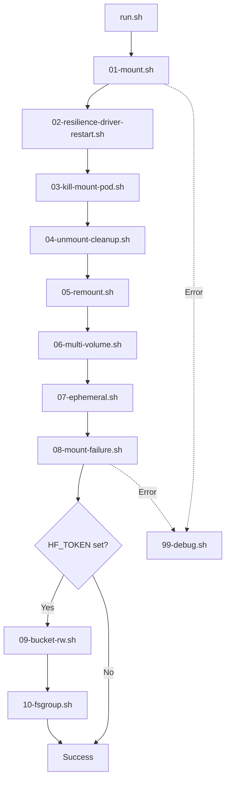
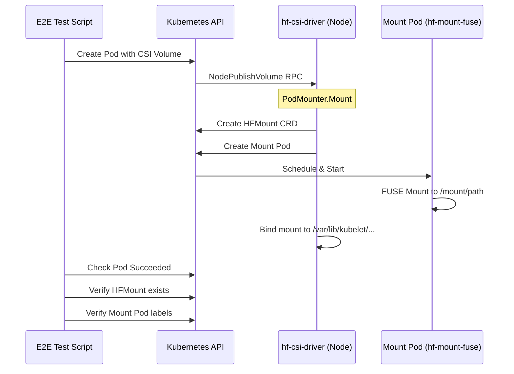

<!-- source: DeepWiki mcp.deepwiki.com · repo huggingface/hf-csi-driver · page 6.2 End-to-End Tests: PodMount Mode · fetched 2026-10-26 -->

# End-to-End Tests: PodMount Mode

Relevant source files

The following files were used as context for generating this wiki page:

- [test/e2e/podmount/01-mount.sh](test/e2e/podmount/01-mount.sh)
- [test/e2e/podmount/02-resilience-driver-restart.sh](test/e2e/podmount/02-resilience-driver-restart.sh)
- [test/e2e/podmount/03-kill-mount-pod.sh](test/e2e/podmount/03-kill-mount-pod.sh)
- [test/e2e/podmount/04-unmount-cleanup.sh](test/e2e/podmount/04-unmount-cleanup.sh)
- [test/e2e/podmount/05-remount.sh](test/e2e/podmount/05-remount.sh)
- [test/e2e/podmount/06-multi-volume.sh](test/e2e/podmount/06-multi-volume.sh)
- [test/e2e/podmount/07-ephemeral.sh](test/e2e/podmount/07-ephemeral.sh)
- [test/e2e/podmount/08-mount-failure.sh](test/e2e/podmount/08-mount-failure.sh)
- [test/e2e/podmount/09-bucket-rw.sh](test/e2e/podmount/09-bucket-rw.sh)
- [test/e2e/podmount/10-fsgroup.sh](test/e2e/podmount/10-fsgroup.sh)
- [test/e2e/podmount/99-debug.sh](test/e2e/podmount/99-debug.sh)
- [test/e2e/podmount/run.sh](test/e2e/podmount/run.sh)

The PodMount End-to-End (E2E) suite validates the functionality of the `hf-csi-driver` when operating in `mountpod` mode. In this mode, the CSI driver creates a dedicated Kubernetes Pod for every volume mount to host the FUSE process. This suite ensures that the driver correctly manages the lifecycle of these mount pods, handles node-level failures, and maintains data integrity across various volume configurations (PV/PVC vs. Ephemeral) and source types (Hugging Face Repos vs. Buckets).

### Test Suite Execution Flow

The suite is executed via a central runner script that orchestrates individual test cases in a specific order to reuse cluster resources where possible.

#### Test Runner Orchestration
The script `test/e2e/podmount/run.sh` defines the execution sequence. It conditionally includes bucket-related tests only if an `HF_TOKEN` is provided in the environment. It also registers a trap to execute `test/e2e/podmount/99-debug.sh` on any failure, which dumps driver logs, `HFMount` CRDs, and mount pod states for troubleshooting.

**PodMount E2E Execution Sequence**

**Sources:** [test/e2e/podmount/run.sh:1-36](), [test/e2e/podmount/99-debug.sh:1-31]()

---

### Core Test Cases

#### 01. Standard PV/PVC Mount
Validates the most common use case: a public Hugging Face repository mounted via `PersistentVolume` and `PersistentVolumeClaim`.
- **Validation:** Confirms that `CSIDriver` attributes (`requiresRepublish: true`) are set correctly [test/e2e/podmount/01-mount.sh:9-11]().
- **Data Flow:** A workload pod reads `config.json` from the mounted volume. The test verifies that an `HFMount` CRD and a corresponding mount pod with the label `hf.csi.huggingface.co/app=hf-mount` are created [test/e2e/podmount/01-mount.sh:75-86]().

#### 02. Driver Resilience (Restart)
Ensures that existing mounts remain functional even if the CSI driver `DaemonSet` is restarted.
- **Validation:** Restarts the `hf-csi-hf-csi-driver-node` DaemonSet while a reader pod is actively polling the mount [test/e2e/podmount/02-resilience-driver-restart.sh:35-37]().
- **Logic:** Verifies that the mount pod survives the driver restart and the workload continues to read data successfully [test/e2e/podmount/02-resilience-driver-restart.sh:40-45]().

#### 03. Mount Pod Recovery
Tests the driver's ability to self-heal when a FUSE host (the mount pod) is deleted.
- **Validation:** Force-deletes the mount pod [test/e2e/podmount/03-kill-mount-pod.sh:11]().
- **Logic:** Monitors the cluster until the driver detects the missing pod and recreates it based on the `HFMount` CRD state [test/e2e/podmount/03-kill-mount-pod.sh:14-21]().

#### 04. Unmount and Cleanup
Validates the lifecycle end-state.
- **Validation:** Deletes the workload pod and waits for the CSI `NodeUnpublishVolume` call [test/e2e/podmount/04-unmount-cleanup.sh:9-10]().
- **Logic:** Ensures that the associated mount pod is terminated and resources are cleaned up from the node [test/e2e/podmount/04-unmount-cleanup.sh:13-20]().

**Sources:** [test/e2e/podmount/01-mount.sh:1-89](), [test/e2e/podmount/02-resilience-driver-restart.sh:1-47](), [test/e2e/podmount/03-kill-mount-pod.sh:1-29](), [test/e2e/podmount/04-unmount-cleanup.sh:1-28]()

---

### Advanced Scenarios and Edge Cases

| Test Script | Scenario | Key Validation |
| :--- | :--- | :--- |
| `06-multi-volume.sh` | Multiple volumes in one Pod | Ensures that a Pod using two different repos triggers the creation of two distinct mount pods [test/e2e/podmount/06-multi-volume.sh:72-74](). |
| `07-ephemeral.sh` | Inline CSI Volumes | Validates `csi` volume sources defined directly in the Pod spec (skipping PV/PVC) [test/e2e/podmount/07-ephemeral.sh:24-30](). |
| `08-mount-failure.sh` | Invalid Repository | Attempts to mount a non-existent repo and verifies that a `FailedMount` event with a descriptive error is emitted [test/e2e/podmount/08-mount-failure.sh:34-54](). |
| `09-bucket-rw.sh` | S3-compatible Buckets | Validates write access to HF Buckets using a provided `HF_TOKEN` [test/e2e/podmount/09-bucket-rw.sh:20-33](). |
| `10-fsgroup.sh` | Permissions & Security | Validates that a non-root user (UID 1000) can write to a bucket when `fsGroup` is applied in the `securityContext` [test/e2e/podmount/10-fsgroup.sh:19-33](). |

**Sources:** [test/e2e/podmount/06-multi-volume.sh:1-76](), [test/e2e/podmount/07-ephemeral.sh:1-37](), [test/e2e/podmount/08-mount-failure.sh:1-58](), [test/e2e/podmount/09-bucket-rw.sh:1-40](), [test/e2e/podmount/10-fsgroup.sh:1-54]()

---

### Implementation Mapping: Test to Code

The following diagram maps the E2E test actions to the specific driver components and Kubernetes objects they exercise.

**System Interaction Map**

**Code Entity Reference Table**

| Concept | Code Entity / Label | Description |
| :--- | :--- | :--- |
| **Mount Mode** | `mountMode: mountpod` | Volume attribute that triggers `PodMounter` logic. |
| **CRD** | `HFMount` | The source of truth for desired mount state on a node. |
| **Labels** | `hf.csi.huggingface.co/app=hf-mount` | Label used by tests to identify and count active mount pods. |
| **Cleanup** | `NodeUnpublishVolume` | CSI RPC called during `04-unmount-cleanup.sh` to trigger pod deletion. |
| **Events** | `FailedMount` | Event reason checked in `08-mount-failure.sh` for error propagation. |

**Sources:** [test/e2e/podmount/01-mount.sh:33](), [test/e2e/podmount/03-kill-mount-pod.sh:9](), [test/e2e/podmount/08-mount-failure.sh:37](), [test/e2e/podmount/01-mount.sh:81]()

---

