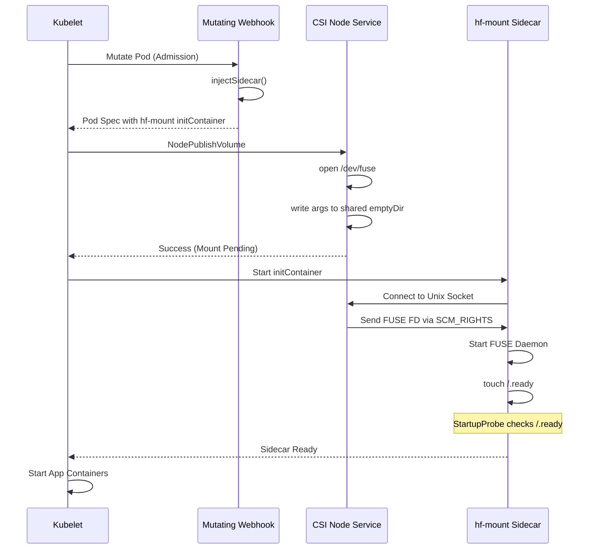
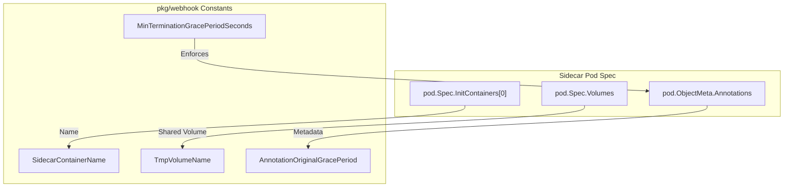

<!-- source: DeepWiki mcp.deepwiki.com · repo huggingface/hf-csi-driver · page 6.3 End-to-End Tests: Sidecar Mode · fetched 2026-10-26 -->

# End-to-End Tests: Sidecar Mode

Relevant source files

The following files were used as context for generating this wiki page:

- [pkg/webhook/sidecar.go](pkg/webhook/sidecar.go)
- [pkg/webhook/sidecar_test.go](pkg/webhook/sidecar_test.go)
- [test/e2e/sidecar/01-ephemeral.sh](test/e2e/sidecar/01-ephemeral.sh)
- [test/e2e/sidecar/02-sidecar-injected.sh](test/e2e/sidecar/02-sidecar-injected.sh)
- [test/e2e/sidecar/03-no-mount-pods.sh](test/e2e/sidecar/03-no-mount-pods.sh)
- [test/e2e/sidecar/04-pv-token.sh](test/e2e/sidecar/04-pv-token.sh)
- [test/e2e/sidecar/05-bucket-rw.sh](test/e2e/sidecar/05-bucket-rw.sh)
- [test/e2e/sidecar/06-fsgroup.sh](test/e2e/sidecar/06-fsgroup.sh)
- [test/e2e/sidecar/07-token-perms.sh](test/e2e/sidecar/07-token-perms.sh)
- [test/e2e/sidecar/08-multi-volume.sh](test/e2e/sidecar/08-multi-volume.sh)
- [test/e2e/sidecar/09-stuck-sidecar.sh](test/e2e/sidecar/09-stuck-sidecar.sh)
- [test/e2e/sidecar/99-debug.sh](test/e2e/sidecar/99-debug.sh)
- [test/e2e/sidecar/run.sh](test/e2e/sidecar/run.sh)

The sidecar E2E suite validates the high-performance "sidecar mode" of the `hf-csi-driver`. In this mode, the FUSE daemon runs as a native Kubernetes sidecar (using KEP-753) within the application pod rather than in a separate mount pod. These tests ensure the mutating admission webhook correctly modifies pod specs, the CSI driver successfully passes file descriptors over Unix sockets, and the sidecar container handles volume lifecycles (including error states like "stuck" mounts) correctly.

## Test Suite Overview

The sidecar tests are executed sequentially by the `test/e2e/sidecar/run.sh` script [test/e2e/sidecar/run.sh:7-24](). The suite requires a Kubernetes cluster with the `hf-csi-webhook` and `MutatingWebhookConfiguration` properly configured [test/e2e/sidecar/01-ephemeral.sh:9-11]().

### Core Injection and Data Flow

The following diagram illustrates the interaction between the Webhook, the CSI Node Service, and the Sidecar container during a test run.

**Sidecar Injection and Mount Data Flow**

**Sources:** [pkg/webhook/sidecar.go:30-107](), [test/e2e/sidecar/01-ephemeral.sh:13-37]()

---

## Detailed Test Case Catalog

### 01-02: Injection Verification
*   **01-ephemeral.sh**: Validates that an inline CSI ephemeral volume triggers the sidecar flow. It verifies that the application container can read files (e.g., `config.json`) from the mounted repository [test/e2e/sidecar/01-ephemeral.sh:13-38]().
*   **02-sidecar-injected.sh**: Inspects the pod spec to confirm that the `hf-mount` init container and the `hf-csi-tmp` `emptyDir` volume were added by the webhook [test/e2e/sidecar/02-sidecar-injected.sh:9-14](). It also verifies that `terminationGracePeriodSeconds` was raised to at least 60s [test/e2e/sidecar/02-sidecar-injected.sh:21-25]().

### 03-04: Infrastructure and PVs
*   **03-no-mount-pods.sh**: Ensures that no `HFMount` CRDs or associated mount pods were created, confirming the driver did not fall back to `podmount` mode [test/e2e/sidecar/03-no-mount-pods.sh:9-14]().
*   **04-pv-token.sh**: Tests the full PVC -> PV -> Secret chain. The webhook must resolve the volume source through the PVC to decide whether to inject the sidecar [test/e2e/sidecar/04-pv-token.sh:14-70]().

### 05-07: Permissions and Credentials
*   **05-bucket-rw.sh**: Validates read/write capabilities on Hugging Face Buckets. Requires `HF_TOKEN` [test/e2e/sidecar/05-bucket-rw.sh:12-39]().
*   **06-fsgroup.sh**: Validates that the sidecar respects `fsGroup` settings, allowing a non-root user (UID 1000) to write to the bucket [test/e2e/sidecar/06-fsgroup.sh:13-52]().
*   **07-token-perms.sh**: Verifies that the token file written by the CSI driver to the shared `emptyDir` (tmpfs) is readable by the unprivileged sidecar user (UID 65534) [test/e2e/sidecar/07-token-perms.sh:9-47]().

### 08-09: Advanced Scenarios
*   **08-multi-volume.sh**: Ensures that a pod mounting multiple HF volumes only receives **one** sidecar container that manages all mounts [test/e2e/sidecar/08-multi-volume.sh:11-48]().
*   **09-stuck-sidecar.sh**: A regression test for a scenario where a sidecar container exists but fails to connect to the Unix socket. It validates that the driver can still unmount the "stuck" FUSE path using `MNT_DETACH` without blocking the `NodeUnpublishVolume` RPC [test/e2e/sidecar/09-stuck-sidecar.sh:1-18]().

---

## Webhook Implementation Details

The sidecar injection logic is encapsulated in `injectSidecar`. It performs several critical modifications to the Pod spec to support the FUSE lifecycle.

### Sidecar Resource Management
Resources are merged from multiple volumes using a "max" strategy. If Volume A requests 128Mi and Volume B requests 256Mi, the sidecar is assigned 256Mi.

| Feature | Implementation | Code Reference |
| :--- | :--- | :--- |
| **Shared Storage** | `hf-csi-tmp` (Memory `emptyDir`) for sockets/args | [pkg/webhook/sidecar.go:41-48]() |
| **Native Sidecar** | `initContainer` with `restartPolicy: Always` | [pkg/webhook/sidecar.go:58-64]() |
| **Readiness** | `StartupProbe` checking for `.ready` file | [pkg/webhook/sidecar.go:89-97]() |
| **Grace Period** | Bumped to `MinTerminationGracePeriodSeconds` (60s) | [pkg/webhook/sidecar.go:19](), [pkg/webhook/sidecar.go:114-131]() |
| **Resource Clamping** | Requests are clamped to limits to prevent API rejection | [pkg/webhook/sidecar_test.go:117-131]() |

### Code Entity Mapping: Sidecar Configuration

The following diagram maps the high-level Sidecar configuration to the specific Go entities and constants used in the webhook.

**Webhook Entity Map**

**Sources:** [pkg/webhook/sidecar.go:19-28](), [pkg/webhook/sidecar.go:38-107]()

---

## Handling "Stuck" Sidecars (PR-23 Regression)

The `09-stuck-sidecar.sh` test validates a critical recovery path. If a sidecar container crashes or fails to start, the CSI driver's `NodePublishVolume` may have already created a kernel FUSE mount. Any standard filesystem call (like `stat` or `ls`) on that path will block indefinitely while the kernel waits for a `FUSE_INIT` response from a daemon that doesn't exist.

The test verifies that:
1.  The bug condition is reproduced: `stat` on the target path times out [test/e2e/sidecar/09-stuck-sidecar.sh:88-96]().
2.  The driver uses `umount -l` (Lazy unmount / `MNT_DETACH`), which bypasses the blocked path lookup and detaches the mount point immediately [test/e2e/sidecar/09-stuck-sidecar.sh:101-106]().
3.  After the lazy unmount, `stat` on the directory works again, allowing the Kubelet to clean up the volume directory [test/e2e/sidecar/09-stuck-sidecar.sh:112-117]().

**Sources:** [test/e2e/sidecar/09-stuck-sidecar.sh:1-125]()

---

