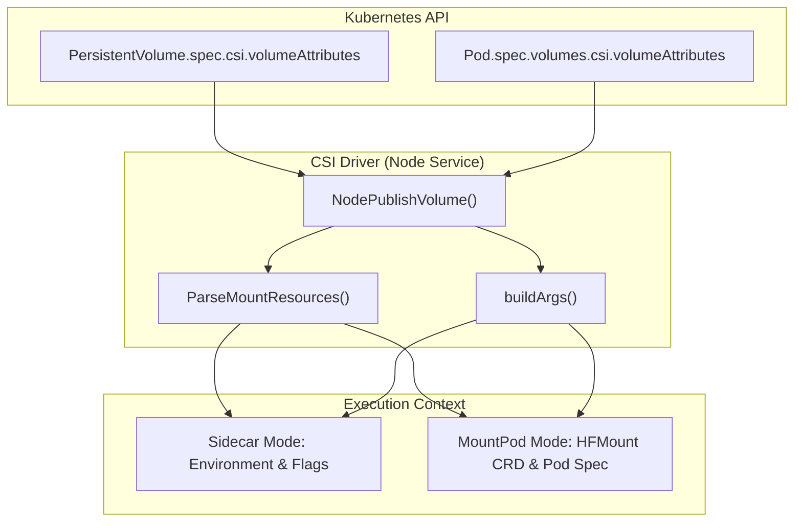
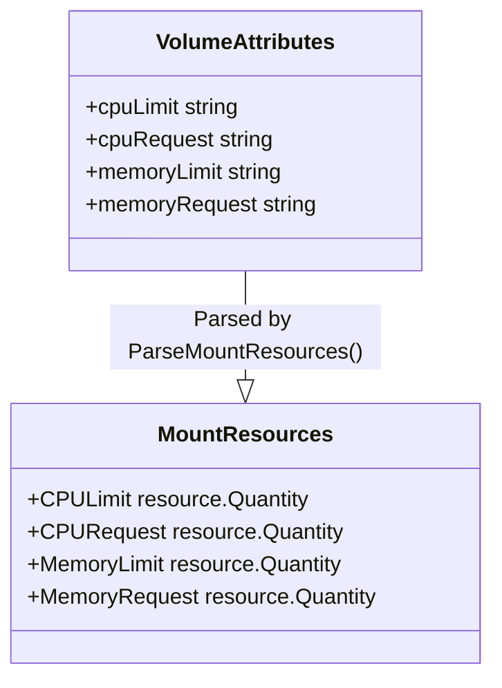

<!-- source: DeepWiki mcp.deepwiki.com · repo huggingface/hf-csi-driver · page 8 Reference: Volume Attributes · fetched 2026-10-26 -->

# Reference: Volume Attributes

<details>
<summary>Relevant source files</summary>

The following files were used as context for generating this wiki page:

- [README.md](README.md)
- [deploy/kubernetes/examples/bucket.yaml](deploy/kubernetes/examples/bucket.yaml)
- [deploy/kubernetes/examples/repo.yaml](deploy/kubernetes/examples/repo.yaml)
- [pkg/driver/mounter.go](pkg/driver/mounter.go)
- [pkg/driver/node.go](pkg/driver/node.go)

</details>


This page provides a comprehensive technical reference for all CSI `volumeAttributes` recognized by the `hf-csi-driver`. These attributes allow users to configure the behavior of the `hf-mount-fuse` daemon, resource allocation, and the mounting mechanism on a per-volume basis.

The driver parses these attributes during the `NodePublishVolume` RPC call [pkg/driver/node.go:49-53]() and translates them into CLI arguments for the FUSE binary or resource specifications for the sidecar/mount pod.

## Attribute Data Flow

The following diagram illustrates how `volumeAttributes` from a `PersistentVolume` or inline `csi` volume spec are processed by the driver's internal components.

### Diagram: Attribute Processing Pipeline

**Sources:** [pkg/driver/node.go:49-177](), [pkg/driver/mounter.go:49-96]()

---

## Core Attributes Reference

These attributes control the source content and the operational behavior of the FUSE filesystem.

| Attribute | Required | Default | Description |
| --- | --- | --- | --- |
| `sourceType` | **Yes** | - | Type of Hugging Face resource: `bucket` or `repo`. [pkg/driver/node.go:23](), [pkg/driver/mounter.go:50-54]() |
| `sourceId` | **Yes** | - | The HF identifier (e.g., `username/my-bucket` or `openai-community/gpt2`). [pkg/driver/node.go:24]() |
| `revision` | No | `main` | Git revision (branch, tag, or commit hash). Only applies if `sourceType` is `repo`. [pkg/driver/node.go:20,25]() |
| `hubEndpoint` | No | `https://huggingface.co` | The Hub API endpoint to connect to. [pkg/driver/node.go:26]() |
| `tokenKey` | No | `token` | The key within the Secret (provided via `nodePublishSecretRef`) containing the HF token. [pkg/driver/node.go:21,35]() |
| `mountMode` | No | `sidecar` | Determines if the FUSE daemon runs as a `sidecar` (injected into the workload) or a `mountpod` (managed by the driver). [pkg/driver/node.go:37,43-46]() |

**Sources:** [pkg/driver/node.go:19-47](), [pkg/driver/mounter.go:13-30](), [README.md:192-210]()

---

## Performance & Cache Tuning

These attributes are passed directly to `hf-mount-fuse` as CLI flags via the `buildArgs` function [pkg/driver/mounter.go:49]().

| Attribute | Default | hf-mount-fuse Flag | Description |
| --- | --- | --- | --- |
| `cacheDir` | Auto | `--cache-dir` | Local path for caching files. In `mountpod` mode, this defaults to a subdirectory of the driver's base cache. [pkg/driver/node.go:27,166]() |
| `cacheSize` | `10000000000` | `--cache-size` | Maximum cache size in bytes. [pkg/driver/node.go:28]() |
| `pollIntervalSecs` | `30` | `--poll-interval-secs` | Frequency (in seconds) to check the Hub for remote changes. [pkg/driver/node.go:29]() |
| `pollListingConcurrency` | `4` | `--poll-listing-concurrency` | Max concurrent API requests per poll round. [pkg/driver/node.go:30]() |
| `metadataTtlMs` | `10000` | `--metadata-ttl-ms` | Kernel metadata cache TTL in milliseconds. [pkg/driver/node.go:31]() |
| `inodeSoftLimit` | `0` | `--inode-soft-limit` | Soft cap on in-memory inode table size. `0` disables eviction. [pkg/driver/node.go:32]() |
| `lruSweepIntervalMs` | `5000` | `--lru-sweep-interval-ms` | Interval between background LRU sweeps for inode eviction. [pkg/driver/node.go:33]() |
| `fuseFdCount` | - | - | Sidecar mode only: number of FUSE file descriptors to open (defaults to global driver config). [pkg/driver/node.go:34]() |

**Sources:** [pkg/driver/node.go:163-173](), [pkg/driver/mounter.go:56-80](), [README.md:198-204]()

---

## Resource Management Attributes

When using `sidecar` mode or `mountpod` mode, the driver uses these attributes to define the CPU and Memory constraints of the FUSE container. These are parsed into the `MountResources` struct [pkg/driver/resources.go:13-18]().

| Attribute | Default | Description |
| --- | --- | --- |
| `cpuLimit` | - | Maximum CPU cores (e.g., `500m`, `2`). |
| `cpuRequest` | `10m` | Guaranteed CPU cores. |
| `memoryLimit` | - | Maximum memory (e.g., `512Mi`, `2Gi`). |
| `memoryRequest` | `32Mi` | Guaranteed memory. |

### Implementation Mapping: Resources to Code
The `ParseMountResources` function in `pkg/driver/resources.go` maps these string attributes to Kubernetes `resource.Quantity` objects.


**Sources:** [pkg/driver/resources.go:13-44](), [pkg/driver/node.go:177](), [README.md:207-210]()

---

## Advanced Passthrough

### `mountFlags`
The `mountFlags` attribute allows passing comma-separated flags for inline ephemeral volumes. For `PersistentVolumes`, the driver instead uses the standard `spec.mountOptions` field. Both are eventually merged into the `ExtraArgs` field of `MountOptions` [pkg/driver/mounter.go:25]().

**Example Usage:**
```yaml
volumeAttributes:
  sourceType: bucket
  sourceId: my-user/my-data
  mountFlags: "advanced-writes,uid=1000,gid=1000"
```

**Sources:** [pkg/driver/node.go:36,178-185](), [pkg/driver/mounter.go:88](), [README.md:206]()

---

